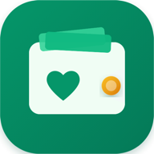

# 📚 DOKUMEN MASTER SOURCE CODE LENGKAP: DOMPET KELUARGA V3.18.3
> Dokumen ini memuat **seluruh source code** (Frontend, Backend Google Apps Script, Styling CSS, Konfigurasi PWA, serta skrip otomatisasi) dalam satu file terpadu yang siap Anda simpan (*save*) sebagai cadangan utuh (*full backup*).

---
## 📋 Daftar Isi Dokumen

### 1. BACKEND (GOOGLE APPS SCRIPT)
- [Server Pusat & Telemetri Lisensi / Auto Sync URL (`backend/DeveloperTelemetry.gs`)](#backend-DeveloperTelemetry-gs)
- [Backend Spreadsheet Pribadi Pengguna (`backend/Code.gs`)](#backend-Code-gs)
- [Panduan Setup Database Pengguna (`backend/PANDUAN_SETUP_DATABASE_PENGGUNA.md`)](#backend-PANDUAN_SETUP_DATABASE_PENGGUNA-md)

### 2. FRONTEND CORE & PWA
- [Index Shell HTML & PWA Head Tags (`index.html`)](#index-html)
- [PWA Web App Manifest (`manifest.json`)](#manifest-json)
- [Service Worker (PWA Offline First Cache) (`sw.js`)](#sw-js)

### 3. STYLING & DESIGN SYSTEM (CSS)
- [Design Tokens & Variabel Warna (`css/tokens.css`)](#css-tokens-css)
- [Layout Framework & Grid Navigasi (`css/layout.css`)](#css-layout-css)
- [Komponen UI (Card, Modal, Button, PWA Banner) (`css/components.css`)](#css-components-css)
- [Halaman & Tampilan Responsif Mobile (`css/pages.css`)](#css-pages-css)

### 4. LOGIKA FRONTEND (JAVASCRIPT MODULAR)
- [Inisialisasi Data Default (`js/initialData.js`)](#js-initialData-js)
- [State Management Reaktif (`js/state.js`)](#js-state-js)
- [Fungsi Utilitas & Chart SVG (`js/utils.js`)](#js-utils-js)
- [Cloud Sync Service (Google Sheets Sync) (`js/utils/cloudSync.js`)](#js-utils-cloudSync-js)
- [License & Telemetry Service (`js/utils/licenseService.js`)](#js-utils-licenseService-js)
- [AI Text & Voice Parser (`js/utils/aiParser.js`)](#js-utils-aiParser-js)
- [Receipt OCR Scanner (`js/utils/receiptScanner.js`)](#js-utils-receiptScanner-js)
- [Exporter (PDF & Excel/CSV) (`js/utils/exporter.js`)](#js-utils-exporter-js)
- [PWA Install & Guided Modal Helper (`js/components/pwaInstall.js`)](#js-components-pwaInstall-js)
- [Koleksi Ikon SVG Lucide (`js/components/icons.js`)](#js-components-icons-js)
- [Modal Base Component (`js/components/modal.js`)](#js-components-modal-js)
- [Toast Notification Component (`js/components/toast.js`)](#js-components-toast-js)
- [Header & Navbar Component (`js/components/navbar.js`)](#js-components-navbar-js)
- [Bottom Nav & Mobile Menu Sheet (`js/components/bottomNav.js`)](#js-components-bottomNav-js)
- [Modal Transaksi Baru & Edit (`js/components/transactionModal.js`)](#js-components-transactionModal-js)
- [Modal Ekspor Laporan (`js/components/exportModal.js`)](#js-components-exportModal-js)
- [Modal Scan Nota AI OCR (`js/components/receiptScanModal.js`)](#js-components-receiptScanModal-js)
- [Modal Catat Cerdas AI (`js/components/aiModal.js`)](#js-components-aiModal-js)
- [Modal Simulasi Bot Telegram (`js/components/telegramSimulator.js`)](#js-components-telegramSimulator-js)
- [Modal Aktivasi Lisensi PRO (`js/components/licenseModal.js`)](#js-components-licenseModal-js)
- [Modal Onboarding Wizard (`js/components/onboardingWizardModal.js`)](#js-components-onboardingWizardModal-js)
- [Halaman Dashboard Keuangan (`js/pages/dashboard.js`)](#js-pages-dashboard-js)
- [Halaman Riwayat Transaksi & Filter (`js/pages/transactions.js`)](#js-pages-transactions-js)
- [Halaman Target Anggaran (`js/pages/budgets.js`)](#js-pages-budgets-js)
- [Halaman Celengan & Target Finansial (`js/pages/goals.js`)](#js-pages-goals-js)
- [Halaman Pengingat Tagihan Rutin (`js/pages/bills.js`)](#js-pages-bills-js)
- [Halaman Laporan & Analisis (`js/pages/reports.js`)](#js-pages-reports-js)
- [Halaman Pengaturan & Cloud Sync (`js/pages/settings.js`)](#js-pages-settings-js)
- [Autentikasi & Gerbang Lisensi (`js/auth-access.js`)](#js-auth-access-js)
- [Entry Point Aplikasi (Router) (`js/app.js`)](#js-app-js)

### 5. BUILD SCRIPT & OTOMASI
- [Bundle Compiler Script (`build_bundle.py`)](#build_bundle-py)

---

## <a id="backend-DeveloperTelemetry-gs"></a> Server Pusat & Telemetri Lisensi / Auto Sync URL
**File Path:** `backend/DeveloperTelemetry.gs`  
**Ukuran File:** 22228 karakter (642 baris)

```javascript
/**
 * ============================================================================
 * DOMPETKU - BACKEND TELEMETRI, LISENSI & DATABASE PELANGGAN (v3.0)
 * ============================================================================
 * Skrip ini dipasang di Google Spreadsheet PRIBADI MILIK DEVELOPER / PEMILIK APLIKASI.
 * Berfungsi untuk:
 * 1. Mengumpulkan Database Nomor WhatsApp / HP Pelanggan untuk Marketing.
 * 2. Mengatur & Memvalidasi Kunci Lisensi Unik Pelanggan (1 Lisensi per Pembeli).
 * 3. Telemetri pengguna & statistik login aktif secara realtime.
 * ============================================================================
 */

const SHEET_USERS = 'Database_Pelanggan';
const SHEET_LICENSES = 'Master_Lisensi';

function onOpen() {
  const ui = SpreadsheetApp.getUi();
  ui.createMenu('👑 Dompetku Admin')
    .addItem('🔑 Buat 10 Kunci Lisensi Unik Baru', 'menuGenerate10Keys')
    .addItem('🔑 Buat 50 Kunci Lisensi Unik Baru', 'menuGenerate50Keys')
    .addSeparator()
    .addItem('📱 Format & Bersihkan Nomor WhatsApp', 'formatAllPhoneNumbers')
    .addItem('⚙️ Inisialisasi Ulang Header Sheet', 'initializeSheets')
    .addToUi();
}

function doGet(e) {
  const action = (e && e.parameter && e.parameter.action) || 'ping';
  
  if (action === 'get_stats') {
    return handleGetStats();
  }

  return handleResponse({
    success: true,
    message: 'Backend Lisensi & Database Pelanggan Dompetku Online',
    timestamp: new Date().toISOString()
  });
}

function doPost(e) {
  try {
    const rawData = e.postData ? e.postData.contents : '';
    if (!rawData) {
      return handleResponse({ success: false, message: 'Tidak ada data POST diterima' });
    }

    const payload = JSON.parse(rawData);
    const action = payload.action || 'record_login';

    if (action === 'record_login' || action === 'checkAccess') {
      return handleRecordLogin(payload);
    }

    if (action === 'verify_license' || action === 'activate_license') {
      return handleActivateLicense(payload);
    }

    if (action === 'save_gas_url' || action === 'delete_gas_url') {
      if (action === 'delete_gas_url') payload.gasUrl = '';
      return handleSaveGasUrl(payload);
    }

    if (action === 'get_user_gas_url') {
      return handleGetUserGasUrl(payload);
    }

    if (action === 'get_stats') {
      return handleGetStats();
    }

    return handleResponse({ success: false, message: 'Action tidak dikenali: ' + action });
  } catch (err) {
    return handleResponse({ success: false, error: err.toString(), stack: err.stack });
  }
}

/**
 * Mencatat Data Login Pengguna & Sinkronisasi Akun Lintas Perangkat (Multi-Device)
 */
function handleRecordLogin(payload) {
  const ss = SpreadsheetApp.getActiveSpreadsheet();
  let sheet = ss.getSheetByName(SHEET_USERS);
  if (!sheet) sheet = initializeUsersSheet(ss);

  const rawIdent = (payload.identifier || payload.email || payload.phone || '').trim().toLowerCase();
  const isEmail = rawIdent.includes('@');
  const email = (isEmail ? rawIdent : (payload.email || '')).trim().toLowerCase();
  const phone = cleanPhoneNumber(payload.phone || (!isEmail ? rawIdent : ''));
  const fullName = (payload.fullName || payload.name || 'Pengguna').trim();
  const password = payload.password || '';
  const familyName = payload.familyName || payload.family || '-';
  const userAgent = payload.userAgent || payload.device || '-';
  const appVersion = payload.appVersion || '3.18.5';
  const licenseKey = payload.licenseKey || '';
  const now = new Date();
  const timeFormatted = Utilities.formatDate(now, ss.getSpreadsheetTimeZone() || 'Asia/Jakarta', 'yyyy-MM-dd HH:mm:ss');

  if (!email && !phone) {
    return handleResponse({ success: false, message: 'Harap masukkan nomor WhatsApp atau email' });
  }

  const data = sheet.getDataRange().getValues();
  let rowIndex = -1;

  for (let i = 1; i < data.length; i++) {
    const rowEmail = String(data[i][3]).toLowerCase().trim();
    const rowPhone = cleanPhoneNumber(data[i][4]);
    
    if ((email && rowEmail === email) || (phone && rowPhone && rowPhone === phone)) {
      rowIndex = i + 1;
      break;
    }
  }

  if (rowIndex > 0) {
    // Pengguna Ditemukan - Update waktu login & telemetri
    const currentLogins = parseInt(sheet.getRange(rowIndex, 9).getValue() || 1, 10);
    const newLogins = currentLogins + 1;

    sheet.getRange(rowIndex, 2).setValue(timeFormatted); // Terakhir Aktif
    if (fullName && fullName !== 'Pengguna' && !sheet.getRange(rowIndex, 3).getValue()) {
      sheet.getRange(rowIndex, 3).setValue(fullName);
    }
    if (phone && !sheet.getRange(rowIndex, 5).getValue()) {
      sheet.getRange(rowIndex, 5).setValue(phone);
    }
    if (licenseKey && !sheet.getRange(rowIndex, 6).getValue()) {
      sheet.getRange(rowIndex, 6).setValue(licenseKey);
    }
    sheet.getRange(rowIndex, 8).setValue(parseDevice(userAgent));
    sheet.getRange(rowIndex, 9).setValue(newLogins);
    sheet.getRange(rowIndex, 10).setValue(appVersion);

    ensureUsersSheetGasUrlHeader(sheet);
    if (payload.gasUrl) {
      sheet.getRange(rowIndex, 13).setValue(payload.gasUrl);
    }
    const savedGasUrl = sheet.getRange(rowIndex, 13).getValue() || (payload.gasUrl || '');

    const savedName = sheet.getRange(rowIndex, 3).getValue() || fullName;
    const savedEmail = sheet.getRange(rowIndex, 4).getValue() || email;
    const savedPhone = sheet.getRange(rowIndex, 5).getValue() || phone;
    const savedKey = sheet.getRange(rowIndex, 6).getValue() || licenseKey;
    const existingStatus = String(sheet.getRange(rowIndex, 7).getValue() || 'Aktif');
    const isPro = existingStatus.includes('PRO') || (savedKey && savedKey !== '-');

    return handleResponse({
      success: true,
      isNewUser: false,
      message: 'Login berhasil terverifikasi untuk: ' + (savedEmail || savedPhone),
      user: {
        name: savedName,
        email: savedEmail,
        phone: savedPhone,
        licenseKey: savedKey && savedKey !== '-' ? savedKey : '',
        isPro: isPro,
        gasUrl: savedGasUrl ? String(savedGasUrl).trim() : ''
      },
      access: { 
        authorized: true, 
        status: isPro ? 'active' : 'trial',
        plan: isPro ? 'Dompetku PRO Lifetime' : 'Mode Uji Coba'
      }
    });

  } else {
    // Pengguna Baru (atau login pertama kali di perangkat baru sebelum registrasi offline)
    ensureUsersSheetGasUrlHeader(sheet);
    const newNo = data.length;
    const device = parseDevice(userAgent);
    const initialStatus = licenseKey ? 'Aktif (PRO)' : 'Aktif (Baru)';
    const registeredEmail = email || (phone + '@dompetku.local');
    const registeredPhone = phone || '-';
    const initGasUrl = payload.gasUrl || '';

    sheet.appendRow([
      newNo,
      timeFormatted,       // B: Waktu Terdaftar
      fullName,            // C: Nama Lengkap
      registeredEmail,     // D: Email
      registeredPhone,     // E: Nomor WhatsApp (HP)
      licenseKey || '-',   // F: Kode Lisensi
      initialStatus,       // G: Status Lisensi
      device,              // H: Perangkat
      1,                   // I: Total Login
      appVersion,          // J: Versi App
      familyName,          // K: Nama Keluarga
      password ? 'PIN tersimpan' : '', // L: Catatan
      initGasUrl           // M: URL Spreadsheet Pengguna
    ]);

    return handleResponse({
      success: true,
      isNewUser: true,
      message: 'Akun berhasil disinkronkan: ' + (registeredEmail || registeredPhone),
      user: {
        name: fullName,
        email: registeredEmail,
        phone: registeredPhone,
        licenseKey: licenseKey || '',
        isPro: !!licenseKey,
        gasUrl: initGasUrl
      },
      access: { authorized: true, status: licenseKey ? 'active' : 'trial', plan: licenseKey ? 'Dompetku PRO Lifetime' : 'Mode Uji Coba' }
    });
  }
}

/**
 * Validasi dan Aktivasi Kunci Lisensi Unik + Simpan Nomor WhatsApp
 */
function handleActivateLicense(payload) {
  const ss = SpreadsheetApp.getActiveSpreadsheet();
  let userSheet = ss.getSheetByName(SHEET_USERS);
  if (!userSheet) userSheet = initializeUsersSheet(ss);

  let licSheet = ss.getSheetByName(SHEET_LICENSES);
  if (!licSheet) licSheet = initializeLicenseSheet(ss);

  const rawKey = (payload.key || payload.licenseKey || '').trim().toUpperCase();
  const email = (payload.email || '').trim().toLowerCase();
  const fullName = (payload.fullName || payload.name || 'Pelanggan').trim();
  const phone = cleanPhoneNumber(payload.phone || payload.phoneNumber || '');
  const now = new Date();
  const timeFormatted = Utilities.formatDate(now, ss.getSpreadsheetTimeZone() || 'Asia/Jakarta', 'yyyy-MM-dd HH:mm:ss');

  if (!rawKey) {
    return handleResponse({ success: false, message: 'Kode kunci lisensi wajib diisi.' });
  }

  // 1. Cek Master Keys Global Developer
  const masterKeys = ['DKPRO-LIFETIME-2026', 'DOMPETKU-PRO-VIP', 'DOMPETKU-PRO-8899', 'DK-SUPER-ACCESS'];
  let isMasterKey = masterKeys.includes(rawKey);

  // 2. Cek di Sheet Master_Lisensi (Kunci Unik per Pelanggan)
  const licData = licSheet.getDataRange().getValues();
  let foundLicIndex = -1;
  let licPlan = 'Dompetku PRO Lifetime';
  let isUniqueKeyMatch = false;

  for (let i = 1; i < licData.length; i++) {
    const sheetKey = String(licData[i][1]).trim().toUpperCase();
    if (sheetKey === rawKey) {
      foundLicIndex = i + 1;
      const assignedEmail = String(licData[i][3]).toLowerCase().trim();
      const assignedPhone = cleanPhoneNumber(licData[i][4]);
      const status = String(licData[i][5]).trim();
      licPlan = String(licData[i][2]).trim() || licPlan;

      // Cek apakah pemilik lisensi cocok (berdasarkan Email ATAU Nomor WhatsApp)
      const isEmailMatch = email && assignedEmail && (assignedEmail === email);
      const isPhoneMatch = phone && assignedPhone && (assignedPhone === phone);
      const isUnbound = !assignedEmail || assignedEmail === '-' || assignedEmail === 'pelanggan@email.com';

      if (!isUnbound && !isEmailMatch && !isPhoneMatch) {
        return handleResponse({
          success: false,
          message: 'Kode lisensi ini sudah digunakan oleh akun email lain (' + (assignedEmail || 'pemilik lain') + ').'
        });
      }

      isUniqueKeyMatch = true;
      break;
    }
  }

  // 3. Fallback jika format cocok dengan pola serial resmi (DK-XXXX-YYYY-ZZZZ)
  const isPatternValid = isMasterKey || isUniqueKeyMatch || /^DK-[A-Z0-9]{4}-[A-Z0-9]{4}-[A-Z0-9]{4}$/.test(rawKey) || (rawKey.startsWith('DKPRO-') && rawKey.length >= 10);

  if (!isPatternValid) {
    return handleResponse({
      success: false,
      message: 'Kunci lisensi tidak valid atau belum terdaftar. Silakan hubungi admin di WhatsApp untuk pembelian lisensi resmi.'
    });
  }

  // Jika kunci unik terdaftar di sheet Master_Lisensi, tandai sebagai Terpakai
  if (foundLicIndex > 0) {
    licSheet.getRange(foundLicIndex, 4).setValue(email);          // Terikat Email
    licSheet.getRange(foundLicIndex, 5).setValue(phone || '-');    // Terikat No WA
    licSheet.getRange(foundLicIndex, 6).setValue('Terpakai (Aktif)');
    licSheet.getRange(foundLicIndex, 7).setValue(timeFormatted);  // Waktu Aktivasi
  }

  // Simpan / Perbarui nomor WhatsApp dan status di Database_Pelanggan
  const usersData = userSheet.getDataRange().getValues();
  let userRow = -1;

  for (let i = 1; i < usersData.length; i++) {
    if (String(usersData[i][3]).toLowerCase().trim() === email) {
      userRow = i + 1;
      break;
    }
  }

  if (userRow > 0) {
    if (phone) userSheet.getRange(userRow, 5).setValue(phone);
    userSheet.getRange(userRow, 6).setValue(rawKey);
    userSheet.getRange(userRow, 7).setValue('Aktif (PRO)');
    userSheet.getRange(userRow, 2).setValue(timeFormatted);
  } else {
    userSheet.appendRow([
      usersData.length,
      timeFormatted,
      fullName,
      email,
      phone || '-',
      rawKey,
      'Aktif (PRO)',
      '🌐 Web App',
      1,
      '3.17.1',
      '-',
      'Aktivasi Mandiri via Aplikasi'
    ]);
  }

  return handleResponse({
    success: true,
    message: '🎉 Lisensi Dompetku PRO Berhasil Diaktifkan! Semua fitur pencatatan dan sinkronisasi telah terbuka.',
    license: {
      status: 'active',
      plan: licPlan,
      key: rawKey,
      email: email,
      phone: phone,
      activatedAt: timeFormatted,
      validUntil: 'Selamanya (Lifetime)'
    }
  });
}

/**
 * Menu Spreadsheet: Generate Kunci Lisensi Unik
 */
function menuGenerate10Keys() { generateLicenseKeys(10); }
function menuGenerate50Keys() { generateLicenseKeys(50); }

function generateLicenseKeys(count = 10) {
  const ss = SpreadsheetApp.getActiveSpreadsheet();
  let sheet = ss.getSheetByName(SHEET_LICENSES);
  if (!sheet) sheet = initializeLicenseSheet(ss);

  const now = new Date();
  const timeFormatted = Utilities.formatDate(now, ss.getSpreadsheetTimeZone() || 'Asia/Jakarta', 'yyyy-MM-dd HH:mm:ss');
  const existingData = sheet.getDataRange().getValues();
  const currentCount = existingData.length - 1;

  const rows = [];
  for (let i = 0; i < count; i++) {
    const num = currentCount + i + 1;
    const part1 = Math.random().toString(36).substring(2, 6).toUpperCase();
    const part2 = Math.random().toString(36).substring(2, 6).toUpperCase();
    const part3 = Math.random().toString(36).substring(2, 6).toUpperCase();
    const key = `DK-${part1}-${part2}-${part3}`;

    rows.push([
      num,
      key,
      'Dompetku PRO Lifetime',
      '-', // Email (Kosong, diisi saat user aktivasi)
      '-', // No WhatsApp (Kosong, diisi saat user aktivasi)
      'Tersedia (Belum Terpakai)',
      '-', // Tanggal Aktivasi
      timeFormatted // Tanggal Dibuat
    ]);
  }

  if (rows.length > 0) {
    const startRow = sheet.getLastRow() + 1;
    sheet.getRange(startRow, 1, rows.length, 8).setValues(rows);
    SpreadsheetApp.getUi().alert(`✅ Berhasil membuat ${count} Kunci Lisensi Unik baru di sheet "${SHEET_LICENSES}"!`);
  }
}

/**
 * Inisialisasi Sheet Database Pelanggan
 */
function initializeUsersSheet(ss) {
  let sheet = ss.getSheetByName(SHEET_USERS);
  if (!sheet) sheet = ss.insertSheet(SHEET_USERS, 0);

  const headers = [
    'No',
    'Terakhir Aktif',
    'Nama Pelanggan',
    'Email Google',
    'Nomor WhatsApp (HP)',
    'Kode Lisensi',
    'Status Akses',
    'Perangkat',
    'Total Login',
    'Versi App',
    'Nama Buku Kas',
    'Catatan Marketing',
    'URL Spreadsheet Pengguna (GasUrl)'
  ];

  sheet.getRange(1, 1, 1, headers.length).setValues([headers]);
  const hRange = sheet.getRange(1, 1, 1, headers.length);
  hRange.setBackground('#0f766e');
  hRange.setFontColor('#ffffff');
  hRange.setFontWeight('bold');
  hRange.setHorizontalAlignment('center');
  sheet.setRowHeight(1, 38);
  sheet.setFrozenRows(1);

  sheet.setColumnWidth(1, 45);   // No
  sheet.setColumnWidth(2, 150);  // Waktu
  sheet.setColumnWidth(3, 170);  // Nama
  sheet.setColumnWidth(4, 220);  // Email
  sheet.setColumnWidth(5, 160);  // No WhatsApp
  sheet.setColumnWidth(6, 170);  // Kode Lisensi
  sheet.setColumnWidth(7, 130);  // Status
  sheet.setColumnWidth(8, 160);  // Perangkat
  sheet.setColumnWidth(9, 80);   // Total Login
  sheet.setColumnWidth(10, 80);  // Versi
  sheet.setColumnWidth(11, 150); // Nama Keluarga
  sheet.setColumnWidth(12, 200); // Catatan
  sheet.setColumnWidth(13, 280); // URL Spreadsheet

  return sheet;
}

/**
 * Menautkan dan Menyimpan URL Google Spreadsheet Pelanggan ke Akun Cloud
 */
function handleSaveGasUrl(payload) {
  const ss = SpreadsheetApp.getActiveSpreadsheet();
  let sheet = ss.getSheetByName(SHEET_USERS);
  if (!sheet) sheet = initializeUsersSheet(ss);

  const email = (payload.email || '').trim().toLowerCase();
  const phone = cleanPhoneNumber(payload.phone || '');
  const licenseKey = (payload.licenseKey || payload.key || '').trim().toUpperCase();
  const gasUrl = (payload.gasUrl || '').trim();

  if (!email && !phone && !licenseKey) {
    return handleResponse({ success: false, message: 'Harap sertakan email, nomor HP, atau kode lisensi.' });
  }

  ensureUsersSheetGasUrlHeader(sheet);

  const data = sheet.getDataRange().getValues();
  let rowIndex = -1;

  for (let i = 1; i < data.length; i++) {
    const rowEmail = String(data[i][3]).toLowerCase().trim();
    const rowPhone = cleanPhoneNumber(data[i][4]);
    const rowKey = String(data[i][5]).toUpperCase().trim();

    if ((email && rowEmail === email) || (phone && rowPhone && rowPhone === phone) || (licenseKey && rowKey === licenseKey)) {
      rowIndex = i + 1;
      break;
    }
  }

  if (rowIndex > 0) {
    sheet.getRange(rowIndex, 13).setValue(gasUrl);
    return handleResponse({
      success: true,
      message: gasUrl 
        ? 'URL Google Spreadsheet berhasil ditautkan ke akun Anda (otomatis aktif di semua HP & PC).' 
        : 'Tautan URL Google Spreadsheet berhasil dilepas/dihapus dari akun cloud.',
      gasUrl: gasUrl
    });
  } else {
    const newNo = data.length;
    const now = new Date();
    const timeFormatted = Utilities.formatDate(now, ss.getSpreadsheetTimeZone() || 'Asia/Jakarta', 'yyyy-MM-dd HH:mm:ss');
    sheet.appendRow([
      newNo,
      timeFormatted,
      payload.name || payload.fullName || 'Pengguna',
      email || (phone + '@dompetku.local'),
      phone || '-',
      licenseKey || '-',
      'Aktif',
      'Web Browser',
      1,
      '3.18.5',
      '-',
      'Saved gasUrl',
      gasUrl
    ]);
    return handleResponse({
      success: true,
      message: 'Akun dan URL Google Spreadsheet berhasil ditautkan.',
      gasUrl: gasUrl
    });
  }
}

/**
 * Mengambil URL Google Spreadsheet Pelanggan Berdasarkan Akun
 */
function handleGetUserGasUrl(payload) {
  const ss = SpreadsheetApp.getActiveSpreadsheet();
  let sheet = ss.getSheetByName(SHEET_USERS);
  if (!sheet) return handleResponse({ success: false, message: 'Sheet pengguna belum dibuat.', gasUrl: '' });

  const email = (payload.email || '').trim().toLowerCase();
  const phone = cleanPhoneNumber(payload.phone || '');
  const licenseKey = (payload.licenseKey || payload.key || '').trim().toUpperCase();

  ensureUsersSheetGasUrlHeader(sheet);

  const data = sheet.getDataRange().getValues();
  for (let i = 1; i < data.length; i++) {
    const rowEmail = String(data[i][3]).toLowerCase().trim();
    const rowPhone = cleanPhoneNumber(data[i][4]);
    const rowKey = String(data[i][5]).toUpperCase().trim();

    if ((email && rowEmail === email) || (phone && rowPhone && rowPhone === phone) || (licenseKey && rowKey === licenseKey)) {
      const gasUrl = data[i].length >= 13 ? String(data[i][12] || '').trim() : '';
      return handleResponse({
        success: true,
        gasUrl: gasUrl,
        email: rowEmail,
        name: data[i][2] || ''
      });
    }
  }

  return handleResponse({ success: false, message: 'Akun belum memiliki URL spreadsheet tersimpan.', gasUrl: '' });
}

function ensureUsersSheetGasUrlHeader(sheet) {
  const headers = sheet.getRange(1, 1, 1, Math.max(sheet.getLastColumn(), 13)).getValues()[0];
  if (!headers[12] || headers[12] !== 'URL Spreadsheet Pengguna (GasUrl)') {
    sheet.getRange(1, 13).setValue('URL Spreadsheet Pengguna (GasUrl)')
      .setBackground('#047857')
      .setFontColor('#ffffff')
      .setFontWeight('bold');
    sheet.setColumnWidth(13, 280);
  }
}

/**
 * Inisialisasi Sheet Master Lisensi
 */
function initializeLicenseSheet(ss) {
  let sheet = ss.getSheetByName(SHEET_LICENSES);
  if (!sheet) sheet = ss.insertSheet(SHEET_LICENSES, 1);

  const headers = [
    'No',
    'Kode Lisensi Unik',
    'Paket Lisensi',
    'Terikat Email',
    'Nomor WhatsApp',
    'Status Kunci',
    'Waktu Diaktivasi',
    'Waktu Dibuat'
  ];

  sheet.getRange(1, 1, 1, headers.length).setValues([headers]);
  const hRange = sheet.getRange(1, 1, 1, headers.length);
  hRange.setBackground('#1e293b');
  hRange.setFontColor('#ffffff');
  hRange.setFontWeight('bold');
  hRange.setHorizontalAlignment('center');
  sheet.setRowHeight(1, 38);
  sheet.setFrozenRows(1);

  sheet.setColumnWidth(1, 45);
  sheet.setColumnWidth(2, 200);
  sheet.setColumnWidth(3, 170);
  sheet.setColumnWidth(4, 220);
  sheet.setColumnWidth(5, 160);
  sheet.setColumnWidth(6, 160);
  sheet.setColumnWidth(7, 160);
  sheet.setColumnWidth(8, 160);

  return sheet;
}

function initializeSheets() {
  const ss = SpreadsheetApp.getActiveSpreadsheet();
  initializeUsersSheet(ss);
  initializeLicenseSheet(ss);
  SpreadsheetApp.getUi().alert('✅ Inisialisasi seluruh tabel header sheet berhasil!');
}

function cleanPhoneNumber(phone) {
  if (!phone) return '';
  let str = String(phone).replace(/[^0-9+]/g, '');
  if (str.startsWith('08')) str = '628' + str.slice(2);
  if (str.startsWith('+62')) str = '62' + str.slice(3);
  return str;
}

function formatAllPhoneNumbers() {
  const ss = SpreadsheetApp.getActiveSpreadsheet();
  const sheet = ss.getSheetByName(SHEET_USERS);
  if (!sheet) return;

  const lastRow = sheet.getLastRow();
  if (lastRow <= 1) return;

  const range = sheet.getRange(2, 5, lastRow - 1, 1);
  const values = range.getValues();

  for (let i = 0; i < values.length; i++) {
    if (values[i][0]) {
      values[i][0] = cleanPhoneNumber(values[i][0]);
    }
  }

  range.setValues(values);
  SpreadsheetApp.getUi().alert('✅ Seluruh nomor WhatsApp berhasil diformat ke standar internasional (628...)!');
}

function handleGetStats() {
  const ss = SpreadsheetApp.getActiveSpreadsheet();
  const sheet = ss.getSheetByName(SHEET_USERS);
  if (!sheet) return handleResponse({ totalUsers: 0 });

  const rows = sheet.getLastRow() - 1;
  return handleResponse({
    success: true,
    totalUsers: Math.max(0, rows),
    checkedAt: new Date().toISOString()
  });
}

function parseDevice(ua) {
  if (!ua || ua === '-') return 'Desktop / Web';
  if (/Android/i.test(ua)) return '📱 Android Phone';
  if (/iPhone|iPad|iPod/i.test(ua)) return '📱 Apple iOS (iPhone/iPad)';
  if (/Macintosh|Mac OS X/i.test(ua)) return '💻 Apple Mac (macOS)';
  if (/Windows/i.test(ua)) return '💻 PC Windows';
  if (/Linux/i.test(ua)) return '💻 Linux Desktop';
  return '🌐 Web Browser';
}

function handleResponse(payload) {
  return ContentService
    .createTextOutput(JSON.stringify(payload))
    .setMimeType(ContentService.MimeType.JSON);
}

```

---

## <a id="backend-Code-gs"></a> Backend Spreadsheet Pribadi Pengguna
**File Path:** `backend/Code.gs`  
**Ukuran File:** 6885 karakter (172 baris)

```javascript
/**
 * Dompet Keluarga - Private Google Sheets Backend (Zero-Knowledge)
 * Skrip ini dipasang langsung pada Google Spreadsheet milik pelanggan (Extensions > Apps Script).
 * 100% PRIVATE: Hanya akun Google Anda yang memiliki akses.
 */

const DK_VERSION = '2.0.0';

const DK_SHEETS = {
  family: ['id', 'name', 'currency', 'currencySymbol', 'inviteCode', 'ownerId', 'createdAt'],
  members: ['id', 'familyId', 'name', 'email', 'phone', 'role', 'roleLabel', 'membershipStatus', 'avatarText', 'joinedAt'],
  accounts: ['id', 'familyId', 'name', 'type', 'typeLabel', 'initialBalance', 'color', 'icon', 'isArchived'],
  categories: ['id', 'familyId', 'name', 'type', 'color', 'icon', 'isArchived'],
  transactions: ['id', 'familyId', 'type', 'amount', 'description', 'categoryId', 'subcategory', 'accountId', 'targetAccountId', 'memberId', 'recordedBy', 'date', 'notes', 'status', 'createdAt'],
  budgets: ['id', 'familyId', 'categoryId', 'amount', 'month', 'year'],
  goals: ['id', 'familyId', 'name', 'targetAmount', 'currentAmount', 'deadline', 'categoryId', 'accountId', 'color', 'icon', 'notes', 'createdAt'],
  recurringBills: ['id', 'familyId', 'name', 'amount', 'dueDay', 'categoryId', 'accountId', 'isPaidThisMonth', 'lastPaidDate', 'notes']
};

function doGet(e) {
  try {
    const action = String((e && e.parameter && e.parameter.action) || 'ping');
    if (action === 'ping') {
      return json_({ success: true, service: 'Dompetku Private Sheets DB', version: DK_VERSION, status: 'online' });
    }
    if (action === 'getFullState') {
      const spreadsheet = SpreadsheetApp.getActiveSpreadsheet();
      ensureDatabase_(spreadsheet);
      return json_({ success: true, data: readFullState_(spreadsheet) });
    }
    return json_({ success: false, message: 'Endpoint aktif. Gunakan aplikasi Dompetku untuk sinkronisasi.' });
  } catch (error) {
    return json_({ success: false, message: error.message });
  }
}

function doPost(e) {
  try {
    const body = JSON.parse((e && e.postData && e.postData.contents) || '{}');
    const spreadsheet = SpreadsheetApp.getActiveSpreadsheet();

    switch (body.action) {
      case 'ping':
      case 'testConnection':
        return json_({ success: true, message: 'Koneksi ke Google Sheets pribadi Anda berhasil!', version: DK_VERSION });

      case 'initDatabase':
        ensureDatabase_(spreadsheet);
        if (body.defaultData) {
          writeFullState_(body.defaultData, spreadsheet);
        }
        return json_({ success: true, message: 'Database Google Sheets berhasil dibuat dan diinisialisasi!' });

      case 'getFullState':
        ensureDatabase_(spreadsheet);
        return json_({ success: true, data: readFullState_(spreadsheet) });

      case 'syncFullState':
        ensureDatabase_(spreadsheet);
        writeFullState_(body.data || {}, spreadsheet);
        return json_({ success: true, message: 'Data berhasil disinkronkan ke Google Sheets Anda.' });

      case 'addTransaction':
        ensureDatabase_(spreadsheet);
        if (body.transaction) {
          upsertRows_('transactions', [body.transaction], spreadsheet);
        }
        return json_({ success: true, message: 'Transaksi berhasil dicatat ke Google Sheets.' });

      default:
        return json_({ success: false, message: 'Aksi POST tidak dikenal.' });
    }
  } catch (error) {
    return json_({ success: false, message: error.message });
  }
}

function ensureDatabase_(spreadsheet) {
  Object.keys(DK_SHEETS).forEach(sheetName => {
    let sheet = spreadsheet.getSheetByName(sheetName);
    const headers = DK_SHEETS[sheetName];
    if (!sheet) {
      sheet = spreadsheet.insertSheet(sheetName);
    }
    const currentHeaders = sheet.getLastColumn() > 0 ? sheet.getRange(1, 1, 1, sheet.getLastColumn()).getValues()[0] : [];
    if (currentHeaders.length === 0 || currentHeaders[0] !== headers[0]) {
      sheet.getRange(1, 1, 1, headers.length).setValues([headers]);
      sheet.getRange(1, 1, 1, headers.length).setFontWeight('bold').setBackground('#059669').setFontColor('#ffffff');
      sheet.setFrozenRows(1);
    }
  });

  // Hapus sheet default "Sheet1" jika ada tabel lain
  const defaultSheet = spreadsheet.getSheetByName('Sheet1') || spreadsheet.getSheetByName('Sheet 1');
  if (defaultSheet && spreadsheet.getSheets().length > 1) {
    try { spreadsheet.deleteSheet(defaultSheet); } catch (_) {}
  }
}

function readFullState_(spreadsheet) {
  const state = {};
  Object.keys(DK_SHEETS).forEach(name => {
    state[name] = readSheetObjects_(spreadsheet, name);
  });
  return state;
}

function writeFullState_(data, spreadsheet) {
  Object.keys(DK_SHEETS).forEach(name => {
    if (Array.isArray(data[name])) {
      replaceSheetData_(name, data[name], spreadsheet);
    } else if (data[name] && typeof data[name] === 'object') {
      replaceSheetData_(name, [data[name]], spreadsheet);
    }
  });
}

function readSheetObjects_(spreadsheet, sheetName) {
  const sheet = spreadsheet.getSheetByName(sheetName);
  if (!sheet || sheet.getLastRow() < 2) return [];
  const values = sheet.getDataRange().getValues();
  const headers = values[0].map(h => String(h || '').trim());
  return values.slice(1).map(row => {
    const obj = {};
    headers.forEach((header, i) => {
      let val = row[i];
      if (val instanceof Date) {
        val = Utilities.formatDate(val, Session.getScriptTimeZone(), 'yyyy-MM-dd');
      }
      obj[header] = val;
    });
    return obj;
  }).filter(obj => obj.id && String(obj.id).trim() !== '');
}

function replaceSheetData_(sheetName, rows, spreadsheet) {
  const sheet = spreadsheet.getSheetByName(sheetName);
  if (!sheet) return;
  const headers = DK_SHEETS[sheetName];
  sheet.clearContents();
  sheet.getRange(1, 1, 1, headers.length).setValues([headers]);
  sheet.getRange(1, 1, 1, headers.length).setFontWeight('bold').setBackground('#059669').setFontColor('#ffffff');
  sheet.setFrozenRows(1);

  if (rows && rows.length > 0) {
    const matrix = rows.map(item => headers.map(h => {
      let val = item[h];
      if (val === undefined || val === null) return '';
      if (typeof val === 'object') return JSON.stringify(val);
      return val;
    }));
    sheet.getRange(2, 1, matrix.length, headers.length).setValues(matrix);
  }
}

function upsertRows_(sheetName, rows, spreadsheet) {
  const sheet = spreadsheet.getSheetByName(sheetName);
  if (!sheet) return;
  const headers = DK_SHEETS[sheetName];
  const matrix = rows.map(item => headers.map(h => {
    let val = item[h];
    if (val === undefined || val === null) return '';
    if (typeof val === 'object') return JSON.stringify(val);
    return val;
  }));
  sheet.getRange(sheet.getLastRow() + 1, 1, matrix.length, headers.length).setValues(matrix);
}

function json_(payload) {
  return ContentService.createTextOutput(JSON.stringify(payload))
    .setMimeType(ContentService.MimeType.JSON);
}

```

---

## <a id="backend-PANDUAN_SETUP_DATABASE_PENGGUNA-md"></a> Panduan Setup Database Pengguna
**File Path:** `backend/PANDUAN_SETUP_DATABASE_PENGGUNA.md`  
**Ukuran File:** 3514 karakter (76 baris)

```markdown
# 📊 Panduan Setup Database Pengguna & Telemetri Login (Khusus Developer / Pemilik Aplikasi)

Panduan ini digunakan oleh Anda sebagai **Pemilik Produk / Pengembang** untuk mengumpulkan data semua orang yang login dan mengakses aplikasi Dompetku secara otomatis dan *real-time* di Google Sheets pribadi Anda.

---

## 🎯 Data yang Otomatis Tercatat di Spreadsheet Anda:
1. **No** (Urutan pendaftaran)
2. **Waktu Terdaftar** (Tanggal & jam pertama kali login)
3. **Nama Lengkap** (Sesuai profil akun Google pengguna)
4. **Alamat Email** (Email Google pengguna)
5. **Foto Profil** (URL foto avatar Google pengguna)
6. **Nama Buku Kas / Keluarga** (Misal: *Keluarga Pratama*)
7. **Perangkat & Browser** (Contoh: *📱 Android Phone*, *💻 Apple Mac*, *💻 PC Windows*)
8. **Total Kali Login** (Menghitung berapa kali pengguna aktif membuka aplikasi)
9. **Versi Aplikasi** (Contoh: `v3.16.1`)
10. **Status Lisensi** (*Aktif (Baru)*, *VIP / Pembeli*, *Trial*, *Expired*)
11. **Login Terakhir** (Tanggal & jam aktivitas terakhir pengguna)
12. **Catatan Pengembang (Admin)** (Kolom bebas untuk Anda memberi catatan, misal: *Sudah transfer via BCA*)
13. **URL Spreadsheet Pengguna (GasUrl)** (Menyimpan URL Apps Script pribadi pengguna agar otomatis melekat pada akun dan langsung aktif di HP/PC lain tanpa perlu setting ulang)

---

## ⚙️ Langkah 1: Buat Spreadsheet Baru di Akun Google Anda

1. Buka browser dan kunjungi: **[sheets.new](https://sheets.new)**
2. Beri judul spreadsheet Anda, contoh: `Dompetku - Database Pelanggan & Pengguna`

---

## 💻 Langkah 2: Pasang Skrip Backend Developer

1. Di Google Sheets tersebut, klik menu atas: **Extensions (Ekstensi)** > **Apps Script**.
2. Hapus semua teks default di editor kode.
3. Buka file **`backend/DeveloperTelemetry.gs`** di folder proyek Anda, salin seluruh kodenya, lalu tempelkan (*paste*) ke editor Apps Script.
4. Klik ikon **Save / Simpan** (💾) atau tekan `Ctrl + S` / `Cmd + S`.

---

## 🚀 Langkah 3: Deploy sebagai Web App

1. Klik tombol biru **Deploy** (di pojok kanan atas) > pilih **New deployment (Penerapan baru)**.
2. Di sebelah kiri tulisan *Select type*, klik ikon gerigi ⚙️ lalu pilih **Web app**.
3. Isi konfigurasi sebagai berikut (SANGAT PENTING):
   - **Description:** `Backend Telemetri Pengguna v2.0`
   - **Execute as:** **`Me (emailanda@gmail.com)`** *(Wajib pilih Me)*
   - **Who has access:** **`Anyone`** *(Wajib pilih Anyone)*
4. Klik **Deploy**.
5. Jika Google meminta izin otorisasi:
   - Klik **Authorize access**.
   - Pilih akun Google Anda.
   - Klik **Advanced (Lanjutan)** di bagian kiri bawah > klik **Go to Untitled project (unsafe)**.
   - Klik **Allow (Izinkan)**.
6. Salin **Web app URL** yang muncul (format: `https://script.google.com/macros/s/AKfycb.../exec`).

---

## 🔗 Langkah 4: Hubungkan ke Aplikasi Frontend Anda

1. Buka file **`js/auth-access.js`** di proyek Anda.
2. Pada baris ke-5, ganti nilai `ACCESS_API_URL` dengan Web App URL yang baru saja Anda salin:

```javascript
const ACCESS_API_URL = 'https://script.google.com/macros/s/AKfycb...URL_MILIK_ANDA.../exec';
```

3. Jalankan build ulang:
```bash
python3 build_bundle.py && cp js/bundle.js bundle.js
```

---

## 🛡️ Jaminan Privasi & Keamanan Pelanggan
- Data keuangan (nominal saldo kas/bank, riwayat transaksi belanja, anggaran bulanan) **TIDAK PERNAH** dikirim ke database developer.
- Hanya data identitas login (nama, email, perangkat, waktu aktif) yang dikirim ke sistem telemetri ini untuk keperluan aktivasi lisensi dan manajemen pelanggan komersial.

```

---

## <a id="index-html"></a> Index Shell HTML & PWA Head Tags
**File Path:** `index.html`  
**Ukuran File:** 5609 karakter (112 baris)

```html
<!DOCTYPE html>
<html lang="id">
<head>
  <meta charset="UTF-8">
  <meta name="viewport" content="width=device-width, initial-scale=1.0, maximum-scale=1.0, user-scalable=no">
  <title>Dompet Keluarga - Pencatatan Keuangan Keluarga Sederhana & Harmonis</title>
  <meta name="description" content="Aplikasi pencatatan keuangan keluarga sederhana, kolaboratif, dan mudah dipahami untuk membantu seluruh anggota mencatat transaksi, memantau anggaran, dan mengelola arus kas bersama.">
  <meta name="theme-color" content="#059669">

  <!-- PWA Manifest & Icons -->
  <link rel="manifest" href="manifest.json">
  <link rel="apple-touch-icon" sizes="180x180" href="icons/apple-touch-icon.png">
  <link rel="icon" type="image/png" sizes="192x192" href="icons/icon-192.png">
  <link rel="icon" type="image/png" sizes="512x512" href="icons/icon-512.png">
  <link rel="icon" type="image/svg+xml" href="icons/icon-192.svg">
  <meta name="mobile-web-app-capable" content="yes">
  <meta name="apple-mobile-web-app-capable" content="yes">
  <meta name="apple-mobile-web-app-status-bar-style" content="default">
  <meta name="apple-mobile-web-app-title" content="DompetKeluarga">

  <!-- Google Fonts: Plus Jakarta Sans -->
  <link rel="preconnect" href="https://fonts.googleapis.com">
  <link rel="preconnect" href="https://fonts.gstatic.com" crossorigin>
  <link href="https://fonts.googleapis.com/css2?family=Plus+Jakarta+Sans:wght@300;400;500;600;700;800&display=swap" rel="stylesheet">

  <!-- Core & Component Stylesheets with Cache Buster -->
  <link rel="stylesheet" href="css/tokens.css?v=20261023_0652">
  <link rel="stylesheet" href="css/layout.css?v=20261023_0652">
  <link rel="stylesheet" href="css/components.css?v=20261023_0652">
  <link rel="stylesheet" href="css/pages.css?v=20261023_0652">
</head>
<body>
  <!-- App Root Shell -->
  <div id="app-shell">
    <div style="display:flex;align-items:center;justify-content:center;height:100vh;flex-direction:column;gap:1rem;color:#059669;font-family:'Plus Jakarta Sans',sans-serif;">
      <div style="width:48px;height:48px;border:3px solid #d1fae5;border-top-color:#059669;border-radius:50%;animation:spin 0.8s linear infinite;"></div>
      <div style="font-weight:700;font-size:1.125rem;">Memuat Dompet Keluarga...</div>
    </div>
  </div>

  <!-- Toast Notification Container -->
  <div id="toast-container"></div>

  <!-- Global Diagnostic Error Handler -->
  <script>
    window.addEventListener('error', function(e) {
      console.error('Captured Global Error:', e);
      var shell = document.getElementById('app-shell');
      if (shell && !document.querySelector('.app-main')) {
        shell.innerHTML = `
          <div style="padding:2.5rem 1.5rem;max-width:560px;margin:2rem auto;background:#fff;border:1px solid #fca5a5;border-radius:12px;box-shadow:0 10px 25px rgba(0,0,0,0.1);font-family:'Plus Jakarta Sans',sans-serif;text-align:center;">
            <div style="width:48px;height:48px;border-radius:50%;background:#fee2e2;color:#dc2626;display:flex;align-items:center;justify-content:center;margin:0 auto 1rem auto;font-size:24px;font-weight:bold;">!</div>
            <h2 style="color:#991b1b;font-size:1.25rem;font-weight:800;margin-bottom:0.5rem;">Pemberitahuan Sistem</h2>
            <p style="color:#64748b;font-size:0.875rem;line-height:1.5;margin-bottom:1.25rem;">
              Sedang memuat versi terbaru: <strong>${e.message || 'Memperbarui cache'}</strong>
            </p>
            <div style="display:flex;gap:0.75rem;justify-content:center;">
              <button onclick="localStorage.clear();location.href=location.pathname+'?reset='+Date.now();" style="padding:0.625rem 1.25rem;background:#059669;color:#fff;border:none;border-radius:8px;font-weight:700;cursor:pointer;">
                Buka Aplikasi Sekarang
              </button>
            </div>
          </div>
        `;
      }
    });
  </script>

  <!-- Single Unified Production Bundle with Cache Buster -->
  <script src="js/bundle.js?v=20261023_1115" onerror="this.onerror=null;this.src='bundle.js?v=20261023_1115';"></script>

  <!-- PWA Service Worker Registration -->
  <script>
    if ('serviceWorker' in navigator) {
      window.addEventListener('load', function() {
        navigator.serviceWorker.register('./sw.js').then(function(reg) {
          reg.update();
        }).catch(function(err) {});
      });
    }

    // Capture install prompt for PWA
    window.deferredInstallPrompt = null;
    window.addEventListener('beforeinstallprompt', function(e) {
      e.preventDefault();
      window.deferredInstallPrompt = e;
      var pwaBtn = document.getElementById('btn-install-pwa');
      if (pwaBtn) pwaBtn.style.display = 'inline-flex';
      var pwaBanner = document.getElementById('pwa-install-banner');
      if (pwaBanner) pwaBanner.style.display = 'flex';
      var sheetPwa = document.getElementById('sheet-pwa-wrap');
      if (sheetPwa) sheetPwa.style.display = 'block';
    });

    window.addEventListener('appinstalled', function() {
      console.log('✅ Dompet Keluarga PWA successfully installed!');
      window.deferredInstallPrompt = null;
      var pwaBtn = document.getElementById('btn-install-pwa');
      if (pwaBtn) pwaBtn.style.display = 'none';
      var pwaBanner = document.getElementById('pwa-install-banner');
      if (pwaBanner) pwaBanner.style.display = 'none';
      var sheetPwa = document.getElementById('sheet-pwa-wrap');
      if (sheetPwa) sheetPwa.style.display = 'none';
    });
  </script>

  <style>
    @keyframes spin {
      to { transform: rotate(360deg); }
    }
  </style>
</body>
</html>

```

---

## <a id="manifest-json"></a> PWA Web App Manifest
**File Path:** `manifest.json`  
**Ukuran File:** 1868 karakter (61 baris)

```json
{
  "name": "Dompet Keluarga - Keuangan Harmonis & Kolaboratif",
  "short_name": "DompetKeluarga",
  "description": "Aplikasi manajemen dan pencatatan keuangan keluarga kolaboratif dengan AI Scanner, Multi-Anggota, dan Cloud Sync.",
  "start_url": "./index.html",
  "scope": "./",
  "display": "standalone",
  "orientation": "portrait",
  "background_color": "#ffffff",
  "theme_color": "#059669",
  "categories": ["finance", "productivity", "utilities"],
  "icons": [
    {
      "src": "icons/icon-192.png",
      "sizes": "192x192",
      "type": "image/png",
      "purpose": "any maskable"
    },
    {
      "src": "icons/icon-512.png",
      "sizes": "512x512",
      "type": "image/png",
      "purpose": "any maskable"
    },
    {
      "src": "icons/icon-192.svg",
      "sizes": "192x192",
      "type": "image/svg+xml",
      "purpose": "any"
    },
    {
      "src": "icons/icon-512.svg",
      "sizes": "512x512",
      "type": "image/svg+xml",
      "purpose": "any"
    }
  ],
  "shortcuts": [
    {
      "name": "Catat Transaksi",
      "short_name": "Catat",
      "description": "Tambah transaksi pengeluaran atau pemasukan baru",
      "url": "./index.html?action=add-tx",
      "icons": [{ "src": "icons/icon-192.png", "sizes": "192x192", "type": "image/png" }]
    },
    {
      "name": "Scan Foto Struk",
      "short_name": "Scan Struk",
      "description": "Pindai struk belanja otomatis dengan AI OCR",
      "url": "./index.html?action=scan-receipt",
      "icons": [{ "src": "icons/icon-192.png", "sizes": "192x192", "type": "image/png" }]
    },
    {
      "name": "Laporan Keuangan",
      "short_name": "Laporan",
      "description": "Lihat ringkasan dan ekspor dokumen PDF / Excel",
      "url": "./index.html?action=reports",
      "icons": [{ "src": "icons/icon-192.png", "sizes": "192x192", "type": "image/png" }]
    }
  ]
}

```

---

## <a id="sw-js"></a> Service Worker (PWA Offline First Cache)
**File Path:** `sw.js`  
**Ukuran File:** 2287 karakter (79 baris)

```javascript
/**
 * Dompet Keluarga Service Worker (PWA Offline First)
 */
const CACHE_NAME = 'dompetku-v3.18.3';

const STATIC_ASSETS = [
  './',
  './index.html',
  './manifest.json',
  './css/tokens.css?v=3.18.2',
  './css/layout.css?v=3.18.2',
  './css/components.css?v=3.18.2',
  './css/pages.css?v=3.18.2',
  './js/bundle.js?v=3.18.2',
  './bundle.js?v=3.18.2',
  './icons/icon-192.png',
  './icons/icon-512.png',
  './icons/apple-touch-icon.png',
  './icons/icon-192.svg',
  './icons/icon-512.svg'
];

// Install Event: Pre-cache static core assets
self.addEventListener('install', (event) => {
  event.waitUntil(
    caches.open(CACHE_NAME).then((cache) => {
      console.log('⚡ [SW] Pre-caching static core assets');
      return cache.addAll(STATIC_ASSETS);
    }).then(() => self.skipWaiting())
  );
});

// Activate Event: Clean up old caches
self.addEventListener('activate', (event) => {
  event.waitUntil(
    caches.keys().then((keys) => {
      return Promise.all(
        keys.map((key) => {
          if (key !== CACHE_NAME) {
            console.log('🧹 [SW] Removing old cache version:', key);
            return caches.delete(key);
          }
        })
      );
    }).then(() => self.clients.claim())
  );
});

// Fetch Event: Network first with Cache fallback for real-time fresh data
self.addEventListener('fetch', (event) => {
  // Ignore non-GET requests or Google Apps Script external API calls
  if (event.request.method !== 'GET' || event.request.url.includes('script.google.com')) {
    return;
  }

  event.respondWith(
    fetch(event.request)
      .then((networkResponse) => {
        if (networkResponse && networkResponse.status === 200 && networkResponse.type === 'basic') {
          const responseToCache = networkResponse.clone();
          caches.open(CACHE_NAME).then((cache) => {
            cache.put(event.request, responseToCache);
          });
        }
        return networkResponse;
      })
      .catch(() => {
        // Fallback to cache when offline
        return caches.match(event.request).then((cachedResponse) => {
          if (cachedResponse) {
            return cachedResponse;
          }
          if (event.request.mode === 'navigate') {
            return caches.match('./index.html');
          }
        });
      })
  );
});

```

---

## <a id="css-tokens-css"></a> Design Tokens & Variabel Warna
**File Path:** `css/tokens.css`  
**Ukuran File:** 2935 karakter (101 baris)

```css
/* Design Tokens for Dompet Keluarga */
@import url('https://fonts.googleapis.com/css2?family=Plus+Jakarta+Sans:wght@300;400;500;600;700;800&display=swap');

:root {
  /* Brand Colors - Primary Emerald */
  --color-primary-50: #ecfdf5;
  --color-primary-100: #d1fae5;
  --color-primary-200: #a7f3d0;
  --color-primary-300: #6ee7b7;
  --color-primary-400: #34d399;
  --color-primary-500: #10b981;
  --color-primary-600: #059669;
  --color-primary-700: #047857;
  --color-primary-800: #065f46;
  --color-primary-900: #064e3b;

  /* Income - Green/Teal */
  --color-income: #059669;
  --color-income-light: #ecfdf5;
  --color-income-border: #a7f3d0;

  /* Expense - Rose/Red */
  --color-expense: #e11d48;
  --color-expense-light: #fff1f2;
  --color-expense-border: #fecdd3;

  /* Transfer - Indigo/Blue */
  --color-transfer: #4f46e5;
  --color-transfer-light: #eef2ff;
  --color-transfer-border: #c7d2fe;

  /* Warning / Budget Status */
  --color-warning: #d97706;
  --color-warning-light: #fffbeb;
  --color-warning-border: #fde68a;

  /* Neutral / Slate Palette */
  --color-slate-50: #f8fafc;
  --color-slate-100: #f1f5f9;
  --color-slate-200: #e2e8f0;
  --color-slate-300: #cbd5e1;
  --color-slate-400: #94a3b8;
  --color-slate-500: #64748b;
  --color-slate-600: #475569;
  --color-slate-700: #334155;
  --color-slate-800: #1e293b;
  --color-slate-900: #0f172a;

  /* App Surfaces */
  --bg-page: #f8fafc;
  --bg-surface: #ffffff;
  --bg-surface-elevated: #ffffff;
  --bg-card: #ffffff;
  --border-subtle: #e2e8f0;
  --border-focus: #10b981;

  /* Typography */
  --font-family: 'Plus Jakarta Sans', -apple-system, BlinkMacSystemFont, 'Segoe UI', Roboto, sans-serif;
  
  --text-main: #0f172a;
  --text-muted: #64748b;
  --text-light: #94a3b8;
  --text-inverted: #ffffff;

  /* Elevations & Shadows */
  --shadow-xs: 0 1px 2px 0 rgba(0, 0, 0, 0.05);
  --shadow-sm: 0 1px 3px 0 rgba(0, 0, 0, 0.1), 0 1px 2px -1px rgba(0, 0, 0, 0.1);
  --shadow-md: 0 4px 6px -1px rgba(0, 0, 0, 0.08), 0 2px 4px -2px rgba(0, 0, 0, 0.05);
  --shadow-lg: 0 10px 15px -3px rgba(0, 0, 0, 0.08), 0 4px 6px -4px rgba(0, 0, 0, 0.04);
  --shadow-xl: 0 20px 25px -5px rgba(0, 0, 0, 0.1), 0 8px 10px -6px rgba(0, 0, 0, 0.04);
  --shadow-glow: 0 0 20px -3px rgba(16, 185, 129, 0.35);

  /* Radius */
  --radius-xs: 4px;
  --radius-sm: 8px;
  --radius-md: 12px;
  --radius-lg: 16px;
  --radius-xl: 24px;
  --radius-full: 9999px;

  /* Transitions */
  --transition-fast: 150ms cubic-bezier(0.4, 0, 0.2, 1);
  --transition-normal: 250ms cubic-bezier(0.4, 0, 0.2, 1);
  --transition-bounce: 350ms cubic-bezier(0.34, 1.56, 0.64, 1);

  /* Layout dimensions */
  --sidebar-width: 260px;
  --header-height: 70px;
  --bottom-nav-height: 72px;
  --max-content-width: 1240px;

  /* Z-index layers */
  --z-base: 1;
  --z-header: 20;
  --z-bottom-nav: 40;
  --z-sidebar-backdrop: 80;
  --z-sidebar: 90;
  --z-modal-backdrop: 1000;
  --z-modal: 1001;
  --z-toast: 1100;
}

```

---

## <a id="css-layout-css"></a> Layout Framework & Grid Navigasi
**File Path:** `css/layout.css`  
**Ukuran File:** 19750 karakter (968 baris)

```css
/* Layout & Structure */
* {
  box-sizing: border-box;
  margin: 0;
  padding: 0;
}

html, body {
  font-family: var(--font-family);
  background-color: var(--bg-page);
  color: var(--text-main);
  min-height: 100vh;
  -webkit-font-smoothing: antialiased;
  -moz-osx-font-smoothing: grayscale;
  width: 100%;
  max-width: 100%;
  overflow-x: hidden;
}

img, svg, canvas {
  max-width: 100%;
}

/* App Shell Container */
#app-shell {
  display: flex;
  min-height: 100vh;
  background-color: var(--bg-page);
  position: relative;
}

/* Desktop & Drawer Sidebar */
.app-sidebar {
  width: var(--sidebar-width);
  background: #ffffff;
  border-right: 1px solid var(--border-subtle);
  display: flex;
  flex-direction: column;
  position: fixed;
  top: 0;
  bottom: 0;
  left: 0;
  z-index: 30;
  transition: transform var(--transition-normal), box-shadow var(--transition-normal);
  box-sizing: border-box;
}

.sidebar-brand {
  height: var(--header-height, 68px);
  min-height: var(--header-height, 68px);
  padding: 0 1.25rem;
  display: flex;
  align-items: center;
  justify-content: space-between;
  border-bottom: 1px solid var(--border-subtle);
  background: #ffffff;
  box-sizing: border-box;
  flex-shrink: 0;
}

.brand-wrapper {
  display: flex;
  align-items: center;
  gap: 0.75rem;
  min-width: 0;
  flex: 1;
}

.brand-icon {
  width: 38px;
  height: 38px;
  background: linear-gradient(135deg, #059669 0%, #047857 100%);
  border-radius: 10px;
  display: flex;
  align-items: center;
  justify-content: center;
  color: white;
  box-shadow: 0 4px 10px rgba(5, 150, 105, 0.25);
  flex-shrink: 0;
}

.brand-icon svg {
  display: block;
}

.brand-text {
  display: flex;
  flex-direction: column;
  min-width: 0;
}

.brand-title {
  font-size: 1.0625rem;
  font-weight: 800;
  color: var(--color-slate-900);
  line-height: 1.2;
  letter-spacing: -0.01em;
  white-space: nowrap;
  overflow: hidden;
  text-overflow: ellipsis;
}

.brand-subtitle {
  font-size: 0.6875rem;
  font-weight: 600;
  color: var(--color-primary-600);
  letter-spacing: 0.01em;
}

.sidebar-close-btn {
  display: flex;
  width: 32px;
  height: 32px;
  border-radius: 8px;
  border: 1px solid var(--border-subtle);
  background: #f8fafc;
  color: var(--color-slate-500);
  align-items: center;
  justify-content: center;
  cursor: pointer;
  transition: all 0.2s ease;
  flex-shrink: 0;
  padding: 0;
  margin-left: 0.5rem;
}

.sidebar-close-btn:hover {
  background: #fee2e2;
  color: #dc2626;
  border-color: #fca5a5;
}

/* Sidebar Collapsed State (Desktop & Mobile) */
#app-shell.sidebar-collapsed .app-sidebar {
  transform: translateX(-100%);
  box-shadow: none;
}

#app-shell.sidebar-collapsed .app-main {
  margin-left: 0;
  width: 100%;
}

#app-shell.sidebar-collapsed .mobile-menu-btn {
  display: flex !important;
}

.sidebar-nav {
  padding: 1.25rem 0.875rem;
  display: flex;
  flex-direction: column;
  gap: 0.375rem;
  flex: 1;
  overflow-y: auto;
  overscroll-behavior: contain;
}

.nav-item {
  display: flex;
  align-items: center;
  gap: 0.875rem;
  padding: 0.6875rem 0.875rem;
  border-radius: 10px;
  color: var(--color-slate-600);
  text-decoration: none;
  font-size: 0.875rem;
  font-weight: 600;
  transition: all 0.15s ease;
  cursor: pointer;
  border: 1px solid transparent;
  user-select: none;
}

.nav-item:hover {
  background-color: #f1f5f9;
  color: var(--color-slate-900);
}

.nav-item.active {
  background: #ecfdf5;
  color: #047857;
  border-color: #a7f3d0;
  font-weight: 700;
  box-shadow: 0 1px 2px rgba(5, 150, 105, 0.06);
}

.nav-item svg {
  width: 19px;
  height: 19px;
  flex-shrink: 0;
  color: var(--color-slate-400);
  transition: color 0.15s ease;
}

.nav-item.active svg {
  color: #059669;
}

.sidebar-footer {
  padding: 1rem 0.875rem;
  border-top: 1px solid var(--border-subtle);
  background: #ffffff;
  display: flex;
  flex-direction: column;
  gap: 0.625rem;
  flex-shrink: 0;
}

.user-profile-badge {
  display: flex;
  align-items: center;
  gap: 0.75rem;
  padding: 0.625rem 0.75rem;
  border-radius: 10px;
  background: #f8fafc;
  border: 1px solid #e2e8f0;
  transition: border-color 0.2s ease, box-shadow 0.2s ease;
}

.user-profile-badge:hover {
  border-color: #cbd5e1;
  box-shadow: 0 2px 4px rgba(0, 0, 0, 0.04);
}

.user-avatar {
  width: 36px;
  height: 36px;
  border-radius: 50%;
  background: linear-gradient(135deg, #1e293b, #0f172a);
  color: white;
  display: flex;
  align-items: center;
  justify-content: center;
  font-weight: 800;
  font-size: 0.8125rem;
  letter-spacing: 0.02em;
  flex-shrink: 0;
  box-shadow: 0 2px 5px rgba(0, 0, 0, 0.1);
}

.user-info {
  flex: 1;
  min-width: 0;
  display: flex;
  flex-direction: column;
  gap: 0.15rem;
}

.user-name {
  font-size: 0.875rem;
  font-weight: 700;
  color: var(--color-slate-900);
  white-space: nowrap;
  overflow: hidden;
  text-overflow: ellipsis;
  line-height: 1.2;
}

.user-role-tag {
  display: inline-block;
  font-size: 0.625rem;
  font-weight: 800;
  padding: 1.5px 6px;
  border-radius: 4px;
  text-transform: uppercase;
  letter-spacing: 0.04em;
  width: fit-content;
  line-height: 1.2;
}

.sidebar-logout-btn {
  width: 100%;
  display: flex;
  align-items: center;
  justify-content: center;
  gap: 0.5rem;
  padding: 0.5rem 0.75rem;
  font-size: 0.8125rem;
  font-weight: 700;
  color: #dc2626;
  background: #fef2f2;
  border: 1px solid #fee2e2;
  border-radius: 8px;
  cursor: pointer;
  transition: all 0.2s cubic-bezier(0.4, 0, 0.2, 1);
  font-family: inherit;
}

.sidebar-logout-btn:hover {
  background: #fee2e2;
  border-color: #fca5a5;
  color: #b91c1c;
  transform: translateY(-1px);
  box-shadow: 0 2px 5px rgba(220, 38, 38, 0.1);
}

.sidebar-logout-btn:active {
  transform: translateY(0);
}

.sidebar-logout-btn svg {
  display: block;
  flex-shrink: 0;
}

.role-owner {
  background-color: #fef3c7;
  color: #92400e;
  border: 1px solid #fde68a;
}

.role-admin {
  background-color: #e0e7ff;
  color: #3730a3;
  border: 1px solid #c7d2fe;
}

.role-member {
  background-color: #f1f5f9;
  color: #475569;
  border: 1px solid #e2e8f0;
}

/* Main Content Area */
.app-main {
  flex: 1;
  margin-left: var(--sidebar-width);
  min-height: 100vh;
  min-width: 0;
  width: calc(100% - var(--sidebar-width));
  display: flex;
  flex-direction: column;
  transition: margin-left var(--transition-normal);
  background-color: var(--bg-page);
}

/* Header */
.app-header {
  height: var(--header-height);
  background: rgba(255, 255, 255, 0.95);
  backdrop-filter: blur(12px);
  border-bottom: 1px solid var(--border-subtle);
  position: sticky;
  top: 0;
  z-index: var(--z-header);
  display: flex;
  align-items: center;
  justify-content: space-between;
  padding: 0 1.5rem;
  width: 100%;
}

.header-left {
  display: flex;
  align-items: center;
  gap: 1.25rem;
}

.header-family-selector {
  display: flex;
  align-items: center;
  gap: 0.625rem;
  padding: 0.45rem 0.85rem;
  border-radius: var(--radius-md);
  background: var(--color-slate-50);
  border: 1px solid var(--border-subtle);
  cursor: pointer;
  transition: all var(--transition-fast);
}

.header-family-selector:hover {
  background: white;
  border-color: var(--color-slate-300);
}

.family-home-icon {
  color: var(--color-primary-600);
}

.header-family-name {
  font-weight: 700;
  font-size: 0.9375rem;
  color: var(--color-slate-900);
}

.header-right {
  display: flex;
  align-items: center;
  gap: 1rem;
}

/* Role / Member Switcher Simulator (for easy role testing) */
.role-switcher-container {
  display: flex;
  align-items: center;
  gap: 0.5rem;
  background: var(--color-primary-50);
  padding: 0.35rem 0.75rem;
  border-radius: var(--radius-full);
  border: 1px solid var(--color-primary-200);
}

.role-switcher-label {
  font-size: 0.75rem;
  font-weight: 700;
  color: var(--color-primary-800);
  display: flex;
  align-items: center;
  gap: 0.25rem;
}

.role-select {
  background: white;
  border: 1px solid var(--color-primary-300);
  border-radius: var(--radius-sm);
  padding: 0.25rem 0.5rem;
  font-size: 0.8125rem;
  font-weight: 600;
  color: var(--color-slate-800);
  cursor: pointer;
  outline: none;
}

.btn-header-add {
  display: inline-flex;
  align-items: center;
  gap: 0.5rem;
  padding: 0.625rem 1.125rem;
  background: linear-gradient(135deg, var(--color-primary-600), var(--color-primary-700));
  color: white;
  border: none;
  border-radius: var(--radius-md);
  font-size: 0.875rem;
  font-weight: 700;
  cursor: pointer;
  box-shadow: 0 2px 8px rgba(16, 185, 129, 0.3);
  transition: all var(--transition-fast);
}

.btn-header-add:hover {
  transform: translateY(-1px);
  box-shadow: 0 4px 12px rgba(16, 185, 129, 0.4);
}

/* Content Viewport */
.content-viewport {
  flex: 1;
  padding: 2rem;
  max-width: var(--max-content-width);
  width: 100%;
  margin: 0 auto;
}

/* Mobile Bottom Navigation */
.mobile-bottom-nav {
  display: none;
  position: fixed;
  bottom: 0;
  left: 0;
  right: 0;
  height: var(--bottom-nav-height);
  background: rgba(255, 255, 255, 0.96);
  backdrop-filter: blur(16px);
  border-top: 1px solid var(--border-subtle);
  z-index: var(--z-bottom-nav);
  justify-content: space-around;
  align-items: center;
  padding: 0 0.5rem;
  box-shadow: 0 -4px 16px rgba(0, 0, 0, 0.05);
}

.bottom-nav-item {
  display: flex;
  flex-direction: column;
  align-items: center;
  justify-content: center;
  color: var(--color-slate-500);
  text-decoration: none;
  font-size: 0.6875rem;
  font-weight: 600;
  gap: 3px;
  flex: 1;
  height: 100%;
  padding-bottom: 4px;
  transition: color var(--transition-fast);
  cursor: pointer;
  position: relative;
  background: transparent;
  border: none;
  font-family: var(--font-family);
}

.mobile-menu-indicator {
  position: absolute;
  top: 5px;
  left: calc(50% + 7px);
  min-width: 15px;
  height: 15px;
  padding: 0 3px;
  display: flex;
  align-items: center;
  justify-content: center;
  background: var(--color-primary-600);
  color: white;
  border: 2px solid white;
  border-radius: var(--radius-full);
  font-size: 0.5rem;
  font-weight: 800;
  line-height: 1;
}

.bottom-nav-item svg {
  width: 22px;
  height: 22px;
}

.bottom-nav-item.active {
  color: var(--color-primary-600);
}

.bottom-nav-item.active svg {
  stroke-width: 2.5;
}

/* Center Floating Add Button for Mobile */
.mobile-add-btn-wrapper {
  position: relative;
  display: flex;
  align-items: center;
  justify-content: center;
  flex: 1;
}

.mobile-fab-add {
  position: absolute;
  top: -26px;
  width: 54px;
  height: 54px;
  border-radius: var(--radius-full);
  background: linear-gradient(135deg, var(--color-primary-500), var(--color-primary-700));
  color: white;
  border: 3px solid #ffffff;
  display: flex;
  align-items: center;
  justify-content: center;
  box-shadow: 0 4px 16px rgba(16, 185, 129, 0.45);
  cursor: pointer;
  transition: transform var(--transition-bounce), box-shadow var(--transition-fast);
}

.mobile-fab-add:active {
  transform: scale(0.92);
}

/* Responsive Media Queries */
@media (max-width: 900px) {
  .app-sidebar {
    transform: translateX(-100%);
    box-shadow: none;
    z-index: var(--z-sidebar, 90);
  }

  .app-sidebar.open {
    transform: translateX(0);
    box-shadow: 0 10px 40px rgba(0, 0, 0, 0.25);
  }

  .sidebar-backdrop {
    display: none;
    position: fixed;
    top: 0;
    left: 0;
    right: 0;
    bottom: 0;
    background: rgba(15, 23, 42, 0.45);
    backdrop-filter: blur(4px);
    z-index: var(--z-sidebar-backdrop, 80);
    opacity: 0;
    transition: opacity var(--transition-normal);
  }

  .sidebar-backdrop.open {
    display: block;
    opacity: 1;
  }

  .sidebar-close-btn {
    display: flex;
  }

  .app-main {
    margin-left: 0;
    width: 100%;
    padding-bottom: calc(var(--bottom-nav-height) + env(safe-area-inset-bottom));
  }

  .app-header {
    padding: 0 1rem;
    height: 60px;
  }

  .content-viewport {
    padding: 1.25rem 1rem;
  }

  .mobile-bottom-nav {
    display: flex;
  }

  .btn-header-add {
    display: none;
  }

  .role-switcher-label span {
    display: none;
  }
}

@media (max-width: 640px) {
  .app-header {
    gap: 0.5rem;
    padding: 0 0.75rem;
  }

  .header-left {
    flex: 1;
    min-width: 0;
    gap: 0.5rem;
  }

  .header-family-selector {
    min-width: 0;
    max-width: 100%;
    padding: 0.4rem 0.625rem;
  }

  .header-family-name {
    display: block;
    min-width: 0;
    max-width: 145px;
    overflow: hidden;
    text-overflow: ellipsis;
    white-space: nowrap;
  }

  .header-right {
    flex-shrink: 0;
    gap: 0.375rem;
  }

  .role-switcher-container {
    display: none;
  }

  .content-viewport {
    min-width: 0;
    padding: 1rem 0.75rem;
    overflow-x: hidden;
  }

  .mobile-bottom-nav {
    height: calc(var(--bottom-nav-height) + env(safe-area-inset-bottom));
    padding: 0 0.125rem env(safe-area-inset-bottom);
  }

  .bottom-nav-item {
    min-width: 0;
    font-size: 0.625rem;
  }

  .bottom-nav-item svg {
    width: 20px;
    height: 20px;
  }
}

@media (max-width: 400px) {
  .header-family-name {
    max-width: 118px;
    font-size: 0.8125rem;
  }

  .content-viewport {
    padding-inline: 0.625rem;
  }
}

/* ==========================================================================
   ELEGANT MOBILE MENU & BOTTOM SHEET STYLING
   ========================================================================== */
.mobile-nav-sheet-wrapper {
  display: flex;
  flex-direction: column;
  gap: 1.15rem;
  padding: 0.25rem 0 0.5rem 0;
}

/* Profile Header Card in Sheet */
.mobile-nav-sheet-profile {
  display: flex;
  align-items: center;
  gap: 0.875rem;
  padding: 0.875rem 1rem;
  background: linear-gradient(135deg, #f8fafc 0%, #f1f5f9 100%);
  border: 1px solid #e2e8f0;
  border-radius: 16px;
  position: relative;
  overflow: hidden;
}

.mobile-nav-sheet-profile::after {
  content: '';
  position: absolute;
  top: 0;
  right: 0;
  width: 90px;
  height: 100%;
  background: radial-gradient(circle at right, rgba(5, 150, 105, 0.08), transparent 70%);
  pointer-events: none;
}

.mobile-sheet-avatar {
  width: 44px;
  height: 44px;
  min-width: 44px;
  border-radius: 12px;
  background: linear-gradient(135deg, var(--color-primary-600, #059669), var(--color-primary-700, #047857));
  color: white;
  display: flex;
  align-items: center;
  justify-content: center;
  font-weight: 800;
  font-size: 1.125rem;
  box-shadow: 0 4px 10px rgba(5, 150, 105, 0.25);
  flex-shrink: 0;
}

.mobile-sheet-user-info {
  flex: 1;
  min-width: 0;
}

.mobile-sheet-user-name {
  font-size: 0.9375rem;
  font-weight: 800;
  color: var(--color-slate-900, #0f172a);
  white-space: nowrap;
  overflow: hidden;
  text-overflow: ellipsis;
  line-height: 1.25;
}

.mobile-sheet-user-sub {
  font-size: 0.75rem;
  color: var(--color-slate-500, #64748b);
  margin-top: 3px;
  display: flex;
  align-items: center;
  gap: 0.4rem;
  flex-wrap: wrap;
}

.mobile-sheet-badge-pro {
  display: inline-flex;
  align-items: center;
  gap: 3px;
  font-size: 0.65rem;
  font-weight: 800;
  background: #fef3c7;
  color: #92400e;
  padding: 2px 7px;
  border-radius: 9999px;
  border: 1px solid #fde68a;
  letter-spacing: 0.02em;
}

/* Section Header */
.mobile-nav-sheet-section-title {
  font-size: 0.6875rem;
  font-weight: 800;
  letter-spacing: 0.08em;
  text-transform: uppercase;
  color: #64748b;
  margin-bottom: 0.625rem;
  display: flex;
  align-items: center;
  gap: 0.5rem;
}

.mobile-nav-sheet-section-title::after {
  content: '';
  flex: 1;
  height: 1px;
  background: #e2e8f0;
}

/* Features Grid - 2 Columns (AI & Scanner) */
.mobile-sheet-features-grid {
  display: grid !important;
  grid-template-columns: repeat(2, minmax(0, 1fr)) !important;
  gap: 0.625rem !important;
}

.mobile-sheet-feature-card {
  display: flex;
  align-items: center;
  gap: 0.75rem;
  padding: 0.75rem 0.85rem;
  border-radius: 14px;
  cursor: pointer;
  transition: all 0.2s cubic-bezier(0.4, 0, 0.2, 1);
  border: 1px solid #e2e8f0;
  background: white;
  user-select: none;
  -webkit-tap-highlight-color: transparent;
  position: relative;
  overflow: hidden;
}

.mobile-sheet-feature-card:active {
  transform: scale(0.97);
}

.mobile-sheet-feature-card.card-ai {
  background: linear-gradient(135deg, #faf5ff 0%, #f3e8ff 100%);
  border-color: #e9d5ff;
}

.mobile-sheet-feature-card.card-scan {
  background: linear-gradient(135deg, #eff6ff 0%, #dbeafe 100%);
  border-color: #bfdbfe;
}

.mobile-sheet-feature-icon {
  width: 40px;
  height: 40px;
  min-width: 40px;
  border-radius: 12px;
  display: flex;
  align-items: center;
  justify-content: center;
  flex-shrink: 0;
  box-shadow: 0 2px 6px rgba(0, 0, 0, 0.05);
}

.mobile-sheet-feature-info {
  flex: 1;
  min-width: 0;
}

.mobile-sheet-feature-title {
  font-size: 0.8125rem;
  font-weight: 800;
  color: var(--color-slate-900, #0f172a);
  line-height: 1.2;
}

.mobile-sheet-feature-desc {
  font-size: 0.6875rem;
  color: var(--color-slate-500, #64748b);
  margin-top: 2px;
  white-space: nowrap;
  overflow: hidden;
  text-overflow: ellipsis;
}

/* Nav Grid - 4 Columns */
.mobile-nav-sheet-grid {
  display: grid !important;
  grid-template-columns: repeat(4, minmax(0, 1fr)) !important;
  gap: 0.65rem 0.25rem !important;
  padding: 0 !important;
  margin: 0 !important;
}

.mobile-nav-sheet-item {
  display: flex !important;
  flex-direction: column !important;
  align-items: center !important;
  justify-content: center !important;
  padding: 0.5rem 0.2rem !important;
  border-radius: 14px !important;
  background: transparent !important;
  cursor: pointer !important;
  transition: all 0.2s cubic-bezier(0.4, 0, 0.2, 1) !important;
  user-select: none !important;
  -webkit-tap-highlight-color: transparent !important;
  text-decoration: none !important;
  position: relative !important;
  border: 1px solid transparent !important;
}

.mobile-nav-sheet-item:hover,
.mobile-nav-sheet-item:active {
  background: #f8fafc !important;
  border-color: #f1f5f9 !important;
  transform: translateY(-2px) scale(0.97) !important;
}

.mobile-nav-sheet-item.is-active {
  background: #ecfdf5 !important;
  border-color: #a7f3d0 !important;
}

.mobile-nav-sheet-icon {
  width: 50px !important;
  height: 50px !important;
  min-width: 50px !important;
  min-height: 50px !important;
  max-width: 50px !important;
  max-height: 50px !important;
  border-radius: 16px !important;
  display: flex !important;
  align-items: center !important;
  justify-content: center !important;
  margin: 0 auto 0.4rem auto !important;
  box-shadow: 0 4px 10px rgba(0, 0, 0, 0.04) !important;
  transition: all 0.2s ease !important;
  flex-shrink: 0 !important;
}

.mobile-nav-sheet-item:hover .mobile-nav-sheet-icon,
.mobile-nav-sheet-item:active .mobile-nav-sheet-icon {
  transform: scale(1.06) !important;
  box-shadow: 0 6px 16px rgba(0, 0, 0, 0.08) !important;
}

.mobile-nav-sheet-label {
  font-size: 0.75rem !important;
  font-weight: 700 !important;
  color: #334155 !important;
  line-height: 1.2 !important;
  text-align: center !important;
  white-space: nowrap !important;
  overflow: hidden !important;
  text-overflow: ellipsis !important;
  max-width: 100% !important;
  padding: 0 2px !important;
}

.mobile-nav-sheet-item.is-active .mobile-nav-sheet-label {
  color: #059669 !important;
}

/* Logout Button in Sheet */
.mobile-sheet-logout-btn {
  width: 100%;
  display: flex;
  align-items: center;
  justify-content: center;
  gap: 0.5rem;
  padding: 0.75rem 1rem;
  border-radius: 12px;
  background: #fef2f2;
  border: 1px solid #fee2e2;
  color: #dc2626;
  font-size: 0.8125rem;
  font-weight: 700;
  cursor: pointer;
  transition: all 0.2s ease;
  font-family: inherit;
}

.mobile-sheet-logout-btn:active {
  background: #fee2e2;
  transform: scale(0.98);
}


```

---

## <a id="css-components-css"></a> Komponen UI (Card, Modal, Button, PWA Banner)
**File Path:** `css/components.css`  
**Ukuran File:** 19689 karakter (706 baris)

```css
/* Reusable UI Components Styling */

/* Buttons */
.btn {
  display: inline-flex;
  align-items: center;
  justify-content: center;
  gap: 0.5rem;
  padding: 0.625rem 1.25rem;
  border-radius: var(--radius-md);
  font-family: var(--font-family);
  font-size: 0.875rem;
  font-weight: 600;
  cursor: pointer;
  transition: all var(--transition-fast);
  border: 1px solid transparent;
  text-decoration: none;
  line-height: 1.25;
}

.btn:disabled {
  opacity: 0.5;
  cursor: not-allowed;
  pointer-events: none;
}

.btn-primary {
  background: linear-gradient(135deg, var(--color-primary-600), var(--color-primary-700));
  color: white;
  box-shadow: var(--shadow-sm);
}
.btn-primary:hover {
  background: linear-gradient(135deg, var(--color-primary-500), var(--color-primary-600));
  box-shadow: 0 4px 12px rgba(16, 185, 129, 0.35);
  transform: translateY(-1px);
}

.btn-secondary {
  background: white;
  color: var(--color-slate-700);
  border-color: var(--color-slate-300);
}
.btn-secondary:hover {
  background: var(--color-slate-50);
  color: var(--color-slate-900);
  border-color: var(--color-slate-400);
}

.btn-danger {
  background: #fee2e2;
  color: #dc2626;
  border-color: #fca5a5;
}
.btn-danger:hover {
  background: #dc2626;
  color: white;
}

.btn-sm {
  padding: 0.375rem 0.75rem;
  font-size: 0.8125rem;
  border-radius: var(--radius-sm);
}

.btn-icon {
  width: 36px;
  height: 36px;
  padding: 0;
  border-radius: var(--radius-md);
}

/* Cards */
.card {
  background: var(--bg-card);
  border: 1px solid var(--border-subtle);
  border-radius: var(--radius-lg);
  padding: 1.5rem;
  box-shadow: var(--shadow-sm);
  transition: box-shadow var(--transition-fast);
}

.card:hover {
  box-shadow: var(--shadow-md);
}

.card-header {
  display: flex;
  align-items: center;
  justify-content: space-between;
  margin-bottom: 1.25rem;
}

.card-title {
  font-size: 1.0625rem;
  font-weight: 700;
  color: var(--color-slate-900);
  display: flex;
  align-items: center;
  gap: 0.5rem;
}

.card-subtitle {
  font-size: 0.8125rem;
  color: var(--text-muted);
  margin-top: 0.25rem;
}

/* Form Controls */
.form-group {
  display: flex;
  flex-direction: column;
  gap: 0.375rem;
  margin-bottom: 1.125rem;
}

.form-label {
  font-size: 0.8125rem;
  font-weight: 600;
  color: var(--color-slate-700);
}

.form-input, .form-select, .form-textarea {
  width: 100%;
  padding: 0.625rem 0.875rem;
  font-family: var(--font-family);
  font-size: 0.875rem;
  color: var(--color-slate-900);
  background: #ffffff;
  border: 1px solid var(--color-slate-300);
  border-radius: var(--radius-md);
  transition: all var(--transition-fast);
  outline: none;
}

.form-input:focus, .form-select:focus, .form-textarea:focus {
  border-color: var(--color-primary-500);
  box-shadow: 0 0 0 3px rgba(16, 185, 129, 0.15);
}

.form-hint {
  font-size: 0.75rem;
  color: var(--text-muted);
}

.currency-input-wrapper {
  position: relative;
  display: flex;
  align-items: center;
}

.currency-prefix {
  position: absolute;
  left: 0.875rem;
  font-weight: 700;
  color: var(--color-slate-500);
  font-size: 0.9375rem;
  pointer-events: none;
}

.currency-input {
  padding-left: 2.5rem !important;
  font-size: 1.125rem !important;
  font-weight: 700 !important;
  color: var(--color-slate-900) !important;
}

/* Quick Nominal Presets */
.quick-presets {
  display: flex;
  flex-wrap: wrap;
  gap: 0.5rem;
  margin-top: 0.5rem;
}

.preset-chip {
  padding: 0.25rem 0.625rem;
  background: var(--color-slate-100);
  border: 1px solid var(--color-slate-200);
  border-radius: var(--radius-full);
  font-size: 0.75rem;
  font-weight: 600;
  color: var(--color-slate-700);
  cursor: pointer;
  transition: all var(--transition-fast);
}

.preset-chip:hover {
  background: var(--color-primary-50);
  border-color: var(--color-primary-300);
  color: var(--color-primary-700);
}

/* Badges */
.badge {
  display: inline-flex;
  align-items: center;
  gap: 0.35rem;
  padding: 0.25rem 0.625rem;
  border-radius: var(--radius-full);
  font-size: 0.75rem;
  font-weight: 600;
  line-height: 1.2;
}

.badge-income {
  background: var(--color-income-light);
  color: var(--color-income);
  border: 1px solid var(--color-income-border);
}

.badge-expense {
  background: var(--color-expense-light);
  color: var(--color-expense);
  border: 1px solid var(--color-expense-border);
}

.badge-transfer {
  background: var(--color-transfer-light);
  color: var(--color-transfer);
  border: 1px solid var(--color-transfer-border);
}

.badge-verified {
  background: #f0fdf4;
  color: #15803d;
}

.badge-cancelled {
  background: #fef2f2;
  color: #991b1b;
  text-decoration: line-through;
}

/* Type Segmented Control */
.type-segmented-control {
  display: grid;
  grid-template-columns: 1fr 1fr 1fr;
  gap: 0.375rem;
  background: var(--color-slate-100);
  padding: 0.375rem;
  border-radius: var(--radius-lg);
  margin-bottom: 1.25rem;
}

.segment-btn {
  padding: 0.625rem;
  border: none;
  background: transparent;
  border-radius: var(--radius-md);
  font-family: var(--font-family);
  font-size: 0.875rem;
  font-weight: 700;
  color: var(--color-slate-600);
  cursor: pointer;
  transition: all var(--transition-fast);
  display: flex;
  align-items: center;
  justify-content: center;
  gap: 0.375rem;
}

.segment-btn.active.type-expense {
  background: var(--color-expense);
  color: white;
  box-shadow: 0 2px 8px rgba(225, 29, 72, 0.3);
}

.segment-btn.active.type-income {
  background: var(--color-income);
  color: white;
  box-shadow: 0 2px 8px rgba(5, 150, 105, 0.3);
}

.segment-btn.active.type-transfer {
  background: var(--color-transfer);
  color: white;
  box-shadow: 0 2px 8px rgba(79, 70, 229, 0.3);
}

/* Modal Framework */
.modal-backdrop {
  position: fixed;
  top: 0;
  left: 0;
  right: 0;
  bottom: 0;
  background: rgba(15, 23, 42, 0.55);
  backdrop-filter: blur(4px);
  z-index: var(--z-modal-backdrop);
  display: flex;
  align-items: center;
  justify-content: center;
  padding: 1rem;
  animation: fadeIn var(--transition-fast) forwards;
}

.modal-container {
  background: white;
  border-radius: var(--radius-xl);
  width: 100%;
  max-width: 520px;
  max-height: 90vh;
  display: flex;
  flex-direction: column;
  box-shadow: var(--shadow-xl);
  overflow: hidden;
  animation: modalPop var(--transition-bounce) forwards;
}

.modal-header {
  padding: 1.25rem 1.5rem;
  border-bottom: 1px solid var(--border-subtle);
  display: flex;
  align-items: center;
  justify-content: space-between;
}

.modal-title {
  font-size: 1.125rem;
  font-weight: 700;
  color: var(--color-slate-900);
}

.modal-close-btn {
  background: transparent;
  border: none;
  color: var(--color-slate-400);
  cursor: pointer;
  padding: 0.375rem;
  border-radius: var(--radius-sm);
  display: flex;
  align-items: center;
  justify-content: center;
}
.modal-close-btn:hover {
  background: var(--color-slate-100);
  color: var(--color-slate-700);
}

.modal-body {
  padding: 1.5rem;
  overflow-y: auto;
}

.modal-footer {
  padding: 1rem 1.5rem;
  border-top: 1px solid var(--border-subtle);
  display: flex;
  align-items: center;
  justify-content: flex-end;
  gap: 0.75rem;
  background: var(--color-slate-50);
}

/* Toast Notifications */
#toast-container {
  position: fixed;
  top: 1.5rem;
  right: 1.5rem;
  z-index: var(--z-toast);
  display: flex;
  flex-direction: column;
  gap: 0.75rem;
  pointer-events: none;
}

.toast {
  pointer-events: auto;
  min-width: 280px;
  max-width: 380px;
  padding: 0.875rem 1.125rem;
  background: white;
  border-radius: var(--radius-md);
  box-shadow: var(--shadow-lg);
  display: flex;
  align-items: center;
  gap: 0.75rem;
  border-left: 4px solid var(--color-primary-500);
  animation: slideInRight var(--transition-bounce);
  font-size: 0.875rem;
  font-weight: 600;
  color: var(--color-slate-800);
}

.toast-success {
  border-left-color: var(--color-primary-500);
}
.toast-error {
  border-left-color: var(--color-expense);
}
.toast-info {
  border-left-color: var(--color-transfer);
}

/* Progress Bar */
.progress-bar-bg {
  width: 100%;
  height: 8px;
  background: var(--color-slate-100);
  border-radius: var(--radius-full);
  overflow: hidden;
  position: relative;
}

.progress-bar-fill {
  height: 100%;
  border-radius: var(--radius-full);
  transition: width 400ms ease-out;
}

.progress-safe {
  background: linear-gradient(90deg, #10b981, #059669);
}
.progress-warning {
  background: linear-gradient(90deg, #f59e0b, #d97706);
}
.progress-danger {
  background: linear-gradient(90deg, #f43f5e, #e11d48);
}

/* Empty State */
.empty-state {
  padding: 3rem 1.5rem;
  display: flex;
  flex-direction: column;
  align-items: center;
  justify-content: center;
  text-align: center;
}

.empty-state-icon {
  width: 64px;
  height: 64px;
  border-radius: var(--radius-full);
  background: var(--color-slate-100);
  color: var(--color-slate-400);
  display: flex;
  align-items: center;
  justify-content: center;
  margin-bottom: 1rem;
}

.empty-state-title {
  font-size: 1rem;
  font-weight: 700;
  color: var(--color-slate-800);
  margin-bottom: 0.375rem;
}

.empty-state-desc {
  font-size: 0.875rem;
  color: var(--text-muted);
  max-width: 320px;
  margin-bottom: 1.25rem;
}

/* Skeleton Loading */
.skeleton {
  background: linear-gradient(90deg, #f1f5f9 25%, #e2e8f0 50%, #f1f5f9 75%);
  background-size: 200% 100%;
  animation: shimmer 1.5s infinite;
  border-radius: var(--radius-sm);
}

/* Mobile overflow menu */
.mobile-more-intro {
  margin-bottom: 0.875rem;
  padding: 0.75rem;
  background: var(--color-primary-50);
  color: var(--color-primary-800);
  border: 1px solid var(--color-primary-200);
  border-radius: var(--radius-md);
  font-size: 0.75rem;
  line-height: 1.45;
}

.mobile-more-grid {
  display: grid;
  grid-template-columns: minmax(0, 1fr);
  gap: 0.625rem;
}

.mobile-more-menu-item {
  width: 100%;
  min-width: 0;
  display: flex;
  align-items: center;
  gap: 0.75rem;
  padding: 0.75rem;
  background: white;
  color: var(--color-slate-800);
  border: 1px solid var(--color-slate-200);
  border-radius: var(--radius-md);
  font-family: var(--font-family);
  cursor: pointer;
  text-align: left;
}

.mobile-more-menu-item.active {
  background: var(--color-primary-50);
  border-color: var(--color-primary-300);
}

.mobile-more-icon {
  width: 42px;
  height: 42px;
  flex-shrink: 0;
  display: flex;
  align-items: center;
  justify-content: center;
  border-radius: var(--radius-md);
}

.mobile-more-icon.purple { background:#ede9fe; color:#7c3aed; }
.mobile-more-icon.orange { background:#ffedd5; color:#ea580c; }
.mobile-more-icon.blue { background:#dbeafe; color:#2563eb; }
.mobile-more-icon.slate { background:#e2e8f0; color:#475569; }

.mobile-more-copy {
  min-width: 0;
  flex: 1;
  display: flex;
  flex-direction: column;
}

.mobile-more-copy strong {
  font-size: 0.875rem;
  color: var(--color-slate-900);
}

.mobile-more-copy small {
  margin-top: 0.125rem;
  color: var(--text-muted);
  font-size: 0.6875rem;
  overflow: hidden;
  text-overflow: ellipsis;
  white-space: nowrap;
}

.mobile-more-chevron {
  flex-shrink: 0;
  color: var(--color-slate-400);
  font-size: 1.5rem;
  line-height: 1;
}

/* Animations */
@keyframes fadeIn {
  from { opacity: 0; }
  to { opacity: 1; }
}

@keyframes modalPop {
  from { opacity: 0; transform: scale(0.95) translateY(10px); }
  to { opacity: 1; transform: scale(1) translateY(0); }
}

@keyframes slideInRight {
  from { opacity: 0; transform: translateX(40px); }
  to { opacity: 1; transform: translateX(0); }
}

@keyframes shimmer {
  0% { background-position: -200% 0; }
  100% { background-position: 200% 0; }
}

@keyframes spin {
  from { transform: rotate(0deg); }
  to { transform: rotate(360deg); }
}

@media (max-width: 640px) {
  .card {
    min-width: 0;
    padding: 1rem;
    border-radius: var(--radius-md);
  }

  .card-header {
    align-items: flex-start;
    gap: 0.75rem;
  }

  .card-title {
    min-width: 0;
    font-size: 1rem;
  }

  .btn {
    min-height: 42px;
    padding-inline: 0.875rem;
  }

  .modal-backdrop {
    align-items: flex-end;
    padding: 0;
  }

  .modal-container {
    max-width: none;
    max-height: min(92dvh, 92vh);
    border-radius: var(--radius-xl) var(--radius-xl) 0 0;
  }

  .modal-header {
    padding: 1rem;
  }

  .modal-title {
    min-width: 0;
    font-size: 1rem;
    line-height: 1.35;
  }

  .modal-body {
    padding: 1rem;
    overscroll-behavior: contain;
  }

  .modal-body [style*="grid-template-columns"]:not(.mobile-nav-sheet-grid):not(.mobile-sheet-features-grid) {
    grid-template-columns: minmax(0, 1fr) !important;
  }

  .modal-footer {
    padding: 0.75rem 1rem calc(0.75rem + env(safe-area-inset-bottom));
    flex-direction: column-reverse;
  }

  .modal-footer .btn {
    width: 100%;
  }

  .type-segmented-control {
    gap: 0.25rem;
    padding: 0.25rem;
  }

  .segment-btn {
    min-width: 0;
    padding: 0.625rem 0.25rem;
    font-size: 0.75rem;
    gap: 0.25rem;
  }

  #toast-container {
    top: 0.75rem;
    left: 0.75rem;
    right: 0.75rem;
  }

  .toast {
    width: 100%;
    min-width: 0;
    max-width: none;
  }
}
/* Access & licensing prototype */
.access-page{min-height:100dvh;display:grid;grid-template-columns:minmax(320px,45%) 1fr;background:#f8fafc;color:#0f172a}
.access-brand-panel{padding:clamp(2.5rem,6vw,6rem);background:linear-gradient(145deg,#047857,#059669 55%,#10b981);color:#fff;display:flex;flex-direction:column;justify-content:center;gap:2rem;position:relative;overflow:hidden}
.access-brand-panel:after{content:"";position:absolute;width:360px;height:360px;border:70px solid rgba(255,255,255,.08);border-radius:50%;right:-170px;bottom:-150px}
.access-brand-mark{width:58px;height:58px;border-radius:18px;background:#fff;color:#059669;display:grid;place-items:center;font-size:2rem;font-weight:900;box-shadow:0 14px 35px rgba(0,0,0,.15)}
.access-brand-copy span{font-size:.75rem;letter-spacing:.18em;font-weight:800;opacity:.85}
.access-brand-copy h1{font-size:clamp(2rem,3.5vw,3.5rem);line-height:1.08;margin:1rem 0;max-width:620px}
.access-brand-copy p{font-size:1rem;line-height:1.7;max-width:540px;opacity:.9}
.access-trust-list{display:grid;gap:.8rem;font-size:.9rem;font-weight:700}
.access-card-wrap{display:grid;place-items:center;padding:clamp(1rem,5vw,4rem)}
.access-card{width:min(100%,520px);background:#fff;border:1px solid #e2e8f0;border-radius:24px;padding:clamp(1.25rem,4vw,2.5rem);box-shadow:0 24px 60px rgba(15,23,42,.09)}
.access-mobile-brand{display:none;align-items:center;gap:.6rem;color:#047857;font-weight:800;margin-bottom:1.5rem}.access-mobile-brand span{font-size:1.5rem}
.access-heading h2{font-size:1.75rem;margin:0 0 .4rem}.access-heading p{color:#64748b;line-height:1.55;margin:0 0 1.5rem}
.access-form{display:grid;gap:1rem}.access-form label{display:grid;gap:.45rem;font-size:.82rem;font-weight:750;color:#334155}
.access-form input,.access-form select{width:100%;min-height:48px;border:1px solid #cbd5e1;border-radius:12px;padding:.75rem .9rem;font:inherit;color:#0f172a;background:#fff;outline:none}
.access-form input:focus,.access-form select:focus{border-color:#10b981;box-shadow:0 0 0 3px rgba(16,185,129,.13)}
.access-form .access-consent{display:flex;align-items:flex-start;gap:.65rem;line-height:1.45}.access-consent input{width:18px;min-height:18px;margin-top:.15rem}
.access-primary,.access-google{min-height:48px;border-radius:12px;border:0;padding:.75rem 1rem;font:inherit;font-weight:800;cursor:pointer}.access-primary{background:#059669;color:#fff}.access-primary:hover{background:#047857}
.access-google{width:100%;background:#fff;border:1px solid #cbd5e1;color:#334155}.access-google:disabled{opacity:.65;cursor:not-allowed}.access-google small{font-weight:600;color:#64748b}
.access-google-host{min-height:48px;display:flex;justify-content:center;margin:.5rem 0}.access-google-host>div{max-width:100%}.access-demo-details{margin-top:1rem;border-top:1px solid #e2e8f0;padding-top:.8rem}.access-demo-details summary{cursor:pointer;color:#64748b;font-size:.78rem;text-align:center;margin-bottom:1rem}
.access-link,.access-switch button,.access-admin-entry,.access-back{border:0;background:transparent;color:#047857;font:inherit;font-weight:750;cursor:pointer;padding:0}.access-link{justify-self:end;margin-top:-.35rem}
.access-switch{text-align:center;color:#64748b;margin:1.25rem 0 .6rem}.access-admin-entry{display:block;margin:auto;font-size:.78rem;color:#64748b;text-decoration:underline}.access-back{margin-bottom:1rem}
.access-divider{display:flex;align-items:center;gap:.8rem;color:#94a3b8;margin:1.25rem 0;font-size:.75rem}.access-divider:before,.access-divider:after{content:"";height:1px;background:#e2e8f0;flex:1}
.access-notice{padding:.85rem 1rem;border:1px solid #a7f3d0;background:#ecfdf5;color:#047857;border-radius:12px;font-size:.84rem;line-height:1.5;margin-bottom:1.25rem}
.access-secondary{width:100%;min-height:46px;margin-top:.65rem;border:1px solid #cbd5e1;border-radius:12px;background:#fff;color:#334155;font:inherit;font-weight:800;cursor:pointer}.access-security-note{margin-top:1rem;padding:.8rem;border-radius:10px;background:#f8fafc;color:#64748b;font-size:.78rem;line-height:1.5}.access-status-icon{text-align:center;font-size:2.5rem;margin-bottom:1rem}.access-heading.centered{text-align:center}.access-status-steps{display:grid;gap:.6rem;padding:1rem;background:#f8fafc;border-radius:12px;margin:1rem 0;color:#64748b;font-size:.84rem}.access-status-steps .done{color:#047857;font-weight:750}
.access-demo-note{margin-top:1rem;padding:.75rem;background:#f8fafc;border-radius:10px;text-align:center;color:#64748b;font-size:.72rem;overflow-wrap:anywhere}
.access-admin-list{display:grid;gap:.75rem;margin:1rem 0}.access-admin-row{display:flex;align-items:center;justify-content:space-between;gap:1rem;padding:1rem;border:1px solid #e2e8f0;border-radius:12px}.access-admin-row>div:first-child{min-width:0;flex:1}.access-admin-row strong,.access-admin-row>div:first-child span{display:block;overflow-wrap:anywhere}.access-admin-row>div:first-child span{color:#64748b;margin-top:.25rem;font-size:.72rem}.access-admin-actions{display:flex;gap:.4rem;flex-wrap:wrap;justify-content:flex-end}.access-admin-actions button{border:1px solid #cbd5e1;background:#fff;border-radius:8px;padding:.45rem .65rem;font:inherit;font-size:.75rem;font-weight:750;cursor:pointer}
.access-status{display:inline-flex;margin-top:.4rem;padding:.2rem .5rem;border-radius:999px;font-size:.65rem;font-weight:800;background:#fef3c7;color:#92400e}.access-status.active{background:#dcfce7;color:#166534}.access-status.suspended{background:#fee2e2;color:#991b1b}
@media(max-width:760px){.access-page{display:block;background:#f8fafc;padding:max(1rem,env(safe-area-inset-top)) 1rem max(1rem,env(safe-area-inset-bottom))}.access-brand-panel{display:none}.access-card-wrap{display:block;padding:0;max-width:520px;margin:auto}.access-card{border-radius:18px;padding:1.25rem;box-shadow:0 10px 30px rgba(15,23,42,.07)}.access-mobile-brand{display:flex}.access-heading h2{font-size:1.4rem}.access-admin-row{align-items:flex-start;flex-direction:column}.access-admin-actions{justify-content:flex-start}}

/* PWA Install Banner & Action Styles */
.pwa-install-banner-wrap {
  animation: slideInDown 0.35s ease;
}
@keyframes slideInDown {
  from { opacity: 0; transform: translateY(-12px); }
  to { opacity: 1; transform: translateY(0); }
}
.mobile-sheet-pwa-banner:hover,
#sheet-btn-install-app:hover {
  transform: translateY(-2px);
  box-shadow: 0 6px 18px rgba(5, 150, 105, 0.28);
}
@media (max-width: 480px) {
  .pwa-install-banner-wrap {
    padding: 0.75rem 0.875rem !important;
  }
}


```

---

## <a id="css-pages-css"></a> Halaman & Tampilan Responsif Mobile
**File Path:** `css/pages.css`  
**Ukuran File:** 23826 karakter (1273 baris)

```css
/* Specific Page Styles */

/* Transaction entry method selector */
.transaction-entry-methods {
  margin-bottom: 1.25rem;
  padding: 1rem;
  background: linear-gradient(135deg, #f8fafc, #f1f5f9);
  border: 1px solid var(--border-subtle);
  border-radius: var(--radius-lg);
}

.transaction-entry-title {
  font-size: 0.875rem;
  font-weight: 800;
  color: var(--color-slate-900);
}

.transaction-entry-subtitle {
  margin-top: 0.125rem;
  font-size: 0.75rem;
  color: var(--text-muted);
}

.transaction-entry-grid {
  display: grid;
  grid-template-columns: repeat(2, minmax(0, 1fr));
  gap: 0.625rem;
  margin-top: 0.75rem;
}

.transaction-entry-option {
  display: flex;
  align-items: center;
  min-width: 0;
  gap: 0.625rem;
  padding: 0.75rem;
  background: white;
  color: var(--color-slate-700);
  border: 1px solid var(--color-slate-200);
  border-radius: var(--radius-md);
  cursor: pointer;
  text-align: left;
}

.transaction-entry-option.active {
  border-color: var(--color-primary-400);
  box-shadow: 0 0 0 2px rgba(16, 185, 129, 0.1);
}

.transaction-entry-option span:last-child {
  min-width: 0;
  display: flex;
  flex-direction: column;
}

.transaction-entry-option strong {
  font-size: 0.8125rem;
  color: var(--color-slate-900);
}

.transaction-entry-option small {
  overflow: hidden;
  color: var(--text-muted);
  font-size: 0.6875rem;
  text-overflow: ellipsis;
  white-space: nowrap;
}

.transaction-entry-icon {
  width: 34px;
  height: 34px;
  flex-shrink: 0;
  display: flex;
  align-items: center;
  justify-content: center;
  border-radius: var(--radius-sm);
}

.transaction-entry-icon.manual { background:#dcfce7; color:#15803d; }
.transaction-entry-icon.ai { background:#ede9fe; color:#6d28d9; }
.transaction-entry-icon.scan { background:#dbeafe; color:#1d4ed8; }
.transaction-entry-icon.bot { background:#e2e8f0; color:#334155; }

.ai-result-edit-grid {
  display: grid;
  grid-template-columns: repeat(2, minmax(0, 1fr));
  gap: 0 0.75rem;
}

.ai-result-wide {
  grid-column: 1 / -1;
}

/* =========================================
   1. DASHBOARD PAGE
   ========================================= */
.dashboard-header {
  display: flex;
  flex-wrap: wrap;
  align-items: center;
  justify-content: space-between;
  gap: 1rem;
  margin-bottom: 1.75rem;
}

.dashboard-title-group h1 {
  font-size: 1.5rem;
  font-weight: 800;
  color: var(--color-slate-900);
}

.dashboard-title-group p {
  font-size: 0.875rem;
  color: var(--text-muted);
  margin-top: 0.25rem;
}

.month-year-picker {
  display: flex;
  align-items: center;
  gap: 0.5rem;
  background: white;
  padding: 0.35rem 0.5rem;
  border-radius: var(--radius-md);
  border: 1px solid var(--border-subtle);
  box-shadow: var(--shadow-xs);
}

.month-select, .year-select {
  border: none;
  background: transparent;
  font-family: var(--font-family);
  font-size: 0.875rem;
  font-weight: 700;
  color: var(--color-slate-800);
  cursor: pointer;
  outline: none;
  padding: 0.25rem 0.5rem;
}

/* 4 Summary Cards Grid */
.metrics-grid {
  display: grid;
  grid-template-columns: repeat(auto-fit, minmax(240px, 1fr));
  gap: 1.25rem;
  margin-bottom: 1.75rem;
}

.metric-card {
  background: white;
  border-radius: var(--radius-lg);
  border: 1px solid var(--border-subtle);
  padding: 1.25rem 1.5rem;
  box-shadow: var(--shadow-sm);
  display: flex;
  flex-direction: column;
  position: relative;
  overflow: hidden;
  transition: transform var(--transition-fast), box-shadow var(--transition-fast);
}

.metric-card:hover {
  transform: translateY(-2px);
  box-shadow: var(--shadow-md);
}

.metric-card-top {
  display: flex;
  align-items: center;
  justify-content: space-between;
  margin-bottom: 0.75rem;
}

.metric-label {
  font-size: 0.8125rem;
  font-weight: 600;
  color: var(--text-muted);
  text-transform: uppercase;
  letter-spacing: 0.04em;
}

.metric-icon-box {
  width: 36px;
  height: 36px;
  border-radius: var(--radius-md);
  display: flex;
  align-items: center;
  justify-content: center;
}

.metric-income .metric-icon-box {
  background: var(--color-income-light);
  color: var(--color-income);
}

.metric-expense .metric-icon-box {
  background: var(--color-expense-light);
  color: var(--color-expense);
}

.metric-balance .metric-icon-box {
  background: var(--color-primary-50);
  color: var(--color-primary-700);
}

.metric-budget .metric-icon-box {
  background: var(--color-transfer-light);
  color: var(--color-transfer);
}

.metric-value {
  font-size: 1.5rem;
  font-weight: 800;
  color: var(--color-slate-900);
  line-height: 1.2;
}

.metric-footer {
  margin-top: 0.75rem;
  display: flex;
  align-items: center;
  gap: 0.375rem;
  font-size: 0.75rem;
  font-weight: 600;
}

.trend-up-bad {
  color: var(--color-expense);
}
.trend-down-good {
  color: var(--color-income);
}
.trend-up-good {
  color: var(--color-income);
}
.trend-neutral {
  color: var(--text-muted);
}

/* Alert Summary Pill (e.g. "Pengeluaran bulan ini naik 12%") */
.summary-alert-banner {
  background: linear-gradient(135deg, #f0fdf4, #ecfdf5);
  border: 1px solid var(--color-primary-200);
  border-radius: var(--radius-lg);
  padding: 1rem 1.25rem;
  display: flex;
  align-items: center;
  gap: 0.875rem;
  margin-bottom: 1.75rem;
  box-shadow: var(--shadow-xs);
}

.summary-alert-banner.warning {
  background: linear-gradient(135deg, #fffbeb, #fef3c7);
  border-color: #fde68a;
}

.summary-alert-icon {
  width: 32px;
  height: 32px;
  border-radius: var(--radius-full);
  background: white;
  display: flex;
  align-items: center;
  justify-content: center;
  color: var(--color-primary-700);
  flex-shrink: 0;
  box-shadow: 0 2px 4px rgba(0, 0, 0, 0.05);
}

.summary-alert-text {
  font-size: 0.875rem;
  color: var(--color-slate-800);
  font-weight: 600;
  flex: 1;
}

/* Dashboard 2-column Grid */
.dashboard-grid-2 {
  display: grid;
  grid-template-columns: 1.4fr 1fr;
  gap: 1.5rem;
  margin-bottom: 1.75rem;
}

@media (max-width: 960px) {
  .dashboard-grid-2 {
    grid-template-columns: 1fr;
  }

  .report-overview-grid {
    grid-template-columns: minmax(0, 1fr);
  }
}

/* Accounts Balances Row */
.accounts-summary-grid {
  display: grid;
  grid-template-columns: repeat(auto-fill, minmax(200px, 1fr));
  gap: 1rem;
  margin-top: 1rem;
}

.account-pill-card {
  background: var(--color-slate-50);
  border: 1px solid var(--border-subtle);
  border-radius: var(--radius-md);
  padding: 1rem;
  display: flex;
  flex-direction: column;
  gap: 0.375rem;
}

.account-pill-top {
  display: flex;
  align-items: center;
  justify-content: space-between;
}

.account-pill-name {
  font-size: 0.8125rem;
  font-weight: 700;
  color: var(--color-slate-700);
  display: flex;
  align-items: center;
  gap: 0.5rem;
}

.account-dot {
  width: 10px;
  height: 10px;
  border-radius: var(--radius-full);
}

.account-pill-balance {
  font-size: 1.125rem;
  font-weight: 800;
  color: var(--color-slate-900);
}

/* Top 5 Expenses List */
.top-expenses-list {
  display: flex;
  flex-direction: column;
  gap: 0.75rem;
}

.top-expense-item {
  display: flex;
  align-items: center;
  justify-content: space-between;
  padding: 0.75rem 1rem;
  background: var(--color-slate-50);
  border-radius: var(--radius-md);
  border: 1px solid var(--border-subtle);
}

.top-expense-left {
  display: flex;
  align-items: center;
  gap: 0.75rem;
  min-width: 0;
}

.top-expense-rank {
  font-size: 0.75rem;
  font-weight: 800;
  color: var(--color-slate-400);
  width: 18px;
}

.top-expense-icon {
  width: 34px;
  height: 34px;
  border-radius: var(--radius-sm);
  display: flex;
  align-items: center;
  justify-content: center;
  flex-shrink: 0;
}

.top-expense-info {
  min-width: 0;
}

.top-expense-title {
  font-size: 0.875rem;
  font-weight: 700;
  color: var(--color-slate-800);
  white-space: nowrap;
  overflow: hidden;
  text-overflow: ellipsis;
}

.top-expense-meta {
  font-size: 0.75rem;
  color: var(--text-muted);
}

.top-expense-amount {
  font-size: 0.9375rem;
  font-weight: 800;
  color: var(--color-expense);
  white-space: nowrap;
}

/* =========================================
   2. TRANSACTIONS PAGE
   ========================================= */
.transactions-header {
  display: flex;
  flex-wrap: wrap;
  align-items: center;
  justify-content: space-between;
  gap: 1rem;
  margin-bottom: 1.5rem;
}

.filter-bar {
  background: white;
  border: 1px solid var(--border-subtle);
  border-radius: var(--radius-lg);
  padding: 1rem 1.25rem;
  margin-bottom: 1.5rem;
  box-shadow: var(--shadow-sm);
  display: flex;
  flex-direction: column;
  gap: 1rem;
}

.search-input-group {
  position: relative;
  display: flex;
  align-items: center;
  flex: 1;
}

.search-icon-inside {
  position: absolute;
  left: 0.875rem;
  color: var(--color-slate-400);
  pointer-events: none;
}

.search-input-field {
  padding-left: 2.5rem !important;
}

.filters-row {
  display: grid;
  grid-template-columns: repeat(auto-fit, minmax(140px, 1fr));
  gap: 0.75rem;
  align-items: center;
}

.filter-actions {
  display: flex;
  align-items: center;
  gap: 0.5rem;
  margin-left: auto;
}

/* Transaction List Item */
.transaction-item {
  display: flex;
  align-items: center;
  justify-content: space-between;
  padding: 1rem 1.25rem;
  border-bottom: 1px solid var(--border-subtle);
  background: white;
  transition: background var(--transition-fast);
  cursor: pointer;
}

.transaction-item:hover {
  background: var(--color-slate-50);
}

.transaction-left {
  display: flex;
  align-items: center;
  gap: 1rem;
  min-width: 0;
  flex: 1;
}

.tx-category-icon {
  width: 42px;
  height: 42px;
  border-radius: var(--radius-md);
  display: flex;
  align-items: center;
  justify-content: center;
  flex-shrink: 0;
}

.tx-main-info {
  display: flex;
  flex-direction: column;
  gap: 0.25rem;
  min-width: 0;
}

.tx-desc-row {
  display: flex;
  align-items: center;
  gap: 0.5rem;
}

.tx-desc {
  font-size: 0.9375rem;
  font-weight: 700;
  color: var(--color-slate-900);
  white-space: nowrap;
  overflow: hidden;
  text-overflow: ellipsis;
}

.tx-meta-row {
  display: flex;
  flex-wrap: wrap;
  align-items: center;
  gap: 0.5rem;
  font-size: 0.75rem;
  color: var(--text-muted);
}

.tx-meta-item {
  display: inline-flex;
  align-items: center;
  gap: 0.25rem;
}

.tx-right {
  display: flex;
  align-items: center;
  gap: 1rem;
  text-align: right;
  flex-shrink: 0;
}

.tx-amount-col {
  display: flex;
  flex-direction: column;
  align-items: flex-end;
  gap: 0.125rem;
}

.tx-amount {
  font-size: 1rem;
  font-weight: 800;
}

.tx-amount.income {
  color: var(--color-income);
}
.tx-amount.expense {
  color: var(--color-expense);
}
.tx-amount.transfer {
  color: var(--color-transfer);
}

.tx-actions-menu {
  display: flex;
  align-items: center;
  gap: 0.375rem;
}

.tx-action-btn {
  border-width: 1px;
  transition: transform var(--transition-fast), background var(--transition-fast), border-color var(--transition-fast);
}

.tx-action-btn:hover {
  transform: translateY(-1px);
}

.tx-action-copy {
  color: #2563eb;
  background: #eff6ff;
  border-color: #bfdbfe;
}

.tx-action-edit {
  color: #b45309;
  background: #fffbeb;
  border-color: #fde68a;
}

.tx-action-delete {
  color: #e11d48;
  background: #fff1f2;
  border-color: #fecdd3;
}

.tx-action-label {
  display: none;
}

/* Stack transaction details before the row becomes too narrow. This also
   protects the layout when Android accessibility font scaling is enabled. */
@media (max-width: 900px) {
  .transaction-item {
    align-items: stretch;
    flex-direction: column;
    gap: 0.75rem;
  }

  .transaction-left {
    width: 100%;
  }

  .tx-main-info,
  .tx-desc-row,
  .tx-desc {
    min-width: 0;
    max-width: 100%;
  }

  .tx-desc {
    display: -webkit-box;
    white-space: normal;
    overflow: hidden;
    overflow-wrap: anywhere;
    -webkit-box-orient: vertical;
    -webkit-line-clamp: 2;
    line-clamp: 2;
  }

  .tx-right {
    width: 100%;
    padding-left: 58px;
    align-items: center;
    justify-content: space-between;
    flex-direction: row;
    gap: 0.75rem;
    text-align: left;
  }

  .tx-amount-col {
    min-width: 0;
    align-items: flex-start;
    flex-direction: row;
    flex-wrap: wrap;
    gap: 0.375rem 0.5rem;
  }

  .tx-amount {
    white-space: nowrap;
  }

  .tx-actions-menu {
    flex-shrink: 0;
  }
}

/* Pagination */
.pagination-container {
  display: flex;
  align-items: center;
  justify-content: space-between;
  padding: 1rem 1.25rem;
  background: white;
  border-top: 1px solid var(--border-subtle);
  border-radius: 0 0 var(--radius-lg) var(--radius-lg);
}

/* =========================================
   3. BUDGETS PAGE
   ========================================= */
.budget-cards-grid {
  display: grid;
  grid-template-columns: repeat(auto-fill, minmax(320px, 1fr));
  gap: 1.25rem;
  margin-top: 1.5rem;
}

.budget-card {
  background: white;
  border: 1px solid var(--border-subtle);
  border-radius: var(--radius-lg);
  padding: 1.25rem;
  box-shadow: var(--shadow-sm);
  display: flex;
  flex-direction: column;
  gap: 1rem;
}

.budget-card-header {
  display: flex;
  align-items: center;
  justify-content: space-between;
}

.budget-category-info {
  display: flex;
  align-items: center;
  gap: 0.75rem;
}

.budget-cat-icon {
  width: 38px;
  height: 38px;
  border-radius: var(--radius-md);
  display: flex;
  align-items: center;
  justify-content: center;
}

.budget-cat-title {
  font-size: 0.9375rem;
  font-weight: 700;
  color: var(--color-slate-900);
}

.budget-status-pill {
  font-size: 0.6875rem;
  font-weight: 700;
  padding: 0.25rem 0.5rem;
  border-radius: var(--radius-full);
  text-transform: uppercase;
}

.budget-status-safe {
  background: #dcfce7;
  color: #15803d;
}

.budget-status-warning {
  background: #fef3c7;
  color: #b45309;
}

.budget-status-danger {
  background: #fee2e2;
  color: #b91c1c;
}

.budget-amounts-row {
  display: flex;
  justify-content: space-between;
  font-size: 0.8125rem;
  color: var(--text-muted);
}

.budget-spent {
  font-weight: 700;
  color: var(--color-slate-800);
}

.budget-remaining {
  font-size: 0.8125rem;
  font-weight: 600;
  display: flex;
  justify-content: space-between;
  padding-top: 0.5rem;
  border-top: 1px dashed var(--border-subtle);
}

/* =========================================
   4. REPORTS PAGE
   ========================================= */
.report-section {
  margin-bottom: 2rem;
}

.report-overview-grid {
  display: grid;
  grid-template-columns: minmax(0, 1fr) minmax(0, 1fr);
  gap: 1.25rem;
  margin-bottom: 1.5rem;
}

.report-health-status {
  display: flex;
  align-items: center;
  gap: 0.75rem;
  padding: 0.875rem;
  border-radius: var(--radius-md);
}

.report-health-status.healthy { background:#ecfdf5; color:#047857; }
.report-health-status.attention { background:#fff1f2; color:#be123c; }

.report-health-icon {
  width: 42px;
  height: 42px;
  flex-shrink: 0;
  display: flex;
  align-items: center;
  justify-content: center;
  background: white;
  border-radius: var(--radius-full);
}

.report-health-status strong,
.report-health-status span {
  display: block;
}

.report-health-status strong { font-size:0.875rem; }
.report-health-status span { margin-top:0.15rem; font-size:0.75rem; opacity:0.85; }

.report-overview-stats {
  display: grid;
  grid-template-columns: repeat(3, minmax(0, 1fr));
  gap: 0.5rem;
  margin-top: 0.875rem;
}

.report-overview-stats div {
  min-width: 0;
  padding: 0.625rem;
  background: var(--color-slate-50);
  border-radius: var(--radius-sm);
}

.report-overview-stats span,
.report-overview-stats strong { display:block; }
.report-overview-stats span { font-size:0.625rem; color:var(--text-muted); }
.report-overview-stats strong { margin-top:0.2rem; font-size:0.8125rem; overflow-wrap:anywhere; }
.report-overview-stats .negative { color:var(--color-expense); }
.report-overview-stats .positive { color:var(--color-income); }

.recommendation-list {
  display: flex;
  flex-direction: column;
  gap: 0.625rem;
}

.recommendation-item {
  display: flex;
  align-items: flex-start;
  gap: 0.625rem;
  padding: 0.625rem;
  background: #fffbeb;
  border: 1px solid #fde68a;
  border-radius: var(--radius-sm);
}

.recommendation-item > span {
  width: 22px;
  height: 22px;
  flex-shrink: 0;
  display: flex;
  align-items: center;
  justify-content: center;
  background: #f59e0b;
  color: white;
  border-radius: var(--radius-full);
  font-size: 0.6875rem;
  font-weight: 800;
}

.recommendation-item p {
  font-size: 0.75rem;
  line-height: 1.45;
  color: var(--color-slate-700);
}

.report-table {
  width: 100%;
  border-collapse: collapse;
  font-size: 0.875rem;
}

.report-table th, .report-table td {
  padding: 0.75rem 1rem;
  text-align: left;
  border-bottom: 1px solid var(--border-subtle);
}

.report-table th {
  background: var(--color-slate-50);
  font-weight: 700;
  color: var(--color-slate-700);
}

/* Print Friendly Styles */
@media print {
  .app-sidebar, .app-header, .mobile-bottom-nav, .no-print, .btn, .filter-bar {
    display: none !important;
  }
  
  .app-main {
    margin-left: 0 !important;
    padding: 0 !important;
  }

  .content-viewport {
    max-width: 100% !important;
    padding: 0 !important;
  }

  .card {
    box-shadow: none !important;
    border: 1px solid #ccc !important;
    break-inside: avoid;
  }
}

/* =========================================
   5. SETTINGS PAGE
   ========================================= */
.settings-tabs {
  display: flex;
  gap: 0.5rem;
  border-bottom: 1px solid var(--border-subtle);
  margin-bottom: 1.5rem;
  overflow-x: auto;
}

.settings-tab-btn {
  padding: 0.75rem 1.25rem;
  font-size: 0.875rem;
  font-weight: 700;
  color: var(--color-slate-500);
  background: transparent;
  border: none;
  border-bottom: 2px solid transparent;
  cursor: pointer;
  white-space: nowrap;
  transition: all var(--transition-fast);
}

.settings-tab-btn.active {
  color: var(--color-primary-700);
  border-bottom-color: var(--color-primary-600);
}

.settings-grid-list {
  display: grid;
  grid-template-columns: repeat(auto-fill, minmax(280px, 1fr));
  gap: 1rem;
}

.setting-item-card {
  background: white;
  border: 1px solid var(--border-subtle);
  border-radius: var(--radius-md);
  padding: 1rem 1.25rem;
  display: flex;
  align-items: center;
  justify-content: space-between;
}

/* =========================================
   6. V2 ENHANCEMENTS (AI, TELEGRAM, GOALS & BILLS)
   ========================================= */

/* AI Quick Prompt Chips */
.ai-prompt-chip {
  background: white;
  border: 1px solid #ddd6fe;
  color: #6d28d9;
  border-radius: var(--radius-full);
  padding: 0.35rem 0.75rem;
  font-size: 0.75rem;
  font-weight: 600;
  cursor: pointer;
  transition: all var(--transition-fast);
  white-space: nowrap;
}
.ai-prompt-chip:hover {
  background: #f5f3ff;
  border-color: #8b5cf6;
  transform: translateY(-1px);
}

/* AI Extracted Entity Badges */
.ai-entity-badge {
  display: inline-flex;
  align-items: center;
  gap: 0.25rem;
  background: #ede9fe;
  color: #5b21b6;
  padding: 0.25rem 0.5rem;
  border-radius: var(--radius-sm);
  font-size: 0.75rem;
  font-weight: 700;
}

/* Telegram Simulator Box */
.telegram-chat-window {
  display: flex;
  flex-direction: column;
  height: 380px;
  background: #e6ebee;
  border-radius: var(--radius-md);
  overflow: hidden;
  border: 1px solid var(--border-subtle);
}

.telegram-messages-container {
  flex: 1;
  padding: 1rem;
  overflow-y: auto;
  display: flex;
  flex-direction: column;
  gap: 0.75rem;
}

.tg-bubble {
  max-width: 80%;
  padding: 0.625rem 0.875rem;
  border-radius: var(--radius-md);
  font-size: 0.875rem;
  line-height: 1.4;
  word-break: break-word;
}

.tg-user {
  align-self: flex-end;
  background: #dcf8c6;
  color: #0f172a;
  border-bottom-right-radius: 2px;
  box-shadow: var(--shadow-xs);
}

.tg-bot {
  align-self: flex-start;
  background: white;
  color: #0f172a;
  border-bottom-left-radius: 2px;
  box-shadow: var(--shadow-xs);
}

.telegram-input-bar {
  display: flex;
  gap: 0.5rem;
  padding: 0.75rem;
  background: white;
  border-top: 1px solid var(--border-subtle);
}

@media (max-width: 640px) {
  .transaction-entry-methods {
    margin-inline: -0.25rem;
    padding: 0.75rem;
  }

  .transaction-entry-grid,
  .ai-result-edit-grid,
  .report-overview-grid {
    grid-template-columns: minmax(0, 1fr);
  }

  .ai-result-wide {
    grid-column: auto;
  }

  .report-overview-stats {
    grid-template-columns: minmax(0, 1fr);
  }

  .dashboard-header,
  .transactions-header {
    align-items: stretch;
    flex-direction: column;
    margin-bottom: 1rem;
  }

  .dashboard-title-group h1 {
    font-size: 1.25rem;
  }

  .month-year-picker {
    width: 100%;
  }

  .month-select,
  .year-select {
    min-width: 0;
    flex: 1;
  }

  .metrics-grid,
  .accounts-summary-grid,
  .budget-cards-grid,
  .settings-grid-list {
    grid-template-columns: minmax(0, 1fr);
    gap: 0.875rem;
  }

  .metrics-grid,
  .dashboard-grid-2,
  .summary-alert-banner {
    margin-bottom: 1rem;
  }

  .metric-card {
    min-width: 0;
    padding: 1rem 1.125rem;
  }

  .metric-value {
    font-size: clamp(1.25rem, 7vw, 1.5rem);
    overflow-wrap: anywhere;
  }

  .summary-alert-banner {
    align-items: flex-start;
    padding: 0.875rem;
  }

  .filters-row {
    grid-template-columns: minmax(0, 1fr);
  }

  .filter-actions {
    width: 100%;
    margin-left: 0;
  }

  .filter-actions .btn {
    flex: 1;
  }

  .transaction-item {
    gap: 0.75rem;
    padding: 0.875rem;
  }

  .transaction-left {
    gap: 0.75rem;
  }

  .tx-category-icon {
    width: 36px;
    height: 36px;
  }

  .tx-desc-row {
    align-items: flex-start;
    flex-direction: column;
    gap: 0.25rem;
  }

  .tx-amount {
    font-size: 0.875rem;
  }

  .tx-right {
    align-items: stretch;
    flex-direction: column;
    padding-left: 48px;
  }

  .tx-amount-col {
    align-items: center;
  }

  .tx-actions-menu {
    display: grid;
    grid-template-columns: repeat(3, minmax(0, 1fr));
    gap: 0.375rem;
    width: 100%;
  }

  .tx-action-btn.btn-icon {
    width: 100%;
    min-width: 0;
    height: 40px;
    gap: 0.3rem;
    padding: 0.375rem 0.5rem;
  }

  .tx-action-label {
    display: inline;
    font-size: 0.6875rem;
    font-weight: 700;
  }

  .pagination-container {
    align-items: stretch;
    flex-direction: column;
    gap: 0.75rem;
    padding: 0.875rem;
    text-align: center;
  }

  .budget-card-header,
  .budget-amounts-row,
  .budget-remaining,
  .setting-item-card {
    gap: 0.75rem;
  }

  .budget-card-header,
  .setting-item-card {
    align-items: flex-start;
  }

  .report-section,
  .report-section .card {
    min-width: 0;
  }

  .report-table {
    display: block;
    max-width: 100%;
    overflow-x: auto;
    white-space: nowrap;
    -webkit-overflow-scrolling: touch;
  }

  .settings-tabs {
    margin-inline: -0.75rem;
    padding-inline: 0.75rem;
    scrollbar-width: none;
  }

  .settings-tabs::-webkit-scrollbar {
    display: none;
  }

  .telegram-chat-window {
    height: min(62dvh, 420px);
  }

  .tg-bubble {
    max-width: 90%;
  }
}

@media (max-width: 400px) {
  .tx-right {
    padding-left: 48px;
  }

  .tx-amount-col {
    flex: 1;
  }

  .tx-action-btn.btn-icon {
    height: 38px;
    padding-inline: 0.25rem;
  }

  .top-expense-item {
    align-items: flex-start;
    gap: 0.5rem;
    padding: 0.75rem;
  }

  .top-expense-rank {
    display: none;
  }

  .top-expense-icon {
    width: 30px;
    height: 30px;
  }

  .top-expense-amount {
    font-size: 0.8125rem;
  }

  .tx-meta-item:nth-last-child(-n+2) {
    display: none;
  }

  .budget-status-pill {
    font-size: 0.625rem;
  }
}

/* Struk / Receipt Tag */
.btn-view-receipt:hover {
  filter: brightness(0.95);
  transform: scale(1.02);
}

```

---

## <a id="js-initialData-js"></a> Inisialisasi Data Default
**File Path:** `js/initialData.js`  
**Ukuran File:** 17346 karakter (639 baris)

```javascript
/**
 * Mock initial data for Indonesian family financial management MVP
 */

export const INITIAL_DATA = {
  currentUser: {
    id: 'user-1',
    name: 'Budi Santoso',
    email: 'budi.santoso@email.com',
    role: 'owner',
    avatarText: 'BS'
  },
  
  family: {
    id: 'fam-1',
    name: 'Keluarga Santoso',
    currency: 'IDR',
    currencySymbol: 'Rp',
    inviteCode: 'SANTOSO-2026',
    ownerId: 'user-1',
    createdAt: '2026-01-01'
  },

  members: [
    {
      id: 'user-1',
      name: 'Budi Santoso',
      role: 'owner',
      roleLabel: 'Super Akses (Pemilik)',
      email: 'budi.santoso@email.com',
      password: '123',
      avatarText: 'BS',
      joinedAt: '2026-01-01'
    },
    {
      id: 'user-2',
      name: 'Siti Rahma',
      role: 'admin',
      roleLabel: 'Admin (Pengelola)',
      email: 'siti.rahma@email.com',
      password: '123',
      avatarText: 'SR',
      joinedAt: '2026-01-02'
    },
    {
      id: 'user-3',
      name: 'Rafi Santoso',
      role: 'member',
      roleLabel: 'Anggota Keluarga',
      email: 'rafi.santoso@email.com',
      password: '123',
      avatarText: 'RS',
      joinedAt: '2026-02-15'
    }
  ],

  accounts: [
    {
      id: 'acc-1',
      familyId: 'fam-1',
      name: 'Kas Dompet Tunai',
      type: 'cash',
      typeLabel: 'Tunai',
      initialBalance: 750000,
      color: '#10b981',
      icon: 'wallet',
      isArchived: false
    },
    {
      id: 'acc-2',
      familyId: 'fam-1',
      name: 'BCA Utama Keluarga',
      type: 'bank',
      typeLabel: 'Bank',
      initialBalance: 18500000,
      color: '#3b82f6',
      icon: 'creditCard',
      isArchived: false
    },
    {
      id: 'acc-3',
      familyId: 'fam-1',
      name: 'Bank Mandiri (Tabungan)',
      type: 'savings',
      typeLabel: 'Tabungan',
      initialBalance: 32000000,
      color: '#6366f1',
      icon: 'wallet',
      isArchived: false
    },
    {
      id: 'acc-4',
      familyId: 'fam-1',
      name: 'GoPay & ShopeePay',
      type: 'ewallet',
      typeLabel: 'E-Wallet',
      initialBalance: 1200000,
      color: '#06b6d4',
      icon: 'creditCard',
      isArchived: false
    }
  ],

  categories: [
    // Expense Categories
    {
      id: 'cat-exp-1',
      familyId: 'fam-1',
      name: 'Makanan & Kuliner',
      type: 'expense',
      icon: 'utensils',
      color: '#f43f5e',
      subcategories: ['Belanja Pasar', 'Restoran & Cafe', 'Camilan & Kopi', 'Air Minum Galon'],
      isDefault: true,
      isArchived: false
    },
    {
      id: 'cat-exp-2',
      familyId: 'fam-1',
      name: 'Rumah Tangga & Belanja',
      type: 'expense',
      icon: 'shoppingBag',
      color: '#f59e0b',
      subcategories: ['Sabun & Kebersihan', 'Perabotan', 'Peralatan Masak', 'Pakaian'],
      isDefault: true,
      isArchived: false
    },
    {
      id: 'cat-exp-3',
      familyId: 'fam-1',
      name: 'Tagihan & Utilitas',
      type: 'expense',
      icon: 'zap',
      color: '#6366f1',
      subcategories: ['Listrik PLN', 'PDAM Air', 'Internet Wifi', 'IPL Lingkungan', 'Pulsa & Kuota'],
      isDefault: true,
      isArchived: false
    },
    {
      id: 'cat-exp-4',
      familyId: 'fam-1',
      name: 'Transportasi',
      type: 'expense',
      icon: 'car',
      color: '#0284c7',
      subcategories: ['Bensin Mobil/Motor', 'E-Toll & Parkir', 'Ojek Online', 'Servis Kendaraan'],
      isDefault: true,
      isArchived: false
    },
    {
      id: 'cat-exp-5',
      familyId: 'fam-1',
      name: 'Pendidikan Anak',
      type: 'expense',
      icon: 'bookOpen',
      color: '#10b981',
      subcategories: ['SPP Bulanan', 'Buku & Seragam', 'Les & Kursus', 'Uang Saku'],
      isDefault: true,
      isArchived: false
    },
    {
      id: 'cat-exp-6',
      familyId: 'fam-1',
      name: 'Kesehatan & Obat',
      type: 'expense',
      icon: 'heartPulse',
      color: '#ef4444',
      subcategories: ['Dokter & Klinik', 'Vitamin & Obat', 'Asuransi / BPJS', 'Perawatan Gigi'],
      isDefault: true,
      isArchived: false
    },
    {
      id: 'cat-exp-7',
      familyId: 'fam-1',
      name: 'Hiburan & Rekreasi',
      type: 'expense',
      icon: 'smile',
      color: '#8b5cf6',
      subcategories: ['Nonton Bioskop', 'Jalan-jalan Akhir Pekan', 'Langganan Streaming'],
      isDefault: true,
      isArchived: false
    },
    {
      id: 'cat-exp-8',
      familyId: 'fam-1',
      name: 'Sosial & Sedekah',
      type: 'expense',
      icon: 'heartPulse',
      color: '#ec4899',
      subcategories: ['Zakat & Sedekah', 'Sumbangan Warga', 'Kado & Hadiah', 'Keluarga Besar'],
      isDefault: true,
      isArchived: false
    },

    // Income Categories
    {
      id: 'cat-inc-1',
      familyId: 'fam-1',
      name: 'Gaji Utama',
      type: 'income',
      icon: 'briefcase',
      color: '#059669',
      subcategories: ['Gaji Ayah', 'Gaji Ibu', 'Tunjangan & Bonus'],
      isDefault: true,
      isArchived: false
    },
    {
      id: 'cat-inc-2',
      familyId: 'fam-1',
      name: 'Usaha & Freelance',
      type: 'income',
      icon: 'dollarSign',
      color: '#0d9488',
      subcategories: ['Hasil Toko Online', 'Proyek Desain/Web', 'Katering Ibu'],
      isDefault: true,
      isArchived: false
    },
    {
      id: 'cat-inc-3',
      familyId: 'fam-1',
      name: 'Investasi & Bunga',
      type: 'income',
      icon: 'trendingUp',
      color: '#2563eb',
      subcategories: ['Dividen Saham', 'Bunga Tabungan', 'Imbal Hasil Reksadana'],
      isDefault: true,
      isArchived: false
    }
  ],

  budgets: [
    { id: 'b-1', familyId: 'fam-1', month: 9, year: 2026, categoryId: 'cat-exp-1', amount: 4500000 },
    { id: 'b-2', familyId: 'fam-1', month: 9, year: 2026, categoryId: 'cat-exp-2', amount: 3000000 },
    { id: 'b-3', familyId: 'fam-1', month: 9, year: 2026, categoryId: 'cat-exp-3', amount: 2200000 },
    { id: 'b-4', familyId: 'fam-1', month: 9, year: 2026, categoryId: 'cat-exp-4', amount: 1500000 },
    { id: 'b-5', familyId: 'fam-1', month: 9, year: 2026, categoryId: 'cat-exp-5', amount: 2500000 },
    { id: 'b-6', familyId: 'fam-1', month: 9, year: 2026, categoryId: 'cat-exp-6', amount: 1000000 },
    { id: 'b-7', familyId: 'fam-1', month: 9, year: 2026, categoryId: 'cat-exp-7', amount: 1200000 },
    
    // August budgets for comparison
    { id: 'b-old-1', familyId: 'fam-1', month: 8, year: 2026, categoryId: 'cat-exp-1', amount: 4500000 },
    { id: 'b-old-2', familyId: 'fam-1', month: 8, year: 2026, categoryId: 'cat-exp-2', amount: 3000000 },
    { id: 'b-old-3', familyId: 'fam-1', month: 8, year: 2026, categoryId: 'cat-exp-3', amount: 2200000 }
  ],

  transactions: [
    // Current Month (September 2026)
    {
      id: 'tx-1',
      familyId: 'fam-1',
      date: '2026-09-01',
      type: 'income',
      amount: 17500000,
      description: 'Gaji Bulanan Ayah PT Teknologi',
      categoryId: 'cat-inc-1',
      subcategory: 'Gaji Ayah',
      accountId: 'acc-2',
      memberId: 'user-1',
      recordedBy: 'user-1',
      notes: 'Gaji bersih setelah potongan asuransi',
      status: 'verified',
      createdAt: '2026-09-01T08:00:00Z',
      updatedAt: '2026-09-01T08:00:00Z'
    },
    {
      id: 'tx-2',
      familyId: 'fam-1',
      date: '2026-09-01',
      type: 'transfer',
      amount: 5000000,
      description: 'Alokasi Tabungan Bulanan',
      accountId: 'acc-2',
      targetAccountId: 'acc-3',
      memberId: 'user-1',
      recordedBy: 'user-1',
      notes: 'Transfer rutin awal bulan',
      status: 'verified',
      createdAt: '2026-09-01T08:15:00Z',
      updatedAt: '2026-09-01T08:15:00Z'
    },
    {
      id: 'tx-3',
      familyId: 'fam-1',
      date: '2026-09-02',
      type: 'expense',
      amount: 1850000,
      description: 'SPP Sekolah Rafi Bulan September',
      categoryId: 'cat-exp-5',
      subcategory: 'SPP Bulanan',
      accountId: 'acc-2',
      memberId: 'user-2',
      recordedBy: 'user-2',
      notes: 'Bayar via virtual account BCA',
      status: 'verified',
      createdAt: '2026-09-02T10:30:00Z',
      updatedAt: '2026-09-02T10:30:00Z'
    },
    {
      id: 'tx-4',
      familyId: 'fam-1',
      date: '2026-09-03',
      type: 'expense',
      amount: 850000,
      description: 'Listrik PLN & Token Tambahan',
      categoryId: 'cat-exp-3',
      subcategory: 'Listrik PLN',
      accountId: 'acc-4',
      memberId: 'user-2',
      recordedBy: 'user-2',
      notes: 'Tagihan bulan berjalan',
      status: 'verified',
      createdAt: '2026-09-03T11:00:00Z',
      updatedAt: '2026-09-03T11:00:00Z'
    },
    {
      id: 'tx-5',
      familyId: 'fam-1',
      date: '2026-09-04',
      type: 'expense',
      amount: 450000,
      description: 'Wifi Indihome Rumah',
      categoryId: 'cat-exp-3',
      subcategory: 'Internet Wifi',
      accountId: 'acc-2',
      memberId: 'user-1',
      recordedBy: 'user-1',
      status: 'verified',
      createdAt: '2026-09-04T09:00:00Z',
      updatedAt: '2026-09-04T09:00:00Z'
    },
    {
      id: 'tx-6',
      familyId: 'fam-1',
      date: '2026-09-05',
      type: 'expense',
      amount: 1250000,
      description: 'Belanja Mingguan Sayur & Daging Supermarket',
      categoryId: 'cat-exp-1',
      subcategory: 'Belanja Pasar',
      accountId: 'acc-2',
      memberId: 'user-2',
      recordedBy: 'user-2',
      status: 'verified',
      createdAt: '2026-09-05T14:20:00Z',
      updatedAt: '2026-09-05T14:20:00Z'
    },
    {
      id: 'tx-7',
      familyId: 'fam-1',
      date: '2026-09-07',
      type: 'expense',
      amount: 350000,
      description: 'Bensin Pertamax Mobil Ayah',
      categoryId: 'cat-exp-4',
      subcategory: 'Bensin Mobil/Motor',
      accountId: 'acc-1',
      memberId: 'user-1',
      recordedBy: 'user-1',
      status: 'verified',
      createdAt: '2026-09-07T16:00:00Z',
      updatedAt: '2026-09-07T16:00:00Z'
    },
    {
      id: 'tx-8',
      familyId: 'fam-1',
      date: '2026-09-09',
      type: 'income',
      amount: 3200000,
      description: 'Hasil Pesanan Katering Arisan Ibu',
      categoryId: 'cat-inc-2',
      subcategory: 'Katering Ibu',
      accountId: 'acc-2',
      memberId: 'user-2',
      recordedBy: 'user-2',
      status: 'verified',
      createdAt: '2026-09-09T18:00:00Z',
      updatedAt: '2026-09-09T18:00:00Z'
    },
    {
      id: 'tx-9',
      familyId: 'fam-1',
      date: '2026-09-11',
      type: 'expense',
      amount: 550000,
      description: 'Makan Malam Keluarga di Resto Padang',
      categoryId: 'cat-exp-1',
      subcategory: 'Restoran & Cafe',
      accountId: 'acc-4',
      memberId: 'user-1',
      recordedBy: 'user-1',
      status: 'verified',
      createdAt: '2026-09-11T20:00:00Z',
      updatedAt: '2026-09-11T20:00:00Z'
    },
    {
      id: 'tx-10',
      familyId: 'fam-1',
      date: '2026-09-13',
      type: 'expense',
      amount: 320000,
      description: 'Vitamin C & Suplemen Kesehatan',
      categoryId: 'cat-exp-6',
      subcategory: 'Vitamin & Obat',
      accountId: 'acc-4',
      memberId: 'user-2',
      recordedBy: 'user-2',
      status: 'verified',
      createdAt: '2026-09-13T13:00:00Z',
      updatedAt: '2026-09-13T13:00:00Z'
    },
    {
      id: 'tx-11',
      familyId: 'fam-1',
      date: '2026-09-14',
      type: 'expense',
      amount: 250000,
      description: 'Buku Tulis & Alat Sekolah Rafi',
      categoryId: 'cat-exp-5',
      subcategory: 'Buku & Seragam',
      accountId: 'acc-1',
      memberId: 'user-3',
      recordedBy: 'user-3',
      notes: 'Buku persiapan ujian semester',
      status: 'verified',
      createdAt: '2026-09-14T15:30:00Z',
      updatedAt: '2026-09-14T15:30:00Z'
    },
    {
      id: 'tx-12',
      familyId: 'fam-1',
      date: '2026-09-16',
      type: 'expense',
      amount: 720000,
      description: 'Belanja Sabun, Minyak & Kebutuhan Dapur',
      categoryId: 'cat-exp-2',
      subcategory: 'Sabun & Kebersihan',
      accountId: 'acc-2',
      memberId: 'user-2',
      recordedBy: 'user-2',
      status: 'verified',
      createdAt: '2026-09-16T11:15:00Z',
      updatedAt: '2026-09-16T11:15:00Z'
    },
    {
      id: 'tx-13',
      familyId: 'fam-1',
      date: '2026-09-17',
      type: 'expense',
      amount: 450000,
      description: 'Nonton Bioskop & Popcorn Akhir Pekan',
      categoryId: 'cat-exp-7',
      subcategory: 'Nonton Bioskop',
      accountId: 'acc-4',
      memberId: 'user-1',
      recordedBy: 'user-1',
      status: 'verified',
      createdAt: '2026-09-17T19:45:00Z',
      updatedAt: '2026-09-17T19:45:00Z'
    },
    {
      id: 'tx-14',
      familyId: 'fam-1',
      date: '2026-09-18',
      type: 'expense',
      amount: 300000,
      description: 'Sedekah Jumat Masjid Lingkungan',
      categoryId: 'cat-exp-8',
      subcategory: 'Zakat & Sedekah',
      accountId: 'acc-1',
      memberId: 'user-1',
      recordedBy: 'user-1',
      status: 'verified',
      createdAt: '2026-09-18T12:30:00Z',
      updatedAt: '2026-09-18T12:30:00Z'
    },

    // Previous Month (August 2026) for comparative analysis
    {
      id: 'tx-old-1',
      familyId: 'fam-1',
      date: '2026-08-01',
      type: 'income',
      amount: 17500000,
      description: 'Gaji Bulanan Ayah Agustus',
      categoryId: 'cat-inc-1',
      subcategory: 'Gaji Ayah',
      accountId: 'acc-2',
      memberId: 'user-1',
      recordedBy: 'user-1',
      status: 'verified',
      createdAt: '2026-08-01T08:00:00Z',
      updatedAt: '2026-08-01T08:00:00Z'
    },
    {
      id: 'tx-old-2',
      familyId: 'fam-1',
      date: '2026-08-05',
      type: 'expense',
      amount: 2200000,
      description: 'Belanja Bulanan Swalayan',
      categoryId: 'cat-exp-2',
      subcategory: 'Sabun & Kebersihan',
      accountId: 'acc-2',
      memberId: 'user-2',
      recordedBy: 'user-2',
      status: 'verified',
      createdAt: '2026-08-05T10:00:00Z',
      updatedAt: '2026-08-05T10:00:00Z'
    },
    {
      id: 'tx-old-3',
      familyId: 'fam-1',
      date: '2026-08-10',
      type: 'expense',
      amount: 1950000,
      description: 'Makanan & Makan Luar Agustus',
      categoryId: 'cat-exp-1',
      subcategory: 'Restoran & Cafe',
      accountId: 'acc-4',
      memberId: 'user-1',
      recordedBy: 'user-1',
      status: 'verified',
      createdAt: '2026-08-10T19:00:00Z',
      updatedAt: '2026-08-10T19:00:00Z'
    },
    {
      id: 'tx-old-4',
      familyId: 'fam-1',
      date: '2026-08-15',
      type: 'expense',
      amount: 1200000,
      description: 'Tagihan Listrik & Air Agustus',
      categoryId: 'cat-exp-3',
      subcategory: 'Listrik PLN',
      accountId: 'acc-2',
      memberId: 'user-2',
      recordedBy: 'user-2',
      status: 'verified',
      createdAt: '2026-08-15T11:00:00Z',
      updatedAt: '2026-08-15T11:00:00Z'
    }
  ],

  goals: [
    {
      id: 'goal-1',
      familyId: 'fam-1',
      name: 'Dana Darurat Keluarga (6 Bulan)',
      targetAmount: 30000000,
      currentAmount: 18500000,
      targetDate: '2026-12-31',
      category: 'Investasi & Tabungan',
      accountId: 'acc-3', // Mandiri Tabungan
      color: '#059669',
      icon: 'shield',
      notes: 'Disimpan di rekening tabungan khusus dengan bunga kompetitif.',
      createdAt: '2026-01-01'
    },
    {
      id: 'goal-2',
      familyId: 'fam-1',
      name: 'Liburan Akhir Tahun ke Yogyakarta',
      targetAmount: 8000000,
      currentAmount: 5200000,
      targetDate: '2026-11-30',
      category: 'Hiburan & Liburan',
      accountId: 'acc-2', // BCA
      color: '#3b82f6',
      icon: 'smile',
      notes: 'Tiket kereta api & sewa homestay keluarga 4 hari 3 malam.',
      createdAt: '2026-03-15'
    },
    {
      id: 'goal-3',
      familyId: 'fam-1',
      name: 'Ganti Laptop Belajar Rafi',
      targetAmount: 12000000,
      currentAmount: 4000000,
      targetDate: '2027-02-28',
      category: 'Pendidikan Anak',
      accountId: 'acc-3',
      color: '#8b5cf6',
      icon: 'bookOpen',
      notes: 'Untuk kebutuhan tugas multimedia & coding sekolah SMA.',
      createdAt: '2026-06-01'
    }
  ],

  recurringBills: [
    {
      id: 'bill-1',
      familyId: 'fam-1',
      name: 'Listrik PLN Pasca-bayar',
      amount: 850000,
      dueDay: 15,
      categoryId: 'cat-exp-3',
      accountId: 'acc-2',
      isPaidThisMonth: true,
      lastPaidDate: '2026-09-03',
      notes: 'No meter: 5412-8890-1234'
    },
    {
      id: 'bill-2',
      familyId: 'fam-1',
      name: 'Wifi Internet Indihome 50 Mbps',
      amount: 450000,
      dueDay: 20,
      categoryId: 'cat-exp-3',
      accountId: 'acc-2',
      isPaidThisMonth: true,
      lastPaidDate: '2026-09-04',
      notes: 'ID Pelanggan: 1224-9008-7761'
    },
    {
      id: 'bill-3',
      familyId: 'fam-1',
      name: 'Iuran Pengelolaan Lingkungan (IPL)',
      amount: 350000,
      dueDay: 25,
      categoryId: 'cat-exp-3',
      accountId: 'acc-1',
      isPaidThisMonth: false,
      lastPaidDate: '2026-08-25',
      notes: 'Keamanan, sampah, dan kebersihan RT 04'
    },
    {
      id: 'bill-4',
      familyId: 'fam-1',
      name: 'BPJS Kesehatan Mandiri (4 Anggota)',
      amount: 600000,
      dueDay: 10,
      categoryId: 'cat-exp-6',
      accountId: 'acc-2',
      isPaidThisMonth: true,
      lastPaidDate: '2026-09-08',
      notes: 'Kelas 1 untuk 4 anggota keluarga'
    }
  ]
};

```

---

## <a id="js-state-js"></a> State Management Reaktif
**File Path:** `js/state.js`  
**Ukuran File:** 32452 karakter (1013 baris)

```javascript
/**
 * State Management & Data Store for Dompet Keluarga
 */
import { INITIAL_DATA } from './initialData.js';

const STORAGE_KEY = 'dompet_keluarga_db_v1';

class AppState {
  constructor() {
    this.listeners = [];
    this.loadState();
  }

  loadState() {
    try {
      const saved = localStorage.getItem(STORAGE_KEY);
      if (saved) {
        const parsed = JSON.parse(saved);
        this.family = parsed.family || INITIAL_DATA.family;
        this.currentUser = parsed.currentUser || INITIAL_DATA.currentUser;
        this.members = parsed.members || INITIAL_DATA.members;
        this.accounts = parsed.accounts || INITIAL_DATA.accounts;
        this.categories = parsed.categories || INITIAL_DATA.categories;
        this.transactions = parsed.transactions || INITIAL_DATA.transactions;
        this.budgets = parsed.budgets || INITIAL_DATA.budgets;
        this.goals = parsed.goals || INITIAL_DATA.goals;
        this.recurringBills = parsed.recurringBills || INITIAL_DATA.recurringBills;
      } else {
        this.resetToInitialData();
      }
    } catch (e) {
      console.error('Failed to load state from localStorage, falling back to initial data', e);
      this.resetToInitialData();
    }

    // Default filters: prioritize month of latest transaction or current date
    const now = new Date();
    if (this.transactions && this.transactions.length > 0) {
      const latestTx = this.transactions[0];
      const d = new Date(latestTx.date);
      if (!isNaN(d.getTime())) {
        this.selectedMonth = d.getMonth() + 1;
        this.selectedYear = d.getFullYear();
      } else {
        this.selectedMonth = now.getMonth() + 1;
        this.selectedYear = now.getFullYear();
      }
    } else {
      this.selectedMonth = now.getMonth() + 1;
      this.selectedYear = now.getFullYear();
    }
    this.activeTab = 'dashboard';
  }

  saveState() {
    try {
      const payload = {
        family: this.family,
        currentUser: this.currentUser,
        members: this.members,
        accounts: this.accounts,
        categories: this.categories,
        transactions: this.transactions,
        budgets: this.budgets,
        goals: this.goals,
        recurringBills: this.recurringBills
      };
      localStorage.setItem(STORAGE_KEY, JSON.stringify(payload));
    } catch (e) {
      console.error('Failed to save state to localStorage', e);
    }
    this.notify();
  }

  resetToInitialData() {
    this.family = JSON.parse(JSON.stringify(INITIAL_DATA.family));
    this.currentUser = JSON.parse(JSON.stringify(INITIAL_DATA.currentUser));
    this.members = JSON.parse(JSON.stringify(INITIAL_DATA.members));
    this.accounts = JSON.parse(JSON.stringify(INITIAL_DATA.accounts));
    this.categories = JSON.parse(JSON.stringify(INITIAL_DATA.categories));
    this.transactions = JSON.parse(JSON.stringify(INITIAL_DATA.transactions));
    this.budgets = JSON.parse(JSON.stringify(INITIAL_DATA.budgets));
    this.goals = JSON.parse(JSON.stringify(INITIAL_DATA.goals));
    this.recurringBills = JSON.parse(JSON.stringify(INITIAL_DATA.recurringBills));
    this.saveState();
  }

  resetToCleanData() {
    const session = (window.AuthAccess && typeof window.AuthAccess.getSession === 'function')
      ? window.AuthAccess.getSession()
      : null;

    const ownerName = session?.fullName || (this.currentUser?.name && this.currentUser.name !== 'Budi Santoso' ? this.currentUser.name : 'Keluarga');
    const ownerEmail = session?.email || (this.currentUser?.email && this.currentUser.email !== 'budi@keluarga.id' ? this.currentUser.email : '');
    const avatar = ownerName.split(' ').map(v => v[0]).join('').slice(0, 2).toUpperCase() || 'DK';

    this.family = {
      id: 'fam_' + Date.now(),
      name: `Keluarga ${ownerName !== 'Keluarga' ? ownerName.split(' ')[0] : 'Harmonis'}`,
      currency: 'IDR',
      currencySymbol: 'Rp',
      inviteCode: 'DK-' + Math.random().toString(36).substring(2, 8).toUpperCase(),
      createdAt: new Date().toISOString()
    };

    const ownerId = 'mem_owner_' + Date.now();
    this.currentUser = {
      id: ownerId,
      name: ownerName,
      email: ownerEmail,
      role: 'owner',
      roleLabel: 'Kepala Keluarga',
      avatarText: avatar
    };

    this.members = [
      {
        id: ownerId,
        name: ownerName,
        email: ownerEmail,
        role: 'owner',
        roleLabel: 'Kepala Keluarga',
        avatarText: avatar
      }
    ];

    // Buat 2 akun standar awal dengan saldo Rp 0
    this.accounts = [
      {
        id: 'acc_kas_utama',
        familyId: this.family.id,
        name: 'Dompet Tunai (Kas Utama)',
        type: 'cash',
        typeLabel: 'Tunai',
        accountNumber: '-',
        initialBalance: 0,
        color: '#10b981',
        icon: 'wallet',
        isArchived: false
      },
      {
        id: 'acc_bank_utama',
        familyId: this.family.id,
        name: 'Rekening Bank Utama',
        type: 'bank',
        typeLabel: 'Bank',
        accountNumber: '-',
        initialBalance: 0,
        color: '#0ea5e9',
        icon: 'creditCard',
        isArchived: false
      }
    ];

    // Gunakan template kategori bawaan agar langsung siap pakai
    this.categories = JSON.parse(JSON.stringify(INITIAL_DATA.categories || []));

    // Riwayat transaksi bersih (0 transaksi)
    this.transactions = [];

    // Anggaran, tabungan, dan tagihan bersih
    this.budgets = [];
    this.goals = [];
    this.recurringBills = [];

    this.saveState();
  }

  subscribe(listener) {
    this.listeners.push(listener);
    return () => {
      this.listeners = this.listeners.filter(l => l !== listener);
    };
  }

  notify() {
    this.listeners.forEach(fn => fn());
  }

  // User / Role Switching (Simulator for testing role-based access)
  setCurrentUser(userId) {
    const user = this.members.find(m => m.id === userId);
    if (user) {
      this.currentUser = {
        id: user.id,
        name: user.name,
        email: user.email,
        role: user.role,
        avatarText: user.avatarText
      };
      this.saveState();
    }
  }

  // Permission Check
  canManageFamily() {
    return this.currentUser.role === 'owner';
  }

  canManageFinances() {
    return this.currentUser.role === 'owner' || this.currentUser.role === 'admin';
  }

  canEditTransaction(transaction) {
    if (this.canManageFinances()) return true;
    // Member can only edit their own transaction
    return transaction.recordedBy === this.currentUser.id || transaction.memberId === this.currentUser.id;
  }

  // Accounts with Running Balance Calculation
  getAccountsWithBalances() {
    return this.accounts.map(acc => {
      let balance = acc.initialBalance || 0;

      this.transactions.forEach(tx => {
        if (tx.status === 'cancelled') return;

        if (tx.type === 'income' && tx.accountId === acc.id) {
          balance += tx.amount;
        } else if (tx.type === 'expense' && tx.accountId === acc.id) {
          balance -= tx.amount;
        } else if (tx.type === 'transfer') {
          if (tx.accountId === acc.id) {
            balance -= tx.amount; // Outgoing transfer
          }
          if (tx.targetAccountId === acc.id) {
            balance += tx.amount; // Incoming transfer
          }
        }
      });

      return {
        ...acc,
        currentBalance: balance
      };
    });
  }

  getAccountById(id) {
    return this.getAccountsWithBalances().find(a => a.id === id);
  }

  addAccount(accData) {
    const newAcc = {
      id: `acc-${Date.now()}`,
      familyId: this.family.id,
      name: accData.name,
      type: accData.type || 'bank',
      typeLabel: accData.typeLabel || 'Bank',
      initialBalance: Number(accData.initialBalance) || 0,
      color: accData.color || '#3b82f6',
      icon: accData.icon || 'creditCard',
      isArchived: false
    };
    this.accounts.push(newAcc);
    this.saveState();
    return newAcc;
  }

  updateAccount(id, updates) {
    const index = this.accounts.findIndex(a => a.id === id);
    if (index !== -1) {
      this.accounts[index] = { ...this.accounts[index], ...updates };
      this.saveState();
    }
  }

  toggleArchiveAccount(id) {
    const acc = this.accounts.find(a => a.id === id);
    if (acc) {
      acc.isArchived = !acc.isArchived;
      this.saveState();
    }
  }

  // Categories
  getCategories(type = null) {
    let cats = this.categories.filter(c => !c.isArchived);
    if (type) {
      cats = cats.filter(c => c.type === type);
    }
    return cats;
  }

  getCategoryById(id) {
    return this.categories.find(c => c.id === id);
  }

  addCategory(catData) {
    const newCat = {
      id: `cat-${catData.type === 'income' ? 'inc' : 'exp'}-${Date.now()}`,
      familyId: this.family.id,
      name: catData.name,
      type: catData.type || 'expense',
      icon: catData.icon || 'tag',
      color: catData.color || '#6366f1',
      subcategories: catData.subcategories || [],
      isDefault: false,
      isArchived: false
    };
    this.categories.push(newCat);
    this.saveState();
    return newCat;
  }

  updateCategory(id, updates) {
    const index = this.categories.findIndex(c => c.id === id);
    if (index !== -1) {
      this.categories[index] = { ...this.categories[index], ...updates };
      this.saveState();
    }
  }

  isCategoryInUse(categoryId) {
    return this.transactions.some(tx => tx.categoryId === categoryId);
  }

  deleteOrArchiveCategory(id) {
    if (this.isCategoryInUse(id)) {
      // Archive instead of delete to protect historical data integrity
      const cat = this.categories.find(c => c.id === id);
      if (cat) {
        cat.isArchived = true;
        this.saveState();
      }
      return { status: 'archived', message: 'Kategori sedang digunakan oleh transaksi, sehingga diarsipkan.' };
    } else {
      this.categories = this.categories.filter(c => c.id !== id);
      this.saveState();
      return { status: 'deleted', message: 'Kategori berhasil dihapus.' };
    }
  }

  // Transactions CRUD
  addTransaction(data) {
    const nowISO = new Date().toISOString();
    const newTx = {
      id: `tx-${Date.now()}`,
      familyId: this.family.id,
      date: data.date || new Date().toISOString().split('T')[0],
      type: data.type, // 'income' | 'expense' | 'transfer'
      amount: Number(data.amount),
      description: data.description.trim(),
      categoryId: data.type !== 'transfer' ? data.categoryId : undefined,
      subcategory: data.subcategory || undefined,
      accountId: data.accountId,
      targetAccountId: data.type === 'transfer' ? data.targetAccountId : undefined,
      memberId: data.memberId || this.currentUser.id,
      recordedBy: this.currentUser.id,
      notes: data.notes ? data.notes.trim() : '',
      status: data.status || 'verified',
      createdAt: nowISO,
      updatedAt: nowISO
    };

    this.transactions.unshift(newTx);
    this.saveState();

    try {
      if (typeof window !== 'undefined') {
        window.dispatchEvent(new CustomEvent('transaction:added', { detail: newTx }));
      }
    } catch (e) {}

    return newTx;
  }

  updateTransaction(id, data) {
    const index = this.transactions.findIndex(t => t.id === id);
    if (index !== -1) {
      const existing = this.transactions[index];
      this.transactions[index] = {
        ...existing,
        ...data,
        updatedBy: this.currentUser.id,
        updatedAt: new Date().toISOString()
      };
      this.saveState();
      try {
        if (typeof window !== 'undefined') {
          window.dispatchEvent(new CustomEvent('transaction:changed', { detail: this.transactions[index] }));
        }
      } catch (e) {}
      return this.transactions[index];
    }
    return null;
  }

  duplicateTransaction(id) {
    const orig = this.transactions.find(t => t.id === id);
    if (!orig) return null;

    const copy = {
      ...orig,
      id: `tx-${Date.now()}`,
      description: `${orig.description} (Salinan)`,
      date: new Date().toISOString().split('T')[0],
      recordedBy: this.currentUser.id,
      updatedBy: undefined,
      createdAt: new Date().toISOString(),
      updatedAt: new Date().toISOString()
    };

    this.transactions.unshift(copy);
    this.saveState();
    try {
      if (typeof window !== 'undefined') {
        window.dispatchEvent(new CustomEvent('transaction:added', { detail: copy }));
      }
    } catch (e) {}
    return copy;
  }

  deleteTransaction(id) {
    this.transactions = this.transactions.filter(t => t.id !== id);
    this.saveState();
    try {
      if (typeof window !== 'undefined') {
        window.dispatchEvent(new CustomEvent('transaction:changed', { detail: { id, deleted: true } }));
      }
    } catch (e) {}
  }

  // Monthly Metrics & Analytics
  getMonthlyMetrics(month = this.selectedMonth, year = this.selectedYear) {
    const currentMonthTx = this.transactions.filter(tx => {
      if (tx.status === 'cancelled') return false;
      const d = new Date(tx.date);
      return d.getMonth() + 1 === month && d.getFullYear() === year;
    });

    // Previous month for comparison
    let prevMonth = month - 1;
    let prevYear = year;
    if (prevMonth === 0) {
      prevMonth = 12;
      prevYear = year - 1;
    }

    const prevMonthTx = this.transactions.filter(tx => {
      if (tx.status === 'cancelled') return false;
      const d = new Date(tx.date);
      return d.getMonth() + 1 === prevMonth && d.getFullYear() === prevYear;
    });

    let totalIncome = 0;
    let totalExpense = 0;
    let transactionCount = currentMonthTx.length;

    currentMonthTx.forEach(tx => {
      if (tx.type === 'income') totalIncome += tx.amount;
      if (tx.type === 'expense') totalExpense += tx.amount;
    });

    let prevIncome = 0;
    let prevExpense = 0;
    prevMonthTx.forEach(tx => {
      if (tx.type === 'income') prevIncome += tx.amount;
      if (tx.type === 'expense') prevExpense += tx.amount;
    });

    const netSavings = totalIncome - totalExpense;

    // Monthly Budgets Comparison
    const currentBudgets = this.budgets.filter(b => b.month === month && b.year === year);
    const totalBudget = currentBudgets.reduce((sum, b) => sum + b.amount, 0);
    const budgetUsedPercent = totalBudget > 0 ? Math.round((totalExpense / totalBudget) * 100) : 0;

    // Expense percentage comparison vs previous month
    let expenseDiffPercent = 0;
    if (prevExpense > 0) {
      expenseDiffPercent = Math.round(((totalExpense - prevExpense) / prevExpense) * 100);
    }

    // Top 5 Expenses
    const topExpenses = currentMonthTx
      .filter(tx => tx.type === 'expense')
      .sort((a, b) => b.amount - a.amount)
      .slice(0, 5);

    // Expenses by Category
    const categoryExpensesMap = {};
    currentMonthTx.filter(tx => tx.type === 'expense').forEach(tx => {
      const cat = this.getCategoryById(tx.categoryId);
      const catId = tx.categoryId || 'unknown';
      const catName = cat ? cat.name : 'Lainnya';
      const catColor = cat ? cat.color : '#94a3b8';
      const catIcon = cat ? cat.icon : 'tag';

      if (!categoryExpensesMap[catId]) {
        categoryExpensesMap[catId] = {
          id: catId,
          label: catName,
          value: 0,
          color: catColor,
          icon: catIcon
        };
      }
      categoryExpensesMap[catId].value += tx.amount;
    });

    const categoryBreakdown = Object.values(categoryExpensesMap).sort((a, b) => b.value - a.value);

    // Daily Expenses
    const daysInMonth = new Date(year, month, 0).getDate();
    const dailyExpenses = [];
    for (let day = 1; day <= daysInMonth; day++) {
      const dateStr = `${year}-${String(month).padStart(2, '0')}-${String(day).padStart(2, '0')}`;
      const dayTotal = currentMonthTx
        .filter(tx => tx.type === 'expense' && tx.date === dateStr)
        .reduce((sum, tx) => sum + tx.amount, 0);

      dailyExpenses.push({
        day,
        date: dateStr,
        amount: dayTotal
      });
    }

    return {
      month,
      year,
      totalIncome,
      totalExpense,
      netSavings,
      transactionCount,
      totalBudget,
      budgetUsedPercent,
      prevIncome,
      prevExpense,
      expenseDiffPercent,
      topExpenses,
      categoryBreakdown,
      dailyExpenses
    };
  }

  // Budgets
  getCategoryBudgetsWithProgress(month = this.selectedMonth, year = this.selectedYear) {
    const expenseCategories = this.getCategories('expense');
    const monthlyBudgets = this.budgets.filter(b => b.month === month && b.year === year);
    const metrics = this.getMonthlyMetrics(month, year);
    const catSpentMap = {};

    metrics.categoryBreakdown.forEach(c => {
      catSpentMap[c.id] = c.value;
    });

    return expenseCategories.map(cat => {
      const budgetEntry = monthlyBudgets.find(b => b.categoryId === cat.id);
      const budgetAmount = budgetEntry ? budgetEntry.amount : 0;
      const spentAmount = catSpentMap[cat.id] || 0;
      const remainingAmount = budgetAmount - spentAmount;
      const percent = budgetAmount > 0 ? Math.round((spentAmount / budgetAmount) * 100) : 0;

      let status = 'safe'; // < 80%
      if (percent >= 100) {
        status = 'danger'; // Over budget
      } else if (percent >= 80) {
        status = 'warning'; // 80 - 99%
      }

      return {
        categoryId: cat.id,
        category: cat,
        budgetAmount,
        spentAmount,
        remainingAmount,
        percent,
        status,
        budgetId: budgetEntry ? budgetEntry.id : null
      };
    });
  }

  setBudget(categoryId, amount, month = this.selectedMonth, year = this.selectedYear) {
    const existing = this.budgets.find(b => b.categoryId === categoryId && b.month === month && b.year === year);
    if (existing) {
      existing.amount = Number(amount);
    } else {
      this.budgets.push({
        id: `b-${Date.now()}`,
        familyId: this.family.id,
        categoryId,
        amount: Number(amount),
        month,
        year
      });
    }
    this.saveState();
  }

  copyBudgetsFromPreviousMonth(targetMonth = this.selectedMonth, targetYear = this.selectedYear) {
    let prevMonth = targetMonth - 1;
    let prevYear = targetYear;
    if (prevMonth === 0) {
      prevMonth = 12;
      prevYear = targetYear - 1;
    }

    const prevBudgets = this.budgets.filter(b => b.month === prevMonth && b.year === prevYear);
    if (prevBudgets.length === 0) {
      return { count: 0, message: 'Tidak ada anggaran di bulan sebelumnya untuk disalin.' };
    }

    let copiedCount = 0;
    prevBudgets.forEach(pb => {
      const exists = this.budgets.find(b => b.categoryId === pb.categoryId && b.month === targetMonth && b.year === targetYear);
      if (exists) {
        exists.amount = pb.amount;
      } else {
        this.budgets.push({
          id: `b-${Date.now()}-${Math.random().toString(36).substr(2, 4)}`,
          familyId: this.family.id,
          categoryId: pb.categoryId,
          amount: pb.amount,
          month: targetMonth,
          year: targetYear
        });
      }
      copiedCount++;
    });

    this.saveState();
    return { count: copiedCount, message: `Berhasil menyalin ${copiedCount} alokasi anggaran dari bulan sebelumnya!` };
  }

  // Members Management & Super Access Control
  addMember(name, email, role = 'member', password = '123') {
    const initials = name.split(' ').map(n => n[0]).join('').toUpperCase().substring(0, 2) || 'AG';
    const roleLabels = {
      owner: 'Super Akses (Pemilik)',
      admin: 'Admin (Pengelola)',
      member: 'Anggota Keluarga'
    };

    const newMember = {
      id: `user-${Date.now()}`,
      name: name.trim(),
      email: email ? email.trim() : `user${Date.now()}@email.com`,
      password: password || '123',
      role,
      roleLabel: roleLabels[role] || 'Anggota',
      avatarText: initials,
      joinedAt: new Date().toISOString().split('T')[0]
    };
    this.members.push(newMember);
    this.saveState();
    return newMember;
  }

  updateMember(userId, updates) {
    const member = this.members.find(m => m.id === userId);
    if (!member) return null;

    const roleLabels = {
      owner: 'Super Akses (Pemilik)',
      admin: 'Admin (Pengelola)',
      member: 'Anggota Keluarga'
    };

    if (updates.name) {
      member.name = updates.name.trim();
      member.avatarText = member.name.split(' ').map(n => n[0]).join('').toUpperCase().substring(0, 2) || 'AG';
    }
    if (updates.email) {
      member.email = updates.email.trim();
    }
    if (updates.password) {
      member.password = updates.password;
    }
    if (updates.role) {
      member.role = updates.role;
      member.roleLabel = roleLabels[updates.role] || updates.role;
    }

    // If updating current active user, sync session
    if (this.currentUser.id === userId) {
      this.currentUser = {
        ...this.currentUser,
        name: member.name,
        email: member.email,
        role: member.role,
        avatarText: member.avatarText
      };
    }

    this.saveState();
    return member;
  }

  deleteMember(userId) {
    const member = this.members.find(m => m.id === userId);
    if (!member) {
      return { success: false, message: 'Anggota tidak ditemukan.' };
    }

    if (member.role === 'owner') {
      const ownerCount = this.members.filter(m => m.role === 'owner').length;
      if (ownerCount <= 1) {
        return { success: false, message: 'Tidak dapat menghapus Pemilik/Super Akses utama ruang keluarga.' };
      }
    }

    this.members = this.members.filter(m => m.id !== userId);

    // If current active user was deleted, fallback to the first available owner
    if (this.currentUser.id === userId) {
      const fallback = this.members.find(m => m.role === 'owner') || this.members[0];
      if (fallback) {
        this.setCurrentUser(fallback.id);
      }
    }

    this.saveState();
    return { success: true, message: `Anggota ${member.name} berhasil dihapus dari ruang keluarga.` };
  }

  updateMemberRole(userId, newRole) {
    return this.updateMember(userId, { role: newRole });
  }

  loginUser(email, password) {
    const user = this.members.find(m => m.email.toLowerCase() === email.toLowerCase());
    if (!user) {
      return { success: false, message: 'Email tidak terdaftar dalam ruang keluarga ini.' };
    }
    if (user.password && user.password !== password) {
      return { success: false, message: 'Kata sandi salah.' };
    }
    this.setCurrentUser(user.id);
    return { success: true, user, message: `Selamat datang kembali, ${user.name}!` };
  }

  // ==========================================
  // Financial Goals / Celengan Digital
  // ==========================================
  getGoals() {
    return (this.goals || []).map(g => {
      const progress = g.targetAmount > 0 ? Math.min(100, Math.round((g.currentAmount / g.targetAmount) * 100)) : 0;
      const remaining = Math.max(0, g.targetAmount - g.currentAmount);
      return {
        ...g,
        progress,
        remaining
      };
    });
  }

  getGoalById(id) {
    return this.getGoals().find(g => g.id === id);
  }

  addGoal(data) {
    const newGoal = {
      id: `goal-${Date.now()}`,
      familyId: this.family.id,
      name: data.name.trim(),
      targetAmount: Number(data.targetAmount) || 0,
      currentAmount: Number(data.initialAmount) || 0,
      targetDate: data.targetDate || '',
      category: data.category || 'Investasi & Tabungan',
      accountId: data.accountId || (this.accounts[0] ? this.accounts[0].id : ''),
      color: data.color || '#059669',
      icon: data.icon || 'target',
      notes: (data.notes || '').trim(),
      createdAt: new Date().toISOString().split('T')[0]
    };
    if (!this.goals) this.goals = [];
    this.goals.push(newGoal);
    this.saveState();
    return newGoal;
  }

  updateGoal(id, updates) {
    const idx = (this.goals || []).findIndex(g => g.id === id);
    if (idx !== -1) {
      this.goals[idx] = { ...this.goals[idx], ...updates };
      this.saveState();
      return this.goals[idx];
    }
    return null;
  }

  depositToGoal(goalId, amount, sourceAccountId) {
    const goal = (this.goals || []).find(g => g.id === goalId);
    if (!goal) return { success: false, message: 'Target tabungan tidak ditemukan.' };
    
    const depositAmount = Number(amount);
    if (depositAmount <= 0) return { success: false, message: 'Nominal setoran harus lebih dari Rp 0.' };

    goal.currentAmount = (goal.currentAmount || 0) + depositAmount;

    // Record as transfer / expense transaction
    this.addTransaction({
      type: 'expense',
      amount: depositAmount,
      description: `Setoran Celengan: ${goal.name}`,
      date: new Date().toISOString().split('T')[0],
      accountId: sourceAccountId,
      categoryId: undefined,
      notes: `Alokasi dana target ${goal.name}`,
      status: 'verified'
    });

    this.saveState();
    return { success: true, message: `Berhasil menyetor dana sebesar ${depositAmount.toLocaleString('id-ID')} ke ${goal.name}!` };
  }

  deleteGoal(id) {
    this.goals = (this.goals || []).filter(g => g.id !== id);
    this.saveState();
    return { success: true, message: 'Target tabungan berhasil dihapus.' };
  }

  // ==========================================
  // Recurring Bills & Reminders
  // ==========================================
  getRecurringBills() {
    return this.recurringBills || [];
  }

  getBillById(id) {
    return (this.recurringBills || []).find(b => b.id === id);
  }

  addRecurringBill(data) {
    const newBill = {
      id: `bill-${Date.now()}`,
      familyId: this.family.id,
      name: data.name.trim(),
      amount: Number(data.amount) || 0,
      dueDay: Number(data.dueDay) || 1,
      categoryId: data.categoryId || (this.categories[0] ? this.categories[0].id : ''),
      accountId: data.accountId || (this.accounts[0] ? this.accounts[0].id : ''),
      isPaidThisMonth: !!data.isPaidThisMonth,
      lastPaidDate: data.isPaidThisMonth ? new Date().toISOString().split('T')[0] : undefined,
      notes: (data.notes || '').trim()
    };
    if (!this.recurringBills) this.recurringBills = [];
    this.recurringBills.push(newBill);
    this.saveState();
    return newBill;
  }

  updateRecurringBill(id, updates) {
    const idx = (this.recurringBills || []).findIndex(b => b.id === id);
    if (idx !== -1) {
      this.recurringBills[idx] = { ...this.recurringBills[idx], ...updates };
      this.saveState();
      return this.recurringBills[idx];
    }
    return null;
  }

  payRecurringBill(billId, accountId = null) {
    const bill = (this.recurringBills || []).find(b => b.id === billId);
    if (!bill) return { success: false, message: 'Tagihan tidak ditemukan.' };

    const useAccount = accountId || bill.accountId;
    const nowStr = new Date().toISOString().split('T')[0];

    // Create automatic expense transaction
    this.addTransaction({
      type: 'expense',
      amount: bill.amount,
      description: `Bayar Tagihan: ${bill.name}`,
      date: nowStr,
      accountId: useAccount,
      categoryId: bill.categoryId,
      notes: bill.notes || 'Pembayaran rutin bulanan',
      status: 'verified'
    });

    bill.isPaidThisMonth = true;
    bill.lastPaidDate = nowStr;
    this.saveState();

    return { success: true, message: `Tagihan "${bill.name}" berhasil dibayar dan dicatat ke transaksi!` };
  }

  deleteRecurringBill(id) {
    this.recurringBills = (this.recurringBills || []).filter(b => b.id !== id);
    this.saveState();
    return { success: true, message: 'Tagihan rutin berhasil dihapus.' };
  }

  updateFamilyInfo(name) {
    this.family.name = name.trim();
    this.saveState();
  }

  // ==========================================
  // Backup, Restore & CSV Export
  // ==========================================
  exportFullBackupJSON() {
    try {
      const backupData = {
        app: 'Dompet Keluarga',
        version: '3.17.0',
        exportedAt: new Date().toISOString(),
        family: this.family,
        currentUser: this.currentUser,
        members: this.members,
        accounts: this.accounts,
        categories: this.categories,
        transactions: this.transactions,
        budgets: this.budgets,
        goals: this.goals,
        recurringBills: this.recurringBills
      };

      const jsonStr = JSON.stringify(backupData, null, 2);
      const blob = new Blob([jsonStr], { type: 'application/json' });
      const url = URL.createObjectURL(blob);
      const nowStr = new Date().toISOString().split('T')[0];
      const a = document.createElement('a');
      a.href = url;
      a.download = `dompetku_backup_${nowStr}_${Date.now().toString().slice(-4)}.json`;
      document.body.appendChild(a);
      a.click();
      document.body.removeChild(a);
      URL.revokeObjectURL(url);
      return true;
    } catch (e) {
      console.error('Failed to export JSON backup', e);
      return false;
    }
  }

  exportAllTransactionsCSV() {
    try {
      const headers = ['ID', 'Tanggal', 'Tipe', 'Deskripsi', 'Kategori', 'Subkategori', 'Jumlah (IDR)', 'Rekening Asal', 'Rekening Tujuan', 'Dicatat Oleh', 'Catatan', 'Status'];
      const rows = [headers];

      const accountMap = new Map((this.accounts || []).map(a => [a.id, a.name]));
      const categoryMap = new Map((this.categories || []).map(c => [c.id, c.name]));
      const memberMap = new Map((this.members || []).map(m => [m.id, m.name]));

      (this.transactions || []).forEach(tx => {
        const typeLabel = tx.type === 'income' ? 'Pemasukan' : tx.type === 'expense' ? 'Pengeluaran' : 'Transfer Antar Rekening';
        const catName = categoryMap.get(tx.categoryId) || '-';
        const subCat = tx.subcategory || '-';
        const accSource = accountMap.get(tx.accountId) || '-';
        const accTarget = tx.targetAccountId ? (accountMap.get(tx.targetAccountId) || '-') : '-';
        const recorder = memberMap.get(tx.recordedBy || tx.memberId) || 'Saya';
        const statusLabel = tx.status === 'verified' ? 'Terverifikasi' : tx.status === 'cancelled' ? 'Dibatalkan' : 'Pending';

        const row = [
          `"${tx.id || ''}"`,
          `"${tx.date || ''}"`,
          `"${typeLabel}"`,
          `"${(tx.description || '').replace(/"/g, '""')}"`,
          `"${catName}"`,
          `"${subCat}"`,
          tx.amount || 0,
          `"${accSource}"`,
          `"${accTarget}"`,
          `"${recorder}"`,
          `"${(tx.notes || '').replace(/"/g, '""')}"`,
          `"${statusLabel}"`
        ];
        rows.push(row);
      });

      const csvContent = '\uFEFF' + rows.map(r => r.join(',')).join('\r\n');
      const blob = new Blob([csvContent], { type: 'text/csv;charset=utf-8;' });
      const url = URL.createObjectURL(blob);
      const nowStr = new Date().toISOString().split('T')[0];
      const a = document.createElement('a');
      a.href = url;
      a.download = `dompetku_transaksi_${nowStr}.csv`;
      document.body.appendChild(a);
      a.click();
      document.body.removeChild(a);
      URL.revokeObjectURL(url);
      return true;
    } catch (e) {
      console.error('Failed to export transactions CSV', e);
      return false;
    }
  }

  importFullBackupJSON(jsonString) {
    try {
      const data = typeof jsonString === 'string' ? JSON.parse(jsonString) : jsonString;
      if (!data || typeof data !== 'object') {
        return { success: false, message: 'Format data cadangan tidak valid.' };
      }

      if (data.family) this.family = data.family;
      if (data.currentUser) this.currentUser = data.currentUser;
      if (Array.isArray(data.members)) this.members = data.members;
      if (Array.isArray(data.accounts)) this.accounts = data.accounts;
      if (Array.isArray(data.categories)) this.categories = data.categories;
      if (Array.isArray(data.transactions)) this.transactions = data.transactions;
      if (Array.isArray(data.budgets)) this.budgets = data.budgets;
      if (Array.isArray(data.goals)) this.goals = data.goals;
      if (Array.isArray(data.recurringBills)) this.recurringBills = data.recurringBills;

      this.saveState();
      return { 
        success: true, 
        message: `Cadangan berhasil dipulihkan! (${this.transactions.length} transaksi dimuat).` 
      };
    } catch (e) {
      console.error('Failed to restore backup', e);
      return { success: false, message: 'Gagal memproses file: ' + e.message };
    }
  }
}

export const appState = new AppState();

```

---

## <a id="js-utils-js"></a> Fungsi Utilitas & Chart SVG
**File Path:** `js/utils.js`  
**Ukuran File:** 11239 karakter (268 baris)

```javascript
/**
 * Formatting, Date, CSV Export, and SVG Data Visualizations Helper
 */

export function formatRupiah(amount, withSymbol = true) {
  if (isNaN(amount) || amount === null || amount === undefined) {
    amount = 0;
  }
  const formatted = Math.abs(Math.round(amount)).toLocaleString('id-ID');
  const sign = amount < 0 ? '-' : '';
  return withSymbol ? `${sign}Rp ${formatted}` : `${sign}${formatted}`;
}

export function parseRupiah(val) {
  if (typeof val === 'number') return val;
  if (!val) return 0;
  const cleaned = val.toString().replace(/[^0-9]/g, '');
  return parseInt(cleaned, 10) || 0;
}

export function formatDate(dateString, style = 'medium') {
  if (!dateString) return '-';
  const date = new Date(dateString);
  if (isNaN(date.getTime())) return dateString;

  const monthsIndo = [
    'Januari', 'Februari', 'Maret', 'April', 'Mei', 'Juni',
    'Juli', 'Agustus', 'September', 'Oktober', 'November', 'Desember'
  ];
  const monthsIndoShort = [
    'Jan', 'Feb', 'Mar', 'Apr', 'Mei', 'Jun',
    'Jul', 'Agt', 'Sep', 'Okt', 'Nov', 'Des'
  ];

  const day = date.getDate();
  const month = date.getMonth();
  const year = date.getFullYear();

  if (style === 'short') {
    return `${day} ${monthsIndoShort[month]}`;
  } else if (style === 'medium') {
    return `${day} ${monthsIndo[month]} ${year}`;
  } else if (style === 'full') {
    const daysIndo = ['Minggu', 'Senin', 'Selasa', 'Rabu', 'Kamis', 'Jumat', 'Sabtu'];
    return `${daysIndo[date.getDay()]}, ${day} ${monthsIndo[month]} ${year}`;
  }
  return `${day}/${month + 1}/${year}`;
}

export function getMonthName(monthIndex) {
  const months = [
    'Januari', 'Februari', 'Maret', 'April', 'Mei', 'Juni',
    'Juli', 'Agustus', 'September', 'Oktober', 'November', 'Desember'
  ];
  return months[monthIndex - 1] || '';
}

/**
 * Generate HTML <option> elements for year select dropdown (default: 2010 to 2050)
 */
export function renderYearOptions(selectedYear, startYear = 2010, endYear = 2050) {
  const current = parseInt(selectedYear, 10) || new Date().getFullYear();
  const start = Math.min(startYear, current);
  const end = Math.max(endYear, current);
  const options = [];
  for (let y = start; y <= end; y++) {
    const isSelected = y === current ? ' selected' : '';
    options.push(`<option value="${y}"${isSelected}>${y}</option>`);
  }
  return options.join('\n');
}

/**
 * Export Transactions array to standard CSV
 */
export function exportToCSV(transactions, categoriesMap, accountsMap, membersMap, filename = 'transaksi-dompet-keluarga.csv') {
  const headers = ['ID', 'Tanggal', 'Jenis', 'Nominal (IDR)', 'Deskripsi', 'Kategori', 'Subkategori', 'Akun Asal', 'Akun Tujuan', 'Anggota', 'Status', 'Catatan'];
  
  const rows = transactions.map(tx => {
    const cat = categoriesMap[tx.categoryId] ? categoriesMap[tx.categoryId].name : '-';
    const acc = accountsMap[tx.accountId] ? accountsMap[tx.accountId].name : '-';
    const targetAcc = tx.targetAccountId && accountsMap[tx.targetAccountId] ? accountsMap[tx.targetAccountId].name : '-';
    const member = membersMap[tx.memberId] ? membersMap[tx.memberId].name : '-';
    
    return [
      `"${tx.id}"`,
      `"${tx.date}"`,
      `"${tx.type.toUpperCase()}"`,
      tx.amount,
      `"${(tx.description || '').replace(/"/g, '""')}"`,
      `"${cat.replace(/"/g, '""')}"`,
      `"${(tx.subcategory || '-').replace(/"/g, '""')}"`,
      `"${acc.replace(/"/g, '""')}"`,
      `"${targetAcc.replace(/"/g, '""')}"`,
      `"${member.replace(/"/g, '""')}"`,
      `"${tx.status}"`,
      `"${(tx.notes || '').replace(/"/g, '""')}"`
    ].join(',');
  });

  const csvContent = '\uFEFF' + [headers.join(','), ...rows].join('\r\n');
  const blob = new Blob([csvContent], { type: 'text/csv;charset=utf-8;' });
  const url = URL.createObjectURL(blob);
  const link = document.createElement('a');
  link.setAttribute('href', url);
  link.setAttribute('download', filename);
  document.body.appendChild(link);
  link.click();
  document.body.removeChild(link);
}

/**
 * Interactive Donut Chart SVG Generator
 */
export function renderDonutChartSVG(data, size = 240) {
  if (!data || data.length === 0) {
    return `<div class="empty-chart" style="height:${size}px;display:flex;align-items:center;justify-content:center;color:var(--text-muted);font-size:0.875rem;">Belum ada pengeluaran di bulan ini</div>`;
  }

  const total = data.reduce((acc, item) => acc + item.value, 0);
  if (total === 0) {
    return `<div class="empty-chart" style="height:${size}px;display:flex;align-items:center;justify-content:center;color:var(--text-muted);font-size:0.875rem;">Total pengeluaran Rp 0</div>`;
  }

  const radius = size * 0.38;
  const strokeWidth = size * 0.16;
  const center = size / 2;
  const circumference = 2 * Math.PI * radius;

  let accumulatedPercent = 0;
  let paths = '';

  data.forEach((slice) => {
    const percent = slice.value / total;
    const strokeDasharray = `${percent * circumference} ${circumference}`;
    const strokeDashoffset = -(accumulatedPercent * circumference);
    accumulatedPercent += percent;

    paths += `
      <circle
        cx="${center}"
        cy="${center}"
        r="${radius}"
        fill="transparent"
        stroke="${slice.color}"
        stroke-width="${strokeWidth}"
        stroke-dasharray="${strokeDasharray}"
        stroke-dashoffset="${strokeDashoffset}"
        style="transition: stroke-width 0.2s; cursor: pointer;"
        transform="rotate(-90 ${center} ${center})"
      >
        <title>${slice.label}: ${formatRupiah(slice.value)} (${Math.round(percent * 100)}%)</title>
      </circle>
    `;
  });

  return `
    <div style="display:flex;flex-direction:column;align-items:center;gap:1rem;">
      <div style="position:relative;width:${size}px;height:${size}px;">
        <svg width="${size}" height="${size}" viewBox="0 0 ${size} ${size}">
          <circle cx="${center}" cy="${center}" r="${radius}" fill="none" stroke="#f1f5f9" stroke-width="${strokeWidth}" />
          ${paths}
        </svg>
        <div style="position:absolute;top:50%;left:50%;transform:translate(-50%,-50%);text-align:center;pointer-events:none;">
          <div style="font-size:0.6875rem;font-weight:700;color:var(--text-muted);text-transform:uppercase;">Total Keluar</div>
          <div style="font-size:0.9375rem;font-weight:800;color:var(--color-slate-900);">${formatRupiah(total)}</div>
        </div>
      </div>
      <div style="display:flex;flex-wrap:wrap;justify-content:center;gap:0.5rem 1rem;max-width:320px;">
        ${data.slice(0, 5).map(slice => `
          <div style="display:flex;align-items:center;gap:0.375rem;font-size:0.75rem;font-weight:600;color:var(--color-slate-700);">
            <span style="width:8px;height:8px;border-radius:50%;background:${slice.color};display:inline-block;"></span>
            <span>${slice.label}</span>
            <span style="color:var(--text-muted);">(${Math.round((slice.value / total) * 100)}%)</span>
          </div>
        `).join('')}
      </div>
    </div>
  `;
}

/**
 * Daily Expenses Trend SVG Bar Chart
 */
export function renderDailyBarChartSVG(daysData, width = 600, height = 180) {
  if (!daysData || daysData.length === 0) {
    return `<div style="height:${height}px;display:flex;align-items:center;justify-content:center;color:var(--text-muted);font-size:0.875rem;">Tidak ada transaksi harian</div>`;
  }

  const maxVal = Math.max(...daysData.map(d => d.amount), 100000);
  const paddingBottom = 24;
  const chartHeight = height - paddingBottom;
  const barWidth = Math.max(4, Math.min(18, (width - 40) / daysData.length - 4));
  const totalW = daysData.length * (barWidth + 4);

  let bars = '';
  daysData.forEach((day, index) => {
    const barH = (day.amount / maxVal) * (chartHeight - 20);
    const x = index * (barWidth + 4) + 10;
    const y = chartHeight - barH;

    bars += `
      <g style="cursor:pointer;">
        <rect
          x="${x}"
          y="${y}"
          width="${barWidth}"
          height="${Math.max(barH, 2)}"
          rx="2"
          fill="${day.amount > 0 ? '#f43f5e' : '#e2e8f0'}"
          opacity="${day.amount > 0 ? '0.85' : '0.4'}"
        >
          <title>Tgl ${day.day}: ${formatRupiah(day.amount)}</title>
        </rect>
        ${index % 3 === 0 || index === daysData.length - 1 ? `
          <text x="${x + barWidth / 2}" y="${height - 6}" font-size="9" fill="#94a3b8" text-anchor="middle" font-weight="600">
            ${day.day}
          </text>
        ` : ''}
      </g>
    `;
  });

  return `
    <div style="width:100%;overflow-x:auto;">
      <svg width="100%" height="${height}" viewBox="0 0 ${Math.max(width, totalW + 20)} ${height}" preserveAspectRatio="none" style="min-width:320px;">
        <line x1="0" y1="${chartHeight}" x2="${Math.max(width, totalW + 20)}" y2="${chartHeight}" stroke="#e2e8f0" stroke-width="1" />
        ${bars}
      </svg>
    </div>
  `;
}

/**
 * 6 Months Cashflow Comparison Chart (Income vs Expense)
 */
export function renderCashflowTrendSVG(trendData, height = 220) {
  if (!trendData || trendData.length === 0) {
    return `<div style="height:${height}px;display:flex;align-items:center;justify-content:center;color:var(--text-muted);">Data tren belum mencukupi</div>`;
  }

  const maxVal = Math.max(...trendData.map(d => Math.max(d.income, d.expense)), 1000000);
  const chartHeight = height - 40;

  return `
    <div style="width:100%;">
      <div style="display:flex;justify-content:flex-end;gap:1rem;margin-bottom:0.75rem;font-size:0.75rem;font-weight:700;">
        <div style="display:flex;align-items:center;gap:0.375rem;"><span style="width:10px;height:10px;background:var(--color-income);border-radius:2px;"></span> Pemasukan</div>
        <div style="display:flex;align-items:center;gap:0.375rem;"><span style="width:10px;height:10px;background:var(--color-expense);border-radius:2px;"></span> Pengeluaran</div>
      </div>
      <div style="display:grid;grid-template-columns:repeat(${trendData.length}, 1fr);gap:0.75rem;height:${chartHeight}px;align-items:flex-end;border-bottom:1px solid var(--border-subtle);padding-bottom:8px;">
        ${trendData.map(item => {
          const incH = Math.max((item.income / maxVal) * (chartHeight - 20), 4);
          const expH = Math.max((item.expense / maxVal) * (chartHeight - 20), 4);
          return `
            <div style="display:flex;flex-direction:column;align-items:center;gap:6px;height:100%;justify-content:flex-end;" title="${item.label}: Masuk ${formatRupiah(item.income)}, Keluar ${formatRupiah(item.expense)}">
              <div style="display:flex;gap:4px;align-items:flex-end;height:100%;">
                <div style="width:16px;height:${incH}px;background:var(--color-income);border-radius:3px 3px 0 0;" title="Pemasukan: ${formatRupiah(item.income)}"></div>
                <div style="width:16px;height:${expH}px;background:var(--color-expense);border-radius:3px 3px 0 0;" title="Pengeluaran: ${formatRupiah(item.expense)}"></div>
              </div>
              <span style="font-size:0.6875rem;font-weight:700;color:var(--color-slate-600);white-space:nowrap;">${item.label}</span>
            </div>
          `;
        }).join('')}
      </div>
    </div>
  `;
}

```

---

## <a id="js-utils-cloudSync-js"></a> Cloud Sync Service (Google Sheets Sync)
**File Path:** `js/utils/cloudSync.js`  
**Ukuran File:** 18329 karakter (552 baris)

```javascript
/**
 * Google Apps Script Cloud Sync Utility for Dompet Keluarga
 */
import { appState } from '../state.js';
import { ToastManager } from '../components/toast.js';

const CLOUD_CONFIG_KEY = 'dompet_keluarga_cloud_config';

export class CloudSyncService {
  static _pollerInterval = null;
  static _isSyncing = false;
  static _debounceTimer = null;

  static getConfig() {
    try {
      const saved = localStorage.getItem(CLOUD_CONFIG_KEY);
      if (saved) return JSON.parse(saved);
    } catch (e) {}
    return {
      gasUrl: '',
      autoSync: true,
      lastSynced: null,
      status: 'offline' // 'connected', 'offline', 'syncing', 'error'
    };
  }

  static saveConfig(config) {
    localStorage.setItem(CLOUD_CONFIG_KEY, JSON.stringify(config));
    if (config && config.gasUrl) {
      this.syncGasUrlToAccount(config.gasUrl);
    }
  }

  /**
   * Menautkan URL Spreadsheet pribadi ke Akun Developer agar otomatis terpasang di HP/PC lain
   */
  static async syncGasUrlToAccount(gasUrl) {
    if (!gasUrl) return;
    try {
      const session = (window.AuthAccess && typeof window.AuthAccess.getSession === 'function') 
        ? window.AuthAccess.getSession() 
        : null;
      let userAccount = null;
      try { userAccount = JSON.parse(localStorage.getItem('dk_user_account_v1') || 'null'); } catch (_) {}
      let license = null;
      try { license = JSON.parse(localStorage.getItem('dk_app_license_v1') || 'null'); } catch (_) {}

      const email = session?.email || userAccount?.email || license?.email || '';
      const phone = session?.phone || userAccount?.phone || license?.phone || '';
      const licenseKey = license?.key || '';

      if (!email && !phone && !licenseKey) return;

      const apiUrl = (window.AuthAccess && typeof window.AuthAccess.getApiUrl === 'function')
        ? window.AuthAccess.getApiUrl()
        : 'https://script.google.com/macros/s/AKfycbwywRn2AgS94Qsh1VEFijrexDroXrb1zDhnvgQwqn6YsEcw24gNk89Yrts-DFSTb5p5HQ/exec';

      fetch(apiUrl, {
        method: 'POST',
        mode: 'cors',
        headers: { 'Content-Type': 'text/plain;charset=utf-8' },
        body: JSON.stringify({
          action: 'save_gas_url',
          email,
          phone,
          licenseKey,
          gasUrl: gasUrl.trim()
        })
      }).then(r => r.json()).then(res => {
        if (res && res.success) {
          console.log('✅ URL Spreadsheet berhasil ditautkan ke akun cloud developer');
        }
      }).catch(err => console.warn('Sync gasUrl to account notice:', err));
    } catch (e) {}
  }

  /**
   * Mengambil URL Spreadsheet dari Akun Developer jika perangkat baru belum memilikinya
   */
  static async fetchRemoteGasUrl() {
    const config = this.getConfig();
    if (config.gasUrl) return config.gasUrl;

    try {
      const session = (window.AuthAccess && typeof window.AuthAccess.getSession === 'function') 
        ? window.AuthAccess.getSession() 
        : null;
      let userAccount = null;
      try { userAccount = JSON.parse(localStorage.getItem('dk_user_account_v1') || 'null'); } catch (_) {}
      let license = null;
      try { license = JSON.parse(localStorage.getItem('dk_app_license_v1') || 'null'); } catch (_) {}

      const email = session?.email || userAccount?.email || license?.email || '';
      const phone = session?.phone || userAccount?.phone || license?.phone || '';
      const licenseKey = license?.key || '';

      if (!email && !phone && !licenseKey) return null;

      const apiUrl = (window.AuthAccess && typeof window.AuthAccess.getApiUrl === 'function')
        ? window.AuthAccess.getApiUrl()
        : 'https://script.google.com/macros/s/AKfycbwywRn2AgS94Qsh1VEFijrexDroXrb1zDhnvgQwqn6YsEcw24gNk89Yrts-DFSTb5p5HQ/exec';

      const res = await fetch(apiUrl, {
        method: 'POST',
        mode: 'cors',
        headers: { 'Content-Type': 'text/plain;charset=utf-8' },
        body: JSON.stringify({
          action: 'get_user_gas_url',
          email,
          phone,
          licenseKey
        })
      });

      const data = await res.json();
      if (data && data.success && data.gasUrl) {
        config.gasUrl = data.gasUrl;
        config.status = 'connected';
        localStorage.setItem(CLOUD_CONFIG_KEY, JSON.stringify(config));
        console.log('✅ URL Spreadsheet berhasil dipulihkan dari akun cloud:', data.gasUrl);
        return data.gasUrl;
      }
    } catch (e) {
      console.warn('fetchRemoteGasUrl error:', e);
    }
    return null;
  }

  /**
   * Menghapus tautan URL Spreadsheet dari Akun Developer (Reset / Ganti Spreadsheet)
   */
  static async clearRemoteGasUrl() {
    try {
      const session = (window.AuthAccess && typeof window.AuthAccess.getSession === 'function') 
        ? window.AuthAccess.getSession() 
        : null;
      let userAccount = null;
      try { userAccount = JSON.parse(localStorage.getItem('dk_user_account_v1') || 'null'); } catch (_) {}
      let license = null;
      try { license = JSON.parse(localStorage.getItem('dk_app_license_v1') || 'null'); } catch (_) {}

      const email = session?.email || userAccount?.email || license?.email || '';
      const phone = session?.phone || userAccount?.phone || license?.phone || '';
      const licenseKey = license?.key || '';

      const apiUrl = (window.AuthAccess && typeof window.AuthAccess.getApiUrl === 'function')
        ? window.AuthAccess.getApiUrl()
        : 'https://script.google.com/macros/s/AKfycbwywRn2AgS94Qsh1VEFijrexDroXrb1zDhnvgQwqn6YsEcw24gNk89Yrts-DFSTb5p5HQ/exec';

      const res = await fetch(apiUrl, {
        method: 'POST',
        mode: 'cors',
        headers: { 'Content-Type': 'text/plain;charset=utf-8' },
        body: JSON.stringify({
          action: 'delete_gas_url',
          email,
          phone,
          licenseKey,
          gasUrl: ''
        })
      });
      const data = await res.json();
      return data;
    } catch (e) {
      console.warn('clearRemoteGasUrl notice:', e);
      return { success: false, message: e.message };
    }
  }

  /**
   * Ping / Test Connection to Google Apps Script Web App
   */
  static async testConnection(url) {
    const targetUrl = url || this.getConfig().gasUrl;
    if (!targetUrl) {
      throw new Error('URL Web App Google Apps Script belum diisi');
    }

    const testEndpoint = `${targetUrl}${targetUrl.includes('?') ? '&' : '?'}action=ping&_t=${Date.now()}`;
    const response = await fetch(testEndpoint, {
      method: 'GET',
      mode: 'cors',
      redirect: 'follow'
    });

    if (!response.ok) {
      throw new Error(`HTTP Error: ${response.status} ${response.statusText}`);
    }

    const json = await response.json();
    if (json && json.success) {
      const current = this.getConfig();
      current.gasUrl = targetUrl;
      current.status = 'connected';
      this.saveConfig(current);
      return json;
    } else {
      throw new Error(json.message || 'Respon tidak valid dari Google Apps Script');
    }
  }

  /**
   * Initialize Database on Google Sheets (Creates all sheets and master headers)
   */
  static async initDatabaseOnSheets(url) {
    const targetUrl = url || this.getConfig().gasUrl;
    if (!targetUrl) throw new Error('URL Web App belum diisi');

    const payload = {
      action: 'initDatabase',
      defaultData: {
        family: appState.family,
        currentUser: appState.currentUser,
        members: appState.members,
        accounts: appState.accounts,
        categories: appState.categories,
        transactions: appState.transactions,
        budgets: appState.budgets,
        goals: appState.goals,
        recurringBills: appState.recurringBills
      }
    };

    const response = await fetch(targetUrl, {
      method: 'POST',
      mode: 'cors',
      headers: { 'Content-Type': 'text/plain;charset=utf-8' },
      body: JSON.stringify(payload),
      redirect: 'follow'
    });

    const json = await response.json();
    if (!json.success) throw new Error(json.message || 'Gagal inisialisasi sheet');

    const config = this.getConfig();
    config.gasUrl = targetUrl;
    config.lastSynced = new Date().toISOString();
    config.status = 'connected';
    this.saveConfig(config);

    return json;
  }

  /**
   * Upload / Push full state to Google Sheets
   */
  static async pushFullState(url) {
    const targetUrl = url || this.getConfig().gasUrl;
    if (!targetUrl) throw new Error('URL Web App belum diisi');

    const payload = {
      action: 'syncFullState',
      data: {
        family: appState.family,
        currentUser: appState.currentUser,
        members: appState.members,
        accounts: appState.accounts,
        categories: appState.categories,
        transactions: appState.transactions,
        budgets: appState.budgets,
        goals: appState.goals,
        recurringBills: appState.recurringBills
      }
    };

    const response = await fetch(targetUrl, {
      method: 'POST',
      mode: 'cors',
      headers: { 'Content-Type': 'text/plain;charset=utf-8' },
      body: JSON.stringify(payload),
      redirect: 'follow'
    });

    const json = await response.json();
    if (!json.success) throw new Error(json.message || 'Gagal sinkronisasi');

    const config = this.getConfig();
    config.lastSynced = new Date().toISOString();
    config.status = 'connected';
    this.saveConfig(config);

    return json;
  }

  /**
   * Debounced push for state mutations (e.g. edit / delete)
   */
  static pushFullStateDebounced(delay = 1500) {
    if (this._debounceTimer) clearTimeout(this._debounceTimer);
    this._debounceTimer = setTimeout(() => {
      const config = this.getConfig();
      if (config.gasUrl && config.autoSync) {
        this.pushFullState(config.gasUrl).catch(e => console.warn('Debounced push notice:', e));
      }
    }, delay);
  }

  /**
   * Download / Pull full state from Google Sheets
   * Supports both POST (preferred, bypasses browser caching & uses existing doPost handler)
   * and GET fallback.
   */
  static async pullFullState(url) {
    const targetUrl = url || this.getConfig().gasUrl;
    if (!targetUrl) throw new Error('URL Web App belum diisi');

    let json = null;

    // 1. Coba POST terlebih dahulu
    try {
      const response = await fetch(targetUrl, {
        method: 'POST',
        mode: 'cors',
        headers: { 'Content-Type': 'text/plain;charset=utf-8' },
        body: JSON.stringify({ action: 'getFullState' }),
        redirect: 'follow'
      });
      if (response.ok) {
        json = await response.json();
      }
    } catch (postErr) {
      console.warn('POST pullFullState failed, attempting GET fallback:', postErr);
    }

    // 2. Fallback GET jika POST gagal
    if (!json || !json.success) {
      try {
        const endpoint = `${targetUrl}${targetUrl.includes('?') ? '&' : '?'}action=getFullState&_t=${Date.now()}`;
        const response = await fetch(endpoint, {
          method: 'GET',
          mode: 'cors',
          redirect: 'follow'
        });
        if (response.ok) {
          json = await response.json();
        }
      } catch (getErr) {
        console.warn('GET pullFullState failed:', getErr);
      }
    }

    if (!json || !json.success || !json.data) {
      throw new Error((json && json.message) || 'Gagal mengunduh data dari Google Sheets');
    }

    const data = json.data;
    let hasChanges = false;

    // 1. Transactions
    if (data.transactions && Array.isArray(data.transactions)) {
      const parsedTransactions = data.transactions
        .filter(t => t && t.id && String(t.id).trim() !== '')
        .map(t => ({
          ...t,
          amount: typeof t.amount === 'number' ? t.amount : (parseFloat(String(t.amount).replace(/[^0-9.-]+/g, '')) || 0),
          status: t.status || 'verified',
          date: t.date ? String(t.date).slice(0, 10) : new Date().toISOString().slice(0, 10)
        }));

      // Sort descending (newest first)
      parsedTransactions.sort((a, b) => {
        const da = new Date(a.date || a.createdAt || 0).getTime();
        const db = new Date(b.date || b.createdAt || 0).getTime();
        return db - da;
      });

      const currentIds = (appState.transactions || []).map(t => `${t.id}-${t.amount}-${t.date}`).join('|');
      const newIds = parsedTransactions.map(t => `${t.id}-${t.amount}-${t.date}`).join('|');
      if (currentIds !== newIds) {
        appState.transactions = parsedTransactions;
        hasChanges = true;
      }
    }

    // 2. Accounts
    if (data.accounts && Array.isArray(data.accounts) && data.accounts.length > 0) {
      const parsedAccounts = data.accounts
        .filter(a => a && a.id)
        .map(a => ({
          ...a,
          initialBalance: typeof a.initialBalance === 'number' ? a.initialBalance : (parseFloat(String(a.initialBalance).replace(/[^0-9.-]+/g, '')) || 0),
          isArchived: String(a.isArchived) === 'true' || a.isArchived === true
        }));
      if (JSON.stringify(parsedAccounts) !== JSON.stringify(appState.accounts)) {
        appState.accounts = parsedAccounts;
        hasChanges = true;
      }
    }

    // 3. Categories
    if (data.categories && Array.isArray(data.categories) && data.categories.length > 0) {
      const parsedCategories = data.categories
        .filter(c => c && c.id)
        .map(c => ({
          ...c,
          isArchived: String(c.isArchived) === 'true' || c.isArchived === true
        }));
      if (JSON.stringify(parsedCategories) !== JSON.stringify(appState.categories)) {
        appState.categories = parsedCategories;
        hasChanges = true;
      }
    }

    // 4. Members
    if (data.members && Array.isArray(data.members) && data.members.length > 0) {
      const validMembers = data.members.filter(m => m && m.id);
      if (JSON.stringify(validMembers) !== JSON.stringify(appState.members)) {
        appState.members = validMembers;
        hasChanges = true;
      }
    }

    // 5. Budgets
    if (data.budgets && Array.isArray(data.budgets)) {
      const parsedBudgets = data.budgets
        .filter(b => b && b.id)
        .map(b => ({
          ...b,
          amount: typeof b.amount === 'number' ? b.amount : (parseFloat(String(b.amount).replace(/[^0-9.-]+/g, '')) || 0),
          month: Number(b.month) || 1,
          year: Number(b.year) || new Date().getFullYear()
        }));
      if (JSON.stringify(parsedBudgets) !== JSON.stringify(appState.budgets)) {
        appState.budgets = parsedBudgets;
        hasChanges = true;
      }
    }

    // 6. Goals
    if (data.goals && Array.isArray(data.goals)) {
      const parsedGoals = data.goals
        .filter(g => g && g.id)
        .map(g => ({
          ...g,
          targetAmount: typeof g.targetAmount === 'number' ? g.targetAmount : (parseFloat(String(g.targetAmount).replace(/[^0-9.-]+/g, '')) || 0),
          currentAmount: typeof g.currentAmount === 'number' ? g.currentAmount : (parseFloat(String(g.currentAmount).replace(/[^0-9.-]+/g, '')) || 0)
        }));
      if (JSON.stringify(parsedGoals) !== JSON.stringify(appState.goals)) {
        appState.goals = parsedGoals;
        hasChanges = true;
      }
    }

    // 7. Recurring Bills
    if (data.recurringBills && Array.isArray(data.recurringBills)) {
      const parsedBills = data.recurringBills
        .filter(r => r && r.id)
        .map(r => ({
          ...r,
          amount: typeof r.amount === 'number' ? r.amount : (parseFloat(String(r.amount).replace(/[^0-9.-]+/g, '')) || 0),
          dueDay: Number(r.dueDay) || 1,
          isPaidThisMonth: String(r.isPaidThisMonth) === 'true' || r.isPaidThisMonth === true
        }));
      if (JSON.stringify(parsedBills) !== JSON.stringify(appState.recurringBills)) {
        appState.recurringBills = parsedBills;
        hasChanges = true;
      }
    }

    if (hasChanges) {
      appState.saveState();
    }

    const config = this.getConfig();
    config.lastSynced = new Date().toISOString();
    config.status = 'connected';
    this.saveConfig(config);

    return { success: true, hasChanges, data: json.data };
  }

  /**
   * Start intelligent auto-sync poller (background & on-focus)
   */
  static startAutoSyncPoller(intervalMs = 15000) {
    if (this._pollerInterval) {
      clearInterval(this._pollerInterval);
    }

    const runSync = async () => {
      const config = this.getConfig();
      if (!config.gasUrl || !config.autoSync || this._isSyncing) return;
      if (typeof document !== 'undefined' && document.hidden) return;

      this._isSyncing = true;
      this.updateSyncUI(true);

      try {
        await this.pullFullState(config.gasUrl);
      } catch (err) {
        console.warn('Auto-sync poller notice:', err);
      } finally {
        this._isSyncing = false;
        this.updateSyncUI(false);
      }
    };

    this._pollerInterval = setInterval(runSync, intervalMs);

    if (typeof window !== 'undefined') {
      window.addEventListener('focus', runSync);
    }
    if (typeof document !== 'undefined') {
      document.addEventListener('visibilitychange', () => {
        if (document.visibilityState === 'visible') {
          runSync();
        }
      });
    }
  }

  static updateSyncUI(isSyncing) {
    const icon = document.getElementById('nav-sync-icon');
    if (icon) {
      if (isSyncing) {
        icon.style.animation = 'spin 1s linear infinite';
      } else {
        icon.style.animation = '';
      }
    }
  }

  /**
   * Non-blocking auto-sync for a single added transaction
   */
  static async syncTransactionAsync(tx) {
    const config = this.getConfig();
    if (!config.gasUrl || !config.autoSync) return;

    try {
      fetch(config.gasUrl, {
        method: 'POST',
        mode: 'cors',
        headers: { 'Content-Type': 'text/plain;charset=utf-8' },
        body: JSON.stringify({
          action: 'addTransaction',
          transaction: tx
        }),
        redirect: 'follow'
      }).then(r => r.json()).then(res => {
        if (res.success) {
          console.log('✅ Auto-synced transaction to Google Sheets:', tx.id);
          const current = this.getConfig();
          current.lastSynced = new Date().toISOString();
          this.saveConfig(current);
        }
      }).catch(err => {
        console.warn('⚠️ Auto-sync background notice:', err);
      });
    } catch (e) {}
  }
}

```

---

## <a id="js-utils-licenseService-js"></a> License & Telemetry Service
**File Path:** `js/utils/licenseService.js`  
**Ukuran File:** 7872 karakter (237 baris)

```javascript
/**
 * ============================================================================
 * DOMPETKU - COMMERCIAL LICENSE & PAYWALL SERVICE (v3.0)
 * ============================================================================
 * Mengatur hak akses fitur PRO, validasi kunci lisensi pelanggan, pengumpulan database
 * nomor WhatsApp pelanggan, dan proteksi paywall komersial.
 */

const LICENSE_STORAGE_KEY = 'dk_app_license_v1';
const DEFAULT_DEVELOPER_WA = '6281234567890'; // Dapat disesuaikan pemilik produk

export class LicenseService {
  /**
   * Mengambil data lisensi yang tersimpan
   */
  static getLicense() {
    try {
      const stored = localStorage.getItem(LICENSE_STORAGE_KEY);
      if (stored) {
        return JSON.parse(stored);
      }
    } catch (_) {}

    // Default status jika belum aktivasi: Trial / Unlicensed
    return {
      status: 'trial', // 'active' (PRO) | 'trial' (Belum Aktivasi)
      plan: 'Mode Uji Coba (Fitur Input Terkunci)',
      key: '',
      email: '',
      phone: '',
      activatedAt: null,
      validUntil: null
    };
  }

  /**
   * Cek apakah aplikasi sudah berlisensi PRO aktif
   */
  static isLicensed() {
    const license = this.getLicense();
    return license && license.status === 'active';
  }

  /**
   * Simpan status lisensi
   */
  static saveLicense(licenseData) {
    try {
      localStorage.setItem(LICENSE_STORAGE_KEY, JSON.stringify(licenseData));
    } catch (_) {}
  }

  /**
   * Format & Standarisasi Nomor Telepon / WhatsApp
   */
  static formatPhoneNumber(rawPhone) {
    if (!rawPhone) return '';
    let str = String(rawPhone).replace(/[^0-9+]/g, '');
    if (str.startsWith('08')) str = '628' + str.slice(2);
    if (str.startsWith('+62')) str = '62' + str.slice(3);
    return str;
  }

  /**
   * Verifikasi dan Aktivasi Kunci Lisensi Unik + Simpan Nomor WhatsApp
   * Mendukung validasi online via Backend Developer & Master Key Offline
   */
  static async activate(rawKey, userEmail = '', userPhone = '') {
    const key = (rawKey || '').trim().toUpperCase();
    if (!key) {
      return { success: false, message: 'Harap masukkan kode kunci lisensi.' };
    }

    let userAccount = null;
    try { userAccount = JSON.parse(localStorage.getItem('dk_user_account_v1') || 'null'); } catch (_) {}

    const session = window.AuthAccess?.getSession() || {};
    const email = (userEmail || session.email || userAccount?.email || '').trim().toLowerCase();
    const fullName = session.fullName || userAccount?.name || 'Pelanggan';
    const phone = this.formatPhoneNumber(userPhone || session.phone || userAccount?.phone || '');

    // 1. Cek Offline Master Keys (Untuk kemudahan aktivasi developer langsung)
    const masterKeys = [
      'DKPRO-LIFETIME-2026',
      'DOMPETKU-PRO-VIP',
      'DOMPETKU-PRO-8899',
      'DK-SUPER-ACCESS'
    ];

    if (masterKeys.includes(key) || (key.startsWith('DKPRO-') && key.length >= 12)) {
      const license = {
        status: 'active',
        plan: 'Dompetku PRO (Akses Penuh Selamanya)',
        key: key,
        email: email,
        phone: phone,
        fullName: fullName,
        activatedAt: new Date().toISOString(),
        validUntil: 'Selamanya (Lifetime)'
      };
      this.saveLicense(license);
      this.notifyServerOfActivation(license);
      return {
        success: true,
        message: '🎉 Lisensi Dompetku PRO Berhasil Diaktifkan! Semua fitur pencatatan telah terbuka penuh.',
        license
      };
    }

    // 2. Cek Online Verification ke Spreadsheet Backend Developer
    const apiUrl = window.AuthAccess?.getApiUrl?.() || 'https://script.google.com/macros/s/AKfycbwywRn2AgS94Qsh1VEFijrexDroXrb1zDhnvgQwqn6YsEcw24gNk89Yrts-DFSTb5p5HQ/exec';
    
    try {
      if (apiUrl && apiUrl.startsWith('http')) {
        const res = await fetch(apiUrl, {
          method: 'POST',
          mode: 'cors',
          headers: { 'Content-Type': 'text/plain;charset=utf-8' },
          body: JSON.stringify({
            action: 'activate_license',
            key: key,
            licenseKey: key,
            email: email,
            phone: phone,
            fullName: fullName,
            userAgent: navigator.userAgent || '-',
            timestamp: new Date().toISOString()
          })
        });

        const data = await res.json();
        if (data && data.success) {
          const license = {
            status: 'active',
            plan: data.license?.plan || data.plan || 'Dompetku PRO Lifetime',
            key: key,
            email: email,
            phone: phone,
            fullName: fullName,
            activatedAt: new Date().toISOString(),
            validUntil: data.validUntil || 'Selamanya (Lifetime)'
          };
          this.saveLicense(license);
          return {
            success: true,
            message: data.message || '🎉 Lisensi Dompetku PRO Berhasil Diverifikasi & Diaktifkan!',
            license
          };
        } else if (data && data.message) {
          return { success: false, message: data.message };
        }
      }
    } catch (err) {
      console.warn('Online license check fallback to pattern:', err);
    }

    // 3. Fallback Pattern Validation: Jika format kode memenuhi standar serial unik (DK-XXXX-YYYY-ZZZZ)
    if (/^DK-[A-Z0-9]{4}-[A-Z0-9]{4}-[A-Z0-9]{4}$/.test(key)) {
      const license = {
        status: 'active',
        plan: 'Dompetku PRO (Serial Terverifikasi)',
        key: key,
        email: email,
        phone: phone,
        fullName: fullName,
        activatedAt: new Date().toISOString(),
        validUntil: 'Selamanya (Lifetime)'
      };
      this.saveLicense(license);
      this.notifyServerOfActivation(license);
      return {
        success: true,
        message: '🎉 Kunci Lisensi Terverifikasi! Semua fitur transaksi terbuka.',
        license
      };
    }

    return {
      success: false,
      message: 'Kunci lisensi tidak valid atau belum terdaftar. Silakan hubungi admin di WhatsApp untuk mendapatkan kunci lisensi resmi.'
    };
  }

  /**
   * Hapus / Nonaktifkan Lisensi
   */
  static deactivate() {
    localStorage.removeItem(LICENSE_STORAGE_KEY);
  }

  /**
   * Kirim catatan aktivasi & data nomor WhatsApp ke spreadsheet developer
   */
  static notifyServerOfActivation(license) {
    try {
      const session = window.AuthAccess?.getSession() || {};
      const payload = {
        action: 'activate_license',
        email: session.email || license.email,
        fullName: session.fullName || license.fullName || 'Pengguna PRO',
        phone: license.phone || '',
        licenseKey: license.key,
        licensePlan: license.plan,
        licenseStatus: 'PRO Aktif',
        userAgent: navigator.userAgent || '-',
        timestamp: new Date().toISOString()
      };
      const apiUrl = window.AuthAccess?.getApiUrl?.();
      if (apiUrl) {
        fetch(apiUrl, {
          method: 'POST',
          mode: 'no-cors',
          headers: { 'Content-Type': 'text/plain;charset=utf-8' },
          body: JSON.stringify(payload)
        }).catch(() => {});
      }
    } catch (_) {}
  }

  /**
   * Link WhatsApp Pembelian Lisensi (Dilengkapi Pesan Otomatis Nama & Email)
   */
  static getBuyWhatsAppUrl(featureReason = 'Akses Penuh Dompetku PRO') {
    const session = window.AuthAccess?.getSession() || {};
    const userName = session.fullName || 'Pelanggan Dompetku';
    const userEmail = session.email || '';

    let messageText = `Halo Admin Dompetku, saya *${userName}*`;
    if (userEmail) {
      messageText += ` (Email: *${userEmail}*)`;
    }
    messageText += ` ingin membeli/mengaktifkan *Kunci Lisensi Dompetku PRO Resmi* untuk ${featureReason}.\n\nMohon info rekening pembayaran dan nomor lisensi saya. Terima kasih!`;

    const encoded = encodeURIComponent(messageText);
    return `https://wa.me/${DEFAULT_DEVELOPER_WA}?text=${encoded}`;
  }
}

```

---

## <a id="js-utils-aiParser-js"></a> AI Text & Voice Parser
**File Path:** `js/utils/aiParser.js`  
**Ukuran File:** 7191 karakter (226 baris)

```javascript
/**
 * AI Natural Language Financial Parser for Indonesian Text
 */
import { appState } from '../state.js';

export function parseNaturalLanguageTransaction(text) {
  if (!text || !text.trim()) {
    return null;
  }

  const cleanText = text.trim();
  const lower = cleanText.toLowerCase();

  const accounts = appState.getAccountsWithBalances().filter(a => !a.isArchived);
  const categories = appState.categories.filter(c => !c.isArchived);
  const members = appState.members;

  // 1. Detect Type (Income, Expense, Transfer)
  let type = 'expense';
  if (lower.includes('transfer') || lower.includes('pindah') || lower.includes('kirim ke')) {
    type = 'transfer';
  } else if (
    lower.includes('gaji') || 
    lower.includes('pendapatan') || 
    lower.includes('terima') || 
    lower.includes('dapat uang') || 
    lower.includes('bonus') ||
    lower.includes('masuk') ||
    lower.includes('hasil jualan') ||
    lower.includes('freelance') ||
    lower.includes('omset')
  ) {
    type = 'income';
  }

  // 2. Extract Amount
  let amount = 0;
  // Match "1.5jt", "2,5 juta", "2jt", "500rb", "50 ribu", "45k", "Rp 45.000", "45000"
  const jtMatch = lower.match(/(\d+(?:[.,]\d+)?)\s*(?:jt|juta)/);
  const rbMatch = lower.match(/(\d+(?:[.,]\d+)?)\s*(?:rb|ribu|k\b)/);
  const rawNumMatch = lower.match(/(?:rp\.?\s*)?(\d{1,3}(?:\.\d{3})+|\d{4,9})/);

  if (jtMatch) {
    const val = parseFloat(jtMatch[1].replace(',', '.'));
    amount = Math.round(val * 1000000);
  } else if (rbMatch) {
    const val = parseFloat(rbMatch[1].replace(',', '.'));
    amount = Math.round(val * 1000);
  } else if (rawNumMatch) {
    amount = parseInt(rawNumMatch[1].replace(/\./g, ''), 10);
  }

  // 3. Match Account(s)
  let detectedAccountId = accounts[0] ? accounts[0].id : '';
  let detectedTargetAccountId = accounts[1] ? accounts[1].id : '';

  accounts.forEach(acc => {
    const accLower = acc.name.toLowerCase();
    const typeLower = acc.type.toLowerCase();

    if (accLower.includes('bca') && lower.includes('bca')) detectedAccountId = acc.id;
    else if (accLower.includes('mandiri') && lower.includes('mandiri')) detectedAccountId = acc.id;
    else if (accLower.includes('gopay') && (lower.includes('gopay') || lower.includes('shopee') || lower.includes('ovo'))) detectedAccountId = acc.id;
    else if ((accLower.includes('tunai') || accLower.includes('cash') || accLower.includes('dompet')) && (lower.includes('tunai') || lower.includes('cash') || lower.includes('dompet'))) detectedAccountId = acc.id;
    else if (accLower.includes('tabungan') && lower.includes('tabungan')) detectedAccountId = acc.id;
  });

  if (type === 'transfer') {
    // Check if target account mentioned
    accounts.forEach(acc => {
      const accLower = acc.name.toLowerCase();
      if (acc.id !== detectedAccountId) {
        if (lower.includes('ke ' + accLower) || (accLower.includes('mandiri') && lower.includes('ke mandiri')) || (accLower.includes('tabungan') && lower.includes('ke tabungan'))) {
          detectedTargetAccountId = acc.id;
        }
      }
    });
  }

  // 4. Match Member
  let detectedMemberId = appState.currentUser.id;
  members.forEach(m => {
    const mName = m.name.toLowerCase();
    if (lower.includes(mName) || 
       (m.role === 'owner' && (lower.includes('ayah') || lower.includes('bapak') || lower.includes('budi'))) ||
       (m.role === 'admin' && (lower.includes('ibu') || lower.includes('mama') || lower.includes('siti'))) ||
       (m.role === 'member' && (lower.includes('anak') || lower.includes('rafi')))) {
      detectedMemberId = m.id;
    }
  });

  // 5. Match Category
  let detectedCategoryId = '';
  let detectedSubcategory = '';

  const availableCategories = categories.filter(c => c.type === (type === 'income' ? 'income' : 'expense'));

  // Keyword dictionary for smart category matching
  const categoryKeywords = {
    'makan': 'cat-exp-1',
    'kuliner': 'cat-exp-1',
    'soto': 'cat-exp-1',
    'bakso': 'cat-exp-1',
    'resto': 'cat-exp-1',
    'kopi': 'cat-exp-1',
    'pasar': 'cat-exp-1',
    'sayur': 'cat-exp-1',
    'daging': 'cat-exp-1',
    'snack': 'cat-exp-1',
    'minum': 'cat-exp-1',
    'galon': 'cat-exp-1',

    'belanja': 'cat-exp-2',
    'sabun': 'cat-exp-2',
    'dapur': 'cat-exp-2',
    'shampoo': 'cat-exp-2',
    'supermarket': 'cat-exp-2',
    'perabot': 'cat-exp-2',

    'listrik': 'cat-exp-3',
    'pln': 'cat-exp-3',
    'token': 'cat-exp-3',
    'wifi': 'cat-exp-3',
    'indihome': 'cat-exp-3',
    'pulsa': 'cat-exp-3',
    'kuota': 'cat-exp-3',
    'pdam': 'cat-exp-3',
    'air': 'cat-exp-3',
    'ipl': 'cat-exp-3',
    'tagihan': 'cat-exp-3',

    'bensin': 'cat-exp-4',
    'pertamax': 'cat-exp-4',
    'pertalite': 'cat-exp-4',
    'toll': 'cat-exp-4',
    'tol': 'cat-exp-4',
    'parkir': 'cat-exp-4',
    'ojek': 'cat-exp-4',
    'gojek': 'cat-exp-4',
    'grab': 'cat-exp-4',
    'servis': 'cat-exp-4',
    'mobil': 'cat-exp-4',
    'motor': 'cat-exp-4',

    'sekolah': 'cat-exp-5',
    'spp': 'cat-exp-5',
    'buku': 'cat-exp-5',
    'les': 'cat-exp-5',
    'kursus': 'cat-exp-5',
    'seragam': 'cat-exp-5',
    'ujian': 'cat-exp-5',

    'obat': 'cat-exp-6',
    'dokter': 'cat-exp-6',
    'klinik': 'cat-exp-6',
    'apotek': 'cat-exp-6',
    'vitamin': 'cat-exp-6',
    'bpjs': 'cat-exp-6',
    'gigi': 'cat-exp-6',

    'bioskop': 'cat-exp-7',
    'nonton': 'cat-exp-7',
    'jalan-jalan': 'cat-exp-7',
    'liburan': 'cat-exp-7',
    'streaming': 'cat-exp-7',
    'game': 'cat-exp-7',

    'zakat': 'cat-exp-8',
    'sedekah': 'cat-exp-8',
    'infaq': 'cat-exp-8',
    'sumbangan': 'cat-exp-8',

    'gaji': 'cat-inc-1',
    'tunjangan': 'cat-inc-1',
    'freelance': 'cat-inc-2',
    'proyek': 'cat-inc-2',
    'jualan': 'cat-inc-2',
    'katering': 'cat-inc-2',
    'investasi': 'cat-inc-3',
    'dividen': 'cat-inc-3',
    'bunga': 'cat-inc-3'
  };

  for (const [kw, catId] of Object.entries(categoryKeywords)) {
    if (lower.includes(kw)) {
      const match = categories.find(c => c.id === catId);
      if (match) {
        detectedCategoryId = match.id;
        break;
      }
    }
  }

  // Fallback category
  if (!detectedCategoryId && availableCategories.length > 0) {
    detectedCategoryId = availableCategories[0].id;
  }

  // 6. Generate Clean Description
  let description = cleanText
    .replace(/(?:sebesar|nominal|seharga|total|bayar pakai|lewat|dari akun|via|ke akun)\s+[^\s]+/gi, '')
    .replace(/\b(?:rp\.?\s*\d+[\d.,]*|\d+\s*(?:jt|juta|rb|ribu|k))\b/gi, '')
    .replace(/\s+/g, ' ')
    .trim();

  if (!description || description.length < 3) {
    description = cleanText;
  }

  // Capitalize first letter
  description = description.charAt(0).toUpperCase() + description.slice(1);

  return {
    rawPrompt: cleanText,
    type,
    amount: amount || 50000,
    description,
    categoryId: type !== 'transfer' ? detectedCategoryId : undefined,
    subcategory: detectedSubcategory || undefined,
    accountId: detectedAccountId,
    targetAccountId: type === 'transfer' ? detectedTargetAccountId : undefined,
    memberId: detectedMemberId,
    date: new Date().toISOString().split('T')[0],
    confidenceScore: amount > 0 ? 0.95 : 0.7
  };
}

```

---

## <a id="js-utils-receiptScanner-js"></a> Receipt OCR Scanner
**File Path:** `js/utils/receiptScanner.js`  
**Ukuran File:** 5051 karakter (140 baris)

```javascript
/**
 * Smart Receipt OCR & AI Scanner Utility
 * Analyzes receipt / invoice images and extracts structured financial data
 */
import { appState } from '../state.js';

export const SAMPLE_RECEIPTS = [
  {
    id: 'sample_supermarket',
    name: '🛒 Superindo Supermarket',
    badge: 'Belanja Bulanan',
    merchant: 'SUPERINDO CABANG BINTARO',
    category: 'cat_groceries',
    amount: 184500,
    date: new Date().toISOString().split('T')[0],
    account: 'acc_bca',
    items: [
      { name: 'Minyak Goreng Sania 2L', qty: 1, price: 34500 },
      { name: 'Beras Premium Ramos 5kg', qty: 1, price: 74000 },
      { name: 'Telur Ayam Negeri 1kg', qty: 1, price: 31000 },
      { name: 'Susu UHT Ultra Milk 1L', qty: 2, price: 22500 }
    ],
    previewGradient: 'linear-gradient(135deg, #10b981, #059669)'
  },
  {
    id: 'sample_minimarket',
    name: '🏪 Indomaret / Alfamart',
    badge: 'Kebutuhan Harian',
    merchant: 'INDOMARET POINT JKT',
    category: 'cat_food',
    amount: 58500,
    date: new Date().toISOString().split('T')[0],
    account: 'acc_gopay',
    items: [
      { name: 'Roti Gandum Sari Roti', qty: 1, price: 21500 },
      { name: 'Kopi Kenangan Ready-to-drink', qty: 2, price: 19000 },
      { name: 'Air Mineral Aqua 600ml', qty: 3, price: 18000 }
    ],
    previewGradient: 'linear-gradient(135deg, #3b82f6, #1d4ed8)'
  },
  {
    id: 'sample_spbu',
    name: '⛽ SPBU Pertamina',
    badge: 'Bahan Bakar',
    merchant: 'SPBU 34-12345 PERTAMINA',
    category: 'cat_transport',
    amount: 150000,
    date: new Date().toISOString().split('T')[0],
    account: 'acc_cash',
    items: [
      { name: 'Pertamax (92) - 11.58 Liter', qty: 1, price: 150000 }
    ],
    previewGradient: 'linear-gradient(135deg, #ef4444, #b91c1c)'
  },
  {
    id: 'sample_resto',
    name: '🍽️ Restoran & Kuliner',
    badge: 'Makan Keluarga',
    merchant: 'WARUNG PADANG SEDAP',
    category: 'cat_food',
    amount: 112000,
    date: new Date().toISOString().split('T')[0],
    account: 'acc_qris',
    items: [
      { name: 'Nasi Rendang Daging', qty: 2, price: 56000 },
      { name: 'Ayam Pop Sambalado', qty: 1, price: 24000 },
      { name: 'Es Teh Manis Jumbo', qty: 3, price: 32000 }
    ],
    previewGradient: 'linear-gradient(135deg, #f59e0b, #d97706)'
  },
  {
    id: 'sample_apotek',
    name: '💊 Apotek & Obat',
    badge: 'Kesehatan',
    merchant: 'APOTEK KIMIA FARMA',
    category: 'cat_health',
    amount: 87500,
    date: new Date().toISOString().split('T')[0],
    account: 'acc_mandiri',
    items: [
      { name: 'Enervon C Multivitamin 30s', qty: 1, price: 48500 },
      { name: 'Panadol Extra Paracetamol', qty: 2, price: 26000 },
      { name: 'Minyak Kayu Putih 60ml', qty: 1, price: 13000 }
    ],
    previewGradient: 'linear-gradient(135deg, #8b5cf6, #6d28d9)'
  }
];

/**
 * Perform simulated Intelligent AI OCR on a receipt dataUrl or file name
 */
export async function analyzeReceiptImage(dataUrl, fileName = '') {
  // Simulate intelligent vision analysis network latency (750ms)
  await new Promise(resolve => setTimeout(resolve, 750));

  const lowerName = (fileName || '').toLowerCase();
  let matchedPreset = SAMPLE_RECEIPTS[0];

  if (lowerName.includes('bensin') || lowerName.includes('spbu') || lowerName.includes('pertamina') || lowerName.includes('shell')) {
    matchedPreset = SAMPLE_RECEIPTS[2];
  } else if (lowerName.includes('resto') || lowerName.includes('makan') || lowerName.includes('cafe') || lowerName.includes('kopi') || lowerName.includes('padang')) {
    matchedPreset = SAMPLE_RECEIPTS[3];
  } else if (lowerName.includes('obat') || lowerName.includes('apotek') || lowerName.includes('farma') || lowerName.includes('sehat')) {
    matchedPreset = SAMPLE_RECEIPTS[4];
  } else if (lowerName.includes('indo') || lowerName.includes('alfa') || lowerName.includes('mart')) {
    matchedPreset = SAMPLE_RECEIPTS[1];
  } else {
    // Pick randomly if general file or use Superindo
    matchedPreset = SAMPLE_RECEIPTS[Math.floor(Math.random() * SAMPLE_RECEIPTS.length)];
  }

  // Find valid category & account from state
  const categories = appState.categories;
  const accounts = appState.getAccountsWithBalances();
  
  const matchedCat = categories.find(c => c.id === matchedPreset.category) || categories[0];
  const matchedAcc = accounts.find(a => a.id === matchedPreset.account) || accounts[0];

  const now = new Date();
  const dateStr = now.toISOString().split('T')[0];
  const timeStr = `${String(now.getHours()).padStart(2, '0')}:${String(now.getMinutes()).padStart(2, '0')}`;

  return {
    merchant: matchedPreset.merchant,
    date: dateStr,
    time: timeStr,
    amount: matchedPreset.amount,
    items: matchedPreset.items,
    category: matchedCat,
    account: matchedAcc,
    member: appState.currentUser,
    confidenceScore: 98.4,
    description: `Belanja di ${matchedPreset.merchant}`,
    notes: `Rincian item: ${matchedPreset.items.map(i => `${i.name} (x${i.qty})`).join(', ')}`,
    rawReceiptUrl: dataUrl
  };
}

export { analyzeReceiptImage };


```

---

## <a id="js-utils-exporter-js"></a> Exporter (PDF & Excel/CSV)
**File Path:** `js/utils/exporter.js`  
**Ukuran File:** 16510 karakter (480 baris)

```javascript
/**
 * Advanced Financial Reports Exporter (PDF, Excel, CSV) for Dompet Keluarga
 */
import { formatRupiah, getMonthName } from '../utils.js';

export class ReportExporter {
  /**
   * Export Transactions to Excel/CSV with UTF-8 BOM
   */
  static exportTransactionsToCSV(transactions, options = {}) {
    const familyName = options.familyName || 'Keluarga';
    const periodLabel = options.periodLabel || 'Semua Periode';
    
    // Headers
    const headers = [
      'ID Transaksi',
      'Tanggal',
      'Tipe Transaksi',
      'Deskripsi',
      'Kategori',
      'Subkategori',
      'Akun / Rekening',
      'Pencatat (Anggota)',
      'Jumlah (IDR)',
      'Status',
      'Catatan / Rincian Struk',
      'Waktu Dibuat'
    ];

    const rows = transactions.map(tx => {
      const typeLabel = tx.type === 'income' ? 'Pemasukan' : (tx.type === 'expense' ? 'Pengeluaran' : 'Transfer');
      const catName = tx.category ? (tx.category.name || tx.category) : (tx.categoryId || '-');
      const accName = tx.account ? (tx.account.name || tx.account) : (tx.accountId || '-');
      const memberName = tx.member ? (tx.member.name || tx.member) : (tx.memberId || '-');
      
      return [
        `"${tx.id}"`,
        `"${tx.date}"`,
        `"${typeLabel}"`,
        `"${(tx.description || '').replace(/"/g, '""')}"`,
        `"${catName}"`,
        `"${tx.subcategory || '-'}"`,
        `"${accName}"`,
        `"${memberName}"`,
        tx.amount || 0,
        `"${tx.status || 'verified'}"`,
        `"${(tx.notes || '').replace(/"/g, '""')}"`,
        `"${tx.createdAt || ''}"`
      ].join(',');
    });

    const metadata = [
      `"LAPORAN BUKU KAS TRANSAKSI - ${familyName.toUpperCase()}"`,
      `"Periode: ${periodLabel}"`,
      `"Total Transaksi: ${transactions.length}"`,
      `"Diekspor Pada: ${new Date().toLocaleString('id-ID')}"`,
      ''
    ];

    const csvContent = '\uFEFF' + metadata.join('\n') + '\n' + headers.join(',') + '\n' + rows.join('\n');
    const filename = `Laporan_Transaksi_${familyName.replace(/\s+/g, '_')}_${periodLabel.replace(/\s+/g, '_')}.csv`;
    
    this.downloadFile(csvContent, filename, 'text/csv;charset=utf-8;');
  }

  /**
   * Export Budget vs Actual Variance Report
   */
  static exportBudgetReportToCSV(budgets, monthlyMetrics, categories, options = {}) {
    const familyName = options.familyName || 'Keluarga';
    const periodLabel = options.periodLabel || 'Bulan Ini';

    const headers = [
      'Kategori',
      'Batas Anggaran (Rp)',
      'Realisasi Pengeluaran (Rp)',
      'Sisa Anggaran (Rp)',
      'Persentase Terpakai (%)',
      'Status Anggaran'
    ];

    const budgetStatusList = monthlyMetrics.budgetStatus || [];
    const rows = budgetStatusList.map(b => {
      const remaining = Math.max(0, b.limit - b.spent);
      const isOver = b.spent > b.limit;
      const statusText = isOver ? 'OVERBUDGET (Melebihi Batas)' : (b.percentage >= 80 ? 'Waspada (>80%)' : 'Aman');

      return [
        `"${b.category ? b.category.name : b.categoryId}"`,
        b.limit,
        b.spent,
        remaining,
        `${b.percentage.toFixed(1)}%`,
        `"${statusText}"`
      ].join(',');
    });

    const metadata = [
      `"LAPORAN REALISASI ANGGARAN - ${familyName.toUpperCase()}"`,
      `"Periode: ${periodLabel}"`,
      `"Total Anggaran: Rp ${monthlyMetrics.totalBudgetLimit || 0}"`,
      `"Total Terpakai: Rp ${monthlyMetrics.totalBudgetSpent || 0}"`,
      `"Diekspor Pada: ${new Date().toLocaleString('id-ID')}"`,
      ''
    ];

    const csvContent = '\uFEFF' + metadata.join('\n') + '\n' + headers.join(',') + '\n' + rows.join('\n');
    const filename = `Laporan_Anggaran_${familyName.replace(/\s+/g, '_')}_${periodLabel.replace(/\s+/g, '_')}.csv`;

    this.downloadFile(csvContent, filename, 'text/csv;charset=utf-8;');
  }

  /**
   * Export Member Spending Contribution Report
   */
  static exportMemberContributionToCSV(members, transactions, options = {}) {
    const familyName = options.familyName || 'Keluarga';
    const periodLabel = options.periodLabel || 'Semua Periode';

    const totalExpenseAll = transactions
      .filter(t => t.type === 'expense' && t.status !== 'cancelled')
      .reduce((sum, t) => sum + t.amount, 0);

    const totalIncomeAll = transactions
      .filter(t => t.type === 'income' && t.status !== 'cancelled')
      .reduce((sum, t) => sum + t.amount, 0);

    const headers = [
      'ID Anggota',
      'Nama Anggota',
      'Peran (Role)',
      'Email / Akun',
      'Total Pengeluaran (Rp)',
      'Kontribusi Pengeluaran (%)',
      'Total Pemasukan (Rp)',
      'Jumlah Transaksi Dicatat'
    ];

    const rows = members.map(m => {
      const memberExpenses = transactions
        .filter(t => t.type === 'expense' && (t.memberId === m.id || (t.member && t.member.id === m.id)))
        .reduce((sum, t) => sum + t.amount, 0);

      const memberIncomes = transactions
        .filter(t => t.type === 'income' && (t.memberId === m.id || (t.member && t.member.id === m.id)))
        .reduce((sum, t) => sum + t.amount, 0);

      const txCount = transactions.filter(t => t.memberId === m.id || (t.member && t.member.id === m.id)).length;
      const expensePct = totalExpenseAll > 0 ? ((memberExpenses / totalExpenseAll) * 100).toFixed(1) : '0.0';

      return [
        `"${m.id}"`,
        `"${m.name}"`,
        `"${m.roleLabel || m.role}"`,
        `"${m.email || '-'}"`,
        memberExpenses,
        `${expensePct}%`,
        memberIncomes,
        txCount
      ].join(',');
    });

    const metadata = [
      `"LAPORAN KONTRIBUSI KEUANGAN ANGGOTA KELUARGA - ${familyName.toUpperCase()}"`,
      `"Periode: ${periodLabel}"`,
      `"Total Pengeluaran Keluarga: Rp ${totalExpenseAll}"`,
      `"Diekspor Pada: ${new Date().toLocaleString('id-ID')}"`,
      ''
    ];

    const csvContent = '\uFEFF' + metadata.join('\n') + '\n' + headers.join(',') + '\n' + rows.join('\n');
    const filename = `Laporan_Anggota_${familyName.replace(/\s+/g, '_')}_${periodLabel.replace(/\s+/g, '_')}.csv`;

    this.downloadFile(csvContent, filename, 'text/csv;charset=utf-8;');
  }

  /**
   * Open Print Window with Styled Financial Report (Print to PDF)
   */
  static printFinancialStatement(data) {
    const {
      family,
      periodLabel,
      metrics,
      accounts,
      transactions,
      members,
      categories
    } = data;

    const printWindow = window.open('', '_blank');
    if (!printWindow) {
      alert('Mohon izinkan pop-up browser untuk mencetak PDF');
      return;
    }

    const netCashflow = metrics.netSavings;
    const isSurplus = netCashflow >= 0;

    const html = `
      <!DOCTYPE html>
      <html lang="id">
      <head>
        <meta charset="UTF-8">
        <title>Laporan Keuangan - ${family.name} (${periodLabel})</title>
        <style>
          @page {
            size: A4;
            margin: 1.5cm;
          }
          * {
            box-sizing: border-box;
            margin: 0;
            padding: 0;
          }
          body {
            font-family: 'Helvetica Neue', Helvetica, Arial, sans-serif;
            color: #1e293b;
            background: #fff;
            padding: 24px;
            font-size: 11pt;
            line-height: 1.4;
          }
          .header-box {
            display: flex;
            justify-content: space-between;
            align-items: center;
            border-bottom: 2px solid #059669;
            padding-bottom: 16px;
            margin-bottom: 20px;
          }
          .family-title {
            font-size: 20pt;
            font-weight: 800;
            color: #065f46;
          }
          .period-subtitle {
            font-size: 11pt;
            color: #64748b;
            font-weight: 600;
            margin-top: 4px;
          }
          .meta-box {
            text-align: right;
            font-size: 9pt;
            color: #64748b;
          }
          .summary-grid {
            display: grid;
            grid-template-columns: repeat(4, 1fr);
            gap: 12px;
            margin-bottom: 24px;
          }
          .summary-card {
            background: #f8fafc;
            border: 1px solid #e2e8f0;
            border-radius: 8px;
            padding: 12px;
          }
          .summary-label {
            font-size: 8pt;
            font-weight: 700;
            text-transform: uppercase;
            color: #64748b;
          }
          .summary-value {
            font-size: 13pt;
            font-weight: 800;
            margin-top: 4px;
          }
          .val-income { color: #059669; }
          .val-expense { color: #e11d48; }
          .val-surplus { color: #0284c7; }
          
          h3 {
            font-size: 12pt;
            font-weight: 800;
            color: #0f172a;
            margin-bottom: 10px;
            border-left: 3px solid #059669;
            padding-left: 8px;
          }
          table {
            width: 100%;
            border-collapse: collapse;
            margin-bottom: 24px;
            font-size: 9pt;
          }
          th {
            background: #f1f5f9;
            color: #334155;
            font-weight: 700;
            text-align: left;
            padding: 8px 10px;
            border-bottom: 1px solid #cbd5e1;
          }
          td {
            padding: 7px 10px;
            border-bottom: 1px solid #e2e8f0;
          }
          tr:nth-child(even) td {
            background: #fafafa;
          }
          .text-right { text-align: right; }
          .badge-in { color: #059669; font-weight: 700; }
          .badge-out { color: #e11d48; font-weight: 700; }
          .footer-sign {
            display: flex;
            justify-content: space-between;
            margin-top: 36px;
            padding-top: 20px;
            page-break-inside: avoid;
          }
          .sign-box {
            text-align: center;
            width: 200px;
          }
          .sign-line {
            border-bottom: 1px solid #334155;
            margin-top: 50px;
            margin-bottom: 4px;
          }
          @media print {
            body { padding: 0; }
            .no-print { display: none !important; }
          }
        </style>
      </head>
      <body>
        <div class="header-box">
          <div>
            <div class="family-title">${family.name}</div>
            <div class="period-subtitle">Laporan Arus Kas & Keuangan Keluarga • ${periodLabel}</div>
          </div>
          <div class="meta-box">
            <div>Mata Uang: <strong>IDR (Rp)</strong></div>
            <div>Dicetak Pada: <strong>${new Date().toLocaleDateString('id-ID', { day: 'numeric', month: 'long', year: 'numeric' })}</strong></div>
            <div>Status: <strong>Final / Terverifikasi</strong></div>
          </div>
        </div>

        <!-- Summary Grid -->
        <div class="summary-grid">
          <div class="summary-card" style="border-left:3px solid #059669;">
            <div class="summary-label">Total Pemasukan</div>
            <div class="summary-value val-income">${formatRupiah(metrics.totalIncome)}</div>
          </div>
          <div class="summary-card" style="border-left:3px solid #e11d48;">
            <div class="summary-label">Total Pengeluaran</div>
            <div class="summary-value val-expense">${formatRupiah(metrics.totalExpense)}</div>
          </div>
          <div class="summary-card" style="border-left:3px solid #0284c7;">
            <div class="summary-label">${isSurplus ? 'Surplus (Sisa Kas)' : 'Defisit Bersih'}</div>
            <div class="summary-value val-surplus">${formatRupiah(Math.abs(netCashflow))}</div>
          </div>
          <div class="summary-card" style="border-left:3px solid #4f46e5;">
            <div class="summary-label">Tabungan Terkumpul</div>
            <div class="summary-value" style="color:#4f46e5;">${metrics.savingsRate.toFixed(1)}%</div>
          </div>
        </div>

        <!-- Budget Realization Section -->
        ${(metrics.budgetStatus || []).length > 0 ? `
          <h3>Realisasi Anggaran Kategori</h3>
          <table>
            <thead>
              <tr>
                <th>Kategori</th>
                <th class="text-right">Batas Anggaran</th>
                <th class="text-right">Pengeluaran Riil</th>
                <th class="text-right">Sisa Anggaran</th>
                <th class="text-right">Terpakai (%)</th>
                <th>Status</th>
              </tr>
            </thead>
            <tbody>
              ${metrics.budgetStatus.map(b => {
                const isOver = b.spent > b.limit;
                return `
                  <tr>
                    <td><strong>${b.category ? b.category.name : b.categoryId}</strong></td>
                    <td class="text-right">${formatRupiah(b.limit)}</td>
                    <td class="text-right">${formatRupiah(b.spent)}</td>
                    <td class="text-right">${formatRupiah(Math.max(0, b.limit - b.spent))}</td>
                    <td class="text-right">${b.percentage.toFixed(1)}%</td>
                    <td><span style="color:${isOver ? '#e11d48' : '#059669'};font-weight:700;">${isOver ? 'Melebihi Target' : 'Terkendali'}</span></td>
                  </tr>
                `;
              }).join('')}
            </tbody>
          </table>
        ` : ''}

        <!-- Top Transactions Table -->
        <h3>Rincian Transaksi Keuangan (${transactions.length} Catatan)</h3>
        <table>
          <thead>
            <tr>
              <th style="width:85px;">Tanggal</th>
              <th>Deskripsi Transaksi</th>
              <th>Kategori</th>
              <th>Rekening / Kas</th>
              <th>Pencatat</th>
              <th class="text-right">Jumlah (Rp)</th>
            </tr>
          </thead>
          <tbody>
            ${transactions.length === 0 ? `
              <tr><td colspan="6" style="text-align:center;color:#94a3b8;padding:16px;">Tidak ada transaksi pada periode ini</td></tr>
            ` : transactions.map(t => {
              const isInc = t.type === 'income';
              const catName = t.category ? (t.category.name || t.category) : '-';
              const accName = t.account ? (t.account.name || t.account) : '-';
              const memName = t.member ? (t.member.name || t.member) : '-';
              return `
                <tr>
                  <td>${t.date}</td>
                  <td>
                    <strong>${t.description}</strong>
                    ${t.notes ? `<br><small style="color:#64748b;font-size:7.5pt;">${t.notes}</small>` : ''}
                  </td>
                  <td>${catName}</td>
                  <td>${accName}</td>
                  <td>${memName}</td>
                  <td class="text-right ${isInc ? 'badge-in' : 'badge-out'}">
                    ${isInc ? '+' : '-'} ${formatRupiah(t.amount)}
                  </td>
                </tr>
              `;
            }).join('')}
          </tbody>
        </table>

        <!-- Signatures / Footer -->
        <div class="footer-sign">
          <div class="sign-box">
            <div>Diverifikasi Oleh:</div>
            <div class="sign-line"></div>
            <div><strong>${members.find(m => m.role === 'owner')?.name || 'Kepala Keluarga'}</strong></div>
            <div style="font-size:8pt;color:#64748b;">Super Akses / Pemilik</div>
          </div>
          <div class="sign-box">
            <div>Dikelola Bersama:</div>
            <div class="sign-line"></div>
            <div><strong>${members.find(m => m.role === 'admin')?.name || 'Pengelola Keuangan'}</strong></div>
            <div style="font-size:8pt;color:#64748b;">Admin Keuangan Keluarga</div>
          </div>
        </div>

        <script>
          window.onload = function() {
            setTimeout(function() {
              window.print();
            }, 500);
          };
        </script>
      </body>
      </html>
    `;

    printWindow.document.open();
    printWindow.document.write(html);
    printWindow.document.close();
  }

  /**
   * Browser File Download Trigger
   */
  static downloadFile(content, fileName, mimeType) {
    const blob = new Blob([content], { type: mimeType });
    const url = URL.createObjectURL(blob);
    const link = document.createElement('a');
    link.href = url;
    link.setAttribute('download', fileName);
    document.body.appendChild(link);
    link.click();
    document.body.removeChild(link);
    URL.revokeObjectURL(url);
  }
}

```

---

## <a id="js-components-pwaInstall-js"></a> PWA Install & Guided Modal Helper
**File Path:** `js/components/pwaInstall.js`  
**Ukuran File:** 12163 karakter (244 baris)

```javascript
/**
 * PWA Install & Add to Home Screen (A2HS) Management
 */
import { modal } from './modal.js';
import { toast } from './toast.js';
import { Icons } from './icons.js';

export function isAppInstalled() {
  if (typeof window === 'undefined') return false;
  return (
    window.matchMedia('(display-mode: standalone)').matches ||
    window.navigator.standalone === true ||
    (typeof document !== 'undefined' && document.referrer.includes('android-app://'))
  );
}

export function getDeviceInfo() {
  const ua = (typeof navigator !== 'undefined' && navigator.userAgent) ? navigator.userAgent : '';
  const isIOS = /iPad|iPhone|iPod/.test(ua) && !window.MSStream;
  const isAndroid = /Android/.test(ua);
  const isChrome = /Chrome|CriOS/.test(ua) && !/Edge|Edg|OPR/.test(ua);
  const isSafari = /Safari/.test(ua) && !/Chrome|CriOS|FxiOS|OPR/.test(ua);
  return { isIOS, isAndroid, isChrome, isSafari };
}

export async function triggerPwaInstall() {
  if (isAppInstalled()) {
    toast.success('Aplikasi Dompet Keluarga sudah terpasang di perangkat Anda!');
    return;
  }

  // 1. If standard beforeinstallprompt was captured
  if (window.deferredInstallPrompt) {
    try {
      window.deferredInstallPrompt.prompt();
      const choice = await window.deferredInstallPrompt.userChoice;
      if (choice && choice.outcome === 'accepted') {
        toast.success('Selamat! Dompet Keluarga berhasil dipasang di layar utama.');
        window.deferredInstallPrompt = null;
        dismissPwaBanner();
        return;
      }
    } catch (err) {
      console.warn('Install prompt error:', err);
    }
  }

  // 2. Fallback to guided modal for iOS / Android / Chrome
  openPwaInstallModal();
}

export function openPwaInstallModal() {
  const { isIOS } = getDeviceInfo();

  let guideHTML = '';

  if (isIOS) {
    guideHTML = `
      <div style="display:flex;flex-direction:column;gap:1.25rem;">
        <div style="background:#f0fdf4;border:1px solid #bbf7d0;border-radius:12px;padding:1rem;display:flex;align-items:center;gap:0.875rem;">
          
          <div>
            <div style="font-weight:800;font-size:1rem;color:#065f46;">Dompet Keluarga (iOS Safari)</div>
            <div style="font-size:0.75rem;color:#047857;margin-top:0.25rem;">Pasang langsung tanpa perlu App Store</div>
          </div>
        </div>

        <div style="display:flex;flex-direction:column;gap:0.875rem;">
          <div style="display:flex;align-items:flex-start;gap:0.75rem;background:#f8fafc;padding:0.875rem;border-radius:10px;border:1px solid #e2e8f0;">
            <div style="width:28px;height:28px;border-radius:50%;background:#059669;color:#fff;display:flex;align-items:center;justify-content:center;font-weight:800;font-size:0.875rem;flex-shrink:0;">1</div>
            <div>
              <div style="font-weight:700;font-size:0.875rem;color:#1e293b;">Buka di Safari & Ketuk Tombol Share</div>
              <div style="font-size:0.775rem;color:#64748b;margin-top:0.25rem;line-height:1.4;">
                Ketuk ikon <strong>Bagikan (Share)</strong> <span style="font-size:1rem;display:inline-block;vertical-align:middle;">⎋ / 📤</span> di bar bawah layar browser Safari.
              </div>
            </div>
          </div>

          <div style="display:flex;align-items:flex-start;gap:0.75rem;background:#f8fafc;padding:0.875rem;border-radius:10px;border:1px solid #e2e8f0;">
            <div style="width:28px;height:28px;border-radius:50%;background:#059669;color:#fff;display:flex;align-items:center;justify-content:center;font-weight:800;font-size:0.875rem;flex-shrink:0;">2</div>
            <div>
              <div style="font-weight:700;font-size:0.875rem;color:#1e293b;">Pilih 'Tambahkan ke Layar Utama'</div>
              <div style="font-size:0.775rem;color:#64748b;margin-top:0.25rem;line-height:1.4;">
                Gulir ke bawah pada menu pop-up, lalu pilih <strong>"Tambahkan ke Layar Utama" (Add to Home Screen ⊞)</strong>.
              </div>
            </div>
          </div>

          <div style="display:flex;align-items:flex-start;gap:0.75rem;background:#f8fafc;padding:0.875rem;border-radius:10px;border:1px solid #e2e8f0;">
            <div style="width:28px;height:28px;border-radius:50%;background:#059669;color:#fff;display:flex;align-items:center;justify-content:center;font-weight:800;font-size:0.875rem;flex-shrink:0;">3</div>
            <div>
              <div style="font-weight:700;font-size:0.875rem;color:#1e293b;">Ketuk 'Tambah' (Add) di Kanan Atas</div>
              <div style="font-size:0.775rem;color:#64748b;margin-top:0.25rem;line-height:1.4;">
                Konfirmasi nama aplikasi, lalu ketuk tombol <strong>Tambah</strong>. Ikon Dompet Keluarga akan langsung muncul di beranda HP Anda!
              </div>
            </div>
          </div>
        </div>

        <button type="button" class="btn btn-primary" id="btn-modal-close-ios" style="width:100%;font-weight:700;">
          Saya Mengerti 👍
        </button>
      </div>
    `;
  } else {
    // Android or Desktop
    guideHTML = `
      <div style="display:flex;flex-direction:column;gap:1.25rem;">
        <div style="background:#f0fdf4;border:1px solid #bbf7d0;border-radius:12px;padding:1rem;display:flex;align-items:center;gap:0.875rem;">
          
          <div>
            <div style="font-weight:800;font-size:1rem;color:#065f46;">Dompet Keluarga (Android / Chrome)</div>
            <div style="font-size:0.75rem;color:#047857;margin-top:0.25rem;">Install instan hemat kuota & layar penuh</div>
          </div>
        </div>

        <div style="display:flex;flex-direction:column;gap:0.875rem;">
          <div style="display:flex;align-items:flex-start;gap:0.75rem;background:#f8fafc;padding:0.875rem;border-radius:10px;border:1px solid #e2e8f0;">
            <div style="width:28px;height:28px;border-radius:50%;background:#059669;color:#fff;display:flex;align-items:center;justify-content:center;font-weight:800;font-size:0.875rem;flex-shrink:0;">1</div>
            <div>
              <div style="font-weight:700;font-size:0.875rem;color:#1e293b;">Buka Menu Titik Tiga (⋮) di Browser</div>
              <div style="font-size:0.775rem;color:#64748b;margin-top:0.25rem;line-height:1.4;">
                Ketuk ikon <strong>titik tiga (⋮)</strong> di sudut kanan atas browser Google Chrome / Edge / Samsung Internet.
              </div>
            </div>
          </div>

          <div style="display:flex;align-items:flex-start;gap:0.75rem;background:#f8fafc;padding:0.875rem;border-radius:10px;border:1px solid #e2e8f0;">
            <div style="width:28px;height:28px;border-radius:50%;background:#059669;color:#fff;display:flex;align-items:center;justify-content:center;font-weight:800;font-size:0.875rem;flex-shrink:0;">2</div>
            <div>
              <div style="font-weight:700;font-size:0.875rem;color:#1e293b;">Pilih 'Install Aplikasi' / 'Tambahkan ke Layar Utama'</div>
              <div style="font-size:0.775rem;color:#64748b;margin-top:0.25rem;line-height:1.4;">
                Cari dan ketuk pilihan <strong>"Install Aplikasi"</strong> (atau <em>"Tambahkan ke Layar Utama" / "Add to Home Screen"</em>).
              </div>
            </div>
          </div>

          <div style="display:flex;align-items:flex-start;gap:0.75rem;background:#f8fafc;padding:0.875rem;border-radius:10px;border:1px solid #e2e8f0;">
            <div style="width:28px;height:28px;border-radius:50%;background:#059669;color:#fff;display:flex;align-items:center;justify-content:center;font-weight:800;font-size:0.875rem;flex-shrink:0;">3</div>
            <div>
              <div style="font-weight:700;font-size:0.875rem;color:#1e293b;">Ketuk 'Install' / 'Pasang'</div>
              <div style="font-size:0.775rem;color:#64748b;margin-top:0.25rem;line-height:1.4;">
                Selesai! Aplikasi akan terpasang di daftar aplikasi HP Anda dan bisa dibuka langsung tanpa mengetik URL lagi.
              </div>
            </div>
          </div>
        </div>

        <div style="display:flex;gap:0.75rem;">
          <button type="button" class="btn btn-secondary" id="btn-modal-close-android" style="flex:1;font-weight:700;">
            Tutup
          </button>
          <button type="button" class="btn btn-primary" id="btn-modal-retry-pwa" style="flex:1.5;font-weight:700;">
            📲 Coba Install Otomatis
          </button>
        </div>
      </div>
    `;
  }

  modal.open({
    title: '📲 Pasang Aplikasi di HP',
    maxWidth: '460px',
    content: guideHTML
  });

  const iosCloseBtn = document.getElementById('btn-modal-close-ios');
  if (iosCloseBtn) {
    iosCloseBtn.onclick = () => modal.close();
  }

  const androidCloseBtn = document.getElementById('btn-modal-close-android');
  if (androidCloseBtn) {
    androidCloseBtn.onclick = () => modal.close();
  }

  const retryBtn = document.getElementById('btn-modal-retry-pwa');
  if (retryBtn) {
    retryBtn.onclick = () => {
      if (window.deferredInstallPrompt) {
        modal.close();
        triggerPwaInstall();
      } else {
        toast.info('Gunakan menu titik tiga (⋮) pada browser Anda lalu pilih "Tambahkan ke Layar Utama"');
      }
    };
  }
}

export function renderPwaBannerHTML() {
  if (isAppInstalled()) return '';
  if (typeof sessionStorage !== 'undefined' && sessionStorage.getItem('dk_pwa_banner_closed') === '1') return '';

  return `
    <div id="pwa-install-banner" class="pwa-install-banner-wrap" style="background:linear-gradient(135deg, #065f46 0%, #047857 100%);color:#fff;border-radius:14px;padding:0.875rem 1.125rem;display:flex;align-items:center;justify-content:space-between;gap:0.75rem;box-shadow:0 6px 18px rgba(5,150,105,0.22);margin-bottom:1.25rem;">
      <div style="display:flex;align-items:center;gap:0.75rem;min-width:0;">
        
        <div style="min-width:0;">
          <div style="font-weight:800;font-size:0.9375rem;line-height:1.2;color:#ffffff;white-space:nowrap;overflow:hidden;text-overflow:ellipsis;">
            Pasang Aplikasi di HP 📲
          </div>
          <div style="font-size:0.75rem;color:#d1fae5;margin-top:0.2rem;line-height:1.3;white-space:nowrap;overflow:hidden;text-overflow:ellipsis;">
            Buka instan dari layar utama & hemat kuota
          </div>
        </div>
      </div>
      <div style="display:flex;align-items:center;gap:0.5rem;flex-shrink:0;">
        <button type="button" id="btn-pwa-banner-install" class="btn btn-sm" style="background:#ffffff;color:#047857;font-weight:800;border:none;border-radius:8px;padding:0.4rem 0.85rem;font-size:0.8125rem;box-shadow:0 2px 6px rgba(0,0,0,0.15);cursor:pointer;">
          Install
        </button>
        <button type="button" id="btn-pwa-banner-close" style="background:transparent;border:none;color:#a7f3d0;font-size:1.125rem;cursor:pointer;padding:0.25rem 0.4rem;line-height:1;" title="Tutup">
          ✕
        </button>
      </div>
    </div>
  `;
}

export function initPwaBannerEvents() {
  const installBtn = document.getElementById('btn-pwa-banner-install');
  if (installBtn) {
    installBtn.onclick = () => triggerPwaInstall();
  }

  const closeBtn = document.getElementById('btn-pwa-banner-close');
  if (closeBtn) {
    closeBtn.onclick = () => dismissPwaBanner();
  }
}

export function dismissPwaBanner() {
  if (typeof sessionStorage !== 'undefined') {
    sessionStorage.setItem('dk_pwa_banner_closed', '1');
  }
  const banner = document.getElementById('pwa-install-banner');
  if (banner) {
    banner.style.transition = 'opacity 0.25s ease, transform 0.25s ease';
    banner.style.opacity = '0';
    banner.style.transform = 'translateY(-10px)';
    setTimeout(() => {
      banner.remove();
    }, 260);
  }
}

```

---

## <a id="js-components-icons-js"></a> Koleksi Ikon SVG Lucide
**File Path:** `js/components/icons.js`  
**Ukuran File:** 20188 karakter (345 baris)

```javascript
/**
 * Lucide-inspired SVG Icon helper
 */
export const Icons = {
  wallet: (size = 20, className = '') => `
    <svg class="${className}" width="${size}" height="${size}" viewBox="0 0 24 24" fill="none" stroke="currentColor" stroke-width="2" stroke-linecap="round" stroke-linejoin="round">
      <path d="M21 12V7H5a2 2 0 0 1 0-4h14v4"></path>
      <path d="M3 5v14a2 2 0 0 0 2 2h16v-5"></path>
      <path d="M18 12a2 2 0 0 0 0 4h4v-4Z"></path>
    </svg>`,

  logOut: (size = 20, className = '') => `
    <svg class="${className}" width="${size}" height="${size}" viewBox="0 0 24 24" fill="none" stroke="currentColor" stroke-width="2" stroke-linecap="round" stroke-linejoin="round">
      <path d="M9 21H5a2 2 0 0 1-2-2V5a2 2 0 0 1 2-2h4"></path>
      <polyline points="16 17 21 12 16 7"></polyline>
      <line x1="21" x2="9" y1="12" y2="12"></line>
    </svg>`,
    
  trendingUp: (size = 20, className = '') => `
    <svg class="${className}" width="${size}" height="${size}" viewBox="0 0 24 24" fill="none" stroke="currentColor" stroke-width="2" stroke-linecap="round" stroke-linejoin="round">
      <polyline points="22 7 13.5 15.5 8.5 10.5 2 17"></polyline>
      <polyline points="16 7 22 7 22 13"></polyline>
    </svg>`,

  trendingDown: (size = 20, className = '') => `
    <svg class="${className}" width="${size}" height="${size}" viewBox="0 0 24 24" fill="none" stroke="currentColor" stroke-width="2" stroke-linecap="round" stroke-linejoin="round">
      <polyline points="22 17 13.5 8.5 8.5 13.5 2 7"></polyline>
      <polyline points="16 17 22 17 22 11"></polyline>
    </svg>`,

  arrowRightLeft: (size = 20, className = '') => `
    <svg class="${className}" width="${size}" height="${size}" viewBox="0 0 24 24" fill="none" stroke="currentColor" stroke-width="2" stroke-linecap="round" stroke-linejoin="round">
      <path d="m16 3 4 4-4 4"></path>
      <path d="M20 7H4"></path>
      <path d="m8 21-4-4 4-4"></path>
      <path d="M4 17h16"></path>
    </svg>`,

  plus: (size = 20, className = '') => `
    <svg class="${className}" width="${size}" height="${size}" viewBox="0 0 24 24" fill="none" stroke="currentColor" stroke-width="2" stroke-linecap="round" stroke-linejoin="round">
      <path d="M5 12h14"></path>
      <path d="M12 5v14"></path>
    </svg>`,

  search: (size = 20, className = '') => `
    <svg class="${className}" width="${size}" height="${size}" viewBox="0 0 24 24" fill="none" stroke="currentColor" stroke-width="2" stroke-linecap="round" stroke-linejoin="round">
      <circle cx="11" cy="11" r="8"></circle>
      <path d="m21 21-4.3-4.3"></path>
    </svg>`,

  filter: (size = 20, className = '') => `
    <svg class="${className}" width="${size}" height="${size}" viewBox="0 0 24 24" fill="none" stroke="currentColor" stroke-width="2" stroke-linecap="round" stroke-linejoin="round">
      <polygon points="22 3 2 3 10 12.46 10 19 14 21 14 12.46 22 3"></polygon>
    </svg>`,

  trash: (size = 20, className = '') => `
    <svg class="${className}" width="${size}" height="${size}" viewBox="0 0 24 24" fill="none" stroke="currentColor" stroke-width="2" stroke-linecap="round" stroke-linejoin="round">
      <path d="M3 6h18"></path>
      <path d="M19 6v14c0 1-1 2-2 2H7c-1 0-2-1-2-2V6"></path>
      <path d="M8 6V4c0-1 1-2 2-2h4c1 0 2 1 2 2v2"></path>
    </svg>`,

  edit: (size = 20, className = '') => `
    <svg class="${className}" width="${size}" height="${size}" viewBox="0 0 24 24" fill="none" stroke="currentColor" stroke-width="2" stroke-linecap="round" stroke-linejoin="round">
      <path d="M17 3a2.85 2.83 0 1 1 4 4L7.5 20.5 2 22l1.5-5.5Z"></path>
    </svg>`,

  copy: (size = 20, className = '') => `
    <svg class="${className}" width="${size}" height="${size}" viewBox="0 0 24 24" fill="none" stroke="currentColor" stroke-width="2" stroke-linecap="round" stroke-linejoin="round">
      <rect width="14" height="14" x="8" y="8" rx="2" ry="2"></rect>
      <path d="M4 16c-1.1 0-2-.9-2-2V4c0-1.1.9-2 2-2h10c1.1 0 2 .9 2 2"></path>
    </svg>`,

  pieChart: (size = 20, className = '') => `
    <svg class="${className}" width="${size}" height="${size}" viewBox="0 0 24 24" fill="none" stroke="currentColor" stroke-width="2" stroke-linecap="round" stroke-linejoin="round">
      <path d="M21.21 15.89A10 10 0 1 1 8 2.83"></path>
      <path d="M22 12A10 10 0 0 0 12 2v10z"></path>
    </svg>`,

  home: (size = 20, className = '') => `
    <svg class="${className}" width="${size}" height="${size}" viewBox="0 0 24 24" fill="none" stroke="currentColor" stroke-width="2" stroke-linecap="round" stroke-linejoin="round">
      <path d="m3 9 9-7 9 7v11a2 2 0 0 1-2 2H5a2 2 0 0 1-2-2z"></path>
      <polyline points="9 22 9 12 15 12 15 22"></polyline>
    </svg>`,

  users: (size = 20, className = '') => `
    <svg class="${className}" width="${size}" height="${size}" viewBox="0 0 24 24" fill="none" stroke="currentColor" stroke-width="2" stroke-linecap="round" stroke-linejoin="round">
      <path d="M16 21v-2a4 4 0 0 0-4-4H6a4 4 0 0 0-4 4v2"></path>
      <circle cx="9" cy="7" r="4"></circle>
      <path d="M22 21v-2a4 4 0 0 0-3-3.87"></path>
      <path d="M16 3.13a4 4 0 0 1 0 7.75"></path>
    </svg>`,

  settings: (size = 20, className = '') => `
    <svg class="${className}" width="${size}" height="${size}" viewBox="0 0 24 24" fill="none" stroke="currentColor" stroke-width="2" stroke-linecap="round" stroke-linejoin="round">
      <path d="M12.22 2h-.44a2 2 0 0 0-2 2v.18a2 2 0 0 1-1 1.73l-.43.25a2 2 0 0 1-2 0l-.15-.08a2 2 0 0 0-2.73.73l-.22.38a2 2 0 0 0 .73 2.73l.15.1a2 2 0 0 1 1 1.72v.51a2 2 0 0 1-1 1.74l-.15.09a2 2 0 0 0-.73 2.73l.22.38a2 2 0 0 0 2.73.73l.15-.08a2 2 0 0 1 2 0l.43.25a2 2 0 0 1 1 1.73V20a2 2 0 0 0 2 2h.44a2 2 0 0 0 2-2v-.18a2 2 0 0 1 1-1.73l.43-.25a2 2 0 0 1 2 0l.15.08a2 2 0 0 0 2.73-.73l.22-.39a2 2 0 0 0-.73-2.73l-.15-.08a2 2 0 0 1-1-1.74v-.5a2 2 0 0 1 1-1.74l.15-.09a2 2 0 0 0 .73-2.73l-.22-.38a2 2 0 0 0-2.73-.73l-.15.08a2 2 0 0 1-2 0l-.43-.25a2 2 0 0 1-1-1.73V4a2 2 0 0 0-2-2z"></path>
      <circle cx="12" cy="12" r="3"></circle>
    </svg>`,

  download: (size = 20, className = '') => `
    <svg class="${className}" width="${size}" height="${size}" viewBox="0 0 24 24" fill="none" stroke="currentColor" stroke-width="2" stroke-linecap="round" stroke-linejoin="round">
      <path d="M21 15v4a2 2 0 0 1-2 2H5a2 2 0 0 1-2-2v-4"></path>
      <polyline points="7 10 12 15 17 10"></polyline>
      <line x1="12" x2="12" y1="15" y2="3"></line>
    </svg>`,

  upload: (size = 20, className = '') => `
    <svg class="${className}" width="${size}" height="${size}" viewBox="0 0 24 24" fill="none" stroke="currentColor" stroke-width="2" stroke-linecap="round" stroke-linejoin="round">
      <path d="M21 15v4a2 2 0 0 1-2 2H5a2 2 0 0 1-2-2v-4"></path>
      <polyline points="17 8 12 3 7 8"></polyline>
      <line x1="12" x2="12" y1="3" y2="15"></line>
    </svg>`,

  database: (size = 20, className = '') => `
    <svg class="${className}" width="${size}" height="${size}" viewBox="0 0 24 24" fill="none" stroke="currentColor" stroke-width="2" stroke-linecap="round" stroke-linejoin="round">
      <ellipse cx="12" cy="5" rx="9" ry="3"></ellipse>
      <path d="M3 5v14c0 1.66 4 3 9 3s9-1.34 9-3V5"></path>
      <path d="M3 12c0 1.66 4 3 9 3s9-1.34 9-3"></path>
    </svg>`,

  printer: (size = 20, className = '') => `
    <svg class="${className}" width="${size}" height="${size}" viewBox="0 0 24 24" fill="none" stroke="currentColor" stroke-width="2" stroke-linecap="round" stroke-linejoin="round">
      <path d="M6 18H4a2 2 0 0 1-2-2v-5a2 2 0 0 1 2-2h16a2 2 0 0 1 2 2v5a2 2 0 0 1-2 2h-2"></path>
      <path d="M6 9V3a1 1 0 0 1 1-1h10a1 1 0 0 1 1 1v6"></path>
      <rect x="6" y="14" width="12" height="8" rx="1"></rect>
    </svg>`,

  calendar: (size = 20, className = '') => `
    <svg class="${className}" width="${size}" height="${size}" viewBox="0 0 24 24" fill="none" stroke="currentColor" stroke-width="2" stroke-linecap="round" stroke-linejoin="round">
      <path d="M8 2v4"></path>
      <path d="M16 2v4"></path>
      <rect width="18" height="18" x="3" y="4" rx="2"></rect>
      <path d="M3 10h18"></path>
    </svg>`,

  checkCircle: (size = 20, className = '') => `
    <svg class="${className}" width="${size}" height="${size}" viewBox="0 0 24 24" fill="none" stroke="currentColor" stroke-width="2" stroke-linecap="round" stroke-linejoin="round">
      <path d="M22 11.08V12a10 10 0 1 1-5.93-9.14"></path>
      <polyline points="22 4 12 14.01 9 11.01"></polyline>
    </svg>`,

  alertTriangle: (size = 20, className = '') => `
    <svg class="${className}" width="${size}" height="${size}" viewBox="0 0 24 24" fill="none" stroke="currentColor" stroke-width="2" stroke-linecap="round" stroke-linejoin="round">
      <path d="m21.73 18-8-14a2 2 0 0 0-3.48 0l-8 14A2 2 0 0 0 4 21h16a2 2 0 0 0 1.73-3Z"></path>
      <line x1="12" x2="12" y1="9" y2="13"></line>
      <line x1="12" x2="12.01" y1="17" y2="17"></line>
    </svg>`,

  refresh: (size = 20, className = '') => `
    <svg class="${className}" width="${size}" height="${size}" viewBox="0 0 24 24" fill="none" stroke="currentColor" stroke-width="2" stroke-linecap="round" stroke-linejoin="round">
      <path d="M3 12a9 9 0 0 1 9-9 9.75 9.75 0 0 1 6.74 2.74L21 8"></path>
      <path d="M21 3v5h-5"></path>
      <path d="M21 12a9 9 0 0 1-9 9 9.75 9.75 0 0 1-6.74-2.74L3 16"></path>
      <path d="M8 16H3v5"></path>
    </svg>`,

  cloud: (size = 20, className = '') => `
    <svg class="${className}" width="${size}" height="${size}" viewBox="0 0 24 24" fill="none" stroke="currentColor" stroke-width="2" stroke-linecap="round" stroke-linejoin="round">
      <path d="M17.5 19H9a7 7 0 1 1 6.71-9h1.79a4.5 4.5 0 1 1 0 9Z"></path>
    </svg>`,

  x: (size = 20, className = '') => `
    <svg class="${className}" width="${size}" height="${size}" viewBox="0 0 24 24" fill="none" stroke="currentColor" stroke-width="2" stroke-linecap="round" stroke-linejoin="round">
      <path d="M18 6 6 18"></path>
      <path d="m6 6 12 12"></path>
    </svg>`,

  tag: (size = 20, className = '') => `
    <svg class="${className}" width="${size}" height="${size}" viewBox="0 0 24 24" fill="none" stroke="currentColor" stroke-width="2" stroke-linecap="round" stroke-linejoin="round">
      <path d="M12 2H2v10l9.29 9.29c.94.94 2.48.94 3.42 0l6.58-6.58c.94-.94.94-2.48 0-3.42L12 2Z"></path>
      <path d="M7 7h.01"></path>
    </svg>`,

  creditCard: (size = 20, className = '') => `
    <svg class="${className}" width="${size}" height="${size}" viewBox="0 0 24 24" fill="none" stroke="currentColor" stroke-width="2" stroke-linecap="round" stroke-linejoin="round">
      <rect width="20" height="14" x="2" y="5" rx="2"></rect>
      <line x1="2" x2="22" y1="10" y2="10"></line>
    </svg>`,

  target: (size = 20, className = '') => `
    <svg class="${className}" width="${size}" height="${size}" viewBox="0 0 24 24" fill="none" stroke="currentColor" stroke-width="2" stroke-linecap="round" stroke-linejoin="round">
      <circle cx="12" cy="12" r="10"></circle>
      <circle cx="12" cy="12" r="6"></circle>
      <circle cx="12" cy="12" r="2"></circle>
    </svg>`,

  sparkles: (size = 20, className = '') => `
    <svg class="${className}" width="${size}" height="${size}" viewBox="0 0 24 24" fill="none" stroke="currentColor" stroke-width="2" stroke-linecap="round" stroke-linejoin="round">
      <path d="m12 3-1.912 5.813a2 2 0 0 1-1.275 1.275L3 12l5.813 1.912a2 2 0 0 1 1.275 1.275L12 21l1.912-5.813a2 2 0 0 1 1.275-1.275L21 12l-5.813-1.912a2 2 0 0 1-1.275-1.275L12 3Z"></path>
      <path d="M5 3v4"></path>
      <path d="M19 17v4"></path>
      <path d="M3 5h4"></path>
      <path d="M17 19h4"></path>
    </svg>`,

  bot: (size = 20, className = '') => `
    <svg class="${className}" width="${size}" height="${size}" viewBox="0 0 24 24" fill="none" stroke="currentColor" stroke-width="2" stroke-linecap="round" stroke-linejoin="round">
      <path d="M12 8V4H8"></path>
      <rect width="16" height="12" x="4" y="8" rx="2"></rect>
      <path d="M2 14h2"></path>
      <path d="M20 14h2"></path>
      <path d="M15 13v2"></path>
      <path d="M9 13v2"></path>
    </svg>`,

  image: (size = 20, className = '') => `
    <svg class="${className}" width="${size}" height="${size}" viewBox="0 0 24 24" fill="none" stroke="currentColor" stroke-width="2" stroke-linecap="round" stroke-linejoin="round">
      <rect width="18" height="18" x="3" y="3" rx="2" ry="2"></rect>
      <circle cx="9" cy="9" r="2"></circle>
      <path d="m21 15-3.086-3.086a2 2 0 0 0-2.828 0L6 21"></path>
    </svg>`,

  fileText: (size = 20, className = '') => `
    <svg class="${className}" width="${size}" height="${size}" viewBox="0 0 24 24" fill="none" stroke="currentColor" stroke-width="2" stroke-linecap="round" stroke-linejoin="round">
      <path d="M15 2H6a2 2 0 0 0-2 2v16a2 2 0 0 0 2 2h12a2 2 0 0 0 2-2V7Z"></path>
      <path d="M14 2v4a2 2 0 0 0 2 2h4"></path>
      <path d="M10 9H8"></path>
      <path d="M16 13H8"></path>
      <path d="M16 17H8"></path>
    </svg>`,

  calendarCheck: (size = 20, className = '') => `
    <svg class="${className}" width="${size}" height="${size}" viewBox="0 0 24 24" fill="none" stroke="currentColor" stroke-width="2" stroke-linecap="round" stroke-linejoin="round">
      <path d="M8 2v4"></path>
      <path d="M16 2v4"></path>
      <rect width="18" height="18" x="3" y="4" rx="2"></rect>
      <path d="M3 10h18"></path>
      <path d="m9 16 2 2 4-4"></path>
    </svg>`,

  send: (size = 20, className = '') => `
    <svg class="${className}" width="${size}" height="${size}" viewBox="0 0 24 24" fill="none" stroke="currentColor" stroke-width="2" stroke-linecap="round" stroke-linejoin="round">
      <path d="m22 2-7 20-4-9-9-4Z"></path>
      <path d="M22 2 11 13"></path>
    </svg>`,

  uploadCloud: (size = 20, className = '') => `
    <svg class="${className}" width="${size}" height="${size}" viewBox="0 0 24 24" fill="none" stroke="currentColor" stroke-width="2" stroke-linecap="round" stroke-linejoin="round">
      <path d="M4 14.899A7 7 0 1 1 15.71 8h1.79a4.5 4.5 0 0 1 2.5 8.242"></path>
      <path d="M12 12v9"></path>
      <path d="m16 16-4-4-4 4"></path>
    </svg>`,

  // Category specific icons
  utensils: (size = 20, className = '') => `
    <svg class="${className}" width="${size}" height="${size}" viewBox="0 0 24 24" fill="none" stroke="currentColor" stroke-width="2" stroke-linecap="round" stroke-linejoin="round">
      <path d="M18 2v6a3 3 0 0 1-3 3 3 3 0 0 1-3-3V2"></path>
      <path d="M15 11v11"></path>
      <path d="M5 2v10a4 4 0 0 0 4 4v6"></path>
      <path d="M9 2v4"></path>
    </svg>`,

  shoppingBag: (size = 20, className = '') => `
    <svg class="${className}" width="${size}" height="${size}" viewBox="0 0 24 24" fill="none" stroke="currentColor" stroke-width="2" stroke-linecap="round" stroke-linejoin="round">
      <path d="M6 2 3 6v14a2 2 0 0 0 2 2h14a2 2 0 0 0 2-2V6l-3-4Z"></path>
      <path d="M3 6h18"></path>
      <path d="M16 10a4 4 0 0 1-8 0"></path>
    </svg>`,

  zap: (size = 20, className = '') => `
    <svg class="${className}" width="${size}" height="${size}" viewBox="0 0 24 24" fill="none" stroke="currentColor" stroke-width="2" stroke-linecap="round" stroke-linejoin="round">
      <polygon points="13 2 3 14 12 14 11 22 21 10 12 10 13 2"></polygon>
    </svg>`,

  car: (size = 20, className = '') => `
    <svg class="${className}" width="${size}" height="${size}" viewBox="0 0 24 24" fill="none" stroke="currentColor" stroke-width="2" stroke-linecap="round" stroke-linejoin="round">
      <path d="M19 17h2c.6 0 1-.4 1-1v-3c0-.9-.7-1.7-1.5-1.9C18.7 10.6 16 10 16 10s-1.3-1.4-2.2-2.3c-.5-.4-1.1-.7-1.8-.7H5c-.6 0-1.1.4-1.4.9l-1.4 2.9A3.7 3.7 0 0 0 2 12v4c0 .6.4 1 1 1h2"></path>
      <circle cx="7" cy="17" r="2"></circle>
      <path d="M9 17h6"></path>
      <circle cx="17" cy="17" r="2"></circle>
    </svg>`,

  bookOpen: (size = 20, className = '') => `
    <svg class="${className}" width="${size}" height="${size}" viewBox="0 0 24 24" fill="none" stroke="currentColor" stroke-width="2" stroke-linecap="round" stroke-linejoin="round">
      <path d="M2 3h6a4 4 0 0 1 4 4v14a3 3 0 0 0-3-3H2z"></path>
      <path d="M22 3h-6a4 4 0 0 0-4 4v14a3 3 0 0 1 3-3h7z"></path>
    </svg>`,

  heartPulse: (size = 20, className = '') => `
    <svg class="${className}" width="${size}" height="${size}" viewBox="0 0 24 24" fill="none" stroke="currentColor" stroke-width="2" stroke-linecap="round" stroke-linejoin="round">
      <path d="M19 14c1.49-1.46 3-3.21 3-5.5A5.5 5.5 0 0 0 16.5 3c-1.76 0-3 .5-4.5 2-1.5-1.5-2.74-2-4.5-2A5.5 5.5 0 0 0 2 8.5c0 2.3 1.5 4.05 3 5.5l7 7Z"></path>
      <path d="M3.22 12H9.5l.5-1 2 4.5 2-7 1.5 3.5h5.27"></path>
    </svg>`,

  smile: (size = 20, className = '') => `
    <svg class="${className}" width="${size}" height="${size}" viewBox="0 0 24 24" fill="none" stroke="currentColor" stroke-width="2" stroke-linecap="round" stroke-linejoin="round">
      <circle cx="12" cy="12" r="10"></circle>
      <path d="M8 14s1.5 2 4 2 4-2 4-2"></path>
      <line x1="9" x2="9.01" y1="9" y2="9"></line>
      <line x1="15" x2="15.01" y1="9" y2="9"></line>
    </svg>`,

  briefcase: (size = 20, className = '') => `
    <svg class="${className}" width="${size}" height="${size}" viewBox="0 0 24 24" fill="none" stroke="currentColor" stroke-width="2" stroke-linecap="round" stroke-linejoin="round">
      <path d="M16 20V4a2 2 0 0 0-2-2h-4a2 2 0 0 0-2 2v16"></path>
      <rect width="20" height="14" x="2" y="6" rx="2"></rect>
    </svg>`,

  dollarSign: (size = 20, className = '') => `
    <svg class="${className}" width="${size}" height="${size}" viewBox="0 0 24 24" fill="none" stroke="currentColor" stroke-width="2" stroke-linecap="round" stroke-linejoin="round">
      <line x1="12" x2="12" y1="2" y2="22"></line>
      <path d="M17 5H9.5a3.5 3.5 0 0 0 0 7h5a3.5 3.5 0 0 1 0 7H6"></path>
    </svg>`,

  camera: (size = 20, className = '') => `
    <svg class="${className}" width="${size}" height="${size}" viewBox="0 0 24 24" fill="none" stroke="currentColor" stroke-width="2" stroke-linecap="round" stroke-linejoin="round">
      <path d="M14.5 4h-5L7 7H4a2 2 0 0 0-2 2v9a2 2 0 0 0 2 2h16a2 2 0 0 0 2-2V9a2 2 0 0 0-2-2h-3l-2.5-3z"></path>
      <circle cx="12" cy="13" r="3"></circle>
    </svg>`,

  receipt: (size = 20, className = '') => `
    <svg class="${className}" width="${size}" height="${size}" viewBox="0 0 24 24" fill="none" stroke="currentColor" stroke-width="2" stroke-linecap="round" stroke-linejoin="round">
      <path d="M4 2v20l2-1 2 1 2-1 2 1 2-1 2 1 2-1 2 1V2l-2 1-2-1-2 1-2-1-2 1-2-1-2 1-2-1Z"></path>
      <path d="M16 8h-6a2 2 0 1 0 0 4h4a2 2 0 1 1 0 4H8"></path>
    </svg>`,

  menu: (size = 20, className = '') => `
    <svg class="${className}" width="${size}" height="${size}" viewBox="0 0 24 24" fill="none" stroke="currentColor" stroke-width="2" stroke-linecap="round" stroke-linejoin="round">
      <line x1="4" x2="20" y1="12" y2="12"></line>
      <line x1="4" x2="20" y1="6" y2="6"></line>
      <line x1="4" x2="20" y1="18" y2="18"></line>
    </svg>`,

  grid: (size = 20, className = '') => `
    <svg class="${className}" width="${size}" height="${size}" viewBox="0 0 24 24" fill="none" stroke="currentColor" stroke-width="2" stroke-linecap="round" stroke-linejoin="round">
      <rect width="7" height="7" x="3" y="3" rx="1"></rect>
      <rect width="7" height="7" x="14" y="3" rx="1"></rect>
      <rect width="7" height="7" x="14" y="14" rx="1"></rect>
      <rect width="7" height="7" x="3" y="14" rx="1"></rect>
    </svg>`,

  moreHorizontal: (size = 20, className = '') => `
    <svg class="${className}" width="${size}" height="${size}" viewBox="0 0 24 24" fill="none" stroke="currentColor" stroke-width="2" stroke-linecap="round" stroke-linejoin="round">
      <circle cx="12" cy="12" r="1"></circle>
      <circle cx="19" cy="12" r="1"></circle>
      <circle cx="5" cy="12" r="1"></circle>
    </svg>`
};

export function getCategoryIcon(iconName, size = 20, className = '') {
  if (Icons[iconName]) {
    return Icons[iconName](size, className);
  }
  return Icons.tag(size, className);
}

```

---

## <a id="js-components-modal-js"></a> Modal Base Component
**File Path:** `js/components/modal.js`  
**Ukuran File:** 3433 karakter (117 baris)

```javascript
/**
 * Reusable Modal & Confirmation Dialog Component
 */
import { Icons } from './icons.js';

class ModalManager {
  open({ title, content, footerButtons = [], maxWidth = '520px' }) {
    this.close(); // Close any existing modal

    const backdrop = document.createElement('div');
    backdrop.className = 'modal-backdrop';
    backdrop.id = 'active-modal-backdrop';

    const container = document.createElement('div');
    container.className = 'modal-container';
    container.style.maxWidth = maxWidth;

    // Header
    const header = document.createElement('div');
    header.className = 'modal-header';
    header.innerHTML = `
      <div class="modal-title">${title}</div>
      <button class="modal-close-btn" id="modal-close-action" title="Tutup">
        ${Icons.x(20)}
      </button>
    `;

    // Body
    const body = document.createElement('div');
    body.className = 'modal-body';
    if (typeof content === 'string') {
      body.innerHTML = content;
    } else if (content instanceof HTMLElement) {
      body.appendChild(content);
    }

    // Footer
    let footer = null;
    if (footerButtons && footerButtons.length > 0) {
      footer = document.createElement('div');
      footer.className = 'modal-footer';
      footerButtons.forEach(btnConfig => {
        const btn = document.createElement('button');
        btn.className = `btn ${btnConfig.className || 'btn-secondary'}`;
        btn.innerText = btnConfig.label || 'OK';
        btn.onclick = (e) => {
          if (btnConfig.onClick) {
            btnConfig.onClick(e, this);
          } else {
            this.close();
          }
        };
        footer.appendChild(btn);
      });
    }

    container.appendChild(header);
    container.appendChild(body);
    if (footer) container.appendChild(footer);

    backdrop.appendChild(container);
    document.body.appendChild(backdrop);

    // Event listeners for close
    const closeBtn = document.getElementById('modal-close-action');
    if (closeBtn) {
      closeBtn.onclick = () => this.close();
    }
    backdrop.onclick = (e) => {
      if (e.target === backdrop) this.close();
    };

    // Prevent body scrolling
    document.body.style.overflow = 'hidden';
  }

  close() {
    const active = document.getElementById('active-modal-backdrop');
    if (active && active.parentNode) {
      active.parentNode.removeChild(active);
    }
    document.body.style.overflow = '';
  }

  confirm({ title = 'Konfirmasi Tindakan', message, confirmText = 'Ya, Lanjutkan', confirmType = 'btn-danger', onConfirm }) {
    this.open({
      title,
      content: `
        <div style="display:flex;align-items:flex-start;gap:1rem;padding:0.5rem 0;">
          <div style="color:${confirmType === 'btn-danger' ? 'var(--color-expense)' : 'var(--color-warning)'};flex-shrink:0;">
            ${Icons.alertTriangle(28)}
          </div>
          <div>
            <p style="font-size:0.9375rem;color:var(--color-slate-800);line-height:1.5;">${message}</p>
          </div>
        </div>
      `,
      footerButtons: [
        {
          label: 'Batal',
          className: 'btn-secondary',
          onClick: () => this.close()
        },
        {
          label: confirmText,
          className: confirmType,
          onClick: () => {
            this.close();
            if (onConfirm) onConfirm();
          }
        }
      ]
    });
  }
}

export const modal = new ModalManager();

```

---

## <a id="js-components-toast-js"></a> Toast Notification Component
**File Path:** `js/components/toast.js`  
**Ukuran File:** 1490 karakter (58 baris)

```javascript
/**
 * Toast Notification Component
 */
import { Icons } from './icons.js';

class ToastManager {
  constructor() {
    this.container = document.getElementById('toast-container');
    if (!this.container) {
      this.container = document.createElement('div');
      this.container.id = 'toast-container';
      document.body.appendChild(this.container);
    }
  }

  show(message, type = 'success', duration = 3200) {
    const toast = document.createElement('div');
    toast.className = `toast toast-${type}`;

    let icon = Icons.checkCircle(20);
    if (type === 'error') icon = Icons.alertTriangle(20);
    if (type === 'info') icon = Icons.pieChart(20);

    toast.innerHTML = `
      <div style="color: ${type === 'success' ? 'var(--color-primary-600)' : type === 'error' ? 'var(--color-expense)' : 'var(--color-transfer)'}; display:flex; align-items:center;">
        ${icon}
      </div>
      <div style="flex:1;">${message}</div>
    `;

    this.container.appendChild(toast);

    setTimeout(() => {
      toast.style.opacity = '0';
      toast.style.transform = 'translateX(50px)';
      toast.style.transition = 'all 0.3s ease';
      setTimeout(() => {
        if (toast.parentNode) {
          toast.parentNode.removeChild(toast);
        }
      }, 300);
    }, duration);
  }

  success(msg) {
    this.show(msg, 'success');
  }

  error(msg) {
    this.show(msg, 'error');
  }

  info(msg) {
    this.show(msg, 'info');
  }
}

export const toast = new ToastManager();

```

---

## <a id="js-components-navbar-js"></a> Header & Navbar Component
**File Path:** `js/components/navbar.js`  
**Ukuran File:** 8937 karakter (210 baris)

```javascript
/**
 * Header & Navbar Component
 */
import { appState } from '../state.js';
import { Icons } from './icons.js';
import { CloudSyncService } from '../utils/cloudSync.js';
import { openTransactionModal } from './transactionModal.js';
import { openAiModal } from './aiModal.js';
import { openTelegramModal } from './telegramSimulator.js';
import { openReceiptScanModal } from './receiptScanModal.js';
import { openMobileSidebar } from './bottomNav.js';
import { modal } from './modal.js';
import { toast } from './toast.js';
import { triggerPwaInstall, isAppInstalled } from './pwaInstall.js';

export function renderNavbar() {
  const family = appState.family;
  const members = appState.members;
  const current = appState.currentUser;

  return `
    <header class="app-header">
      <div class="header-left">
        <!-- Mobile Drawer Hamburger Button -->
        <button class="mobile-menu-btn" id="mobile-menu-btn" title="Buka Menu Sidebar">
          ${Icons.menu(20)}
        </button>

        <div class="header-family-selector" id="family-profile-trigger" title="Klik untuk info keluarga">
          <span class="family-home-icon">${Icons.home(18)}</span>
          <span class="header-family-name">${family.name}</span>
          <span class="badge hide-on-mobile" style="background:#e0f2fe;color:#0369a1;font-size:0.6875rem;">IDR</span>
        </div>
      </div>

      <div class="header-right">
        <!-- PWA Install App Button -->
        <button class="btn btn-secondary btn-sm" id="btn-install-pwa" style="display:${isAppInstalled() ? 'none' : 'inline-flex'};align-items:center;gap:0.35rem;background:#ecfdf5;color:#059669;border-color:#a7f3d0;font-weight:700;" title="Install Aplikasi di Layar Utama HP / PC">
          📲 <span class="hide-on-mobile">Install App</span>
        </button>

        <!-- Role Switcher Simulator for quick role & permission testing -->
        <div class="role-switcher-container" title="Simulasi Akses Peran Keluarga">
          <label class="role-switcher-label hide-on-mobile">
            ${Icons.users(14)}
            <span>Peran:</span>
          </label>
          <select id="user-role-switcher" class="role-select">
            ${members.map(m => `
              <option value="${m.id}" ${m.id === current.id ? 'selected' : ''}>
                ${m.name} (${m.roleLabel || m.role})
              </option>
            `).join('')}
          </select>
        </div>

        <!-- Quick Cloud Sync Button -->
        <button class="btn btn-secondary btn-sm" id="btn-header-sync" style="display:inline-flex;align-items:center;gap:0.35rem;padding:0.4rem 0.65rem;font-weight:700;font-size:0.75rem;border-radius:8px;background:#f0fdf4;color:#15803d;border-color:#bbf7d0;" title="Sinkronkan dengan Google Spreadsheet Sekarang">
          <span id="nav-sync-icon" style="display:inline-block;transition:transform 0.4s ease;">🔄</span>
          <span class="hide-on-mobile">Sinkron</span>
        </button>

        <button class="btn-header-add" id="header-btn-add-tx">
          ${Icons.plus(18)} <span class="hide-on-mobile">Catat Transaksi</span>
        </button>

        <!-- Header Logout Button -->
        <button class="btn btn-secondary btn-sm hide-on-mobile" id="navbar-btn-logout" style="display:inline-flex;align-items:center;gap:0.375rem;color:#dc2626;border-color:#fecaca;background:#fff5f5;font-weight:700;padding:0.4rem 0.65rem;" title="Keluar dari Akun (Logout)">
          ${Icons.logOut ? Icons.logOut(15) : '🚪'}
          <span>Keluar</span>
        </button>

        <div class="user-avatar" style="cursor:pointer;" id="user-avatar-trigger" title="${current.name} (${current.role})">
          ${current.avatarText || 'DK'}
        </div>
      </div>
    </header>
  `;
}

export function attachNavbarListeners() {
  const syncBtn = document.getElementById('btn-header-sync');
  if (syncBtn) {
    syncBtn.onclick = async () => {
      const config = CloudSyncService.getConfig();
      if (!config.gasUrl) {
        toast.error('URL Google Apps Script belum dipasang di menu Pengaturan.');
        return;
      }
      const icon = document.getElementById('nav-sync-icon');
      if (icon) icon.style.animation = 'spin 1s linear infinite';
      syncBtn.disabled = true;
      try {
        const res = await CloudSyncService.pullFullState(config.gasUrl);
        toast.success(res.hasChanges 
          ? '✅ Data berhasil disinkronkan dengan Google Sheets!' 
          : '✅ Data lokal sudah sama dengan Google Sheets.');
      } catch (err) {
        toast.error('Gagal sinkron: ' + err.message);
      } finally {
        if (icon) icon.style.animation = '';
        syncBtn.disabled = false;
      }
    };
  }

  const navbarLogoutBtn = document.getElementById('navbar-btn-logout');
  if (navbarLogoutBtn) {
    navbarLogoutBtn.onclick = () => {
      modal.confirm({
        title: 'Keluar dari Akun',
        message: 'Apakah Anda yakin ingin keluar dari akun saat ini? Data yang tersimpan di perangkat Anda tetap aman.',
        confirmText: 'Ya, Keluar',
        confirmType: 'btn-danger',
        onConfirm: () => {
          if (window.AuthAccess && typeof window.AuthAccess.logout === 'function') {
            window.AuthAccess.logout();
          } else {
            sessionStorage.removeItem('dk_google_session_v2');
            location.reload();
          }
        }
      });
    };
  }
  const menuBtn = document.getElementById('mobile-menu-btn');
  if (menuBtn) {
    menuBtn.onclick = () => {
      openMobileSidebar();
    };
  }

  const pwaBtn = document.getElementById('btn-install-pwa');
  if (pwaBtn) {
    pwaBtn.onclick = () => {
      triggerPwaInstall();
    };
  }

  const addBtn = document.getElementById('header-btn-add-tx');
  if (addBtn) {
    addBtn.onclick = () => openTransactionModal();
  }

  const avatarTrigger = document.getElementById('user-avatar-trigger');
  if (avatarTrigger) {
    avatarTrigger.onclick = () => {
      if (window.innerWidth <= 900) {
        openMobileSidebar();
      }
    };
  }

  const roleSwitcher = document.getElementById('user-role-switcher');
  if (roleSwitcher) {
    roleSwitcher.onchange = (e) => {
      appState.setCurrentUser(e.target.value);
      const user = appState.members.find(m => m.id === e.target.value);
      toast.info(`Beralih ke akun: ${user ? user.name : ''} (${user ? user.roleLabel : ''})`);
    };
  }

  const famTrigger = document.getElementById('family-profile-trigger');
  if (famTrigger) {
    famTrigger.onclick = () => {
      modal.open({
        title: 'Info Ruang Keluarga',
        content: `
          <div style="display:flex;flex-direction:column;gap:1rem;">
            <div style="text-align:center;padding:1rem 0;">
              <div style="width:56px;height:56px;border-radius:var(--radius-full);background:var(--color-primary-100);color:var(--color-primary-700);display:flex;align-items:center;justify-content:center;margin:0 auto 0.75rem auto;">
                ${Icons.home(28)}
              </div>
              <h3 style="font-size:1.125rem;font-weight:800;color:var(--color-slate-900);">${appState.family.name}</h3>
              <p style="font-size:0.8125rem;color:var(--text-muted);margin-top:0.25rem;">Mata uang utama: Rupiah Indonesia (Rp)</p>
            </div>
            
            <div style="background:var(--color-slate-50);border:1px solid var(--border-subtle);border-radius:var(--radius-md);padding:1rem;">
              <div style="font-size:0.75rem;font-weight:700;color:var(--text-muted);text-transform:uppercase;margin-bottom:0.375rem;">Kode Undangan Anggota</div>
              <div style="display:flex;align-items:center;justify-content:space-between;background:white;padding:0.5rem 0.75rem;border-radius:var(--radius-sm);border:1px solid var(--color-slate-200);gap:0.5rem;">
                <code style="font-size:0.9375rem;font-weight:800;color:var(--color-primary-700);letter-spacing:0.08em;overflow:hidden;text-overflow:ellipsis;">${appState.family.inviteCode}</code>
                <button class="btn btn-secondary btn-sm" id="btn-copy-invite-code" style="flex-shrink:0;">
                  ${Icons.copy(14)} Salin
                </button>
              </div>
              <p style="font-size:0.75rem;color:var(--text-muted);margin-top:0.5rem;">
                Bagikan kode ini atau tautan kepada anggota keluarga agar dapat bergabung ke ruang keluarga ini.
              </p>
            </div>
          </div>
        `,
        footerButtons: [
          {
            label: 'Tutup',
            className: 'btn-primary',
            onClick: () => modal.close()
          }
        ]
      });

      const copyBtn = document.getElementById('btn-copy-invite-code');
      if (copyBtn) {
        copyBtn.onclick = () => {
          navigator.clipboard.writeText(appState.family.inviteCode);
          toast.success('Kode undangan disalin ke clipboard!');
        };
      }
    };
  }
}

```

---

## <a id="js-components-bottomNav-js"></a> Bottom Nav & Mobile Menu Sheet
**File Path:** `js/components/bottomNav.js`  
**Ukuran File:** 17026 karakter (455 baris)

```javascript
/**
 * Mobile Bottom Navigation & Desktop Sidebar Component
 */
import { appState } from '../state.js';
import { Icons } from './icons.js';
import { openTransactionModal } from './transactionModal.js';
import { openAiModal } from './aiModal.js';
import { openReceiptScanModal } from './receiptScanModal.js';
import { openTelegramModal } from './telegramSimulator.js';
import { modal } from './modal.js';
import { toast } from './toast.js';
import { triggerPwaInstall, isAppInstalled } from './pwaInstall.js';

export function renderSidebar() {
  const current = appState.currentUser;
  const activeTab = appState.activeTab;

  return `
    <!-- Mobile Sidebar Backdrop Overlay -->
    <div class="sidebar-backdrop" id="sidebar-backdrop"></div>

    <aside class="app-sidebar" id="app-sidebar">
      <div class="sidebar-brand">
        <div class="brand-wrapper">
          <div class="brand-icon">
            ${Icons.wallet(20)}
          </div>
          <div class="brand-text">
            <div class="brand-title">Dompetku</div>
            <div class="brand-subtitle">Keuangan Harmonis</div>
          </div>
        </div>
        <button class="sidebar-close-btn" id="sidebar-close-btn" title="Sembunyikan Sidebar">
          ${Icons.x ? Icons.x(16) : '✕'}
        </button>
      </div>

      <nav class="sidebar-nav">
        <a class="nav-item ${activeTab === 'dashboard' ? 'active' : ''}" data-tab="dashboard">
          ${Icons.pieChart(19)}
          <span>Dashboard</span>
        </a>
        <a class="nav-item ${activeTab === 'transactions' ? 'active' : ''}" data-tab="transactions">
          ${Icons.arrowRightLeft(19)}
          <span>Transaksi</span>
        </a>
        <a class="nav-item ${activeTab === 'budgets' ? 'active' : ''}" data-tab="budgets">
          ${Icons.target(19)}
          <span>Anggaran</span>
        </a>
        <a class="nav-item ${activeTab === 'goals' ? 'active' : ''}" data-tab="goals">
          ${Icons.sparkles(19)}
          <span>Celengan Impian</span>
        </a>
        <a class="nav-item ${activeTab === 'bills' ? 'active' : ''}" data-tab="bills">
          ${Icons.calendar(19)}
          <span>Tagihan Rutin</span>
        </a>
        <a class="nav-item ${activeTab === 'reports' ? 'active' : ''}" data-tab="reports">
          ${Icons.trendingUp(19)}
          <span>Laporan</span>
        </a>
        <a class="nav-item ${activeTab === 'settings' ? 'active' : ''}" data-tab="settings">
          ${Icons.settings(19)}
          <span>Pengaturan</span>
        </a>
      </nav>

      <div class="sidebar-footer">
        <div class="user-profile-badge">
          <div class="user-avatar">
            ${current.avatarText || 'DK'}
          </div>
          <div class="user-info">
            <div class="user-name">${current.name}</div>
            <div class="user-role-tag role-${current.role}">${current.role === 'owner' ? 'Pemilik' : current.role === 'admin' ? 'Admin' : 'Anggota'}</div>
          </div>
        </div>
        <button class="sidebar-logout-btn" id="sidebar-btn-logout" title="Keluar dari Akun">
          ${Icons.logOut ? Icons.logOut(15) : '🚪'}
          <span>Keluar (Logout)</span>
        </button>
      </div>
    </aside>
  `;
}

export function renderBottomNav() {
  const activeTab = appState.activeTab;
  const isMenuTabActive = ['goals', 'bills', 'reports', 'settings'].includes(activeTab);

  return `
    <nav class="mobile-bottom-nav">
      <a class="bottom-nav-item ${activeTab === 'dashboard' ? 'active' : ''}" data-tab="dashboard">
        ${Icons.pieChart(20)}
        <span>Beranda</span>
      </a>
      <a class="bottom-nav-item ${activeTab === 'transactions' ? 'active' : ''}" data-tab="transactions">
        ${Icons.arrowRightLeft(20)}
        <span>Transaksi</span>
      </a>

      <!-- Center Floating Add Button -->
      <div class="mobile-add-btn-wrapper">
        <button class="mobile-fab-add" id="mobile-fab-add-tx" title="Catat Transaksi Cepat">
          ${Icons.plus(24)}
        </button>
      </div>

      <a class="bottom-nav-item ${activeTab === 'budgets' ? 'active' : ''}" data-tab="budgets">
        ${Icons.target(20)}
        <span>Anggaran</span>
      </a>
      <a class="bottom-nav-item ${isMenuTabActive ? 'active' : ''}" id="btn-mobile-more-menu">
        ${Icons.grid(20)}
        <span>Menu</span>
      </a>
    </nav>
  `;
}

export function openMobileMenuSheet(onTabChange) {
  const current = appState.currentUser || { name: 'Kepala Keluarga', role: 'owner' };
  const license = window.LicenseService?.getLicense?.();
  const isPro = license && license.status === 'active';
  const activeTab = appState.activeTab;

  const initials = (current.name || 'U').split(' ').map(n => n[0]).filter(Boolean).slice(0, 2).join('').toUpperCase() || 'DK';

  modal.open({
    title: 'Menu & Navigasi',
    maxWidth: '480px',
    content: `
      <div class="mobile-nav-sheet-wrapper">
        <!-- Profile Header Card -->
        <div class="mobile-nav-sheet-profile">
          <div class="mobile-sheet-avatar">
            ${initials}
          </div>
          <div class="mobile-sheet-user-info">
            <div class="mobile-sheet-user-name">${current.name || 'Pengguna Dompetku'}</div>
            <div class="mobile-sheet-user-sub">
              <span>${current.email || (appState.familySettings?.name ? 'Keluarga ' + appState.familySettings.name : 'Buku Kas Keluarga')}</span>
              <span class="mobile-sheet-badge-pro">${isPro ? '👑 PRO Lifetime' : '✨ Aktif'}</span>
            </div>
          </div>
          <button type="button" class="btn btn-secondary btn-icon btn-sm" id="sheet-btn-quick-settings" title="Pengaturan" style="width:34px;height:34px;border-radius:10px;flex-shrink:0;">
            ${Icons.settings(16)}
          </button>
        </div>

        <!-- Section 1: Fitur Unggulan (AI & OCR) -->
        <div>
          <div class="mobile-nav-sheet-section-title">Fitur Cerdas</div>
          <div class="mobile-sheet-features-grid">
            <div class="mobile-sheet-feature-card card-ai" id="sheet-btn-ai">
              <div class="mobile-sheet-feature-icon" style="background:#ede9fe;color:#7c3aed;">
                ${Icons.sparkles(20)}
              </div>
              <div class="mobile-sheet-feature-info">
                <div class="mobile-sheet-feature-title">Catat AI</div>
                <div class="mobile-sheet-feature-desc">Teks bebas / Voice</div>
              </div>
            </div>

            <div class="mobile-sheet-feature-card card-scan" id="sheet-btn-scan">
              <div class="mobile-sheet-feature-icon" style="background:#dbeafe;color:#2563eb;">
                ${Icons.camera(20)}
              </div>
              <div class="mobile-sheet-feature-info">
                <div class="mobile-sheet-feature-title">Scan Struk</div>
                <div class="mobile-sheet-feature-desc">Deteksi Foto OCR</div>
              </div>
            </div>
          </div>
        </div>

        ${!isAppInstalled() ? `
        <!-- Section PWA: Pasang Aplikasi di HP -->
        <div id="sheet-pwa-wrap">
          <div class="mobile-sheet-feature-card" id="sheet-btn-install-app" style="background:linear-gradient(135deg, #ecfdf5 0%, #d1fae5 100%);border:1px solid #a7f3d0;cursor:pointer;padding:0.75rem 0.875rem;">
            <div class="mobile-sheet-feature-icon" style="background:#059669;color:#ffffff;box-shadow:0 3px 8px rgba(5,150,105,0.3);">
              📲
            </div>
            <div class="mobile-sheet-feature-info" style="min-width:0;flex:1;">
              <div class="mobile-sheet-feature-title" style="color:#065f46;display:flex;align-items:center;gap:0.4rem;">
                <span>Pasang Aplikasi di HP</span>
                <span class="badge" style="background:#059669;color:#fff;font-size:0.625rem;padding:0.15rem 0.35rem;border-radius:4px;">GRATIS</span>
              </div>
              <div class="mobile-sheet-feature-desc" style="color:#047857;">Akses instan dari layar utama & offline</div>
            </div>
          </div>
        </div>
        ` : ''}

        <!-- Section 2: Navigasi Menu Lengkap -->
        <div>
          <div class="mobile-nav-sheet-section-title">Navigasi Keuangan</div>
          <div class="mobile-nav-sheet-grid">
            <div class="mobile-nav-sheet-item ${activeTab === 'dashboard' ? 'is-active' : ''}" data-sheet-tab="dashboard">
              <div class="mobile-nav-sheet-icon" style="background:linear-gradient(135deg, #ecfdf5 0%, #d1fae5 100%);color:#059669;">
                ${Icons.pieChart(22)}
              </div>
              <div class="mobile-nav-sheet-label">Dashboard</div>
            </div>

            <div class="mobile-nav-sheet-item ${activeTab === 'transactions' ? 'is-active' : ''}" data-sheet-tab="transactions">
              <div class="mobile-nav-sheet-icon" style="background:linear-gradient(135deg, #eff6ff 0%, #dbeafe 100%);color:#2563eb;">
                ${Icons.arrowRightLeft(22)}
              </div>
              <div class="mobile-nav-sheet-label">Transaksi</div>
            </div>

            <div class="mobile-nav-sheet-item ${activeTab === 'budgets' ? 'is-active' : ''}" data-sheet-tab="budgets">
              <div class="mobile-nav-sheet-icon" style="background:linear-gradient(135deg, #fef3c7 0%, #fde68a 100%);color:#d97706;">
                ${Icons.target(22)}
              </div>
              <div class="mobile-nav-sheet-label">Anggaran</div>
            </div>

            <div class="mobile-nav-sheet-item ${activeTab === 'goals' ? 'is-active' : ''}" data-sheet-tab="goals">
              <div class="mobile-nav-sheet-icon" style="background:linear-gradient(135deg, #f5f3ff 0%, #ede9fe 100%);color:#7c3aed;">
                ${Icons.sparkles(22)}
              </div>
              <div class="mobile-nav-sheet-label">Celengan</div>
            </div>

            <div class="mobile-nav-sheet-item ${activeTab === 'bills' ? 'is-active' : ''}" data-sheet-tab="bills">
              <div class="mobile-nav-sheet-icon" style="background:linear-gradient(135deg, #fee2e2 0%, #fecaca 100%);color:#dc2626;">
                ${Icons.calendar(22)}
              </div>
              <div class="mobile-nav-sheet-label">Tagihan</div>
            </div>

            <div class="mobile-nav-sheet-item ${activeTab === 'reports' ? 'is-active' : ''}" data-sheet-tab="reports">
              <div class="mobile-nav-sheet-icon" style="background:linear-gradient(135deg, #e0f2fe 0%, #bae6fd 100%);color:#0284c7;">
                ${Icons.trendingUp(22)}
              </div>
              <div class="mobile-nav-sheet-label">Laporan</div>
            </div>

            <div class="mobile-nav-sheet-item ${activeTab === 'settings' ? 'is-active' : ''}" data-sheet-tab="settings">
              <div class="mobile-nav-sheet-icon" style="background:linear-gradient(135deg, #f1f5f9 0%, #e2e8f0 100%);color:#475569;">
                ${Icons.settings(22)}
              </div>
              <div class="mobile-nav-sheet-label">Pengaturan</div>
            </div>

            <div class="mobile-nav-sheet-item" id="sheet-btn-sync">
              <div class="mobile-nav-sheet-icon" style="background:linear-gradient(135deg, #f0fdf4 0%, #dcfce7 100%);color:#16a34a;">
                ${Icons.cloud ? Icons.cloud(22) : Icons.refresh(22)}
              </div>
              <div class="mobile-nav-sheet-label">Sinkron Cloud</div>
            </div>
          </div>
        </div>

        <!-- Section 3: Akun & Logout -->
        <div style="padding-top:0.25rem;">
          <button type="button" class="mobile-sheet-logout-btn" id="sheet-btn-logout">
            ${Icons.logOut ? Icons.logOut(18) : '🚪'}
            <span>Keluar dari Akun</span>
          </button>
        </div>
      </div>
    `,
    footerButtons: [
      {
        label: 'Tutup',
        className: 'btn-secondary',
        onClick: () => modal.close()
      }
    ]
  });

  document.querySelectorAll('[data-sheet-tab]').forEach(el => {
    el.onclick = () => {
      const tab = el.dataset.sheetTab;
      modal.close();
      if (tab && onTabChange) {
        onTabChange(tab);
      }
    };
  });

  const quickSettingsBtn = document.getElementById('sheet-btn-quick-settings');
  if (quickSettingsBtn) {
    quickSettingsBtn.onclick = () => {
      modal.close();
      if (onTabChange) onTabChange('settings');
    };
  }

  const aiBtn = document.getElementById('sheet-btn-ai');
  if (aiBtn) {
    aiBtn.onclick = () => {
      modal.close();
      openAiModal();
    };
  }

  const scanBtn = document.getElementById('sheet-btn-scan');
  if (scanBtn) {
    scanBtn.onclick = () => {
      modal.close();
      openReceiptScanModal();
    };
  }

  const pwaInstallBtn = document.getElementById('sheet-btn-install-app');
  if (pwaInstallBtn) {
    pwaInstallBtn.onclick = () => {
      modal.close();
      setTimeout(() => {
        triggerPwaInstall();
      }, 250);
    };
  }

  const syncBtn = document.getElementById('sheet-btn-sync');
  if (syncBtn) {
    syncBtn.onclick = async () => {
      modal.close();
      const navBtn = document.getElementById('btn-header-sync');
      if (navBtn) {
        navBtn.click();
      } else {
        toast.info('Menyinkronkan data...');
        try {
          const { CloudSyncService } = await import('../utils/cloudSync.js');
          const conf = CloudSyncService.getConfig();
          if (!conf.gasUrl) {
            toast.info('URL Google Apps Script belum diisi di Pengaturan');
            return;
          }
          await CloudSyncService.pullFullState(conf.gasUrl);
          toast.success('Data berhasil disinkronkan!');
          appState.notify();
        } catch (e) {
          toast.error('Sinkronisasi gagal: ' + e.message);
        }
      }
    };
  }

  const sheetLogoutBtn = document.getElementById('sheet-btn-logout');
  if (sheetLogoutBtn) {
    sheetLogoutBtn.onclick = () => {
      modal.close();
      triggerAppLogout();
    };
  }
}

function triggerAppLogout() {
  modal.confirm({
    title: 'Keluar dari Akun',
    message: 'Apakah Anda yakin ingin keluar dari akun saat ini? Data yang tersimpan di perangkat Anda tetap aman.',
    confirmText: 'Ya, Keluar',
    confirmType: 'btn-danger',
    onConfirm: () => {
      if (window.AuthAccess && typeof window.AuthAccess.logout === 'function') {
        window.AuthAccess.logout();
      } else {
        sessionStorage.removeItem('dk_google_session_v2');
        location.reload();
      }
    }
  });
}

export function attachNavListeners(onTabChange) {
  // Sidebar Logout Button
  const sidebarLogoutBtn = document.getElementById('sidebar-btn-logout');
  if (sidebarLogoutBtn) {
    sidebarLogoutBtn.onclick = () => {
      closeMobileSidebar();
      triggerAppLogout();
    };
  }

  // Navigation tabs
  document.querySelectorAll('[data-tab]').forEach(el => {
    el.onclick = (e) => {
      e.preventDefault();
      const tab = el.dataset.tab;
      closeMobileSidebar();
      if (tab) {
        onTabChange(tab);
      }
    };
  });

  // FAB button
  const fab = document.getElementById('mobile-fab-add-tx');
  if (fab) {
    fab.onclick = () => openTransactionModal();
  }

  // Mobile More Menu button
  const moreBtn = document.getElementById('btn-mobile-more-menu');
  if (moreBtn) {
    moreBtn.onclick = () => openMobileMenuSheet(onTabChange);
  }

  // Mobile Sidebar Backdrop & Close Button
  const backdrop = document.getElementById('sidebar-backdrop');
  if (backdrop) {
    backdrop.onclick = () => closeMobileSidebar();
  }

  const closeBtn = document.getElementById('sidebar-close-btn');
  if (closeBtn) {
    closeBtn.onclick = () => {
      toggleSidebar(false);
    };
  }
}

export function toggleSidebar(forceOpen = null) {
  const shell = document.getElementById('app-shell');
  const sidebar = document.getElementById('app-sidebar');
  const backdrop = document.getElementById('sidebar-backdrop');
  const isMobile = window.innerWidth <= 1024;

  if (isMobile) {
    if (forceOpen === true || (forceOpen === null && !sidebar?.classList.contains('open'))) {
      if (sidebar) sidebar.classList.add('open');
      if (backdrop) backdrop.classList.add('open');
    } else {
      if (sidebar) sidebar.classList.remove('open');
      if (backdrop) backdrop.classList.remove('open');
    }
  } else {
    // Desktop Mode
    if (forceOpen === true) {
      if (shell) shell.classList.remove('sidebar-collapsed');
      localStorage.setItem('dk_sidebar_collapsed', 'false');
    } else if (forceOpen === false) {
      if (shell) shell.classList.add('sidebar-collapsed');
      localStorage.setItem('dk_sidebar_collapsed', 'true');
    } else {
      const isCollapsed = shell?.classList.toggle('sidebar-collapsed');
      localStorage.setItem('dk_sidebar_collapsed', isCollapsed ? 'true' : 'false');
    }
  }
}

export function openMobileSidebar() {
  toggleSidebar(true);
}

export function closeMobileSidebar() {
  toggleSidebar(false);
}

```

---

## <a id="js-components-transactionModal-js"></a> Modal Transaksi Baru & Edit
**File Path:** `js/components/transactionModal.js`  
**Ukuran File:** 19875 karakter (451 baris)

```javascript
/**
 * Quick Add / Edit / Duplicate Transaction Modal
 */
import { appState } from '../state.js';
import { modal } from './modal.js';
import { toast } from './toast.js';
import { Icons } from './icons.js';
import { formatRupiah, parseRupiah } from '../utils.js';
import { openReceiptScanModal } from './receiptScanModal.js';
import { openAiModal } from './aiModal.js';
import { openTelegramModal } from './telegramSimulator.js';
import { LicenseService } from '../utils/licenseService.js';
import { openLicenseActivationModal } from './licenseModal.js';

export function openTransactionModal(existingTx = null) {
  // Paywall Check for New Transactions (Requires Active Developer / PRO License)
  if (!existingTx && !LicenseService.isLicensed()) {
    openLicenseActivationModal('Pencatatan Transaksi Baru');
    return;
  }

  const isEdit = !!existingTx;
  let currentType = existingTx ? existingTx.type : 'expense';
  let currentReceiptUrl = existingTx && existingTx.receiptUrl ? existingTx.receiptUrl : null;

  const accounts = appState.getAccountsWithBalances().filter(a => !a.isArchived);
  const members = appState.members;
  const categories = appState.categories.filter(c => !c.isArchived);

  function renderContent(type) {
    const activeCategories = categories.filter(c => c.type === type);
    const defaultDate = existingTx ? existingTx.date : new Date().toISOString().split('T')[0];
    const defaultAmount = existingTx ? existingTx.amount : '';
    const defaultDesc = existingTx ? existingTx.description : '';
    const defaultAccountId = existingTx ? existingTx.accountId : (accounts[0] ? accounts[0].id : '');
    const defaultTargetAccId = existingTx ? existingTx.targetAccountId : (accounts[1] ? accounts[1].id : '');
    const defaultMemberId = existingTx ? existingTx.memberId : appState.currentUser.id;
    const defaultCategoryId = existingTx && existingTx.categoryId ? existingTx.categoryId : (activeCategories[0] ? activeCategories[0].id : '');
    const defaultSubcategory = existingTx && existingTx.subcategory ? existingTx.subcategory : '';
    const defaultNotes = existingTx && existingTx.notes ? existingTx.notes : '';
    const defaultStatus = existingTx && existingTx.status ? existingTx.status : 'verified';

    const selectedCategory = activeCategories.find(c => c.id === defaultCategoryId) || activeCategories[0];
    const subcategories = selectedCategory ? (selectedCategory.subcategories || []) : [];

    return `
      <form id="transaction-form" onsubmit="return false;">
        ${!isEdit ? `
          <!-- Baris Opsi Input Cepat & Cerdas -->
          <div style="background:var(--color-slate-50,#f8fafc);border:1px solid var(--border-subtle,#e2e8f0);border-radius:12px;padding:0.6rem 0.75rem;margin-bottom:1rem;display:flex;align-items:center;justify-content:space-between;gap:0.5rem;flex-wrap:wrap;">
            <span style="font-size:0.75rem;font-weight:700;color:var(--text-muted,#64748b);text-transform:uppercase;letter-spacing:0.04em;">Mode Pintar:</span>
            <div style="display:flex;gap:0.4rem;flex-wrap:wrap;">
              <button type="button" class="btn btn-secondary btn-sm" id="btn-quick-ocr" style="background:#eff6ff;color:#1d4ed8;border-color:#bfdbfe;padding:0.35rem 0.65rem;font-size:0.75rem;font-weight:700;display:flex;align-items:center;gap:0.35rem;" title="Foto atau Scan Nota Belanja">
                ${Icons.camera(14)} Scan Struk AI
              </button>
              <button type="button" class="btn btn-secondary btn-sm" id="btn-quick-ai" style="background:#f5f3ff;color:#6d28d9;border-color:#ddd6fe;padding:0.35rem 0.65rem;font-size:0.75rem;font-weight:700;display:flex;align-items:center;gap:0.35rem;" title="Ketik Bahasa Santai / Suara">
                ${Icons.sparkles(14)} Catat AI
              </button>
              <button type="button" class="btn btn-secondary btn-sm" id="btn-quick-bot" style="background:#f8fafc;color:#334155;border-color:#cbd5e1;padding:0.35rem 0.65rem;font-size:0.75rem;font-weight:700;display:flex;align-items:center;gap:0.35rem;" title="Simulasi Input via Bot Telegram">
                ${Icons.bot(14)} Bot Telegram
              </button>
            </div>
          </div>
        ` : ''}

        <!-- Type Selection -->
        <div class="type-segmented-control">
          <button type="button" class="segment-btn type-expense ${type === 'expense' ? 'active' : ''}" data-type="expense">
            ${Icons.trendingDown(16)} Pengeluaran
          </button>
          <button type="button" class="segment-btn type-income ${type === 'income' ? 'active' : ''}" data-type="income">
            ${Icons.trendingUp(16)} Pemasukan
          </button>
          <button type="button" class="segment-btn type-transfer ${type === 'transfer' ? 'active' : ''}" data-type="transfer">
            ${Icons.arrowRightLeft(16)} Transfer
          </button>
        </div>

        <!-- Nominal Input -->
        <div class="form-group">
          <label class="form-label">Nominal Transaksi *</label>
          <div class="currency-input-wrapper">
            <span class="currency-prefix">Rp</span>
            <input 
              type="text" 
              id="tx-amount-input" 
              class="form-input currency-input" 
              placeholder="0" 
              value="${defaultAmount ? parseRupiah(defaultAmount).toLocaleString('id-ID') : ''}"
              required 
              autocomplete="off"
            />
          </div>
          <div class="quick-presets">
            <button type="button" class="preset-chip" data-add="10000">+10 rb</button>
            <button type="button" class="preset-chip" data-add="20000">+20 rb</button>
            <button type="button" class="preset-chip" data-add="50000">+50 rb</button>
            <button type="button" class="preset-chip" data-add="100000">+100 rb</button>
            <button type="button" class="preset-chip" data-add="500000">+500 rb</button>
            <button type="button" class="preset-chip" data-add="1000000">+1 jt</button>
          </div>
        </div>

        <!-- Description & Date Row -->
        <div style="display:grid;grid-template-columns:1.5fr 1fr;gap:0.75rem;">
          <div class="form-group">
            <label class="form-label">Deskripsi Transaksi *</label>
            <input 
              type="text" 
              id="tx-desc-input" 
              class="form-input" 
              placeholder="Contoh: Belanja Sayur di Pasar" 
              value="${defaultDesc}" 
              required 
            />
          </div>
          <div class="form-group">
            <label class="form-label">Tanggal *</label>
            <input 
              type="date" 
              id="tx-date-input" 
              class="form-input" 
              value="${defaultDate}" 
              required 
            />
          </div>
        </div>

        ${type !== 'transfer' ? `
          <!-- Category & Subcategory Row -->
          <div style="display:grid;grid-template-columns:1fr 1fr;gap:0.75rem;">
            <div class="form-group">
              <label class="form-label">Kategori *</label>
              <select id="tx-category-select" class="form-select">
                ${activeCategories.map(c => `
                  <option value="${c.id}" ${c.id === defaultCategoryId ? 'selected' : ''}>
                    ${c.name}
                  </option>
                `).join('')}
              </select>
            </div>
            <div class="form-group">
              <label class="form-label">Subkategori (Opsional)</label>
              <select id="tx-subcategory-select" class="form-select">
                <option value="">-- Pilih Subkategori --</option>
                ${subcategories.map(s => `
                  <option value="${s}" ${s === defaultSubcategory ? 'selected' : ''}>${s}</option>
                `).join('')}
              </select>
            </div>
          </div>
        ` : ''}

        <!-- Accounts Row -->
        <div style="display:grid;grid-template-columns:${type === 'transfer' ? '1fr 1fr' : '1fr'};gap:0.75rem;">
          <div class="form-group">
            <label class="form-label">${type === 'transfer' ? 'Dari Akun (Asal) *' : 'Rekening / Dompet *'}</label>
            <select id="tx-account-select" class="form-select">
              ${accounts.map(a => `
                <option value="${a.id}" ${a.id === defaultAccountId ? 'selected' : ''}>
                  ${a.name} (${formatRupiah(a.currentBalance)})
                </option>
              `).join('')}
            </select>
          </div>

          ${type === 'transfer' ? `
            <div class="form-group">
              <label class="form-label">Ke Akun (Tujuan) *</label>
              <select id="tx-target-account-select" class="form-select">
                ${accounts.map(a => `
                  <option value="${a.id}" ${a.id === defaultTargetAccId ? 'selected' : ''}>
                    ${a.name} (${formatRupiah(a.currentBalance)})
                  </option>
                `).join('')}
              </select>
            </div>
          ` : ''}
        </div>

        <!-- Member & Status Row -->
        <div style="display:grid;grid-template-columns:1fr 1fr;gap:0.75rem;">
          <div class="form-group">
            <label class="form-label">Anggota yang Bertransaksi *</label>
            <select id="tx-member-select" class="form-select">
              ${members.map(m => `
                <option value="${m.id}" ${m.id === defaultMemberId ? 'selected' : ''}>
                  ${m.name} (${m.roleLabel || m.role})
                </option>
              `).join('')}
            </select>
          </div>
          <div class="form-group">
            <label class="form-label">Status Transaksi</label>
            <select id="tx-status-select" class="form-select">
              <option value="verified" ${defaultStatus === 'verified' ? 'selected' : ''}>✓ Terverifikasi</option>
              <option value="cancelled" ${defaultStatus === 'cancelled' ? 'selected' : ''}>✕ Dibatalkan</option>
            </select>
          </div>
        </div>

        <!-- Notes -->
        <div class="form-group">
          <label class="form-label">Catatan Tambahan (Opsional)</label>
          <input 
            type="text" 
            id="tx-notes-input" 
            class="form-input" 
            placeholder="Contoh: Titipan Ibu, Struk tersimpan di lemari" 
            value="${defaultNotes}" 
          />
        </div>

        <!-- Receipt / Struk Image Attachment -->
        <div class="form-group" style="margin-bottom:0.5rem;">
          <div style="display:flex;justify-content:space-between;align-items:center;margin-bottom:0.375rem;">
            <label class="form-label" style="margin-bottom:0;">Lampiran Foto Struk / Nota</label>
            <button type="button" id="btn-switch-to-ocr" style="background:none;border:none;color:#2563eb;font-size:0.75rem;font-weight:700;cursor:pointer;display:inline-flex;align-items:center;gap:0.25rem;">
              ${Icons.camera(14)} Pindai Otomatis Pakai AI
            </button>
          </div>
          <div id="receipt-upload-container" style="border:1.5px dashed var(--color-slate-300);border-radius:var(--radius-md);padding:0.75rem;background:var(--color-slate-50);text-align:center;">
            ${currentReceiptUrl ? `
              <div style="display:flex;align-items:center;justify-content:space-between;gap:1rem;background:white;padding:0.5rem 0.75rem;border-radius:var(--radius-sm);border:1px solid var(--border-subtle);">
                <div style="display:flex;align-items:center;gap:0.75rem;">
                  
                  <div style="text-align:left;">
                    <div style="font-size:0.8125rem;font-weight:700;color:var(--color-slate-800);">Foto Struk Terlampir</div>
                    <div style="font-size:0.6875rem;color:var(--text-muted);">Siap disimpan bersama transaksi</div>
                  </div>
                </div>
                <button type="button" class="btn btn-secondary btn-sm" id="btn-remove-receipt" style="color:var(--color-expense);">
                  ${Icons.trash(14)} Hapus
                </button>
              </div>
            ` : `
              <label for="receipt-file-input" style="cursor:pointer;display:flex;flex-direction:column;align-items:center;gap:0.375rem;padding:0.5rem 0;">
                <span style="color:var(--color-primary-600);">${Icons.image(24)}</span>
                <span style="font-size:0.8125rem;font-weight:700;color:var(--color-slate-700);">Klik untuk Unggah Foto Struk / Bukti Transfer</span>
                <span style="font-size:0.6875rem;color:var(--text-muted);">Format JPG, PNG, atau WebP (Maks. 2MB)</span>
              </label>
              <input type="file" id="receipt-file-input" accept="image/*" style="display:none;" />
            `}
          </div>
        </div>
      </form>
    `;
  }

  function attachListeners() {
    const form = document.getElementById('transaction-form');
    if (!form) return;

    // Type buttons
    form.querySelectorAll('.segment-btn').forEach(btn => {
      btn.onclick = () => {
        currentType = btn.dataset.type;
        const body = document.querySelector('.modal-body');
        if (body) {
          body.innerHTML = renderContent(currentType);
          attachListeners();
        }
      };
    });

    // Amount formatter
    const amountInput = document.getElementById('tx-amount-input');
    if (amountInput) {
      amountInput.oninput = (e) => {
        const raw = parseRupiah(e.target.value);
        e.target.value = raw > 0 ? raw.toLocaleString('id-ID') : '';
      };
    }

    // Quick chips
    form.querySelectorAll('.preset-chip').forEach(chip => {
      chip.onclick = () => {
        const add = parseInt(chip.dataset.add, 10);
        const current = parseRupiah(amountInput.value);
        amountInput.value = (current + add).toLocaleString('id-ID');
      };
    });

    // Category change subcategories updater
    const catSelect = document.getElementById('tx-category-select');
    const subcatSelect = document.getElementById('tx-subcategory-select');
    if (catSelect && subcatSelect) {
      catSelect.onchange = () => {
        const cat = categories.find(c => c.id === catSelect.value);
        const subcats = cat ? (cat.subcategories || []) : [];
        subcatSelect.innerHTML = `
          <option value="">-- Pilih Subkategori --</option>
          ${subcats.map(s => `<option value="${s}">${s}</option>`).join('')}
        `;
      };
    }

    // Receipt File Input Listener
    const receiptInput = document.getElementById('receipt-file-input');
    if (receiptInput) {
      receiptInput.onchange = (e) => {
        const file = e.target.files[0];
        if (!file) return;
        if (file.size > 3 * 1024 * 1024) {
          toast.error('Ukuran file foto maksimal 3MB.');
          return;
        }

        const reader = new FileReader();
        reader.onload = (event) => {
          currentReceiptUrl = event.target.result;
          const body = document.querySelector('.modal-body');
          if (body) {
            body.innerHTML = renderContent(currentType);
            attachListeners();
          }
          toast.success('Foto struk berhasil dimuat!');
        };
        reader.readAsDataURL(file);
      };
    }

    // Remove Receipt Button Listener
    const removeReceiptBtn = document.getElementById('btn-remove-receipt');
    if (removeReceiptBtn) {
      removeReceiptBtn.onclick = () => {
        currentReceiptUrl = null;
        const body = document.querySelector('.modal-body');
        if (body) {
          body.innerHTML = renderContent(currentType);
          attachListeners();
        }
      };
    }

    // Switch to OCR Scanner Button
    const switchOcrBtn = document.getElementById('btn-switch-to-ocr');
    if (switchOcrBtn) {
      switchOcrBtn.onclick = () => {
        openReceiptScanModal();
      };
    }

    // Quick Smart Option Buttons (Scan Struk, AI, Telegram)
    const quickOcrBtn = document.getElementById('btn-quick-ocr');
    if (quickOcrBtn) {
      quickOcrBtn.onclick = () => {
        openReceiptScanModal();
      };
    }

    const quickAiBtn = document.getElementById('btn-quick-ai');
    if (quickAiBtn) {
      quickAiBtn.onclick = () => {
        openAiModal();
      };
    }

    const quickBotBtn = document.getElementById('btn-quick-bot');
    if (quickBotBtn) {
      quickBotBtn.onclick = () => {
        openTelegramModal();
      };
    }
  }

  modal.open({
    title: isEdit ? 'Ubah Catatan Transaksi' : 'Catat Transaksi Baru',
    content: renderContent(currentType),
    maxWidth: '560px',
    footerButtons: [
      {
        label: 'Batal',
        className: 'btn-secondary',
        onClick: () => modal.close()
      },
      {
        label: isEdit ? 'Simpan Perubahan' : 'Simpan Transaksi',
        className: 'btn-primary',
        onClick: () => {
          const amountRaw = parseRupiah(document.getElementById('tx-amount-input')?.value);
          const desc = document.getElementById('tx-desc-input')?.value;
          const date = document.getElementById('tx-date-input')?.value;
          const accountId = document.getElementById('tx-account-select')?.value;
          const memberId = document.getElementById('tx-member-select')?.value;
          const status = document.getElementById('tx-status-select')?.value;
          const notes = document.getElementById('tx-notes-input')?.value;
          const catSelect = document.getElementById('tx-category-select');
          const subcatSelect = document.getElementById('tx-subcategory-select');
          const targetAccSelect = document.getElementById('tx-target-account-select');

          // Validations
          if (!amountRaw || amountRaw <= 0) {
            toast.error('Harap masukkan nominal transaksi yang valid.');
            return;
          }
          if (!desc || !desc.trim()) {
            toast.error('Deskripsi transaksi wajib diisi.');
            return;
          }
          if (!date) {
            toast.error('Tanggal transaksi wajib dipilih.');
            return;
          }
          if (!accountId) {
            toast.error('Harap pilih akun rekening/dompet.');
            return;
          }
          if (currentType === 'transfer') {
            const targetAccId = targetAccSelect ? targetAccSelect.value : null;
            if (!targetAccId) {
              toast.error('Harap pilih akun tujuan transfer.');
              return;
            }
            if (targetAccId === accountId) {
              toast.error('Akun asal dan akun tujuan transfer tidak boleh sama.');
              return;
            }
          }

          const payload = {
            type: currentType,
            amount: amountRaw,
            description: desc,
            date,
            accountId,
            targetAccountId: currentType === 'transfer' ? targetAccSelect.value : undefined,
            categoryId: currentType !== 'transfer' ? catSelect.value : undefined,
            subcategory: currentType !== 'transfer' && subcatSelect.value ? subcatSelect.value : undefined,
            memberId,
            status,
            notes,
            receiptUrl: currentReceiptUrl || undefined
          };

          if (isEdit) {
            appState.updateTransaction(existingTx.id, payload);
            toast.success('Transaksi berhasil diperbarui!');
          } else {
            appState.addTransaction(payload);
            toast.success('Transaksi berhasil dicatat!');
          }

          modal.close();
        }
      }
    ]
  });

  attachListeners();
}

```

---

## <a id="js-components-exportModal-js"></a> Modal Ekspor Laporan
**File Path:** `js/components/exportModal.js`  
**Ukuran File:** 13155 karakter (299 baris)

```javascript
/**
 * Interactive Export Modal Dialog for Dompet Keluarga
 */
import { appState } from '../state.js';
import { Icons } from './icons.js';
import { modal } from './modal.js';
import { toast } from './toast.js';
import { formatRupiah, getMonthName } from '../utils.js';
import { ReportExporter } from '../utils/exporter.js';

export function openExportModal() {
  const family = appState.family;
  const currentMonth = appState.selectedMonth;
  const currentYear = appState.selectedYear;
  const categories = appState.categories;
  const accounts = appState.getAccountsWithBalances();
  const members = appState.members;

  modal.open({
    title: '📊 Ekspor Laporan & Buku Kas Keuangan',
    content: `
      <div style="display:flex;flex-direction:column;gap:1.25rem;">
        <!-- Format Selection Grid -->
        <div>
          <label class="form-label" style="font-weight:700;margin-bottom:0.5rem;display:block;">Pilih Format & Jenis Laporan *</label>
          <div style="display:grid;grid-template-columns:repeat(auto-fit, minmax(220px, 1fr));gap:0.75rem;">
            
            <label style="border:2px solid #059669;background:#ecfdf5;border-radius:10px;padding:0.875rem;cursor:pointer;display:flex;align-items:flex-start;gap:0.75rem;transition:.2s;" id="label-type-pdf">
              <input type="radio" name="export-type" value="pdf" checked style="margin-top:0.25rem;accent-color:#059669;" />
              <div>
                <div style="font-weight:800;font-size:0.875rem;color:#065f46;">📑 Laporan Lengkap (PDF / Cetak)</div>
                <div style="font-size:0.75rem;color:#047857;margin-top:0.25rem;line-height:1.4;">
                  Dilengkapi kop keluarga, ringkasan arus kas, grafik, tabel realisasi anggaran & tanda tangan.
                </div>
              </div>
            </label>

            <label style="border:1px solid #cbd5e1;background:#f8fafc;border-radius:10px;padding:0.875rem;cursor:pointer;display:flex;align-items:flex-start;gap:0.75rem;transition:.2s;" id="label-type-csv-tx">
              <input type="radio" name="export-type" value="csv-tx" style="margin-top:0.25rem;accent-color:#059669;" />
              <div>
                <div style="font-weight:800;font-size:0.875rem;color:#1e293b;">📊 Buku Kas Transaksi (Excel / CSV)</div>
                <div style="font-size:0.75rem;color:#64748b;margin-top:0.25rem;line-height:1.4;">
                  Data mentah seluruh transaksi, rincian struk, kategori, dan akun rekening.
                </div>
              </div>
            </label>

            <label style="border:1px solid #cbd5e1;background:#f8fafc;border-radius:10px;padding:0.875rem;cursor:pointer;display:flex;align-items:flex-start;gap:0.75rem;transition:.2s;" id="label-type-csv-budget">
              <input type="radio" name="export-type" value="csv-budget" style="margin-top:0.25rem;accent-color:#059669;" />
              <div>
                <div style="font-weight:800;font-size:0.875rem;color:#1e293b;">🎯 Realisasi Anggaran (Excel)</div>
                <div style="font-size:0.75rem;color:#64748b;margin-top:0.25rem;line-height:1.4;">
                  Perbandingan batas anggaran vs pengeluaran riil per kategori.
                </div>
              </div>
            </label>

            <label style="border:1px solid #cbd5e1;background:#f8fafc;border-radius:10px;padding:0.875rem;cursor:pointer;display:flex;align-items:flex-start;gap:0.75rem;transition:.2s;" id="label-type-csv-member">
              <input type="radio" name="export-type" value="csv-member" style="margin-top:0.25rem;accent-color:#059669;" />
              <div>
                <div style="font-weight:800;font-size:0.875rem;color:#1e293b;">👥 Kontribusi Anggota (Excel)</div>
                <div style="font-size:0.75rem;color:#64748b;margin-top:0.25rem;line-height:1.4;">
                  Total belanja dan porsi pengeluaran masing-masing anggota keluarga.
                </div>
              </div>
            </label>

          </div>
        </div>

        <!-- Filter Period -->
        <div style="background:var(--color-slate-50);padding:1rem;border-radius:8px;">
          <div class="form-group" style="margin-bottom:0.75rem;">
            <label class="form-label" style="font-weight:700;">Rentang Waktu</label>
            <select id="export-period-select" class="form-select">
              <option value="current_month" selected>Bulan Ini (${getMonthName(currentMonth)} ${currentYear})</option>
              <option value="last_3_months">3 Bulan Terakhir</option>
              <option value="current_year">Tahun Berjalan (${currentYear})</option>
              <option value="all_time">Semua Riwayat (All Time)</option>
              <option value="custom">Kustom Rentang Tanggal</option>
            </select>
          </div>

          <!-- Custom Date Range Picker (hidden by default) -->
          <div id="export-custom-dates" style="display:none;grid-template-columns:1fr 1fr;gap:0.75rem;margin-top:0.75rem;">
            <div class="form-group">
              <label class="form-label" style="font-size:0.75rem;">Dari Tanggal</label>
              <input type="date" id="export-start-date" class="form-input" value="${currentYear}-${String(currentMonth).padStart(2, '0')}-01" />
            </div>
            <div class="form-group">
              <label class="form-label" style="font-size:0.75rem;">Sampai Tanggal</label>
              <input type="date" id="export-end-date" class="form-input" value="${new Date().toISOString().split('T')[0]}" />
            </div>
          </div>
        </div>

        <!-- Filter Account & Category -->
        <div style="display:grid;grid-template-columns:1fr 1fr;gap:0.75rem;">
          <div class="form-group">
            <label class="form-label" style="font-size:0.8125rem;">Filter Akun / Rekening</label>
            <select id="export-account-filter" class="form-select">
              <option value="all">Semua Rekening & Dompet</option>
              ${accounts.map(a => `<option value="${a.id}">${a.name}</option>`).join('')}
            </select>
          </div>

          <div class="form-group">
            <label class="form-label" style="font-size:0.8125rem;">Filter Kategori</label>
            <select id="export-category-filter" class="form-select">
              <option value="all">Semua Kategori</option>
              ${categories.map(c => `<option value="${c.id}">${c.name}</option>`).join('')}
            </select>
          </div>
        </div>

        <!-- Live Summary Box -->
        <div id="export-summary-box" style="background:#f1f5f9;border:1px dashed #cbd5e1;padding:0.75rem 1rem;border-radius:8px;font-size:0.8125rem;color:#475569;display:flex;justify-content:space-between;align-items:center;">
          <span>📦 Menghitung data yang akan diekspor...</span>
        </div>
      </div>
    `,
    footerButtons: [
      { label: 'Batal', className: 'btn-secondary', onClick: () => modal.close() },
      {
        label: '🚀 Ekspor Sekarang',
        className: 'btn-primary',
        onClick: () => {
          executeExport();
        }
      }
    ]
  });

  // Setup interaction within the modal
  setupModalInteractions();
}

function setupModalInteractions() {
  const radios = document.querySelectorAll('input[name="export-type"]');
  radios.forEach(radio => {
    radio.onchange = () => {
      document.querySelectorAll('label[id^="label-type-"]').forEach(lbl => {
        lbl.style.borderColor = '#cbd5e1';
        lbl.style.background = '#f8fafc';
      });
      const selectedLabel = document.getElementById(`label-type-${radio.value}`);
      if (selectedLabel) {
        selectedLabel.style.borderColor = '#059669';
        selectedLabel.style.background = '#ecfdf5';
      }
    };
  });

  const periodSelect = document.getElementById('export-period-select');
  const customDates = document.getElementById('export-custom-dates');
  if (periodSelect) {
    periodSelect.onchange = () => {
      if (customDates) {
        customDates.style.display = periodSelect.value === 'custom' ? 'grid' : 'none';
      }
      updateSummaryBox();
    };
  }

  const accFilter = document.getElementById('export-account-filter');
  const catFilter = document.getElementById('export-category-filter');
  const startDate = document.getElementById('export-start-date');
  const endDate = document.getElementById('export-end-date');

  if (accFilter) accFilter.onchange = updateSummaryBox;
  if (catFilter) catFilter.onchange = updateSummaryBox;
  if (startDate) startDate.onchange = updateSummaryBox;
  if (endDate) endDate.onchange = updateSummaryBox;

  updateSummaryBox();
}

function getFilteredExportTransactions() {
  let txs = [...appState.transactions];
  const period = document.getElementById('export-period-select')?.value || 'current_month';
  const currentMonth = appState.selectedMonth;
  const currentYear = appState.selectedYear;

  // Filter Date Range
  if (period === 'current_month') {
    txs = txs.filter(t => {
      const d = new Date(t.date);
      return (d.getMonth() + 1) === currentMonth && d.getFullYear() === currentYear;
    });
  } else if (period === 'last_3_months') {
    const end = new Date(currentYear, currentMonth, 0);
    const start = new Date(currentYear, currentMonth - 3, 1);
    txs = txs.filter(t => {
      const d = new Date(t.date);
      return d >= start && d <= end;
    });
  } else if (period === 'current_year') {
    txs = txs.filter(t => new Date(t.date).getFullYear() === currentYear);
  } else if (period === 'custom') {
    const startVal = document.getElementById('export-start-date')?.value;
    const endVal = document.getElementById('export-end-date')?.value;
    if (startVal) txs = txs.filter(t => t.date >= startVal);
    if (endVal) txs = txs.filter(t => t.date <= endVal);
  }

  // Filter Account
  const accVal = document.getElementById('export-account-filter')?.value;
  if (accVal && accVal !== 'all') {
    txs = txs.filter(t => t.accountId === accVal || (t.account && t.account.id === accVal));
  }

  // Filter Category
  const catVal = document.getElementById('export-category-filter')?.value;
  if (catVal && catVal !== 'all') {
    txs = txs.filter(t => t.categoryId === catVal || (t.category && t.category.id === catVal));
  }

  return txs;
}

function updateSummaryBox() {
  const summaryBox = document.getElementById('export-summary-box');
  if (!summaryBox) return;

  const filtered = getFilteredExportTransactions();
  const totalAmount = filtered.reduce((sum, t) => sum + (t.amount || 0), 0);

  summaryBox.innerHTML = `
    <div>
      Siap diekspor: <strong>${filtered.length} Transaksi</strong>
    </div>
    <div style="font-weight:700;color:var(--color-primary-700);">
      Total Nominal: ${formatRupiah(totalAmount)}
    </div>
  `;
}

function executeExport() {
  const selectedType = document.querySelector('input[name="export-type"]:checked')?.value || 'pdf';
  const period = document.getElementById('export-period-select')?.value || 'current_month';
  const currentMonth = appState.selectedMonth;
  const currentYear = appState.selectedYear;

  let periodLabel = `${getMonthName(currentMonth)} ${currentYear}`;
  if (period === 'last_3_months') periodLabel = '3 Bulan Terakhir';
  if (period === 'current_year') periodLabel = `Tahun ${currentYear}`;
  if (period === 'all_time') periodLabel = 'Semua Periode';
  if (period === 'custom') {
    const s = document.getElementById('export-start-date')?.value || '';
    const e = document.getElementById('export-end-date')?.value || '';
    periodLabel = `${s} s/d ${e}`;
  }

  const transactions = getFilteredExportTransactions();
  const family = appState.family;
  const metrics = appState.getMonthlyMetrics(currentMonth, currentYear);
  const accounts = appState.getAccountsWithBalances();
  const members = appState.members;
  const categories = appState.categories;

  if (selectedType === 'pdf') {
    toast.info('Menyiapkan dokumen cetak PDF...');
    ReportExporter.printFinancialStatement({
      family,
      periodLabel,
      metrics,
      accounts,
      transactions,
      members,
      categories
    });
    modal.close();
    toast.success('Pratinjau PDF siap dicetak / disimpan!');
  } else if (selectedType === 'csv-tx') {
    toast.info('Mengunduh file Excel/CSV Transaksi...');
    ReportExporter.exportTransactionsToCSV(transactions, {
      familyName: family.name,
      periodLabel
    });
    modal.close();
    toast.success('File CSV Transaksi berhasil diunduh!');
  } else if (selectedType === 'csv-budget') {
    toast.info('Mengunduh Laporan Anggaran...');
    ReportExporter.exportBudgetReportToCSV(appState.budgets, metrics, categories, {
      familyName: family.name,
      periodLabel
    });
    modal.close();
    toast.success('File Laporan Anggaran berhasil diunduh!');
  } else if (selectedType === 'csv-member') {
    toast.info('Mengunduh Laporan Anggota...');
    ReportExporter.exportMemberContributionToCSV(members, transactions, {
      familyName: family.name,
      periodLabel
    });
    modal.close();
    toast.success('File Laporan Anggota berhasil diunduh!');
  }
}

```

---

## <a id="js-components-receiptScanModal-js"></a> Modal Scan Nota AI OCR
**File Path:** `js/components/receiptScanModal.js`  
**Ukuran File:** 19686 karakter (458 baris)

```javascript
/**
 * Smart Receipt Scan, OCR Analysis & Confirmation Modal Component
 * Dompet Keluarga V2
 */
import { appState } from '../state.js';
import { analyzeReceiptImage, SAMPLE_RECEIPTS } from '../utils/receiptScanner.js';
import { modal } from './modal.js';
import { toast } from './toast.js';
import { Icons, getCategoryIcon } from './icons.js';
import { formatRupiah, parseRupiah } from '../utils.js';
import { LicenseService } from '../utils/licenseService.js';
import { openLicenseActivationModal } from './licenseModal.js';

export function openReceiptScanModal() {
  if (!LicenseService.isLicensed()) {
    openLicenseActivationModal('AI Scan Struk / Nota');
    return;
  }

  let currentStep = 'upload'; // 'upload' | 'scanning' | 'confirm'
  let currentImageDataUrl = null;
  let analysisResult = null;

  function renderModalContent() {
    const categories = appState.categories.filter(c => c.type === 'expense');
    const accounts = appState.getAccountsWithBalances().filter(a => !a.isArchived);
    const members = appState.members;

    if (currentStep === 'upload') {
      return `
        <div style="display:flex;flex-direction:column;gap:1.25rem;">
          <!-- Top Description Banner -->
          <div style="background:linear-gradient(135deg, #eff6ff, #f0fdf4);border:1px solid #bfdbfe;border-radius:var(--radius-lg);padding:1rem 1.25rem;display:flex;align-items:center;gap:0.875rem;">
            <div style="width:40px;height:40px;border-radius:var(--radius-full);background:white;color:#2563eb;display:flex;align-items:center;justify-content:center;box-shadow:0 2px 8px rgba(37,99,235,0.2);flex-shrink:0;">
              ${Icons.camera(22)}
            </div>
            <div>
              <div style="font-size:0.9375rem;font-weight:800;color:var(--color-slate-900);">AI Analisis Struk & Nota Pembayaran</div>
              <div style="font-size:0.75rem;color:var(--text-muted);margin-top:0.15rem;">
                Foto atau unggah struk belanjaan, AI otomatis membaca toko, nominal, item belanja, lalu Anda tinggal konfirmasi.
              </div>
            </div>
          </div>

          <!-- Dropzone Upload Area -->
          <div id="receipt-dropzone" style="border:2px dashed #93c5fd;border-radius:var(--radius-lg);background:#f8fafc;padding:2rem 1rem;text-align:center;cursor:pointer;transition:all 0.2s ease;">
            <label for="receipt-file-picker" style="cursor:pointer;display:flex;flex-direction:column;align-items:center;gap:0.625rem;">
              <div style="width:52px;height:52px;border-radius:50%;background:#dbeafe;color:#1d4ed8;display:flex;align-items:center;justify-content:center;">
                ${Icons.uploadCloud(26)}
              </div>
              <div>
                <div style="font-size:0.9375rem;font-weight:800;color:var(--color-slate-800);">Pilih atau Jepret Foto Struk</div>
                <div style="font-size:0.75rem;color:var(--text-muted);margin-top:0.25rem;">Format JPG, PNG, atau WebP (Kamera HP / Komputer)</div>
              </div>
            </label>
            <input type="file" id="receipt-file-picker" accept="image/*" capture="environment" style="display:none;" />
          </div>

          <!-- Quick Sample Receipts for Fast Testing -->
          <div>
            <div style="font-size:0.75rem;font-weight:700;color:var(--text-muted);text-transform:uppercase;margin-bottom:0.625rem;display:flex;align-items:center;gap:0.375rem;">
              ${Icons.sparkles(14)} Atau Coba Contoh Struk Simulasi:
            </div>
            <div style="display:grid;grid-template-columns:repeat(auto-fit, minmax(180px, 1fr));gap:0.625rem;">
              ${SAMPLE_RECEIPTS.map(s => `
                <button type="button" class="btn-sample-receipt" data-sample-id="${s.id}" style="background:white;border:1px solid var(--border-subtle);border-radius:var(--radius-md);padding:0.625rem 0.75rem;text-align:left;cursor:pointer;display:flex;flex-direction:column;gap:0.25rem;transition:all 0.15s ease;">
                  <div style="display:flex;justify-content:space-between;align-items:center;">
                    <span style="font-size:0.8125rem;font-weight:800;color:var(--color-slate-800);">${s.name}</span>
                  </div>
                  <div style="display:flex;justify-content:space-between;align-items:center;font-size:0.6875rem;color:var(--text-muted);">
                    <span>${s.badge}</span>
                    <span style="font-weight:700;color:var(--color-slate-900);">${formatRupiah(s.amount)}</span>
                  </div>
                </button>
              `).join('')}
            </div>
          </div>
        </div>
      `;
    }

    if (currentStep === 'scanning') {
      return `
        <div style="display:flex;flex-direction:column;align-items:center;justify-content:center;padding:2.5rem 1rem;gap:1.5rem;text-align:center;">
          <div style="position:relative;width:240px;height:240px;border-radius:var(--radius-lg);overflow:hidden;border:2px solid #3b82f6;box-shadow:0 8px 24px rgba(59,130,246,0.25);background:#0f172a;">
            
            
            <!-- Glowing Laser Line -->
            <div style="position:absolute;top:0;left:0;right:0;height:4px;background:#60a5fa;box-shadow:0 0 14px #3b82f6, 0 0 24px #93c5fd;animation:laserScan 1.6s ease-in-out infinite;"></div>
          </div>

          <div>
            <div style="font-size:1.125rem;font-weight:800;color:var(--color-slate-900);display:flex;align-items:center;justify-content:center;gap:0.5rem;">
              <span style="color:#2563eb;">${Icons.sparkles(20)}</span> AI Sedang Menganalisis Struk...
            </div>
            <p style="font-size:0.8125rem;color:var(--text-muted);margin-top:0.375rem;">
              Mengekstrak nama toko, rincian barang belanjaan, tanggal transaksi, dan total pembayaran.
            </p>
          </div>

          <style>
            @keyframes laserScan {
              0% { top: 5%; }
              50% { top: 92%; }
              100% { top: 5%; }
            }
          </style>
        </div>
      `;
    }

    if (currentStep === 'confirm' && analysisResult) {
      const res = analysisResult;
      return `
        <form id="receipt-confirm-form" onsubmit="return false;" style="display:flex;flex-direction:column;gap:1.25rem;">
          <!-- Success AI Banner -->
          <div style="background:#ecfdf5;border:1px solid #a7f3d0;border-radius:var(--radius-md);padding:0.75rem 1rem;display:flex;align-items:center;justify-content:space-between;">
            <div style="display:flex;align-items:center;gap:0.5rem;color:#065f46;font-size:0.8125rem;font-weight:700;">
              ${Icons.checkCircle(18)} Hasil Analisis AI Berhasil (Akurasi ${res.confidenceScore}%)
            </div>
            <button type="button" class="btn btn-secondary btn-sm" id="btn-re-scan" style="font-size:0.75rem;padding:0.25rem 0.5rem;">
              ${Icons.camera(12)} Ganti Foto
            </button>
          </div>

          <!-- Struk Preview & Items Breakdown -->
          <div style="display:grid;grid-template-columns:140px 1fr;gap:1rem;background:var(--color-slate-50);padding:1rem;border-radius:var(--radius-md);border:1px solid var(--border-subtle);">
            <!-- Image Thumbnail -->
            <div style="text-align:center;">
              
              <span class="badge" style="background:#e0f2fe;color:#0369a1;margin-top:0.375rem;font-size:0.6875rem;">Struk Terlampir</span>
            </div>

            <!-- Items Table from OCR -->
            <div style="overflow-y:auto;max-height:150px;">
              <div style="font-size:0.75rem;font-weight:700;color:var(--text-muted);text-transform:uppercase;margin-bottom:0.375rem;">
                Rincian Barang Terbaca (${res.items.length} item):
              </div>
              <div style="display:flex;flex-direction:column;gap:0.375rem;font-size:0.8125rem;">
                ${res.items.map(item => `
                  <div style="display:flex;justify-content:space-between;background:white;padding:0.375rem 0.5rem;border-radius:var(--radius-sm);border:1px solid var(--color-slate-200);">
                    <span style="font-weight:600;color:var(--color-slate-800);">${item.name} <small style="color:var(--text-muted);">(x${item.qty})</small></span>
                    <span style="font-weight:700;color:var(--color-slate-900);">${formatRupiah(item.price)}</span>
                  </div>
                `).join('')}
              </div>
            </div>
          </div>

          <!-- Editable Confirmation Form -->
          <div style="display:flex;flex-direction:column;gap:0.875rem;">
            <!-- Total Nominal -->
            <div class="form-group" style="margin-bottom:0;">
              <label class="form-label" style="font-size:0.8125rem;font-weight:700;">Total Nominal Transaksi *</label>
              <div class="currency-input-wrapper">
                <span class="currency-prefix">Rp</span>
                <input 
                  type="text" 
                  id="confirm-tx-amount" 
                  class="form-input currency-input" 
                  value="${res.amount.toLocaleString('id-ID')}" 
                  style="font-size:1.125rem;font-weight:800;color:var(--color-expense);"
                  required 
                />
              </div>
            </div>

            <!-- Description & Date -->
            <div style="display:grid;grid-template-columns:1.5fr 1fr;gap:0.75rem;">
              <div class="form-group" style="margin-bottom:0;">
                <label class="form-label" style="font-size:0.8125rem;">Deskripsi Transaksi *</label>
                <input 
                  type="text" 
                  id="confirm-tx-desc" 
                  class="form-input" 
                  value="${res.description}" 
                  required 
                />
              </div>
              <div class="form-group" style="margin-bottom:0;">
                <label class="form-label" style="font-size:0.8125rem;">Tanggal *</label>
                <input 
                  type="date" 
                  id="confirm-tx-date" 
                  class="form-input" 
                  value="${res.date}" 
                  required 
                />
              </div>
            </div>

            <!-- Category & Account -->
            <div style="display:grid;grid-template-columns:1fr 1fr;gap:0.75rem;">
              <div class="form-group" style="margin-bottom:0;">
                <label class="form-label" style="font-size:0.8125rem;">Kategori Pengeluaran *</label>
                <select id="confirm-tx-cat" class="form-select">
                  ${categories.map(c => `
                    <option value="${c.id}" ${c.id === (res.category ? res.category.id : '') ? 'selected' : ''}>
                      ${c.name}
                    </option>
                  `).join('')}
                </select>
              </div>

              <div class="form-group" style="margin-bottom:0;">
                <label class="form-label" style="font-size:0.8125rem;">Rekening / Dompet Asal *</label>
                <select id="confirm-tx-acc" class="form-select">
                  ${accounts.map(a => `
                    <option value="${a.id}" ${a.id === (res.account ? res.account.id : '') ? 'selected' : ''}>
                      ${a.name} (${formatRupiah(a.currentBalance)})
                    </option>
                  `).join('')}
                </select>
              </div>
            </div>

            <!-- Member & Notes -->
            <div style="display:grid;grid-template-columns:1fr 1.5fr;gap:0.75rem;">
              <div class="form-group" style="margin-bottom:0;">
                <label class="form-label" style="font-size:0.8125rem;">Anggota Keluarga *</label>
                <select id="confirm-tx-member" class="form-select">
                  ${members.map(m => `
                    <option value="${m.id}" ${m.id === appState.currentUser.id ? 'selected' : ''}>
                      ${m.name} (${m.roleLabel || m.role})
                    </option>
                  `).join('')}
                </select>
              </div>

              <div class="form-group" style="margin-bottom:0;">
                <label class="form-label" style="font-size:0.8125rem;">Catatan Item</label>
                <input 
                  type="text" 
                  id="confirm-tx-notes" 
                  class="form-input" 
                  value="${res.notes}" 
                />
              </div>
            </div>
          </div>
        </form>
      `;
    }

    return '';
  }

  function getFooterButtons() {
    if (currentStep === 'upload') {
      return [
        {
          label: 'Tutup',
          className: 'btn-secondary',
          onClick: () => modal.close()
        }
      ];
    }

    if (currentStep === 'scanning') {
      return [];
    }

    if (currentStep === 'confirm') {
      return [
        {
          label: 'Batal',
          className: 'btn-secondary',
          onClick: () => modal.close()
        },
        {
          label: '✓ Konfirmasi & Catat Transaksi',
          className: 'btn-primary',
          onClick: () => {
            const amountInput = document.getElementById('confirm-tx-amount');
            const descInput = document.getElementById('confirm-tx-desc');
            const dateInput = document.getElementById('confirm-tx-date');
            const catSelect = document.getElementById('confirm-tx-cat');
            const accSelect = document.getElementById('confirm-tx-acc');
            const memberSelect = document.getElementById('confirm-tx-member');
            const notesInput = document.getElementById('confirm-tx-notes');

            const amountRaw = parseRupiah(amountInput ? amountInput.value : '0');
            const desc = descInput ? descInput.value.trim() : '';
            const date = dateInput ? dateInput.value : '';
            const categoryId = catSelect ? catSelect.value : '';
            const accountId = accSelect ? accSelect.value : '';
            const memberId = memberSelect ? memberSelect.value : appState.currentUser.id;
            const notes = notesInput ? notesInput.value.trim() : '';

            if (!amountRaw || amountRaw <= 0) {
              toast.error('Harap masukkan nominal yang valid.');
              return;
            }
            if (!desc) {
              toast.error('Deskripsi transaksi wajib diisi.');
              return;
            }

            // Save transaction with attached receipt photo
            appState.addTransaction({
              type: 'expense',
              amount: amountRaw,
              description: desc,
              date: date || new Date().toISOString().split('T')[0],
              categoryId,
              accountId,
              memberId,
              notes,
              receiptUrl: currentImageDataUrl,
              status: 'verified'
            });

            toast.success(`Transaksi "${desc}" sebesar ${formatRupiah(amountRaw)} berhasil dicatat!`);
            modal.close();
          }
        }
      ];
    }
    return [];
  }

  function updateModal() {
    modal.open({
      title: currentStep === 'confirm' ? 'Konfirmasi Hasil Analisis Struk' : 'Scan & Analisis Foto Struk (AI OCR)',
      content: renderModalContent(),
      maxWidth: currentStep === 'confirm' ? '600px' : '520px',
      footerButtons: getFooterButtons()
    });
    attachStepListeners();
  }

  function createSyntheticReceiptImage(sample) {
    // Generate a clean simulated receipt dataUrl using canvas
    const canvas = document.createElement('canvas');
    canvas.width = 400;
    canvas.height = 520;
    const ctx = canvas.getContext('2d');

    // Background
    ctx.fillStyle = '#ffffff';
    ctx.fillRect(0, 0, 400, 520);

    // Header styling
    ctx.fillStyle = '#1e293b';
    ctx.font = 'bold 18px sans-serif';
    ctx.textAlign = 'center';
    ctx.fillText(sample.merchant, 200, 45);

    ctx.fillStyle = '#64748b';
    ctx.font = '12px sans-serif';
    ctx.fillText(`Tanggal: ${sample.date}  •  Kasir: #04`, 200, 70);
    ctx.fillText('========================================', 200, 90);

    // Items
    let y = 120;
    ctx.textAlign = 'left';
    sample.items.forEach(item => {
      ctx.fillStyle = '#0f172a';
      ctx.font = 'bold 13px sans-serif';
      ctx.fillText(item.name, 30, y);
      
      ctx.fillStyle = '#64748b';
      ctx.font = '12px sans-serif';
      ctx.textAlign = 'right';
      ctx.fillText(`Rp ${item.price.toLocaleString('id-ID')}`, 370, y);
      ctx.textAlign = 'left';
      y += 26;
    });

    ctx.fillStyle = '#64748b';
    ctx.fillText('----------------------------------------', 200, y);
    y += 28;

    // Total
    ctx.fillStyle = '#0f172a';
    ctx.font = 'bold 16px sans-serif';
    ctx.fillText('TOTAL :', 30, y);
    ctx.textAlign = 'right';
    ctx.fillText(`Rp ${sample.amount.toLocaleString('id-ID')}`, 370, y);

    y += 35;
    ctx.textAlign = 'center';
    ctx.fillStyle = '#94a3b8';
    ctx.font = '11px sans-serif';
    ctx.fillText('*** TERIMA KASIH ATAS KUNJUNGAN ANDA ***', 200, y);

    return canvas.toDataURL('image/png');
  }

  async function processImage(dataUrl, fileName = '') {
    currentImageDataUrl = dataUrl;
    currentStep = 'scanning';
    updateModal();

    try {
      analysisResult = await analyzeReceiptImage(dataUrl, fileName);
      currentStep = 'confirm';
      updateModal();
      toast.success('Struk berhasil dianalisis! Silakan periksa dan konfirmasi.');
    } catch (e) {
      toast.error('Gagal menganalisis struk, silakan coba foto lain.');
      currentStep = 'upload';
      updateModal();
    }
  }

  function attachStepListeners() {
    if (currentStep === 'upload') {
      const fileInput = document.getElementById('receipt-file-picker');
      if (fileInput) {
        fileInput.onchange = (e) => {
          const file = e.target.files[0];
          if (!file) return;
          const reader = new FileReader();
          reader.onload = (event) => {
            processImage(event.target.result, file.name);
          };
          reader.readAsDataURL(file);
        };
      }

      // Sample receipt buttons
      document.querySelectorAll('.btn-sample-receipt').forEach(btn => {
        btn.onclick = () => {
          const sampleId = btn.dataset.sampleId;
          const sample = SAMPLE_RECEIPTS.find(s => s.id === sampleId) || SAMPLE_RECEIPTS[0];
          const syntheticDataUrl = createSyntheticReceiptImage(sample);
          processImage(syntheticDataUrl, sample.merchant);
        };
      });
    }

    if (currentStep === 'confirm') {
      const reScanBtn = document.getElementById('btn-re-scan');
      if (reScanBtn) {
        reScanBtn.onclick = () => {
          currentStep = 'upload';
          currentImageDataUrl = null;
          analysisResult = null;
          updateModal();
        };
      }

      const amountInput = document.getElementById('confirm-tx-amount');
      if (amountInput) {
        amountInput.oninput = (e) => {
          const raw = parseRupiah(e.target.value);
          e.target.value = raw > 0 ? raw.toLocaleString('id-ID') : '';
        };
      }
    }
  }

  // Initial Open
  updateModal();
}

export const openReceiptScanner = openReceiptScanModal;

```

---

## <a id="js-components-aiModal-js"></a> Modal Catat Cerdas AI
**File Path:** `js/components/aiModal.js`  
**Ukuran File:** 10022 karakter (238 baris)

```javascript
/**
 * AI Smart Expense Entry Modal Component
 */
import { appState } from '../state.js';
import { parseNaturalLanguageTransaction } from '../utils/aiParser.js';
import { modal } from './modal.js';
import { toast } from './toast.js';
import { Icons, getCategoryIcon } from './icons.js';
import { formatRupiah } from '../utils.js';
import { LicenseService } from '../utils/licenseService.js';
import { openLicenseActivationModal } from './licenseModal.js';

export function openAIExpenseModal() {
  if (!LicenseService.isLicensed()) {
    openLicenseActivationModal('AI Smart Input Transaksi');
    return;
  }

  let parsedResult = null;

  function renderAIContent() {
    const categoriesMap = {};
    appState.categories.forEach(c => { categoriesMap[c.id] = c; });
    const accountsMap = {};
    appState.accounts.forEach(a => { accountsMap[a.id] = a; });
    const membersMap = {};
    appState.members.forEach(m => { membersMap[m.id] = m; });

    return `
      <div style="display:flex;flex-direction:column;gap:1.25rem;">
        <!-- Header banner -->
        <div style="background:linear-gradient(135deg, #ecfdf5, #f0fdf4);border:1px solid #a7f3d0;border-radius:var(--radius-lg);padding:1rem 1.25rem;display:flex;align-items:center;gap:0.875rem;">
          <div style="width:38px;height:38px;border-radius:var(--radius-full);background:white;color:var(--color-primary-600);display:flex;align-items:center;justify-content:center;box-shadow:0 2px 6px rgba(16,185,129,0.2);flex-shrink:0;">
            ${Icons.sparkles(20)}
          </div>
          <div>
            <div style="font-size:0.9375rem;font-weight:800;color:var(--color-slate-900);">AI Assistant Dompet Keluarga</div>
            <div style="font-size:0.75rem;color:var(--text-muted);margin-top:0.15rem;">
              Ketik kalimat bebas dalam bahasa sehari-hari, AI akan mengekstrak nominal, jenis, kategori, dan rekening otomatis.
            </div>
          </div>
        </div>

        <!-- Input Area -->
        <div class="form-group" style="margin-bottom:0;">
          <label class="form-label">Tulis Transaksi Anda *</label>
          <div style="position:relative;">
            <textarea 
              id="ai-text-input" 
              class="form-textarea" 
              rows="3" 
              placeholder="Contoh: Beli soto ayam dan es teh 45.000 bayar pakai gopay ibu..." 
              style="padding-right:2.5rem;font-size:0.9375rem;line-height:1.5;"
            ></textarea>
            <button type="button" id="btn-ai-parse-trigger" style="position:absolute;right:8px;bottom:8px;background:var(--color-primary-600);color:white;border:none;border-radius:var(--radius-sm);padding:6px 10px;cursor:pointer;display:flex;align-items:center;gap:4px;font-size:0.75rem;font-weight:700;">
              ${Icons.sparkles(14)} Analisis
            </button>
          </div>
        </div>

        <!-- Quick Example Prompts -->
        <div>
          <div style="font-size:0.75rem;font-weight:700;color:var(--text-muted);text-transform:uppercase;margin-bottom:0.5rem;">Contoh Kalimat Cepat:</div>
          <div style="display:flex;flex-wrap:wrap;gap:0.375rem;">
            <button type="button" class="preset-chip ai-prompt-chip" data-prompt="Makan siang soto ayam 45.000 bayar pakai gopay">
              🍜 Soto ayam 45rb (GoPay)
            </button>
            <button type="button" class="preset-chip ai-prompt-chip" data-prompt="Gaji freelance proyek website 3.5jt masuk bca ayah">
              💼 Freelance 3.5jt (BCA)
            </button>
            <button type="button" class="preset-chip ai-prompt-chip" data-prompt="Isi bensin pertamax mobil 250rb dari kas tunai">
              ⛽ Bensin 250rb (Tunai)
            </button>
            <button type="button" class="preset-chip ai-prompt-chip" data-prompt="Transfer tabungan 2jt dari bca ke mandiri">
              🔄 Transfer 2jt BCA ke Mandiri
            </button>
          </div>
        </div>

        <!-- Live Parsed Result Card -->
        <div id="ai-parsed-preview-container" style="display:none;background:var(--color-slate-50);border:1px solid var(--border-subtle);border-radius:var(--radius-lg);padding:1rem 1.25rem;">
          <!-- Dynamically inserted -->
        </div>
      </div>
    `;
  }

  function updatePreview(parsed) {
    parsedResult = parsed;
    const container = document.getElementById('ai-parsed-preview-container');
    if (!container || !parsed) return;

    const cat = appState.getCategoryById(parsed.categoryId);
    const acc = appState.getAccountById(parsed.accountId);
    const targetAcc = parsed.targetAccountId ? appState.getAccountById(parsed.targetAccountId) : null;
    const member = appState.members.find(m => m.id === parsed.memberId);

    const catColor = cat ? cat.color : '#94a3b8';
    const iconName = parsed.type === 'transfer' ? 'arrowRightLeft' : (cat ? cat.icon : 'tag');

    container.style.display = 'block';
    container.innerHTML = `
      <div style="display:flex;align-items:center;justify-content:space-between;margin-bottom:0.875rem;padding-bottom:0.625rem;border-bottom:1px solid var(--border-subtle);">
        <div style="display:flex;align-items:center;gap:0.5rem;">
          <span style="color:var(--color-primary-600);">${Icons.checkCircle(18)}</span>
          <span style="font-size:0.875rem;font-weight:800;color:var(--color-slate-900);">Hasil Analisis AI (Terdeteksi)</span>
        </div>
        <span class="badge badge-${parsed.type}" style="text-transform:uppercase;">
          ${parsed.type}
        </span>
      </div>

      <div style="display:grid;grid-template-columns:1fr 1fr;gap:0.75rem;font-size:0.8125rem;">
        <div>
          <span style="color:var(--text-muted);">Deskripsi:</span>
          <div style="font-weight:700;color:var(--color-slate-900);">${parsed.description}</div>
        </div>
        <div>
          <span style="color:var(--text-muted);">Nominal:</span>
          <div style="font-weight:800;font-size:1.0625rem;color:${parsed.type === 'income' ? 'var(--color-income)' : parsed.type === 'expense' ? 'var(--color-expense)' : 'var(--color-transfer)'};">
            ${formatRupiah(parsed.amount)}
          </div>
        </div>
        ${parsed.type !== 'transfer' ? `
          <div>
            <span style="color:var(--text-muted);">Kategori:</span>
            <div style="font-weight:700;color:var(--color-slate-900);display:flex;align-items:center;gap:0.375rem;">
              <span style="width:8px;height:8px;border-radius:50%;background:${catColor};"></span>
              ${cat ? cat.name : 'Umum'}
            </div>
          </div>
        ` : ''}
        <div>
          <span style="color:var(--text-muted);">${parsed.type === 'transfer' ? 'Akun Asal ➜ Tujuan:' : 'Rekening / Dompet:'}</span>
          <div style="font-weight:700;color:var(--color-slate-900);">
            ${acc ? acc.name : '-'} ${targetAcc ? `➜ ${targetAcc.name}` : ''}
          </div>
        </div>
        <div>
          <span style="color:var(--text-muted);">Anggota:</span>
          <div style="font-weight:700;color:var(--color-slate-900);">${member ? member.name : '-'}</div>
        </div>
        <div>
          <span style="color:var(--text-muted);">Tanggal:</span>
          <div style="font-weight:700;color:var(--color-slate-900);">${parsed.date}</div>
        </div>
      </div>
    `;
  }

  modal.open({
    title: '✨ Catat Pintar Pakai AI',
    content: renderAIContent(),
    maxWidth: '560px',
    footerButtons: [
      {
        label: 'Batal',
        className: 'btn-secondary',
        onClick: () => modal.close()
      },
      {
        label: 'Simpan Transaksi',
        className: 'btn-primary',
        onClick: () => {
          if (!parsedResult) {
            const inputVal = document.getElementById('ai-text-input')?.value;
            if (inputVal && inputVal.trim()) {
              parsedResult = parseNaturalLanguageTransaction(inputVal);
            }
          }

          if (!parsedResult || !parsedResult.amount) {
            toast.error('Harap masukkan kalimat transaksi atau klik Analisis terlebih dahulu.');
            return;
          }

          appState.addTransaction({
            type: parsedResult.type,
            amount: parsedResult.amount,
            description: parsedResult.description,
            date: parsedResult.date,
            accountId: parsedResult.accountId,
            targetAccountId: parsedResult.targetAccountId,
            categoryId: parsedResult.categoryId,
            subcategory: parsedResult.subcategory,
            memberId: parsedResult.memberId,
            notes: `Dicatat via AI Assistant: "${parsedResult.rawPrompt}"`,
            status: 'verified'
          });

          toast.success(`Transaksi "${parsedResult.description}" sebesar ${formatRupiah(parsedResult.amount)} berhasil disimpan via AI!`);
          modal.close();
        }
      }
    ]
  });

  // Attach listeners inside AI modal
  const textarea = document.getElementById('ai-text-input');
  const parseBtn = document.getElementById('btn-ai-parse-trigger');

  if (textarea) {
    textarea.oninput = (e) => {
      if (e.target.value.length > 5) {
        const parsed = parseNaturalLanguageTransaction(e.target.value);
        updatePreview(parsed);
      }
    };
  }

  if (parseBtn && textarea) {
    parseBtn.onclick = () => {
      const parsed = parseNaturalLanguageTransaction(textarea.value);
      if (parsed) {
        updatePreview(parsed);
        toast.info('Analisis kalimat selesai!');
      } else {
        toast.error('Ketik kalimat transaksi terlebih dahulu.');
      }
    };
  }

  document.querySelectorAll('.ai-prompt-chip').forEach(chip => {
    chip.onclick = () => {
      const prompt = chip.dataset.prompt;
      if (textarea) {
        textarea.value = prompt;
        const parsed = parseNaturalLanguageTransaction(prompt);
        updatePreview(parsed);
      }
    };
  });
}

export function openAiModal() {
  return openAIExpenseModal();
}


```

---

## <a id="js-components-telegramSimulator-js"></a> Modal Simulasi Bot Telegram
**File Path:** `js/components/telegramSimulator.js`  
**Ukuran File:** 9625 karakter (215 baris)

```javascript
/**
 * Interactive Telegram Bot Simulator Component for Dompet Keluarga V2
 */
import { appState } from '../state.js';
import { parseNaturalLanguageTransaction } from '../utils/aiParser.js';
import { modal } from './modal.js';
import { toast } from './toast.js';
import { Icons } from './icons.js';
import { formatRupiah, getMonthName } from '../utils.js';

export function openTelegramBotSimulator() {
  const family = appState.family;
  const current = appState.currentUser;

  let messages = [
    {
      sender: 'bot',
      time: '08:00',
      text: `👋 Halo <b>${current.name}</b>! Saya adalah <b>Bot Telegram Dompet Keluarga</b> untuk ruang <i>${family.name}</i>.\n\nKetik pesan seperti:\n• <code>/catat Beli soto 35rb pakai gopay</code>\n• <code>/saldo</code> (Cek saldo seluruh akun)\n• <code>/anggaran</code> (Cek status anggaran)\n• <code>/laporan</code> (Ringkasan bulan ini)`
    }
  ];

  function renderTelegramChat() {
    return `
      <div style="display:flex;flex-direction:column;height:460px;background:#eef2f5;border-radius:var(--radius-lg);overflow:hidden;border:1px solid var(--border-subtle);">
        <!-- Telegram Header -->
        <div style="background:#2481cc;color:white;padding:0.75rem 1rem;display:flex;align-items:center;gap:0.75rem;box-shadow:0 2px 4px rgba(0,0,0,0.1);">
          <div style="width:36px;height:36px;border-radius:var(--radius-full);background:white;color:#2481cc;display:flex;align-items:center;justify-content:center;font-weight:800;">
            ${Icons.bot(20)}
          </div>
          <div>
            <div style="font-size:0.875rem;font-weight:700;">Dompet Keluarga Bot</div>
            <div style="font-size:0.6875rem;opacity:0.85;">bot • selalu online</div>
          </div>
          <span class="badge" style="margin-left:auto;background:rgba(255,255,255,0.2);color:white;font-size:0.6875rem;">
            SIMULASI V2
          </span>
        </div>

        <!-- Chat Messages Container -->
        <div id="tg-messages-box" style="flex:1;padding:1rem;overflow-y:auto;display:flex;flex-direction:column;gap:0.75rem;">
          ${messages.map(m => `
            <div style="display:flex;justify-content:${m.sender === 'user' ? 'flex-end' : 'flex-start'};">
              <div style="max-width:85%;padding:0.625rem 0.875rem;border-radius:12px;background:${m.sender === 'user' ? '#effdde' : '#ffffff'};box-shadow:0 1px 2px rgba(0,0,0,0.08);font-size:0.8125rem;color:#1e293b;line-height:1.45;">
                <div>${m.text.replace(/\n/g, '<br/>')}</div>
                <div style="font-size:0.625rem;color:#94a3b8;text-align:right;margin-top:0.25rem;">${m.time}</div>
              </div>
            </div>
          `).join('')}
        </div>

        <!-- Quick Action Bar -->
        <div style="padding:0.35rem 0.75rem;background:#f8fafc;border-top:1px solid #e2e8f0;display:flex;gap:0.35rem;overflow-x:auto;">
          <button type="button" class="preset-chip tg-quick-btn" data-cmd="/saldo">💳 /saldo</button>
          <button type="button" class="preset-chip tg-quick-btn" data-cmd="/anggaran">🎯 /anggaran</button>
          <button type="button" class="preset-chip tg-quick-btn" data-cmd="/laporan">📊 /laporan</button>
          <button type="button" class="preset-chip tg-quick-btn" data-cmd="/catat Makan siang bakso 30rb">🍜 /catat Makan 30rb</button>
        </div>

        <!-- Telegram Input Bar -->
        <div style="padding:0.625rem;background:white;border-top:1px solid #e2e8f0;display:flex;gap:0.5rem;align-items:center;">
          <input 
            type="text" 
            id="tg-chat-input" 
            class="form-input" 
            placeholder="Tulis perintah atau /catat transaksi..." 
            style="border-radius:var(--radius-full);padding:0.5rem 1rem;font-size:0.8125rem;"
            autocomplete="off"
          />
          <button type="button" id="tg-send-btn" class="btn btn-primary" style="border-radius:var(--radius-full);padding:0.5rem 0.875rem;">
            ${Icons.send(16)}
          </button>
        </div>
      </div>
    `;
  }

  function handleCommand(cmdText) {
    const time = new Date().toLocaleTimeString('id-ID', { hour: '2-digit', minute: '2-digit' });
    messages.push({ sender: 'user', time, text: cmdText });

    const lower = cmdText.toLowerCase().trim();
    let botReply = '';

    if (lower === '/saldo') {
      const accounts = appState.getAccountsWithBalances().filter(a => !a.isArchived);
      const totalAll = accounts.reduce((sum, a) => sum + a.currentBalance, 0);
      botReply = `💰 <b>Saldo Rekening & Dompet:</b>\n` + 
        accounts.map(a => `• ${a.name}: <b>${formatRupiah(a.currentBalance)}</b>`).join('\n') +
        `\n\n💵 <b>Total Saldo Kas: ${formatRupiah(totalAll)}</b>`;
    } else if (lower === '/anggaran') {
      const budgetList = appState.getCategoryBudgetsWithProgress();
      const totalBudget = budgetList.reduce((s, b) => s + b.budgetAmount, 0);
      const totalSpent = budgetList.reduce((s, b) => s + b.spentAmount, 0);
      const pct = totalBudget > 0 ? Math.round((totalSpent / totalBudget) * 100) : 0;
      botReply = `🎯 <b>Status Anggaran Bulan ${getMonthName(appState.selectedMonth)}:</b>\n` +
        `• Total Target: ${formatRupiah(totalBudget)}\n` +
        `• Terpakai: ${formatRupiah(totalSpent)} (<b>${pct}%</b>)\n` +
        `• Sisa Alokasi: <b>${formatRupiah(totalBudget - totalSpent)}</b>\n\n` +
        budgetList.slice(0, 4).map(b => `• ${b.category.name}: ${formatRupiah(b.spentAmount)} / ${formatRupiah(b.budgetAmount)} (${b.percent}%)`).join('\n');
    } else if (lower === '/laporan') {
      const metrics = appState.getMonthlyMetrics();
      botReply = `📊 <b>Laporan Arus Kas (${getMonthName(metrics.month)} ${metrics.year}):</b>\n` +
        `• Pemasukan: <b>${formatRupiah(metrics.totalIncome)}</b>\n` +
        `• Pengeluaran: <b>${formatRupiah(metrics.totalExpense)}</b>\n` +
        `• Sisa Surplus: <b>${formatRupiah(metrics.netSavings)}</b>\n` +
        `• Total Transaksi: <b>${metrics.transactionCount}</b> transaksi.`;
    } else if (lower.startsWith('/catat') || lower.startsWith('catat')) {
      const textToParse = cmdText.replace(/^\/?catat\s*/i, '').trim();
      if (!textToParse) {
        botReply = `❓ Harap sertakan detail transaksi.\nContoh: <code>/catat Beli soto ayam 45.000 bayar pakai gopay</code>`;
      } else {
        const parsed = parseNaturalLanguageTransaction(textToParse);
        if (parsed) {
          appState.addTransaction({
            type: parsed.type,
            amount: parsed.amount,
            description: parsed.description,
            date: parsed.date,
            accountId: parsed.accountId,
            targetAccountId: parsed.targetAccountId,
            categoryId: parsed.categoryId,
            memberId: appState.currentUser.id,
            notes: `Dicatat via Bot Telegram: "${textToParse}"`,
            status: 'verified'
          });

          const cat = appState.getCategoryById(parsed.categoryId);
          const acc = appState.getAccountById(parsed.accountId);

          botReply = `✅ <b>Transaksi Berhasil Dicatat!</b>\n\n` +
            `• Deskripsi: <b>${parsed.description}</b>\n` +
            `• Nominal: <b>${formatRupiah(parsed.amount)}</b>\n` +
            `• Jenis: ${parsed.type.toUpperCase()}\n` +
            `• Kategori: ${cat ? cat.name : '-'}\n` +
            `• Akun: ${acc ? acc.name : '-'}\n` +
            `• Oleh: ${appState.currentUser.name}`;
          
          toast.success(`Transaksi dicatat via Telegram: ${parsed.description}`);
        }
      }
    } else {
      botReply = `Perintah tidak dikenali. Gunakan:\n• <code>/catat [kalimat transaksi]</code>\n• <code>/saldo</code>\n• <code>/anggaran</code>\n• <code>/laporan</code>`;
    }

    setTimeout(() => {
      messages.push({ sender: 'bot', time: new Date().toLocaleTimeString('id-ID', { hour: '2-digit', minute: '2-digit' }), text: botReply });
      const body = document.querySelector('.modal-body');
      if (body) {
        body.innerHTML = renderTelegramChat();
        attachChatListeners();
        const box = document.getElementById('tg-messages-box');
        if (box) box.scrollTop = box.scrollHeight;
      }
    }, 400);

    const body = document.querySelector('.modal-body');
    if (body) {
      body.innerHTML = renderTelegramChat();
      attachChatListeners();
      const box = document.getElementById('tg-messages-box');
      if (box) box.scrollTop = box.scrollHeight;
    }
  }

  function attachChatListeners() {
    const input = document.getElementById('tg-chat-input');
    const sendBtn = document.getElementById('tg-send-btn');

    if (sendBtn && input) {
      sendBtn.onclick = () => {
        if (input.value.trim()) {
          const val = input.value.trim();
          input.value = '';
          handleCommand(val);
        }
      };

      input.onkeydown = (e) => {
        if (e.key === 'Enter' && input.value.trim()) {
          const val = input.value.trim();
          input.value = '';
          handleCommand(val);
        }
      };
    }

    document.querySelectorAll('.tg-quick-btn').forEach(btn => {
      btn.onclick = () => {
        const cmd = btn.dataset.cmd;
        handleCommand(cmd);
      };
    });
  }

  modal.open({
    title: '💬 Simulator Bot Telegram Dompet Keluarga',
    content: renderTelegramChat(),
    maxWidth: '520px',
    footerButtons: [
      {
        label: 'Tutup',
        className: 'btn-secondary',
        onClick: () => modal.close()
      }
    ]
  });

  attachChatListeners();
}

export function openTelegramModal() {
  return openTelegramBotSimulator();
}


```

---

## <a id="js-components-licenseModal-js"></a> Modal Aktivasi Lisensi PRO
**File Path:** `js/components/licenseModal.js`  
**Ukuran File:** 11174 karakter (225 baris)

```javascript
/**
 * ============================================================================
 * DOMPETKU - LICENSE ACTIVATION MODAL (PAYWALL & LEAD CAPTURE POPUP v3.0)
 * ============================================================================
 * Menampilkan popup aktivasi lisensi PRO saat pengguna mencoba mengakses
 * fitur pencatatan transaksi jika belum memiliki lisensi resmi.
 * Dilengkapi input Nomor WhatsApp aktif untuk database marketing & validasi lisensi unik.
 */
import { Icons } from './icons.js';
import { modal } from './modal.js';
import { toast } from './toast.js';
import { LicenseService } from '../utils/licenseService.js';

export function openLicenseActivationModal(featureName = 'Pencatatan Transaksi') {
  const currentLicense = LicenseService.getLicense();
  const isCurrentlyPro = LicenseService.isLicensed();
  const session = window.AuthAccess?.getSession() || {};

  const contentHtml = `
    <div class="license-modal-wrap" style="text-align:center;padding:0.5rem 0.25rem;">
      <!-- Hero Icon / Badge -->
      <div style="width:68px;height:68px;margin:0 auto 1.25rem;border-radius:20px;background:linear-gradient(135deg, #fef3c7 0%, #fde68a 100%);border:2px solid #f59e0b;display:flex;align-items:center;justify-content:center;box-shadow:0 10px 25px -5px rgba(245, 158, 11, 0.3);">
        <span style="color:#d97706;display:inline-flex;">
          ${Icons.sparkles ? Icons.sparkles(34) : Icons.checkCircle(34)}
        </span>
      </div>

      <h3 style="font-size:1.35rem;font-weight:800;color:var(--color-slate-900,#0f172a);margin:0 0 0.5rem;letter-spacing:-0.02em;">
        ${isCurrentlyPro ? 'Status Lisensi Dompetku PRO' : 'Aktifkan Lisensi Dompetku PRO'}
      </h3>

      <p style="font-size:0.92rem;color:var(--color-slate-600,#475569);line-height:1.55;margin:0 auto 1.25rem;max-width:420px;">
        ${isCurrentlyPro 
          ? 'Aplikasi Anda telah berstatus PRO resmi. Semua fitur pencatatan dan sinkronisasi aktif selamanya.'
          : `Fitur <strong style="color:var(--color-emerald-700,#047857);">${featureName}</strong> membutuhkan <strong>Lisensi Khusus Developer</strong> untuk digunakan secara penuh.`}
      </p>

      <!-- Benefits List Card -->
      <div style="background:var(--color-slate-50,#f8fafc);border:1px solid var(--color-slate-200,#e2e8f0);border-radius:14px;padding:1rem 1.15rem;text-align:left;margin-bottom:1.25rem;">
        <div style="font-size:0.8rem;font-weight:700;text-transform:uppercase;letter-spacing:0.05em;color:var(--color-slate-500,#64748b);margin-bottom:0.65rem;">
          Keuntungan Akses Dompetku PRO:
        </div>
        <ul style="list-style:none;padding:0;margin:0;display:grid;gap:0.5rem;font-size:0.875rem;color:var(--color-slate-800,#1e293b);">
          <li style="display:flex;align-items:center;gap:0.6rem;">
            <span style="color:#10b981;flex-shrink:0;">${Icons.checkCircle(16)}</span>
            <span><strong>Catat Transaksi Tanpa Batas</strong> (Pemasukan, Pengeluaran & Transfer)</span>
          </li>
          <li style="display:flex;align-items:center;gap:0.6rem;">
            <span style="color:#10b981;flex-shrink:0;">${Icons.checkCircle(16)}</span>
            <span><strong>AI OCR Scan Struk & Asisten Cerdas</strong> otomatis</span>
          </li>
          <li style="display:flex;align-items:center;gap:0.6rem;">
            <span style="color:#10b981;flex-shrink:0;">${Icons.checkCircle(16)}</span>
            <span><strong>Sinkronisasi Realtime Google Spreadsheet</strong> pribadi</span>
          </li>
          <li style="display:flex;align-items:center;gap:0.6rem;">
            <span style="color:#10b981;flex-shrink:0;">${Icons.checkCircle(16)}</span>
            <span><strong>Ekspor Laporan Keuangan</strong> Excel, CSV & PDF Lengkap</span>
          </li>
        </ul>
      </div>

      <!-- Activation Input Area (Lead Capture + License Key) -->
      <div style="background:#ffffff;border:1.5px dashed var(--color-emerald-400,#34d399);border-radius:14px;padding:1.15rem;margin-bottom:1.25rem;text-align:left;">
        
        <!-- Nomor WhatsApp Input (Marketing & Ownership) -->
        <div style="margin-bottom:0.85rem;">
          <label for="license-phone-input" style="display:block;font-size:0.82rem;font-weight:700;color:var(--color-slate-800,#1e293b);margin-bottom:0.35rem;">
            📱 Nomor WhatsApp Aktif (Wajib):
          </label>
          <input 
            type="tel" 
            id="license-phone-input" 
            placeholder="Contoh: 081234567890"
            value="${currentLicense?.phone || session.phone || ''}"
            style="width:100%;box-sizing:border-box;padding:0.65rem 0.85rem;border:1px solid var(--color-slate-300,#cbd5e1);border-radius:8px;font-size:0.95rem;font-weight:600;color:var(--color-slate-900,#0f172a);background:var(--color-slate-50,#f8fafc);"
          />
          <div style="font-size:0.75rem;color:var(--color-slate-500,#64748b);margin-top:0.25rem;">
            Digunakan untuk validasi hak kepemilikan lisensi resmi & info pembaruan fitur.
          </div>
        </div>

        <!-- Kode Lisensi Input -->
        <div style="margin-bottom:0.5rem;">
          <label for="license-key-input" style="display:block;font-size:0.82rem;font-weight:700;color:var(--color-slate-800,#1e293b);margin-bottom:0.35rem;">
            🔑 Kode Serial Lisensi PRO:
          </label>
          <div style="display:flex;gap:0.5rem;">
            <input 
              type="text" 
              id="license-key-input" 
              placeholder="Contoh: DK-XXXX-YYYY-ZZZZ"
              value="${currentLicense?.key || ''}"
              style="flex:1;padding:0.65rem 0.85rem;border:1px solid var(--color-slate-300,#cbd5e1);border-radius:8px;font-family:monospace;font-size:0.95rem;font-weight:600;text-transform:uppercase;color:var(--color-slate-900,#0f172a);background:var(--color-slate-50,#f8fafc);"
            />
            <button 
              type="button" 
              id="btn-do-activate-license" 
              class="btn btn-primary"
              style="background:linear-gradient(135deg, #059669 0%, #047857 100%);border:none;padding:0.65rem 1.25rem;font-weight:700;white-space:nowrap;border-radius:8px;cursor:pointer;box-shadow:0 4px 12px rgba(5, 150, 105, 0.25);"
            >
              Aktivasi
            </button>
          </div>
        </div>

        <div id="license-msg-box" style="margin-top:0.5rem;font-size:0.82rem;line-height:1.4;"></div>
      </div>

      <!-- Purchase WhatsApp CTA -->
      <div style="display:flex;flex-direction:column;gap:0.6rem;">
        <a 
          href="${LicenseService.getBuyWhatsAppUrl(featureName)}" 
          target="_blank" 
          rel="noopener noreferrer"
          class="btn"
          style="display:flex;align-items:center;justify-content:center;gap:0.6rem;background:#25D366;color:#ffffff;text-decoration:none;font-weight:700;font-size:0.95rem;padding:0.75rem 1.25rem;border-radius:10px;box-shadow:0 4px 14px rgba(37, 211, 102, 0.35);transition:transform 0.15s ease;"
          onmouseover="this.style.transform='translateY(-1px)'"
          onmouseout="this.style.transform='translateY(0)'"
        >
          <span>${Icons.send ? Icons.send(18) : '💬'}</span>
          <span>Beli / Minta Kunci Lisensi via WhatsApp</span>
        </a>

        ${isCurrentlyPro ? `
          <button 
            type="button" 
            id="btn-deactivate-license" 
            style="background:transparent;border:none;color:var(--color-expense,#ef4444);font-size:0.8rem;font-weight:600;cursor:pointer;padding:0.4rem;text-decoration:underline;"
          >
            Hapus / Ganti Lisensi di Perangkat Ini
          </button>
        ` : ''}
      </div>
    </div>
  `;

  modal.open({
    title: isCurrentlyPro ? '✨ Lisensi Dompetku PRO' : '🔒 Akses Fitur Terkunci (Lisensi PRO)',
    content: contentHtml,
    maxWidth: '480px',
    footerButtons: [
      {
        label: 'Tutup',
        className: 'btn-secondary',
        onClick: () => modal.close()
      }
    ]
  });

  // Attach event handlers
  setTimeout(() => {
    const keyInput = document.getElementById('license-key-input');
    const phoneInput = document.getElementById('license-phone-input');
    const btnActivate = document.getElementById('btn-do-activate-license');
    const msgBox = document.getElementById('license-msg-box');
    const btnDeactivate = document.getElementById('btn-deactivate-license');

    if (btnActivate && keyInput) {
      btnActivate.onclick = async () => {
        const rawKey = keyInput.value.trim();
        const rawPhone = phoneInput ? phoneInput.value.trim() : '';

        if (!rawPhone || rawPhone.length < 9) {
          msgBox.innerHTML = '<span style="color:#ef4444;font-weight:600;">Harap masukkan Nomor WhatsApp aktif Anda (minimal 9 digit).</span>';
          if (phoneInput) phoneInput.focus();
          return;
        }

        if (!rawKey) {
          msgBox.innerHTML = '<span style="color:#ef4444;font-weight:600;">Harap ketik kode kunci lisensi terlebih dahulu.</span>';
          keyInput.focus();
          return;
        }

        btnActivate.disabled = true;
        btnActivate.innerText = 'Memverifikasi...';
        msgBox.innerHTML = '<span style="color:#0284c7;font-weight:600;">Sedang memvalidasi lisensi & menyimpan nomor WhatsApp...</span>';

        try {
          const userAccount = JSON.parse(localStorage.getItem('dk_user_account_v1') || 'null') || {};
          const currentEmail = session.email || userAccount.email || '';
          const res = await LicenseService.activate(rawKey, currentEmail, rawPhone);
          if (res.success) {
            msgBox.innerHTML = `<span style="color:#10b981;font-weight:700;">${res.message}</span>`;
            toast.show(res.message, 'success');
            setTimeout(() => {
              modal.close();
              if (window.dispatchEvent) {
                window.dispatchEvent(new CustomEvent('license-updated', { detail: res.license }));
              }
            }, 1200);
          } else {
            msgBox.innerHTML = `<span style="color:#ef4444;font-weight:600;">${res.message}</span>`;
            toast.show(res.message, 'error');
            btnActivate.disabled = false;
            btnActivate.innerText = 'Aktivasi';
          }
        } catch (err) {
          msgBox.innerHTML = `<span style="color:#ef4444;font-weight:600;">Gagal aktivasi: ${err.message || err}</span>`;
          btnActivate.disabled = false;
          btnActivate.innerText = 'Aktivasi';
        }
      };
    }

    if (btnDeactivate) {
      btnDeactivate.onclick = () => {
        if (confirm('Apakah Anda yakin ingin menghapus lisensi PRO dari perangkat ini?')) {
          LicenseService.deactivate();
          toast.show('Lisensi dinonaktifkan.', 'info');
          modal.close();
          if (window.dispatchEvent) {
            window.dispatchEvent(new CustomEvent('license-updated', { detail: null }));
          }
        }
      };
    }
  }, 100);
}

// Make accessible on window object
if (typeof window !== 'undefined') {
  window.openLicenseActivationModal = openLicenseActivationModal;
}

```

---

## <a id="js-components-onboardingWizardModal-js"></a> Modal Onboarding Wizard
**File Path:** `js/components/onboardingWizardModal.js`  
**Ukuran File:** 29467 karakter (669 baris)

```javascript
/**
 * Interactive Onboarding Setup Wizard Component for Dompetku
 * Guides first-time users through family identity, initial accounts, and starting mode.
 */

function openOnboardingWizardModal(force = false) {
  // Jika tidak dipaksa dibuka dari tombol Pengaturan, cek apakah sudah pernah selesai atau disetup
  if (!force) {
    const isCompleted = localStorage.getItem('dk_onboarding_completed');
    if (isCompleted === 'true') {
      return;
    }

    // Jika akun sudah memiliki data tersimpan (bukan fresh install kosong)
    const savedStateStr = localStorage.getItem('dompet_keluarga_db_v1');
    if (savedStateStr) {
      try {
        const parsed = JSON.parse(savedStateStr);
        if (parsed && parsed.family && parsed.family.name && parsed.family.name !== 'Keluarga Pratama') {
          localStorage.setItem('dk_onboarding_completed', 'true');
          return;
        }
      } catch (_) {}
    }
  }

  let currentStep = 1;
  const totalSteps = 4;

  const session = window.AuthAccess?.getSession?.() || {};
  const defaultUserName = session.fullName || appState.currentUser?.name || 'Pengguna';
  const defaultFamilyName = session.fullName 
    ? `Keluarga ${session.fullName.split(' ')[0]}` 
    : (appState.family?.name || 'Keluarga Saya');

  // Wizard temporary state
  const wizardData = {
    familyName: defaultFamilyName,
    userName: defaultUserName,
    currency: 'IDR',
    currencySymbol: 'Rp',
    cashBalance: 500000,
    bankName: 'Rekening Bank BCA',
    bankBalance: 5000000,
    hasEwallet: false,
    ewalletName: 'GoPay / OVO',
    ewalletBalance: 200000,
    startMode: 'clean' // 'clean' or 'demo'
  };

  function renderWizardStep() {
    switch (currentStep) {
      case 1:
        return `
          <div style="display:flex;flex-direction:column;gap:1.25rem;">
            <div style="text-align:center;padding:0.5rem 0;">
              <div style="font-size:2.5rem;margin-bottom:0.5rem;">🏡</div>
              <h3 style="font-size:1.25rem;font-weight:800;color:var(--color-slate-900);margin:0 0 0.375rem 0;">
                Selamat Datang di Dompetku!
              </h3>
              <p style="font-size:0.875rem;color:var(--text-muted);margin:0;line-height:1.5;">
                Mari atur identitas pembukuan keuangan keluarga Anda dalam waktu kurang dari 1 menit.
              </p>
            </div>

            <div style="background:var(--color-slate-50);border:1px solid var(--border-subtle);border-radius:var(--radius-md);padding:1.25rem;display:flex;flex-direction:column;gap:1rem;">
              <div class="form-group" style="margin-bottom:0;">
                <label class="form-label" style="font-weight:700;">Nama Keluarga / Buku Kas *</label>
                <input 
                  type="text" 
                  id="wiz-family-name" 
                  class="form-input" 
                  value="${wizardData.familyName}" 
                  placeholder="Contoh: Keluarga Pratama / Dompet Pribadi"
                  required 
                />
                <small style="font-size:0.75rem;color:var(--text-muted);margin-top:0.25rem;display:block;">
                  Nama ini akan muncul pada dashboard dan kop laporan keuangan Anda.
                </small>
              </div>

              <div class="form-group" style="margin-bottom:0;">
                <label class="form-label" style="font-weight:700;">Nama Panggilan Anda *</label>
                <input 
                  type="text" 
                  id="wiz-user-name" 
                  class="form-input" 
                  value="${wizardData.userName}" 
                  placeholder="Contoh: Ayah Budi / Budi"
                  required 
                />
              </div>

              <div class="form-group" style="margin-bottom:0;">
                <label class="form-label" style="font-weight:700;">Mata Uang Utama *</label>
                <select id="wiz-currency" class="form-select">
                  <option value="IDR" ${wizardData.currency === 'IDR' ? 'selected' : ''}>IDR (Rp) - Rupiah Indonesia</option>
                  <option value="USD" ${wizardData.currency === 'USD' ? 'selected' : ''}>USD ($) - US Dollar</option>
                  <option value="MYR" ${wizardData.currency === 'MYR' ? 'selected' : ''}>MYR (RM) - Ringgit Malaysia</option>
                  <option value="SGD" ${wizardData.currency === 'SGD' ? 'selected' : ''}>SGD (S$) - Singapore Dollar</option>
                </select>
              </div>
            </div>
          </div>
        `;

      case 2:
        return `
          <div style="display:flex;flex-direction:column;gap:1.25rem;">
            <div style="text-align:center;padding:0.25rem 0;">
              <div style="font-size:2.25rem;margin-bottom:0.375rem;">💳</div>
              <h3 style="font-size:1.15rem;font-weight:800;color:var(--color-slate-900);margin:0 0 0.25rem 0;">
                Atur Akun & Saldo Awal
              </h3>
              <p style="font-size:0.8125rem;color:var(--text-muted);margin:0;line-height:1.4;">
                Masukkan estimasi saldo dana yang Anda miliki saat ini. Anda dapat menambah akun lainnya nanti.
              </p>
            </div>

            <div style="display:flex;flex-direction:column;gap:0.875rem;">
              <!-- Akun Tunai -->
              <div style="background:#f0fdf4;border:1px solid #bbf7d0;border-radius:var(--radius-md);padding:1rem;">
                <div style="display:flex;align-items:center;gap:0.5rem;margin-bottom:0.5rem;">
                  <span style="font-size:1.25rem;">💵</span>
                  <strong style="font-size:0.875rem;color:#166534;">Dompet Tunai (Cash)</strong>
                </div>
                <div class="form-group" style="margin-bottom:0;">
                  <label class="form-label" style="font-size:0.75rem;color:#15803d;">Saldo Tunai Saat Ini</label>
                  <div class="currency-input-wrapper">
                    <span class="currency-prefix">${wizardData.currencySymbol}</span>
                    <input 
                      type="text" 
                      id="wiz-cash-balance" 
                      class="form-input currency-input" 
                      value="${wizardData.cashBalance.toLocaleString('id-ID')}"
                      placeholder="0"
                    />
                  </div>
                </div>
              </div>

              <!-- Rekening Bank -->
              <div style="background:#eff6ff;border:1px solid #bfdbfe;border-radius:var(--radius-md);padding:1rem;">
                <div style="display:flex;align-items:center;gap:0.5rem;margin-bottom:0.5rem;">
                  <span style="font-size:1.25rem;">🏦</span>
                  <strong style="font-size:0.875rem;color:#1e40af;">Rekening Bank Utama</strong>
                </div>
                <div style="display:grid;grid-template-columns:1.2fr 1fr;gap:0.75rem;">
                  <div class="form-group" style="margin-bottom:0;">
                    <label class="form-label" style="font-size:0.75rem;color:#1d4ed8;">Nama Bank</label>
                    <input 
                      type="text" 
                      id="wiz-bank-name" 
                      class="form-input" 
                      value="${wizardData.bankName}"
                      placeholder="Contoh: Bank BCA / Mandiri"
                    />
                  </div>
                  <div class="form-group" style="margin-bottom:0;">
                    <label class="form-label" style="font-size:0.75rem;color:#1d4ed8;">Saldo Rekening</label>
                    <div class="currency-input-wrapper">
                      <span class="currency-prefix">${wizardData.currencySymbol}</span>
                      <input 
                        type="text" 
                        id="wiz-bank-balance" 
                        class="form-input currency-input" 
                        value="${wizardData.bankBalance.toLocaleString('id-ID')}"
                        placeholder="0"
                      />
                    </div>
                  </div>
                </div>
              </div>

              <!-- E-Wallet Tambahan -->
              <div style="background:#faf5ff;border:1px solid #e9d5ff;border-radius:var(--radius-md);padding:1rem;">
                <div style="display:flex;justify-content:space-between;align-items:center;margin-bottom:0.5rem;">
                  <div style="display:flex;align-items:center;gap:0.5rem;">
                    <span style="font-size:1.25rem;">📱</span>
                    <strong style="font-size:0.875rem;color:#6b21a8;">Dompet Digital / E-Wallet (Opsional)</strong>
                  </div>
                  <label style="display:flex;align-items:center;gap:0.35rem;font-size:0.75rem;font-weight:700;color:#7e22ce;cursor:pointer;">
                    <input type="checkbox" id="wiz-has-ewallet" ${wizardData.hasEwallet ? 'checked' : ''} style="accent-color:#7e22ce;" />
                    Aktifkan
                  </label>
                </div>
                <div id="wiz-ewallet-fields" style="display:${wizardData.hasEwallet ? 'grid' : 'none'};grid-template-columns:1.2fr 1fr;gap:0.75rem;margin-top:0.5rem;">
                  <div class="form-group" style="margin-bottom:0;">
                    <label class="form-label" style="font-size:0.75rem;color:#7e22ce;">Nama E-Wallet</label>
                    <input 
                      type="text" 
                      id="wiz-ewallet-name" 
                      class="form-input" 
                      value="${wizardData.ewalletName}"
                      placeholder="GoPay / OVO / Dana"
                    />
                  </div>
                  <div class="form-group" style="margin-bottom:0;">
                    <label class="form-label" style="font-size:0.75rem;color:#7e22ce;">Saldo E-Wallet</label>
                    <div class="currency-input-wrapper">
                      <span class="currency-prefix">${wizardData.currencySymbol}</span>
                      <input 
                        type="text" 
                        id="wiz-ewallet-balance" 
                        class="form-input currency-input" 
                        value="${wizardData.ewalletBalance.toLocaleString('id-ID')}"
                        placeholder="0"
                      />
                    </div>
                  </div>
                </div>
              </div>
            </div>
          </div>
        `;

      case 3:
        return `
          <div style="display:flex;flex-direction:column;gap:1.25rem;">
            <div style="text-align:center;padding:0.25rem 0;">
              <div style="font-size:2.25rem;margin-bottom:0.375rem;">🎯</div>
              <h3 style="font-size:1.15rem;font-weight:800;color:var(--color-slate-900);margin:0 0 0.25rem 0;">
                Pilih Cara Anda Memulai
              </h3>
              <p style="font-size:0.8125rem;color:var(--text-muted);margin:0;line-height:1.4;">
                Apakah Anda ingin langsung mencatat pembukuan asli, atau mencoba data simulasi terlebih dahulu?
              </p>
            </div>

            <div style="display:flex;flex-direction:column;gap:0.875rem;">
              <!-- Option A: Clean Mode (Recommended) -->
              <label 
                id="card-mode-clean" 
                style="border:2px solid ${wizardData.startMode === 'clean' ? '#059669' : '#e2e8f0'};background:${wizardData.startMode === 'clean' ? '#f0fdf4' : '#ffffff'};border-radius:var(--radius-md);padding:1.125rem;cursor:pointer;display:flex;align-items:flex-start;gap:0.875rem;transition:all 0.2s cubic-bezier(0.4, 0, 0.2, 1);box-shadow:${wizardData.startMode === 'clean' ? '0 4px 12px rgba(5,150,105,0.1)' : 'none'};"
              >
                <input 
                  type="radio" 
                  name="wiz-start-mode" 
                  value="clean" 
                  ${wizardData.startMode === 'clean' ? 'checked' : ''} 
                  style="margin-top:0.25rem;accent-color:#059669;"
                />
                <div style="flex:1;">
                  <div style="display:flex;align-items:center;justify-content:space-between;flex-wrap:wrap;gap:0.375rem;margin-bottom:0.25rem;">
                    <strong style="font-size:0.9375rem;color:#065f46;">🟢 Mulai Bersih (0 Transaksi)</strong>
                    <span class="badge" style="background:#ccfbf1;color:#0f766e;font-weight:800;font-size:0.6875rem;padding:0.2rem 0.5rem;border-radius:4px;">
                      PILIHAN UTAMA PELANGGAN
                    </span>
                  </div>
                  <p style="font-size:0.8125rem;color:#15803d;line-height:1.45;margin:0;">
                    Memulai dengan catatan kosong, akun terisi saldo awal di langkah sebelumnya, dan siap mencatat transaksi riil Anda dari awal.
                  </p>
                </div>
              </label>

              <!-- Option B: Demo Mode -->
              <label 
                id="card-mode-demo" 
                style="border:2px solid ${wizardData.startMode === 'demo' ? '#d97706' : '#e2e8f0'};background:${wizardData.startMode === 'demo' ? '#fffbeb' : '#ffffff'};border-radius:var(--radius-md);padding:1.125rem;cursor:pointer;display:flex;align-items:flex-start;gap:0.875rem;transition:all 0.2s cubic-bezier(0.4, 0, 0.2, 1);box-shadow:${wizardData.startMode === 'demo' ? '0 4px 12px rgba(217,119,6,0.1)' : 'none'};"
              >
                <input 
                  type="radio" 
                  name="wiz-start-mode" 
                  value="demo" 
                  ${wizardData.startMode === 'demo' ? 'checked' : ''} 
                  style="margin-top:0.25rem;accent-color:#d97706;"
                />
                <div style="flex:1;">
                  <div style="display:flex;align-items:center;justify-content:space-between;flex-wrap:wrap;gap:0.375rem;margin-bottom:0.25rem;">
                    <strong style="font-size:0.9375rem;color:#92400e;">🔵 Coba Data Demo (Simulasi)</strong>
                    <span class="badge" style="background:#fef3c7;color:#92400e;font-weight:700;font-size:0.6875rem;padding:0.2rem 0.5rem;border-radius:4px;">
                      UNTUK EKSPLORASI FITUR
                    </span>
                  </div>
                  <p style="font-size:0.8125rem;color:#b45309;line-height:1.45;margin:0;">
                    Memuat contoh Keluarga Santoso dengan 18+ transaksi, anggaran, dan target tabungan untuk melihat demo grafik dan laporan lengkap.
                  </p>
                </div>
              </label>
            </div>
          </div>
        `;

      case 4:
        const totalInitialBalance = wizardData.cashBalance + wizardData.bankBalance + (wizardData.hasEwallet ? wizardData.ewalletBalance : 0);
        return `
          <div style="display:flex;flex-direction:column;gap:1.25rem;">
            <div style="text-align:center;padding:0.25rem 0;">
              <div style="font-size:2.5rem;margin-bottom:0.375rem;">🚀</div>
              <h3 style="font-size:1.25rem;font-weight:800;color:var(--color-slate-900);margin:0 0 0.25rem 0;">
                Semua Sudah Siap!
              </h3>
              <p style="font-size:0.8125rem;color:var(--text-muted);margin:0;line-height:1.4;">
                Berikut ringkasan konfigurasi awal aplikasi Dompetku untuk Anda:
              </p>
            </div>

            <div style="background:var(--color-slate-50);border:1px solid var(--border-subtle);border-radius:var(--radius-md);padding:1.125rem;display:flex;flex-direction:column;gap:0.75rem;">
              <div style="display:flex;justify-content:space-between;align-items:center;border-bottom:1px solid #e2e8f0;padding-bottom:0.5rem;">
                <span style="font-size:0.8125rem;color:var(--text-muted);">Nama Pembukuan:</span>
                <strong style="font-size:0.875rem;color:var(--color-slate-900);">${wizardData.familyName}</strong>
              </div>
              <div style="display:flex;justify-content:space-between;align-items:center;border-bottom:1px solid #e2e8f0;padding-bottom:0.5rem;">
                <span style="font-size:0.8125rem;color:var(--text-muted);">Pemilik Utama:</span>
                <strong style="font-size:0.875rem;color:var(--color-slate-900);">${wizardData.userName}</strong>
              </div>
              <div style="display:flex;justify-content:space-between;align-items:center;border-bottom:1px solid #e2e8f0;padding-bottom:0.5rem;">
                <span style="font-size:0.8125rem;color:var(--text-muted);">Mode Awal:</span>
                <strong style="font-size:0.875rem;color:${wizardData.startMode === 'clean' ? '#059669' : '#d97706'};">
                  ${wizardData.startMode === 'clean' ? '🟢 Bersih (0 Transaksi)' : '🔵 Demo Simulasi'}
                </strong>
              </div>
              ${wizardData.startMode === 'clean' ? `
                <div style="display:flex;justify-content:space-between;align-items:center;padding-top:0.25rem;">
                  <span style="font-size:0.8125rem;color:var(--text-muted);">Total Saldo Awal:</span>
                  <strong style="font-size:1rem;font-weight:800;color:var(--color-slate-900);">
                    ${formatRupiah(totalInitialBalance)}
                  </strong>
                </div>
              ` : ''}
            </div>

            <!-- Jaminan Privasi -->
            <div style="background:#f0fdf4;border:1px solid #86efac;border-radius:var(--radius-md);padding:0.875rem 1rem;display:flex;align-items:center;gap:0.75rem;">
              <span style="font-size:1.5rem;">🛡️</span>
              <div style="font-size:0.75rem;color:#166534;line-height:1.4;">
                <strong>Privasi Terjamin 100%:</strong> Data keuangan Anda tersimpan aman di browser Anda. Kapan pun Anda mau, Anda bisa menghubungkan Google Spreadsheet pribadi di menu Pengaturan.
              </div>
            </div>
          </div>
        `;
    }
  }

  function renderProgressBar() {
    const steps = [
      { num: 1, label: 'Profil' },
      { num: 2, label: 'Saldo Awal' },
      { num: 3, label: 'Mode' },
      { num: 4, label: 'Selesai' }
    ];

    return `
      <div style="display:flex;align-items:center;justify-content:space-between;margin-bottom:1.25rem;position:relative;">
        <div style="position:absolute;top:50%;left:12%;right:12%;height:3px;background:#e2e8f0;transform:translateY(-50%);z-index:1;"></div>
        <div style="position:absolute;top:50%;left:12%;width:${((currentStep - 1) / (totalSteps - 1)) * 76}%;height:3px;background:#059669;transform:translateY(-50%);z-index:1;transition:width 0.3s ease;"></div>
        
        ${steps.map(s => {
          const isDone = s.num < currentStep;
          const isActive = s.num === currentStep;
          const bg = isDone ? '#059669' : (isActive ? '#059669' : '#ffffff');
          const color = isDone || isActive ? '#ffffff' : '#64748b';
          const border = isDone || isActive ? '2px solid #059669' : '2px solid #cbd5e1';
          return `
            <div style="display:flex;flex-direction:column;align-items:center;gap:0.25rem;z-index:2;">
              <div style="width:28px;height:28px;border-radius:50%;background:${bg};border:${border};color:${color};display:flex;align-items:center;justify-content:center;font-size:0.75rem;font-weight:800;transition:all 0.2s;">
                ${isDone ? '✓' : s.num}
              </div>
              <span style="font-size:0.6875rem;font-weight:${isActive ? '700' : '500'};color:${isActive ? '#059669' : '#64748b'};">
                ${s.label}
              </span>
            </div>
          `;
        }).join('')}
      </div>
    `;
  }

  function getFooterButtons() {
    const buttons = [];

    // Skip / Tutup Button
    if (currentStep === 1) {
      buttons.push({
        label: 'Lewati Panduan',
        className: 'btn-secondary',
        onClick: () => {
          localStorage.setItem('dk_onboarding_completed', 'true');
          modal.close();
          toast.info('Panduan dilewati. Anda dapat membukanya kembali di menu Pengaturan.');
        }
      });
    }

    // Back Button
    if (currentStep > 1) {
      buttons.push({
        label: '← Kembali',
        className: 'btn-secondary',
        onClick: () => {
          saveCurrentStepData();
          currentStep--;
          updateModal();
        }
      });
    }

    // Next / Finish Button
    if (currentStep < totalSteps) {
      buttons.push({
        label: 'Lanjutkan →',
        className: 'btn-primary',
        onClick: () => {
          if (validateAndSaveCurrentStep()) {
            currentStep++;
            updateModal();
          }
        }
      });
    } else {
      buttons.push({
        label: '🚀 Mulai Kelola Keuangan',
        className: 'btn-primary',
        onClick: () => {
          finishOnboarding();
        }
      });
    }

    return buttons;
  }

  function saveCurrentStepData() {
    if (currentStep === 1) {
      const famInput = document.getElementById('wiz-family-name');
      const userInput = document.getElementById('wiz-user-name');
      const currSelect = document.getElementById('wiz-currency');
      if (famInput) wizardData.familyName = famInput.value.trim() || wizardData.familyName;
      if (userInput) wizardData.userName = userInput.value.trim() || wizardData.userName;
      if (currSelect) {
        wizardData.currency = currSelect.value;
        wizardData.currencySymbol = currSelect.value === 'IDR' ? 'Rp' : (currSelect.value === 'USD' ? '$' : (currSelect.value === 'MYR' ? 'RM' : 'S$'));
      }
    } else if (currentStep === 2) {
      const cashInput = document.getElementById('wiz-cash-balance');
      const bankNameInput = document.getElementById('wiz-bank-name');
      const bankBalInput = document.getElementById('wiz-bank-balance');
      const ewalletCheck = document.getElementById('wiz-has-ewallet');
      const ewalletNameInput = document.getElementById('wiz-ewallet-name');
      const ewalletBalInput = document.getElementById('wiz-ewallet-balance');

      if (cashInput) wizardData.cashBalance = parseRupiah(cashInput.value);
      if (bankNameInput) wizardData.bankName = bankNameInput.value.trim() || 'Rekening Bank Utama';
      if (bankBalInput) wizardData.bankBalance = parseRupiah(bankBalInput.value);
      if (ewalletCheck) wizardData.hasEwallet = ewalletCheck.checked;
      if (ewalletNameInput) wizardData.ewalletName = ewalletNameInput.value.trim() || 'GoPay / OVO';
      if (ewalletBalInput) wizardData.ewalletBalance = parseRupiah(ewalletBalInput.value);
    } else if (currentStep === 3) {
      const selectedMode = document.querySelector('input[name="wiz-start-mode"]:checked');
      if (selectedMode) wizardData.startMode = selectedMode.value;
    }
  }

  function validateAndSaveCurrentStep() {
    saveCurrentStepData();
    if (currentStep === 1) {
      if (!wizardData.familyName) {
        toast.error('Nama keluarga / buku kas wajib diisi.');
        return false;
      }
      if (!wizardData.userName) {
        toast.error('Nama Anda wajib diisi.');
        return false;
      }
    }
    return true;
  }

  function attachStepEvents() {
    if (currentStep === 2) {
      const cashInput = document.getElementById('wiz-cash-balance');
      if (cashInput) {
        cashInput.oninput = (e) => {
          const raw = parseRupiah(e.target.value);
          e.target.value = raw > 0 ? raw.toLocaleString('id-ID') : '';
        };
      }

      const bankBalInput = document.getElementById('wiz-bank-balance');
      if (bankBalInput) {
        bankBalInput.oninput = (e) => {
          const raw = parseRupiah(e.target.value);
          e.target.value = raw > 0 ? raw.toLocaleString('id-ID') : '';
        };
      }

      const ewalletBalInput = document.getElementById('wiz-ewallet-balance');
      if (ewalletBalInput) {
        ewalletBalInput.oninput = (e) => {
          const raw = parseRupiah(e.target.value);
          e.target.value = raw > 0 ? raw.toLocaleString('id-ID') : '';
        };
      }

      const ewalletCheck = document.getElementById('wiz-has-ewallet');
      const ewalletFields = document.getElementById('wiz-ewallet-fields');
      if (ewalletCheck && ewalletFields) {
        ewalletCheck.onchange = (e) => {
          ewalletFields.style.display = e.target.checked ? 'grid' : 'none';
          wizardData.hasEwallet = e.target.checked;
        };
      }
    }

    if (currentStep === 3) {
      const cardClean = document.getElementById('card-mode-clean');
      const cardDemo = document.getElementById('card-mode-demo');
      const radioClean = document.querySelector('input[value="clean"]');
      const radioDemo = document.querySelector('input[value="demo"]');

      if (cardClean && radioClean) {
        cardClean.onclick = () => {
          radioClean.checked = true;
          wizardData.startMode = 'clean';
          updateCardStyles();
        };
      }

      if (cardDemo && radioDemo) {
        cardDemo.onclick = () => {
          radioDemo.checked = true;
          wizardData.startMode = 'demo';
          updateCardStyles();
        };
      }

      function updateCardStyles() {
        if (cardClean && cardDemo) {
          cardClean.style.borderColor = wizardData.startMode === 'clean' ? '#059669' : '#e2e8f0';
          cardClean.style.background = wizardData.startMode === 'clean' ? '#f0fdf4' : '#ffffff';
          cardDemo.style.borderColor = wizardData.startMode === 'demo' ? '#d97706' : '#e2e8f0';
          cardDemo.style.background = wizardData.startMode === 'demo' ? '#fffbeb' : '#ffffff';
        }
      }
    }
  }

  function finishOnboarding() {
    saveCurrentStepData();

    if (wizardData.startMode === 'clean') {
      const now = new Date();
      const todayStr = now.toISOString().split('T')[0];
      const words = wizardData.userName.trim().split(/\s+/);
      const avatar = words.length > 1 ? (words[0][0] + words[1][0]).toUpperCase() : wizardData.userName.substring(0, 2).toUpperCase();

      appState.family = {
        id: 'fam-1',
        name: wizardData.familyName,
        currency: wizardData.currency,
        currencySymbol: wizardData.currencySymbol,
        inviteCode: 'KELUARGA-' + now.getFullYear(),
        ownerId: 'user-1',
        createdAt: todayStr
      };

      appState.currentUser = {
        id: 'user-1',
        name: wizardData.userName,
        email: session.email || 'pengguna@email.com',
        role: 'owner',
        roleLabel: 'Super Akses (Pemilik)',
        avatarText: avatar
      };

      appState.members = [
        {
          id: 'user-1',
          name: wizardData.userName,
          role: 'owner',
          roleLabel: 'Super Akses (Pemilik)',
          email: session.email || 'pengguna@email.com',
          phone: '',
          membershipStatus: 'active',
          avatarText: avatar,
          joinedAt: todayStr
        }
      ];

      const initialAccounts = [
        {
          id: 'acc-1',
          familyId: 'fam-1',
          name: 'Kas Dompet Tunai',
          type: 'cash',
          typeLabel: 'Tunai',
          initialBalance: wizardData.cashBalance,
          color: '#10b981',
          icon: 'wallet',
          isArchived: false
        },
        {
          id: 'acc-2',
          familyId: 'fam-1',
          name: wizardData.bankName,
          type: 'bank',
          typeLabel: 'Bank',
          initialBalance: wizardData.bankBalance,
          color: '#3b82f6',
          icon: 'creditCard',
          isArchived: false
        }
      ];

      if (wizardData.hasEwallet) {
        initialAccounts.push({
          id: 'acc-3',
          familyId: 'fam-1',
          name: wizardData.ewalletName,
          type: 'ewallet',
          typeLabel: 'E-Wallet',
          initialBalance: wizardData.ewalletBalance,
          color: '#8b5cf6',
          icon: 'smartphone',
          isArchived: false
        });
      }

      appState.accounts = initialAccounts;
      appState.categories = JSON.parse(JSON.stringify(INITIAL_DATA.categories));
      appState.transactions = [];
      appState.budgets = [];
      appState.goals = [];
      appState.recurringBills = [];
      appState.selectedMonth = now.getMonth() + 1;
      appState.selectedYear = now.getFullYear();
      appState.saveState();

    } else {
      // Demo mode
      appState.resetToInitialData();
    }

    localStorage.setItem('dk_onboarding_completed', 'true');
    appState.notify();
    modal.close();

    toast.success(`🎉 Selamat Datang di Dompetku, ${wizardData.userName}! Aplikasi siap digunakan.`);
  }

  function updateModal() {
    modal.open({
      title: `✨ Panduan Setup Awal (${currentStep}/${totalSteps})`,
      content: `
        <div>
          ${renderProgressBar()}
          ${renderWizardStep()}
        </div>
      `,
      footerButtons: getFooterButtons(),
      maxWidth: '560px'
    });
    attachStepEvents();

    // Pastikan jika ditutup via tombol X atau backdrop, flag selesai tetap tersimpan
    const closeBtn = document.getElementById('modal-close-action');
    if (closeBtn) {
      const origClose = closeBtn.onclick;
      closeBtn.onclick = (e) => {
        localStorage.setItem('dk_onboarding_completed', 'true');
        if (typeof origClose === 'function') origClose(e);
        else modal.close();
      };
    }
  }

  // Launch initial step
  updateModal();
}

```

---

## <a id="js-pages-dashboard-js"></a> Halaman Dashboard Keuangan
**File Path:** `js/pages/dashboard.js`  
**Ukuran File:** 10891 karakter (273 baris)

```javascript
import { appState } from '../state.js';
import { Icons, getCategoryIcon } from '../components/icons.js';
import { formatRupiah, getMonthName, renderDonutChartSVG, renderDailyBarChartSVG, renderYearOptions } from '../utils.js';
import { openTransactionModal } from '../components/transactionModal.js';
import { openReceiptScanModal } from '../components/receiptScanModal.js';
import { openAiModal } from '../components/aiModal.js';
import { openTelegramModal } from '../components/telegramSimulator.js';
import { openExportModal } from '../components/exportModal.js';
import { renderPwaBannerHTML, initPwaBannerEvents } from '../components/pwaInstall.js';

export function renderDashboardPage() {
  const metrics = appState.getMonthlyMetrics();
  const accounts = appState.getAccountsWithBalances().filter(a => !a.isArchived);
  const categories = appState.categories;

  // Comparison insight text
  let insightBannerClass = 'summary-alert-banner';
  let insightIcon = Icons.trendingUp(20);
  let insightText = '';

  if (metrics.expenseDiffPercent > 0) {
    insightBannerClass += ' warning';
    insightIcon = Icons.alertTriangle(20);
    insightText = `Pengeluaran bulan ini meningkat <strong>${metrics.expenseDiffPercent}%</strong> dibanding bulan ${getMonthName(metrics.month === 1 ? 12 : metrics.month - 1)}. Pastikan cek anggaran kategori utama Anda.`;
  } else if (metrics.expenseDiffPercent < 0) {
    insightIcon = Icons.checkCircle(20);
    insightText = `Bagus! Pengeluaran bulan ini lebih hemat <strong>${Math.abs(metrics.expenseDiffPercent)}%</strong> dibanding bulan lalu. Pertahankan ritme menabung Anda.`;
  } else {
    insightText = `Kondisi keuangan bulan <strong>${getMonthName(metrics.month)} ${metrics.year}</strong> terpantau stabil. Anggaran terpakai: <strong>${metrics.budgetUsedPercent}%</strong>.`;
  }

  const months = [
    { num: 1, name: 'Januari' }, { num: 2, name: 'Februari' }, { num: 3, name: 'Maret' },
    { num: 4, name: 'April' }, { num: 5, name: 'Mei' }, { num: 6, name: 'Juni' },
    { num: 7, name: 'Juli' }, { num: 8, name: 'Agustus' }, { num: 9, name: 'September' },
    { num: 10, name: 'Oktober' }, { num: 11, name: 'November' }, { num: 12, name: 'Desember' }
  ];

  return `
    <div class="dashboard-page">
      <!-- Top Title & Month Picker -->
      <div class="dashboard-header">
        <div class="dashboard-title-group">
          <h1>Dashboard Keuangan</h1>
          <p>Ringkasan arus kas dan kesehatan finansial keluarga</p>
        </div>

        <div class="month-year-picker">
          <span style="color:var(--color-primary-600);">${Icons.calendar(18)}</span>
          <select id="dash-month-select" class="month-select">
            ${months.map(m => `
              <option value="${m.num}" ${m.num === appState.selectedMonth ? 'selected' : ''}>
                ${m.name}
              </option>
            `).join('')}
          </select>
          <select id="dash-year-select" class="year-select">
            ${renderYearOptions(appState.selectedYear, 2010, 2050)}
          </select>
        </div>
      </div>

      <!-- PWA Mobile Install Banner -->
      ${renderPwaBannerHTML()}

      <!-- Insight Alert Banner -->
      <div class="${insightBannerClass}">
        <div class="summary-alert-icon">
          ${insightIcon}
        </div>
        <div class="summary-alert-text">
          ${insightText}
        </div>
      </div>

      <!-- 4 Key Metric Tiles -->
      <div class="metrics-grid">
        <!-- Income Metric -->
        <div class="metric-card metric-income">
          <div class="metric-card-top">
            <span class="metric-label">Total Pemasukan</span>
            <div class="metric-icon-box">
              ${Icons.trendingUp(20)}
            </div>
          </div>
          <div class="metric-value">${formatRupiah(metrics.totalIncome)}</div>
          <div class="metric-footer trend-up-good">
            <span>Bulan lalu: ${formatRupiah(metrics.prevIncome)}</span>
          </div>
        </div>

        <!-- Expense Metric -->
        <div class="metric-card metric-expense">
          <div class="metric-card-top">
            <span class="metric-label">Total Pengeluaran</span>
            <div class="metric-icon-box">
              ${Icons.trendingDown(20)}
            </div>
          </div>
          <div class="metric-value">${formatRupiah(metrics.totalExpense)}</div>
          <div class="metric-footer ${metrics.expenseDiffPercent > 0 ? 'trend-up-bad' : 'trend-down-good'}">
            <span>${metrics.expenseDiffPercent > 0 ? `▲ Naik ${metrics.expenseDiffPercent}%` : metrics.expenseDiffPercent < 0 ? `▼ Turun ${Math.abs(metrics.expenseDiffPercent)}%` : 'Sama seperti bulan lalu'}</span>
          </div>
        </div>

        <!-- Net Balance Metric -->
        <div class="metric-card metric-balance">
          <div class="metric-card-top">
            <span class="metric-label">Sisa Saldo Bulan Ini</span>
            <div class="metric-icon-box">
              ${Icons.wallet(20)}
            </div>
          </div>
          <div class="metric-value" style="color:${metrics.netSavings >= 0 ? 'var(--color-primary-700)' : 'var(--color-expense)'};">
            ${formatRupiah(metrics.netSavings)}
          </div>
          <div class="metric-footer trend-neutral">
            <span>${metrics.transactionCount} transaksi tercatat</span>
          </div>
        </div>

        <!-- Budget Usage Metric -->
        <div class="metric-card metric-budget">
          <div class="metric-card-top">
            <span class="metric-label">Pemakaian Anggaran</span>
            <div class="metric-icon-box">
              ${Icons.target(20)}
            </div>
          </div>
          <div class="metric-value">${metrics.budgetUsedPercent}%</div>
          <div class="metric-footer trend-neutral">
            <span>Dari total limit: ${formatRupiah(metrics.totalBudget)}</span>
          </div>
        </div>
      </div>

      <!-- Charts 2-Column Grid -->
      <div class="dashboard-grid-2">
        <!-- Daily Expense Trend Bar Chart -->
        <div class="card">
          <div class="card-header">
            <div>
              <div class="card-title">
                ${Icons.trendingDown(18)} Grafik Pengeluaran Harian
              </div>
              <div class="card-subtitle">Pola pengeluaran sepanjang bulan ${getMonthName(metrics.month)} ${metrics.year}</div>
            </div>
          </div>
          ${renderDailyBarChartSVG(metrics.dailyExpenses, 560, 200)}
        </div>

        <!-- Category Expenses Donut Chart -->
        <div class="card">
          <div class="card-header">
            <div>
              <div class="card-title">
                ${Icons.pieChart(18)} Kategori Pengeluaran
              </div>
              <div class="card-subtitle">Porsi belanja per kategori</div>
            </div>
          </div>
          ${renderDonutChartSVG(metrics.categoryBreakdown, 220)}
        </div>
      </div>

      <!-- Bottom Grid: Top 5 Expenses & Accounts Balances -->
      <div class="dashboard-grid-2">
        <!-- Top 5 Expenses -->
        <div class="card">
          <div class="card-header">
            <div class="card-title">
              ${Icons.trendingDown(18)} 5 Pengeluaran Terbesar
            </div>
            <button class="btn btn-secondary btn-sm" id="btn-view-all-tx">
              Lihat Semua
            </button>
          </div>

          <div class="top-expenses-list">
            ${metrics.topExpenses.length > 0 ? metrics.topExpenses.map((tx, idx) => {
              const cat = categories.find(c => c.id === tx.categoryId);
              const iconName = cat ? cat.icon : 'tag';
              const catColor = cat ? cat.color : '#94a3b8';
              return `
                <div class="top-expense-item">
                  <div class="top-expense-left">
                    <span class="top-expense-rank">#${idx + 1}</span>
                    <div class="top-expense-icon" style="background:${catColor}20;color:${catColor};">
                      ${getCategoryIcon(iconName, 18)}
                    </div>
                    <div class="top-expense-info">
                      <div class="top-expense-title">${tx.description}</div>
                      <div class="top-expense-meta">${cat ? cat.name : '-'} • ${tx.date}</div>
                    </div>
                  </div>
                  <div class="top-expense-amount">
                    -${formatRupiah(tx.amount)}
                  </div>
                </div>
              `;
            }).join('') : `
              <div class="empty-state" style="padding:1.5rem 0;">
                <p style="color:var(--text-muted);font-size:0.875rem;">Belum ada data pengeluaran di bulan ini.</p>
              </div>
            `}
          </div>
        </div>

        <!-- Account Balances Summary -->
        <div class="card">
          <div class="card-header">
            <div class="card-title">
              ${Icons.creditCard(18)} Saldo Setiap Akun
            </div>
            <button class="btn btn-primary btn-sm" id="btn-quick-record-tx">
              ${Icons.plus(14)} Catat
            </button>
          </div>

          <div class="accounts-summary-grid">
            ${accounts.map(acc => `
              <div class="account-pill-card">
                <div class="account-pill-top">
                  <div class="account-pill-name">
                    <span class="account-dot" style="background:${acc.color};"></span>
                    ${acc.name}
                  </div>
                  <span class="badge" style="background:#f1f5f9;color:var(--color-slate-700);font-size:0.6875rem;">
                    ${acc.typeLabel || acc.type}
                  </span>
                </div>
                <div class="account-pill-balance">
                  ${formatRupiah(acc.currentBalance)}
                </div>
              </div>
            `).join('')}
          </div>
        </div>
      </div>
    </div>
  `;
}

export function attachDashboardListeners(navigateToTab) {
  const monthSelect = document.getElementById('dash-month-select');
  const yearSelect = document.getElementById('dash-year-select');

  if (monthSelect) {
    monthSelect.onchange = (e) => {
      appState.selectedMonth = parseInt(e.target.value, 10);
      appState.notify();
    };
  }

  if (yearSelect) {
    yearSelect.onchange = (e) => {
      appState.selectedYear = parseInt(e.target.value, 10);
      appState.notify();
    };
  }

  const viewAllBtn = document.getElementById('btn-view-all-tx');
  if (viewAllBtn) {
    viewAllBtn.onclick = () => navigateToTab('transactions');
  }

  const quickRecordBtn = document.getElementById('btn-quick-record-tx');
  if (quickRecordBtn) {
    quickRecordBtn.onclick = () => openTransactionModal();
  }

  initPwaBannerEvents();
}

```

---

## <a id="js-pages-transactions-js"></a> Halaman Riwayat Transaksi & Filter
**File Path:** `js/pages/transactions.js`  
**Ukuran File:** 19490 karakter (487 baris)

```javascript
/**
 * Transactions List & Search Page Module
 */
import { appState } from '../state.js';
import { Icons, getCategoryIcon } from '../components/icons.js';
import { formatRupiah, formatDate, exportToCSV } from '../utils.js';
import { openTransactionModal } from '../components/transactionModal.js';
import { openReceiptScanModal } from '../components/receiptScanModal.js';
import { modal } from '../components/modal.js';
import { toast } from '../components/toast.js';

let filterState = {
  search: '',
  type: 'all',
  categoryId: 'all',
  accountId: 'all',
  memberId: 'all',
  sortBy: 'date-desc',
  page: 1,
  pageSize: 8
};

export function renderTransactionsPage() {
  const accounts = appState.getAccountsWithBalances();
  const categories = appState.categories;
  const members = appState.members;
  const current = appState.currentUser;

  // Build maps for fast lookups
  const categoriesMap = {};
  categories.forEach(c => { categoriesMap[c.id] = c; });
  const accountsMap = {};
  accounts.forEach(a => { accountsMap[a.id] = a; });
  const membersMap = {};
  members.forEach(m => { membersMap[m.id] = m; });

  // Apply filters
  let filtered = appState.transactions.filter(tx => {
    // Search text
    if (filterState.search) {
      const q = filterState.search.toLowerCase();
      const matchDesc = (tx.description || '').toLowerCase().includes(q);
      const matchNotes = (tx.notes || '').toLowerCase().includes(q);
      const matchSub = (tx.subcategory || '').toLowerCase().includes(q);
      if (!matchDesc && !matchNotes && !matchSub) return false;
    }

    // Type
    if (filterState.type !== 'all' && tx.type !== filterState.type) {
      return false;
    }

    // Category
    if (filterState.categoryId !== 'all' && tx.categoryId !== filterState.categoryId) {
      return false;
    }

    // Account
    if (filterState.accountId !== 'all') {
      if (tx.accountId !== filterState.accountId && tx.targetAccountId !== filterState.accountId) {
        return false;
      }
    }

    // Member
    if (filterState.memberId !== 'all' && tx.memberId !== filterState.memberId) {
      return false;
    }

    return true;
  });

  // Sort
  filtered.sort((a, b) => {
    if (filterState.sortBy === 'date-desc') {
      return new Date(b.date) - new Date(a.date) || b.id.localeCompare(a.id);
    } else if (filterState.sortBy === 'date-asc') {
      return new Date(a.date) - new Date(b.date) || a.id.localeCompare(b.id);
    } else if (filterState.sortBy === 'amount-desc') {
      return b.amount - a.amount;
    } else if (filterState.sortBy === 'amount-asc') {
      return a.amount - b.amount;
    }
    return 0;
  });

  // Pagination
  const totalItems = filtered.length;
  const totalPages = Math.ceil(totalItems / filterState.pageSize) || 1;
  if (filterState.page > totalPages) filterState.page = totalPages;
  const startIndex = (filterState.page - 1) * filterState.pageSize;
  const paginatedTransactions = filtered.slice(startIndex, startIndex + filterState.pageSize);

  return `
    <div class="transactions-page">
      <!-- Header -->
      <div class="transactions-header">
        <div>
          <h1 style="font-size:1.5rem;font-weight:800;color:var(--color-slate-900);">Daftar Transaksi</h1>
          <p style="font-size:0.875rem;color:var(--text-muted);margin-top:0.25rem;">
            Total ${totalItems} transaksi ditemukan
          </p>
        </div>
        <div style="display:flex;gap:0.75rem;align-items:center;flex-wrap:wrap;">
          <button class="btn btn-secondary" id="btn-scan-receipt-tx" style="background:#eff6ff;color:#1d4ed8;border-color:#bfdbfe;">
            ${Icons.camera(16)} Scan Foto Struk
          </button>
          <button class="btn btn-secondary" id="btn-export-csv" title="Unduh CSV">
            ${Icons.download(16)} Ekspor CSV
          </button>
          <button class="btn btn-primary" id="btn-add-tx-page">
            ${Icons.plus(16)} Catat Transaksi
          </button>
        </div>
      </div>

      <!-- Filters & Search Bar -->
      <div class="filter-bar">
        <div class="search-input-group">
          <span class="search-icon-inside">${Icons.search(18)}</span>
          <input 
            type="text" 
            id="tx-search-input" 
            class="form-input search-input-field" 
            placeholder="Cari transaksi berdasarkan deskripsi atau catatan..." 
            value="${filterState.search}"
          />
        </div>

        <div class="filters-row">
          <!-- Type Filter -->
          <div class="form-group" style="margin-bottom:0;">
            <label class="form-label" style="font-size:0.75rem;">Jenis</label>
            <select id="filter-type-select" class="form-select" style="padding:0.45rem 0.65rem;font-size:0.8125rem;">
              <option value="all" ${filterState.type === 'all' ? 'selected' : ''}>Semua Jenis</option>
              <option value="expense" ${filterState.type === 'expense' ? 'selected' : ''}>Pengeluaran</option>
              <option value="income" ${filterState.type === 'income' ? 'selected' : ''}>Pemasukan</option>
              <option value="transfer" ${filterState.type === 'transfer' ? 'selected' : ''}>Transfer</option>
            </select>
          </div>

          <!-- Category Filter -->
          <div class="form-group" style="margin-bottom:0;">
            <label class="form-label" style="font-size:0.75rem;">Kategori</label>
            <select id="filter-category-select" class="form-select" style="padding:0.45rem 0.65rem;font-size:0.8125rem;">
              <option value="all" ${filterState.categoryId === 'all' ? 'selected' : ''}>Semua Kategori</option>
              ${categories.map(c => `
                <option value="${c.id}" ${c.id === filterState.categoryId ? 'selected' : ''}>${c.name}</option>
              `).join('')}
            </select>
          </div>

          <!-- Account Filter -->
          <div class="form-group" style="margin-bottom:0;">
            <label class="form-label" style="font-size:0.75rem;">Akun / Dompet</label>
            <select id="filter-account-select" class="form-select" style="padding:0.45rem 0.65rem;font-size:0.8125rem;">
              <option value="all" ${filterState.accountId === 'all' ? 'selected' : ''}>Semua Akun</option>
              ${accounts.map(a => `
                <option value="${a.id}" ${a.id === filterState.accountId ? 'selected' : ''}>${a.name}</option>
              `).join('')}
            </select>
          </div>

          <!-- Member Filter -->
          <div class="form-group" style="margin-bottom:0;">
            <label class="form-label" style="font-size:0.75rem;">Anggota</label>
            <select id="filter-member-select" class="form-select" style="padding:0.45rem 0.65rem;font-size:0.8125rem;">
              <option value="all" ${filterState.memberId === 'all' ? 'selected' : ''}>Semua Anggota</option>
              ${members.map(m => `
                <option value="${m.id}" ${m.id === filterState.memberId ? 'selected' : ''}>${m.name}</option>
              `).join('')}
            </select>
          </div>

          <!-- Sort Filter -->
          <div class="form-group" style="margin-bottom:0;">
            <label class="form-label" style="font-size:0.75rem;">Urutkan</label>
            <select id="filter-sort-select" class="form-select" style="padding:0.45rem 0.65rem;font-size:0.8125rem;">
              <option value="date-desc" ${filterState.sortBy === 'date-desc' ? 'selected' : ''}>Tanggal Terbaru</option>
              <option value="date-asc" ${filterState.sortBy === 'date-asc' ? 'selected' : ''}>Tanggal Terlama</option>
              <option value="amount-desc" ${filterState.sortBy === 'amount-desc' ? 'selected' : ''}>Nominal Terbesar</option>
              <option value="amount-asc" ${filterState.sortBy === 'amount-asc' ? 'selected' : ''}>Nominal Terkecil</option>
            </select>
          </div>

          <div style="display:flex;align-items:flex-end;height:100%;padding-top:1.25rem;">
            <button class="btn btn-secondary btn-sm" id="btn-reset-filters" style="width:100%;">
              ${Icons.refresh(14)} Reset
            </button>
          </div>
        </div>
      </div>

      <!-- Transaction List Container -->
      <div class="card" style="padding:0;overflow:hidden;">
        ${paginatedTransactions.length > 0 ? `
          <div class="transactions-list">
            ${paginatedTransactions.map(tx => {
              const cat = categoriesMap[tx.categoryId];
              const acc = accountsMap[tx.accountId];
              const targetAcc = tx.targetAccountId ? accountsMap[tx.targetAccountId] : null;
              const member = membersMap[tx.memberId];
              const iconName = tx.type === 'transfer' ? 'arrowRightLeft' : (cat ? cat.icon : 'tag');
              const catColor = tx.type === 'transfer' ? '#4f46e5' : (cat ? cat.color : '#94a3b8');
              const isAllowedToEdit = appState.canEditTransaction(tx);

              return `
                <div class="transaction-item" data-tx-id="${tx.id}">
                  <div class="transaction-left">
                    <div class="tx-category-icon" style="background:${catColor}20;color:${catColor};">
                      ${getCategoryIcon(iconName, 20)}
                    </div>
                    <div class="tx-main-info">
                      <div class="tx-desc-row">
                        <span class="tx-desc">${tx.description}</span>
                        ${tx.status === 'cancelled' ? '<span class="badge badge-cancelled">Dibatalkan</span>' : ''}
                        ${tx.receiptUrl ? `
                          <button class="badge btn-view-receipt" data-receipt-url="${tx.receiptUrl}" data-desc="${tx.description}" style="background:#fef3c7;color:#b45309;cursor:pointer;border:none;display:inline-flex;align-items:center;gap:0.25rem;">
                            ${Icons.image(12)} Struk
                          </button>
                        ` : ''}
                      </div>
                      <div class="tx-meta-row">
                        <span class="tx-meta-item">${Icons.calendar(12)} ${formatDate(tx.date, 'short')}</span>
                        ${tx.type !== 'transfer' && cat ? `<span class="tx-meta-item">• ${cat.name} ${tx.subcategory ? `(${tx.subcategory})` : ''}</span>` : ''}
                        <span class="tx-meta-item">• ${acc ? acc.name : '-'} ${targetAcc ? `➜ ${targetAcc.name}` : ''}</span>
                        <span class="tx-meta-item" style="color:var(--color-primary-700);font-weight:600;">• Oleh ${member ? member.name : '-'}</span>
                      </div>
                    </div>
                  </div>

                  <div class="tx-right">
                    <div class="tx-amount-col">
                      <div class="tx-amount ${tx.type}">
                        ${tx.type === 'income' ? `+${formatRupiah(tx.amount)}` : tx.type === 'expense' ? `-${formatRupiah(tx.amount)}` : formatRupiah(tx.amount)}
                      </div>
                      <span class="badge badge-${tx.type}" style="font-size:0.625rem;">
                        ${tx.type === 'income' ? 'Pemasukan' : tx.type === 'expense' ? 'Pengeluaran' : 'Transfer'}
                      </span>
                    </div>

                    <div class="tx-actions-menu">
                      <button class="btn btn-secondary btn-icon btn-sm action-duplicate-tx" data-id="${tx.id}" title="Duplikasi Transaksi">
                        ${Icons.copy(15)}
                      </button>
                      ${isAllowedToEdit ? `
                        <button class="btn btn-secondary btn-icon btn-sm action-edit-tx" data-id="${tx.id}" title="Ubah Transaksi">
                          ${Icons.edit(15)}
                        </button>
                        <button class="btn btn-secondary btn-icon btn-sm action-delete-tx" data-id="${tx.id}" title="Hapus Transaksi" style="color:var(--color-expense);">
                          ${Icons.trash(15)}
                        </button>
                      ` : ''}
                    </div>
                  </div>
                </div>
              `;
            }).join('')}
          </div>

          <!-- Pagination Bar -->
          <div class="pagination-container">
            <span style="font-size:0.8125rem;color:var(--text-muted);">
              Menampilkan <strong>${startIndex + 1}</strong> - <strong>${Math.min(startIndex + filterState.pageSize, totalItems)}</strong> dari <strong>${totalItems}</strong> transaksi
            </span>
            <div style="display:flex;gap:0.5rem;align-items:center;">
              <button class="btn btn-secondary btn-sm" id="btn-prev-page" ${filterState.page <= 1 ? 'disabled' : ''}>
                Sebelumnya
              </button>
              <span style="font-size:0.8125rem;font-weight:700;padding:0 0.5rem;">
                ${filterState.page} / ${totalPages}
              </span>
              <button class="btn btn-secondary btn-sm" id="btn-next-page" ${filterState.page >= totalPages ? 'disabled' : ''}>
                Selanjutnya
              </button>
            </div>
          </div>
        ` : `
          <!-- Empty State -->
          <div class="empty-state">
            <div class="empty-state-icon">
              ${Icons.search(32)}
            </div>
            <div class="empty-state-title">Tidak ada transaksi ditemukan</div>
            <div class="empty-state-desc">
              Coba sesuaikan kata kunci pencarian atau ubah filter untuk menemukan transaksi yang Anda cari.
            </div>
            <button class="btn btn-primary btn-sm" id="btn-empty-add-tx">
              ${Icons.plus(14)} Catat Transaksi Baru
            </button>
          </div>
        `}
      </div>
    </div>
  `;
}

export function attachTransactionsListeners() {
  // Search input
  const searchInput = document.getElementById('tx-search-input');
  if (searchInput) {
    searchInput.oninput = (e) => {
      filterState.search = e.target.value;
      filterState.page = 1;
      appState.notify();
    };
  }

  // Type filter
  const typeSelect = document.getElementById('filter-type-select');
  if (typeSelect) {
    typeSelect.onchange = (e) => {
      filterState.type = e.target.value;
      filterState.page = 1;
      appState.notify();
    };
  }

  // Category filter
  const catSelect = document.getElementById('filter-category-select');
  if (catSelect) {
    catSelect.onchange = (e) => {
      filterState.categoryId = e.target.value;
      filterState.page = 1;
      appState.notify();
    };
  }

  // Account filter
  const accSelect = document.getElementById('filter-account-select');
  if (accSelect) {
    accSelect.onchange = (e) => {
      filterState.accountId = e.target.value;
      filterState.page = 1;
      appState.notify();
    };
  }

  // Member filter
  const memberSelect = document.getElementById('filter-member-select');
  if (memberSelect) {
    memberSelect.onchange = (e) => {
      filterState.memberId = e.target.value;
      filterState.page = 1;
      appState.notify();
    };
  }

  // Sort filter
  const sortSelect = document.getElementById('filter-sort-select');
  if (sortSelect) {
    sortSelect.onchange = (e) => {
      filterState.sortBy = e.target.value;
      appState.notify();
    };
  }

  // Reset filters
  const resetBtn = document.getElementById('btn-reset-filters');
  if (resetBtn) {
    resetBtn.onclick = () => {
      filterState = {
        search: '',
        type: 'all',
        categoryId: 'all',
        accountId: 'all',
        memberId: 'all',
        sortBy: 'date-desc',
        page: 1,
        pageSize: 8
      };
      appState.notify();
      toast.info('Filter transaksi telah direset.');
    };
  }

  // Add & Scan Transaction Buttons
  const addBtn = document.getElementById('btn-add-tx-page');
  if (addBtn) addBtn.onclick = () => openTransactionModal();
  const scanBtn = document.getElementById('btn-scan-receipt-tx');
  if (scanBtn) scanBtn.onclick = () => openReceiptScanModal();
  const emptyAddBtn = document.getElementById('btn-empty-add-tx');
  if (emptyAddBtn) emptyAddBtn.onclick = () => openTransactionModal();

  // Export CSV
  const exportBtn = document.getElementById('btn-export-csv');
  if (exportBtn) {
    exportBtn.onclick = () => {
      const categoriesMap = {};
      appState.categories.forEach(c => { categoriesMap[c.id] = c; });
      const accountsMap = {};
      appState.accounts.forEach(a => { accountsMap[a.id] = a; });
      const membersMap = {};
      appState.members.forEach(m => { membersMap[m.id] = m; });

      exportToCSV(appState.transactions, categoriesMap, accountsMap, membersMap);
      toast.success('File CSV transaksi berhasil diunduh!');
    };
  }

  // Pagination buttons
  const prevBtn = document.getElementById('btn-prev-page');
  if (prevBtn) {
    prevBtn.onclick = () => {
      if (filterState.page > 1) {
        filterState.page--;
        appState.notify();
      }
    };
  }
  const nextBtn = document.getElementById('btn-next-page');
  if (nextBtn) {
    nextBtn.onclick = () => {
      filterState.page++;
      appState.notify();
    };
  }

  // Item Actions: Duplicate, Edit, Delete
  document.querySelectorAll('.action-duplicate-tx').forEach(btn => {
    btn.onclick = (e) => {
      e.stopPropagation();
      const id = btn.dataset.id;
      const dup = appState.duplicateTransaction(id);
      if (dup) {
        toast.success(`Transaksi "${dup.description}" berhasil diduplikasi!`);
      }
    };
  });

  document.querySelectorAll('.action-edit-tx').forEach(btn => {
    btn.onclick = (e) => {
      e.stopPropagation();
      const id = btn.dataset.id;
      const tx = appState.transactions.find(t => t.id === id);
      if (tx) {
        openTransactionModal(tx);
      }
    };
  });

  document.querySelectorAll('.action-delete-tx').forEach(btn => {
    btn.onclick = (e) => {
      e.stopPropagation();
      const id = btn.dataset.id;
      const tx = appState.transactions.find(t => t.id === id);
      if (tx) {
        modal.confirm({
          title: 'Hapus Transaksi',
          message: `Apakah Anda yakin ingin menghapus catatan transaksi <strong>"${tx.description}"</strong> sebesar <strong>${formatRupiah(tx.amount)}</strong>? Saldo akun akan diperbarui otomatis.`,
          confirmText: 'Hapus Transaksi',
          confirmType: 'btn-danger',
          onConfirm: () => {
            appState.deleteTransaction(id);
            toast.success('Catatan transaksi telah dihapus.');
          }
        });
      }
    };
  });

  // View Receipt Modal
  document.querySelectorAll('.btn-view-receipt').forEach(btn => {
    btn.onclick = (e) => {
      e.stopPropagation();
      const receiptUrl = btn.dataset.receiptUrl;
      const desc = btn.dataset.desc;
      if (receiptUrl) {
        modal.open({
          title: `Foto Struk: ${desc}`,
          content: `
            <div style="text-align:center;padding:0.5rem 0;">
              
            </div>
          `,
          footerButtons: [
            {
              label: 'Tutup',
              className: 'btn-primary',
              onClick: () => modal.close()
            }
          ]
        });
      }
    };
  });
}

```

---

## <a id="js-pages-budgets-js"></a> Halaman Target Anggaran
**File Path:** `js/pages/budgets.js`  
**Ukuran File:** 23106 karakter (568 baris)

```javascript
/**
 * Budgets Page Module
 */
import { appState } from '../state.js';
import { Icons, getCategoryIcon } from '../components/icons.js';
import { formatRupiah, parseRupiah, getMonthName, renderYearOptions } from '../utils.js';
import { modal } from '../components/modal.js';
import { toast } from '../components/toast.js';

export function renderBudgetsPage() {
  const budgetProgressList = appState.getCategoryBudgetsWithProgress();
  const totalBudget = budgetProgressList.reduce((sum, b) => sum + b.budgetAmount, 0);
  const totalSpent = budgetProgressList.reduce((sum, b) => sum + b.spentAmount, 0);
  const totalRemaining = totalBudget - totalSpent;
  const overallPercent = totalBudget > 0 ? Math.round((totalSpent / totalBudget) * 100) : 0;

  const warningCount = budgetProgressList.filter(b => b.status === 'warning').length;
  const dangerCount = budgetProgressList.filter(b => b.status === 'danger').length;

  const months = [
    { num: 1, name: 'Januari' }, { num: 2, name: 'Februari' }, { num: 3, name: 'Maret' },
    { num: 4, name: 'April' }, { num: 5, name: 'Mei' }, { num: 6, name: 'Juni' },
    { num: 7, name: 'Juli' }, { num: 8, name: 'Agustus' }, { num: 9, name: 'September' },
    { num: 10, name: 'Oktober' }, { num: 11, name: 'November' }, { num: 12, name: 'Desember' }
  ];

  return `
    <div class="budgets-page">
      <!-- Header -->
      <div class="dashboard-header">
        <div>
          <h1 style="font-size:1.5rem;font-weight:800;color:var(--color-slate-900);">Anggaran Bulanan</h1>
          <p style="font-size:0.875rem;color:var(--text-muted);margin-top:0.25rem;">
            Rencanakan dan kendalikan pengeluaran keluarga per kategori
          </p>
        </div>

        <div style="display:flex;gap:0.75rem;align-items:center;flex-wrap:wrap;">
          <div class="month-year-picker">
            <span style="color:var(--color-primary-600);">${Icons.calendar(18)}</span>
            <select id="budget-month-select" class="month-select">
              ${months.map(m => `
                <option value="${m.num}" ${m.num === appState.selectedMonth ? 'selected' : ''}>
                  ${m.name}
                </option>
              `).join('')}
            </select>
            <select id="budget-year-select" class="year-select">
              ${renderYearOptions(appState.selectedYear, 2010, 2050)}
            </select>
          </div>

          <button class="btn btn-secondary" id="btn-copy-prev-budget">
            ${Icons.copy(16)} Salin Bulan Lalu
          </button>

          <button class="btn btn-primary" id="btn-add-budget-header">
            ${Icons.plus(16)} Atur Anggaran Kategori
          </button>
        </div>
      </div>

      <!-- Overall Budget Summary Card -->
      <div class="card" style="margin-bottom:1.5rem;">
        <div style="display:flex;flex-wrap:wrap;justify-content:space-between;align-items:center;gap:1.5rem;margin-bottom:1.25rem;">
          <div>
            <span style="font-size:0.8125rem;font-weight:700;color:var(--text-muted);text-transform:uppercase;">
              Total Anggaran Bulan ${getMonthName(appState.selectedMonth)} ${appState.selectedYear}
            </span>
            <div style="font-size:1.75rem;font-weight:800;color:var(--color-slate-900);margin-top:0.25rem;">
              ${formatRupiah(totalBudget)}
            </div>
          </div>

          <div style="display:flex;gap:1.5rem;flex-wrap:wrap;">
            <div>
              <div style="font-size:0.75rem;font-weight:600;color:var(--text-muted);">Terpakai</div>
              <div style="font-size:1.125rem;font-weight:800;color:var(--color-expense);">${formatRupiah(totalSpent)}</div>
            </div>
            <div>
              <div style="font-size:0.75rem;font-weight:600;color:var(--text-muted);">Sisa Anggaran</div>
              <div style="font-size:1.125rem;font-weight:800;color:${totalRemaining >= 0 ? 'var(--color-income)' : 'var(--color-expense)'};">
                ${formatRupiah(totalRemaining)}
              </div>
            </div>
            <div>
              <div style="font-size:0.75rem;font-weight:600;color:var(--text-muted);">Realisasi Total</div>
              <div style="font-size:1.125rem;font-weight:800;color:var(--color-slate-800);">${overallPercent}%</div>
            </div>
          </div>
        </div>

        <div class="progress-bar-bg" style="height:12px;">
          <div 
            class="progress-bar-fill ${overallPercent >= 100 ? 'progress-danger' : overallPercent >= 80 ? 'progress-warning' : 'progress-safe'}"
            style="width: ${Math.min(overallPercent, 100)}%;"
          ></div>
        </div>

        ${dangerCount > 0 || warningCount > 0 ? `
          <div style="display:flex;gap:1rem;margin-top:1rem;padding-top:0.75rem;border-top:1px solid var(--border-subtle);flex-wrap:wrap;font-size:0.8125rem;font-weight:600;">
            ${dangerCount > 0 ? `
              <span style="color:var(--color-expense);display:inline-flex;align-items:center;gap:0.35rem;">
                ${Icons.alertTriangle(15)} <strong>${dangerCount} kategori</strong> telah melebihi batas anggaran (≥100%)
              </span>
            ` : ''}
            ${warningCount > 0 ? `
              <span style="color:var(--color-warning);display:inline-flex;align-items:center;gap:0.35rem;">
                ${Icons.alertTriangle(15)} <strong>${warningCount} kategori</strong> mendekati batas (80%-99%)
              </span>
            ` : ''}
          </div>
        ` : ''}
      </div>

      <!-- Category Budget Cards Grid -->
      <div class="budget-cards-grid">
        ${budgetProgressList.map(item => {
          const cat = item.category;
          const statusClass = item.status === 'danger' ? 'budget-status-danger' : item.status === 'warning' ? 'budget-status-warning' : 'budget-status-safe';
          const statusLabel = item.status === 'danger' ? 'Melebihi Batas' : item.status === 'warning' ? 'Waspada (≥80%)' : item.budgetAmount === 0 ? 'Belum Diatur' : 'Aman';

          return `
            <div class="budget-card">
              <div class="budget-card-header">
                <div class="budget-category-info">
                  <div class="budget-cat-icon" style="background:${cat.color}20;color:${cat.color};">
                    ${getCategoryIcon(cat.icon, 20)}
                  </div>
                  <div>
                    <div class="budget-cat-title">${cat.name}</div>
                    <div style="font-size:0.75rem;color:var(--text-muted);">${item.percent}% terpakai</div>
                  </div>
                </div>

                <span class="budget-status-pill ${statusClass}">
                  ${statusLabel}
                </span>
              </div>

              <!-- Progress Bar -->
              <div class="progress-bar-bg">
                <div 
                  class="progress-bar-fill ${item.status === 'danger' ? 'progress-danger' : item.status === 'warning' ? 'progress-warning' : 'progress-safe'}"
                  style="width: ${Math.min(item.percent, 100)}%;"
                ></div>
              </div>

              <div class="budget-amounts-row">
                <div>
                  <span>Terpakai: </span>
                  <span class="budget-spent">${formatRupiah(item.spentAmount)}</span>
                </div>
                <div>
                  <span>Target: </span>
                  <span style="font-weight:700;color:var(--color-slate-900);">${formatRupiah(item.budgetAmount)}</span>
                </div>
              </div>

              <div class="budget-remaining">
                <span style="color:var(--text-muted);">Sisa alokasi:</span>
                <span style="font-weight:800;color:${item.remainingAmount >= 0 ? 'var(--color-primary-700)' : 'var(--color-expense)'};">
                  ${formatRupiah(item.remainingAmount)}
                </span>
              </div>

              <!-- Action Buttons Row -->
              <div style="display:flex;gap:0.375rem;align-items:center;margin-top:0.25rem;">
                <button class="btn btn-secondary btn-sm action-set-budget" data-cat-id="${cat.id}" data-current="${item.budgetAmount}" style="flex:1;">
                  ${Icons.edit(14)} Atur Target
                </button>
                <button class="btn btn-secondary btn-icon btn-sm action-edit-cat-from-budget" data-cat-id="${cat.id}" title="Edit Detail Kategori (${cat.name})">
                  ${Icons.settings(14)}
                </button>
                ${item.budgetAmount > 0 ? `
                  <button class="btn btn-secondary btn-icon btn-sm action-clear-budget" data-cat-id="${cat.id}" data-name="${cat.name}" title="Nolkan Anggaran Bulan Ini" style="color:var(--color-expense);">
                    ${Icons.x(14)}
                  </button>
                ` : ''}
                <button class="btn btn-secondary btn-icon btn-sm action-delete-cat-from-budget" data-cat-id="${cat.id}" data-name="${cat.name}" title="Hapus / Arsipkan Kategori" style="color:var(--color-expense);">
                  ${Icons.trash(14)}
                </button>
              </div>
            </div>
          `;
        }).join('')}
      </div>
    </div>
  `;
}

// Modal for Creating New Custom Category (e.g. Investasi)
function openCreateCategoryModal(prefillType = 'expense', onCreatedCallback = null) {
  modal.open({
    title: 'Tambah Kategori Kustom Baru',
    content: `
      <div class="form-group">
        <label class="form-label">Nama Kategori *</label>
        <input 
          type="text" 
          id="custom-cat-name-input" 
          class="form-input" 
          placeholder="Contoh: Investasi & Reksadana, Tabungan Haji, Zakat" 
          required 
        />
      </div>

      <div class="form-group">
        <label class="form-label">Jenis Kategori *</label>
        <select id="custom-cat-type-select" class="form-select">
          <option value="expense" ${prefillType === 'expense' ? 'selected' : ''}>Pengeluaran / Anggaran Belanja</option>
          <option value="income" ${prefillType === 'income' ? 'selected' : ''}>Pemasukan</option>
        </select>
      </div>

      <div class="form-group">
        <label class="form-label">Subkategori (Pisahkan dengan tanda koma)</label>
        <input 
          type="text" 
          id="custom-cat-subcats-input" 
          class="form-input" 
          placeholder="Contoh: Saham, Reksadana Pasar Uang, Emas Batangan, P2P" 
        />
        <span class="form-hint">Opsional. Membantu merinci pencatatan transaksi lebih spesifik.</span>
      </div>

      <div class="form-group">
        <label class="form-label">Pilihan Warna Kategori</label>
        <div style="display:flex;align-items:center;gap:0.75rem;">
          <input 
            type="color" 
            id="custom-cat-color-input" 
            class="form-input" 
            value="#0284c7" 
            style="width:54px;height:42px;padding:2px;cursor:pointer;" 
          />
          <span style="font-size:0.8125rem;color:var(--text-muted);">Pilih warna tema untuk grafik & kartu anggaran</span>
        </div>
      </div>
    `,
    footerButtons: [
      {
        label: 'Batal',
        className: 'btn-secondary',
        onClick: () => modal.close()
      },
      {
        label: 'Simpan Kategori Baru',
        className: 'btn-primary',
        onClick: () => {
          const name = document.getElementById('custom-cat-name-input')?.value;
          const type = document.getElementById('custom-cat-type-select')?.value || 'expense';
          const subcatsRaw = document.getElementById('custom-cat-subcats-input')?.value || '';
          const color = document.getElementById('custom-cat-color-input')?.value || '#0284c7';

          if (!name || !name.trim()) {
            toast.error('Nama kategori wajib diisi.');
            return;
          }

          const subcategories = subcatsRaw.split(',').map(s => s.trim()).filter(Boolean);
          const newCat = appState.addCategory({
            name: name.trim(),
            type,
            color,
            subcategories,
            icon: type === 'expense' ? 'target' : 'trendingUp'
          });

          toast.success(`Kategori kustom "${newCat.name}" berhasil ditambahkan!`);
          modal.close();

          if (onCreatedCallback) {
            onCreatedCallback(newCat);
          }
        }
      }
    ]
  });
}

// Modal for Editing Existing Category Metadata (Name, Color, Subcategories)
function openEditCategoryModal(catId) {
  const cat = appState.getCategoryById(catId);
  if (!cat) return;

  modal.open({
    title: `Edit Kategori: ${cat.name}`,
    content: `
      <div class="form-group">
        <label class="form-label">Nama Kategori *</label>
        <input type="text" id="edit-cat-name-input" class="form-input" value="${cat.name}" required />
      </div>

      <div class="form-group">
        <label class="form-label">Subkategori (Pisahkan dengan koma)</label>
        <input 
          type="text" 
          id="edit-cat-subcats-input" 
          class="form-input" 
          value="${(cat.subcategories || []).join(', ')}" 
        />
      </div>

      <div class="form-group">
        <label class="form-label">Warna Kategori</label>
        <div style="display:flex;align-items:center;gap:0.75rem;">
          <input 
            type="color" 
            id="edit-cat-color-input" 
            class="form-input" 
            value="${cat.color || '#6366f1'}" 
            style="width:54px;height:42px;padding:2px;cursor:pointer;" 
          />
          <span style="font-size:0.8125rem;color:var(--text-muted);">Pilih warna kartu anggaran & grafik</span>
        </div>
      </div>
    `,
    footerButtons: [
      {
        label: 'Batal',
        className: 'btn-secondary',
        onClick: () => modal.close()
      },
      {
        label: 'Simpan Perubahan',
        className: 'btn-primary',
        onClick: () => {
          const name = document.getElementById('edit-cat-name-input')?.value;
          const subcatsRaw = document.getElementById('edit-cat-subcats-input')?.value || '';
          const color = document.getElementById('edit-cat-color-input')?.value || cat.color;

          if (!name || !name.trim()) {
            toast.error('Nama kategori wajib diisi.');
            return;
          }

          const subcategories = subcatsRaw.split(',').map(s => s.trim()).filter(Boolean);
          appState.updateCategory(catId, {
            name: name.trim(),
            color,
            subcategories
          });

          toast.success(`Kategori "${name}" berhasil diperbarui!`);
          modal.close();
        }
      }
    ]
  });
}

function openCategoryBudgetModal(selectedCatId = null) {
  const expenseCats = appState.getCategories('expense');
  const defaultCatId = selectedCatId || (expenseCats[0] ? expenseCats[0].id : '');
  const existingBudget = appState.budgets.find(b => b.categoryId === defaultCatId && b.month === appState.selectedMonth && b.year === appState.selectedYear);
  const currentVal = existingBudget ? existingBudget.amount : 0;

  modal.open({
    title: 'Rencanakan & Atur Anggaran Kategori',
    content: `
      <div class="form-group">
        <div style="display:flex;justify-content:space-between;align-items:center;margin-bottom:0.25rem;">
          <label class="form-label" style="margin-bottom:0;">Pilih Kategori Pengeluaran *</label>
          <button type="button" class="btn btn-secondary btn-sm" id="btn-quick-create-cat" style="font-size:0.75rem;padding:0.2rem 0.5rem;">
            ${Icons.plus(12)} + Tambah Kategori Baru
          </button>
        </div>
        <select id="modal-cat-select" class="form-select">
          ${expenseCats.map(c => `
            <option value="${c.id}" ${c.id === defaultCatId ? 'selected' : ''}>${c.name}</option>
          `).join('')}
        </select>
      </div>

      <div class="form-group">
        <label class="form-label">Alokasi Anggaran Bulan ${getMonthName(appState.selectedMonth)} ${appState.selectedYear} (IDR) *</label>
        <div class="currency-input-wrapper">
          <span class="currency-prefix">Rp</span>
          <input 
            type="text" 
            id="modal-budget-input" 
            class="form-input currency-input" 
            value="${currentVal > 0 ? currentVal.toLocaleString('id-ID') : ''}" 
            placeholder="0" 
            autocomplete="off"
          />
        </div>
        <div class="quick-presets" style="margin-top:0.75rem;">
          <button type="button" class="preset-chip" data-val="500000">+500 rb</button>
          <button type="button" class="preset-chip" data-val="1000000">+1 jt</button>
          <button type="button" class="preset-chip" data-val="2000000">+2 jt</button>
          <button type="button" class="preset-chip" data-val="3500000">+3.5 jt</button>
          <button type="button" class="preset-chip" data-val="5000000">+5 jt</button>
        </div>
      </div>
    `,
    footerButtons: [
      {
        label: 'Batal',
        className: 'btn-secondary',
        onClick: () => modal.close()
      },
      {
        label: 'Hapus / Nolkan',
        className: 'btn-secondary',
        onClick: () => {
          const catSelect = document.getElementById('modal-cat-select');
          const catId = catSelect ? catSelect.value : defaultCatId;
          const cat = appState.getCategoryById(catId);
          appState.setBudget(catId, 0, appState.selectedMonth, appState.selectedYear);
          toast.info(`Anggaran ${cat ? cat.name : 'kategori'} dinolkan.`);
          modal.close();
        }
      },
      {
        label: 'Simpan Anggaran',
        className: 'btn-primary',
        onClick: () => {
          const catSelect = document.getElementById('modal-cat-select');
          const catId = catSelect ? catSelect.value : defaultCatId;
          const input = document.getElementById('modal-budget-input');
          const val = parseRupiah(input?.value);
          const cat = appState.getCategoryById(catId);

          appState.setBudget(catId, val, appState.selectedMonth, appState.selectedYear);
          toast.success(`Anggaran ${cat ? cat.name : 'kategori'} berhasil disimpan: ${formatRupiah(val)}`);
          modal.close();
        }
      }
    ]
  });

  // Quick create category button inside budget modal
  const quickCreateCatBtn = document.getElementById('btn-quick-create-cat');
  if (quickCreateCatBtn) {
    quickCreateCatBtn.onclick = () => {
      openCreateCategoryModal('expense', (newCat) => {
        // Automatically reopen budget modal selecting newly created category!
        openCategoryBudgetModal(newCat.id);
      });
    };
  }

  const catSelect = document.getElementById('modal-cat-select');
  const input = document.getElementById('modal-budget-input');

  if (catSelect && input) {
    catSelect.onchange = () => {
      const b = appState.budgets.find(b => b.categoryId === catSelect.value && b.month === appState.selectedMonth && b.year === appState.selectedYear);
      input.value = b && b.amount > 0 ? b.amount.toLocaleString('id-ID') : '';
    };
  }

  if (input) {
    input.oninput = (e) => {
      const raw = parseRupiah(e.target.value);
      e.target.value = raw > 0 ? raw.toLocaleString('id-ID') : '';
    };
  }

  document.querySelectorAll('.preset-chip').forEach(chip => {
    chip.onclick = () => {
      const val = parseInt(chip.dataset.val, 10);
      input.value = val.toLocaleString('id-ID');
    };
  });
}

export function attachBudgetsListeners() {
  const monthSelect = document.getElementById('budget-month-select');
  const yearSelect = document.getElementById('budget-year-select');

  if (monthSelect) {
    monthSelect.onchange = (e) => {
      appState.selectedMonth = parseInt(e.target.value, 10);
      appState.notify();
    };
  }

  if (yearSelect) {
    yearSelect.onchange = (e) => {
      appState.selectedYear = parseInt(e.target.value, 10);
      appState.notify();
    };
  }

  // Copy previous month budget
  const copyBtn = document.getElementById('btn-copy-prev-budget');
  if (copyBtn) {
    copyBtn.onclick = () => {
      modal.confirm({
        title: 'Salin Anggaran Bulan Sebelumnya',
        message: `Apakah Anda ingin menyalin seluruh target anggaran kategori dari bulan ${getMonthName(appState.selectedMonth === 1 ? 12 : appState.selectedMonth - 1)} ke bulan <strong>${getMonthName(appState.selectedMonth)} ${appState.selectedYear}</strong>?`,
        confirmText: 'Ya, Salin Anggaran',
        confirmType: 'btn-primary',
        onConfirm: () => {
          const res = appState.copyBudgetsFromPreviousMonth(appState.selectedMonth, appState.selectedYear);
          if (res.count > 0) {
            toast.success(res.message);
          } else {
            toast.info(res.message);
          }
        }
      });
    };
  }

  // Header Add / Set Budget button
  const addHeaderBtn = document.getElementById('btn-add-budget-header');
  if (addHeaderBtn) {
    addHeaderBtn.onclick = () => openCategoryBudgetModal();
  }

  // Set Budget for single category card
  document.querySelectorAll('.action-set-budget').forEach(btn => {
    btn.onclick = () => {
      const catId = btn.dataset.catId;
      openCategoryBudgetModal(catId);
    };
  });

  // Edit Category details directly from card
  document.querySelectorAll('.action-edit-cat-from-budget').forEach(btn => {
    btn.onclick = () => {
      const catId = btn.dataset.catId;
      openEditCategoryModal(catId);
    };
  });

  // Clear / Zero budget for category this month
  document.querySelectorAll('.action-clear-budget').forEach(btn => {
    btn.onclick = () => {
      const catId = btn.dataset.catId;
      const catName = btn.dataset.name;
      modal.confirm({
        title: 'Nolkan Anggaran Kategori',
        message: `Apakah Anda yakin ingin menonaktifkan / menolkan target anggaran untuk kategori <strong>"${catName}"</strong> pada bulan ${getMonthName(appState.selectedMonth)} ${appState.selectedYear}?`,
        confirmText: 'Ya, Nolkan Target',
        confirmType: 'btn-secondary',
        onConfirm: () => {
          appState.setBudget(catId, 0, appState.selectedMonth, appState.selectedYear);
          toast.info(`Anggaran "${catName}" telah dinolkan.`);
        }
      });
    };
  });

  // Delete / Archive Category directly from card
  document.querySelectorAll('.action-delete-cat-from-budget').forEach(btn => {
    btn.onclick = () => {
      const catId = btn.dataset.catId;
      const catName = btn.dataset.name;
      modal.confirm({
        title: 'Hapus / Arsipkan Kategori',
        message: `Apakah Anda yakin ingin menghapus kategori <strong>"${catName}"</strong>? Jika kategori ini sudah memiliki riwayat transaksi, sistem akan mengarsipkannya agar laporan keuangan tetap aman.`,
        confirmText: 'Ya, Lanjutkan',
        confirmType: 'btn-danger',
        onConfirm: () => {
          const res = appState.deleteOrArchiveCategory(catId);
          toast.info(res.message);
        }
      });
    };
  });
}


```

---

## <a id="js-pages-goals-js"></a> Halaman Celengan & Target Finansial
**File Path:** `js/pages/goals.js`  
**Ukuran File:** 13665 karakter (326 baris)

```javascript
/**
 * Financial Goals / Celengan Digital Page Module (Dompet Keluarga V2)
 */
import { appState } from '../state.js';
import { Icons, getCategoryIcon } from '../components/icons.js';
import { formatRupiah, parseRupiah, formatDate } from '../utils.js';
import { modal } from '../components/modal.js';
import { toast } from '../components/toast.js';

export function renderGoalsPage() {
  const goals = appState.getGoals();
  const accounts = appState.getAccountsWithBalances().filter(a => !a.isArchived);
  const totalTargetAll = goals.reduce((sum, g) => sum + g.targetAmount, 0);
  const totalCollectedAll = goals.reduce((sum, g) => sum + g.currentAmount, 0);
  const overallProgress = totalTargetAll > 0 ? Math.round((totalCollectedAll / totalTargetAll) * 100) : 0;

  return `
    <div class="goals-page">
      <!-- Header -->
      <div class="dashboard-header">
        <div>
          <h1 style="font-size:1.5rem;font-weight:800;color:var(--color-slate-900);">Tujuan Keuangan & Celengan Digital</h1>
          <p style="font-size:0.875rem;color:var(--text-muted);margin-top:0.25rem;">
            Rencanakan target tabungan masa depan keluarga secara kolaboratif
          </p>
        </div>

        <button class="btn btn-primary" id="btn-add-goal">
          ${Icons.plus(16)} Buat Target Baru
        </button>
      </div>

      <!-- Overall Goals Progress Card -->
      <div class="card" style="margin-bottom:1.5rem;background:linear-gradient(135deg, #ffffff, #f0fdf4);border-color:#a7f3d0;">
        <div style="display:flex;flex-wrap:wrap;justify-content:space-between;align-items:center;gap:1.5rem;margin-bottom:1.25rem;">
          <div>
            <div style="font-size:0.8125rem;font-weight:700;color:var(--color-primary-700);text-transform:uppercase;">
              Total Dana Impian Terkumpul
            </div>
            <div style="font-size:1.875rem;font-weight:800;color:var(--color-slate-900);margin-top:0.25rem;">
              ${formatRupiah(totalCollectedAll)}
            </div>
            <div style="font-size:0.8125rem;color:var(--text-muted);margin-top:0.25rem;">
              Dari total target: <strong>${formatRupiah(totalTargetAll)}</strong> (${goals.length} target impian)
            </div>
          </div>

          <div style="text-align:right;">
            <div style="font-size:0.75rem;font-weight:700;color:var(--text-muted);text-transform:uppercase;">Tingkat Pencapaian</div>
            <div style="font-size:2rem;font-weight:800;color:var(--color-primary-700);">${overallProgress}%</div>
          </div>
        </div>

        <div class="progress-bar-bg" style="height:14px;background:#e2e8f0;">
          <div class="progress-bar-fill progress-safe" style="width:${Math.min(overallProgress, 100)}%;"></div>
        </div>
      </div>

      <!-- Goals Grid -->
      <div class="budget-cards-grid">
        ${goals.map(goal => {
          const acc = accounts.find(a => a.id === goal.accountId);
          const isDone = goal.progress >= 100;

          return `
            <div class="budget-card" style="border-top:4px solid ${goal.color};">
              <div class="budget-card-header">
                <div class="budget-category-info">
                  <div class="budget-cat-icon" style="background:${goal.color}20;color:${goal.color};">
                    ${getCategoryIcon(goal.icon || 'target', 20)}
                  </div>
                  <div>
                    <div class="budget-cat-title">${goal.name}</div>
                    <div style="font-size:0.75rem;color:var(--text-muted);">${goal.category} • Target: ${goal.targetDate ? formatDate(goal.targetDate, 'medium') : 'Tanpa batas'}</div>
                  </div>
                </div>

                <span class="badge" style="background:${isDone ? '#dcfce7' : '#e0f2fe'};color:${isDone ? '#15803d' : '#0369a1'};">
                  ${isDone ? '🎉 Tercapai' : `${goal.progress}%`}
                </span>
              </div>

              <!-- Progress Bar -->
              <div class="progress-bar-bg" style="height:10px;">
                <div 
                  class="progress-bar-fill" 
                  style="width:${goal.progress}%;background:${goal.color};"
                ></div>
              </div>

              <div class="budget-amounts-row">
                <div>
                  <span>Terkumpul: </span>
                  <span style="font-weight:800;color:var(--color-slate-900);">${formatRupiah(goal.currentAmount)}</span>
                </div>
                <div>
                  <span>Target: </span>
                  <span style="font-weight:700;color:var(--text-muted);">${formatRupiah(goal.targetAmount)}</span>
                </div>
              </div>

              <div class="budget-remaining">
                <span style="color:var(--text-muted);">Akun Penyimpan:</span>
                <span style="font-weight:700;color:var(--color-slate-800);">${acc ? acc.name : 'Kas Keluarga'}</span>
              </div>

              ${goal.notes ? `
                <div style="font-size:0.75rem;color:var(--text-muted);font-style:italic;">
                  "${goal.notes}"
                </div>
              ` : ''}

              <div style="display:flex;gap:0.375rem;margin-top:0.5rem;">
                <button class="btn btn-primary btn-sm action-deposit-goal" data-id="${goal.id}" data-name="${goal.name}" style="flex:1;">
                  ${Icons.plus(14)} Setor Dana
                </button>
                <button class="btn btn-secondary btn-icon btn-sm action-edit-goal" data-id="${goal.id}" title="Edit Target">
                  ${Icons.edit(14)}
                </button>
                <button class="btn btn-secondary btn-icon btn-sm action-delete-goal" data-id="${goal.id}" data-name="${goal.name}" title="Hapus Target" style="color:var(--color-expense);">
                  ${Icons.trash(14)}
                </button>
              </div>
            </div>
          `;
        }).join('')}
      </div>
    </div>
  `;
}

export function attachGoalsListeners() {
  const accounts = appState.getAccountsWithBalances().filter(a => !a.isArchived);

  // Add Goal Modal
  const addBtn = document.getElementById('btn-add-goal');
  if (addBtn) {
    addBtn.onclick = () => {
      modal.open({
        title: 'Buat Target Tabungan / Celengan Baru',
        content: `
          <div class="form-group">
            <label class="form-label">Nama Target Finansial *</label>
            <input type="text" id="goal-name-input" class="form-input" placeholder="Contoh: Dana Darurat 6 Bulan, Liburan Akhir Tahun, Beli Laptop" required />
          </div>

          <div style="display:grid;grid-template-columns:1fr 1fr;gap:0.75rem;">
            <div class="form-group">
              <label class="form-label">Target Nominal (Rp) *</label>
              <div class="currency-input-wrapper">
                <span class="currency-prefix">Rp</span>
                <input type="text" id="goal-target-amount" class="form-input currency-input" placeholder="0" required />
              </div>
            </div>
            <div class="form-group">
              <label class="form-label">Setoran Awal (Opsional)</label>
              <div class="currency-input-wrapper">
                <span class="currency-prefix">Rp</span>
                <input type="text" id="goal-init-amount" class="form-input currency-input" placeholder="0" />
              </div>
            </div>
          </div>

          <div style="display:grid;grid-template-columns:1fr 1fr;gap:0.75rem;">
            <div class="form-group">
              <label class="form-label">Target Tercapai (Tanggal)</label>
              <input type="date" id="goal-date-input" class="form-input" value="2026-12-31" />
            </div>
            <div class="form-group">
              <label class="form-label">Simpan di Rekening / Dompet</label>
              <select id="goal-account-select" class="form-select">
                ${accounts.map(a => `<option value="${a.id}">${a.name}</option>`).join('')}
              </select>
            </div>
          </div>

          <div class="form-group">
            <label class="form-label">Catatan / Rencana Target</label>
            <input type="text" id="goal-notes-input" class="form-input" placeholder="Contoh: Disisihkan Rp 1 Juta dari gaji tiap bulan" />
          </div>
        `,
        footerButtons: [
          { label: 'Batal', className: 'btn-secondary', onClick: () => modal.close() },
          {
            label: 'Simpan Target',
            className: 'btn-primary',
            onClick: () => {
              const name = document.getElementById('goal-name-input')?.value;
              const targetAmount = parseRupiah(document.getElementById('goal-target-amount')?.value);
              const initAmount = parseRupiah(document.getElementById('goal-init-amount')?.value);
              const targetDate = document.getElementById('goal-date-input')?.value;
              const accountId = document.getElementById('goal-account-select')?.value;
              const notes = document.getElementById('goal-notes-input')?.value;

              if (!name || !name.trim()) {
                toast.error('Nama target wajib diisi.');
                return;
              }
              if (!targetAmount || targetAmount <= 0) {
                toast.error('Target nominal harus lebih dari Rp 0.');
                return;
              }

              appState.addGoal({
                name: name.trim(),
                targetAmount,
                initialAmount: initAmount,
                targetDate,
                accountId,
                notes
              });

              toast.success(`Target tabungan "${name}" berhasil dibuat!`);
              modal.close();
            }
          }
        ]
      });

      ['goal-target-amount', 'goal-init-amount'].forEach(id => {
        const input = document.getElementById(id);
        if (input) {
          input.oninput = (e) => {
            const raw = parseRupiah(e.target.value);
            e.target.value = raw > 0 ? raw.toLocaleString('id-ID') : '';
          };
        }
      });
    };
  }

  // Deposit to Goal Modal
  document.querySelectorAll('.action-deposit-goal').forEach(btn => {
    btn.onclick = () => {
      const goalId = btn.dataset.id;
      const goal = appState.getGoalById(goalId);
      if (!goal) return;

      modal.open({
        title: `Setor Dana: ${goal.name}`,
        content: `
          <div class="form-group">
            <label class="form-label">Nominal Setoran (IDR) *</label>
            <div class="currency-input-wrapper">
              <span class="currency-prefix">Rp</span>
              <input type="text" id="deposit-amount-input" class="form-input currency-input" placeholder="0" />
            </div>
            <div class="quick-presets" style="margin-top:0.75rem;">
              <button type="button" class="preset-chip" data-val="100000">+100 rb</button>
              <button type="button" class="preset-chip" data-val="500000">+500 rb</button>
              <button type="button" class="preset-chip" data-val="1000000">+1 jt</button>
              <button type="button" class="preset-chip" data-val="2000000">+2 jt</button>
            </div>
          </div>

          <div class="form-group">
            <label class="form-label">Sumber Dana (Rekening / Dompet) *</label>
            <select id="deposit-account-select" class="form-select">
              ${accounts.map(a => `
                <option value="${a.id}">${a.name} (${formatRupiah(a.currentBalance)})</option>
              `).join('')}
            </select>
          </div>
        `,
        footerButtons: [
          { label: 'Batal', className: 'btn-secondary', onClick: () => modal.close() },
          {
            label: 'Konfirmasi Setoran',
            className: 'btn-primary',
            onClick: () => {
              const amount = parseRupiah(document.getElementById('deposit-amount-input')?.value);
              const accId = document.getElementById('deposit-account-select')?.value;

              if (!amount || amount <= 0) {
                toast.error('Masukkan nominal setoran yang valid.');
                return;
              }

              const res = appState.depositToGoal(goalId, amount, accId);
              if (res.success) {
                toast.success(res.message);
                modal.close();
              } else {
                toast.error(res.message);
              }
            }
          }
        ]
      });

      const input = document.getElementById('deposit-amount-input');
      if (input) {
        input.oninput = (e) => {
          const raw = parseRupiah(e.target.value);
          e.target.value = raw > 0 ? raw.toLocaleString('id-ID') : '';
        };
      }

      document.querySelectorAll('.preset-chip').forEach(chip => {
        chip.onclick = () => {
          const val = parseInt(chip.dataset.val, 10);
          input.value = val.toLocaleString('id-ID');
        };
      });
    };
  });

  // Delete Goal
  document.querySelectorAll('.action-delete-goal').forEach(btn => {
    btn.onclick = () => {
      const id = btn.dataset.id;
      const name = btn.dataset.name;

      modal.confirm({
        title: 'Hapus Target Tabungan',
        message: `Apakah Anda yakin ingin menghapus target tabungan <strong>"${name}"</strong>?`,
        confirmText: 'Ya, Hapus',
        confirmType: 'btn-danger',
        onConfirm: () => {
          appState.deleteGoal(id);
          toast.success('Target tabungan telah dihapus.');
        }
      });
    };
  });
}

```

---

## <a id="js-pages-bills-js"></a> Halaman Pengingat Tagihan Rutin
**File Path:** `js/pages/bills.js`  
**Ukuran File:** 13919 karakter (328 baris)

```javascript
/**
 * Recurring Bills & Bill Reminders Page Module (Dompet Keluarga V2)
 */
import { appState } from '../state.js';
import { Icons, getCategoryIcon } from '../components/icons.js';
import { formatRupiah, parseRupiah, formatDate } from '../utils.js';
import { modal } from '../components/modal.js';
import { toast } from '../components/toast.js';

export function renderBillsPage() {
  const bills = appState.getRecurringBills();
  const accounts = appState.getAccountsWithBalances().filter(a => !a.isArchived);
  const categories = appState.categories;

  const totalMonthlyBills = bills.reduce((sum, b) => sum + b.amount, 0);
  const paidBills = bills.filter(b => b.isPaidThisMonth);
  const unpaidBills = bills.filter(b => !b.isPaidThisMonth);
  const totalPaid = paidBills.reduce((sum, b) => sum + b.amount, 0);
  const totalUnpaid = unpaidBills.reduce((sum, b) => sum + b.amount, 0);

  const todayDate = new Date().getDate();

  return `
    <div class="bills-page">
      <!-- Header -->
      <div class="dashboard-header">
        <div>
          <h1 style="font-size:1.5rem;font-weight:800;color:var(--color-slate-900);">Tagihan Rutin & Pengingat</h1>
          <p style="font-size:0.875rem;color:var(--text-muted);margin-top:0.25rem;">
            Pantau tanggal jatuh tempo dan bayar kewajiban bulanan tepat waktu
          </p>
        </div>

        <button class="btn btn-primary" id="btn-add-bill">
          ${Icons.plus(16)} Tambah Tagihan
        </button>
      </div>

      <!-- Summary Metrics Grid -->
      <div class="metrics-grid" style="margin-bottom:1.5rem;">
        <div class="metric-card">
          <div class="metric-card-top">
            <span class="metric-label">Total Kewajiban Bulanan</span>
            <div class="metric-icon-box" style="background:#eef2ff;color:#4f46e5;">
              ${Icons.calendarCheck(20)}
            </div>
          </div>
          <div class="metric-value">${formatRupiah(totalMonthlyBills)}</div>
          <div class="metric-footer trend-neutral">
            <span>${bills.length} tagihan terdaftar</span>
          </div>
        </div>

        <div class="metric-card">
          <div class="metric-card-top">
            <span class="metric-label">Sudah Dibayar (Bulan Ini)</span>
            <div class="metric-icon-box" style="background:var(--color-income-light);color:var(--color-income);">
              ${Icons.checkCircle(20)}
            </div>
          </div>
          <div class="metric-value" style="color:var(--color-income);">${formatRupiah(totalPaid)}</div>
          <div class="metric-footer trend-up-good">
            <span>${paidBills.length} tagihan lunas</span>
          </div>
        </div>

        <div class="metric-card">
          <div class="metric-card-top">
            <span class="metric-label">Belum Dibayar</span>
            <div class="metric-icon-box" style="background:var(--color-expense-light);color:var(--color-expense);">
              ${Icons.alertTriangle(20)}
            </div>
          </div>
          <div class="metric-value" style="color:${totalUnpaid > 0 ? 'var(--color-expense)' : 'var(--color-income)'};">
            ${formatRupiah(totalUnpaid)}
          </div>
          <div class="metric-footer ${totalUnpaid > 0 ? 'trend-up-bad' : 'trend-neutral'}">
            <span>${unpaidBills.length} tagihan menunggu</span>
          </div>
        </div>
      </div>

      <!-- Bills List Card -->
      <div class="card" style="padding:0;overflow:hidden;">
        <div style="padding:1.25rem 1.5rem;border-bottom:1px solid var(--border-subtle);display:flex;justify-content:space-between;align-items:center;">
          <div class="card-title">${Icons.zap(18)} Jadwal Jatuh Tempo Tagihan</div>
        </div>

        <div class="transactions-list">
          ${bills.map(bill => {
            const cat = categories.find(c => c.id === bill.categoryId);
            const acc = accounts.find(a => a.id === bill.accountId);
            const catColor = cat ? cat.color : '#6366f1';
            const iconName = cat ? cat.icon : 'zap';

            const daysLeft = bill.dueDay - todayDate;
            let statusBadge = '';
            if (bill.isPaidThisMonth) {
              statusBadge = `<span class="badge" style="background:#dcfce7;color:#15803d;">✓ Lunas (${bill.lastPaidDate ? formatDate(bill.lastPaidDate, 'short') : 'Bulan ini'})</span>`;
            } else if (daysLeft < 0) {
              statusBadge = `<span class="badge" style="background:#fee2e2;color:#b91c1c;">⚠️ Terlewat (Tgl ${bill.dueDay})</span>`;
            } else if (daysLeft <= 3) {
              statusBadge = `<span class="badge" style="background:#fef3c7;color:#b45309;">⏰ Jatuh Tempo (${daysLeft === 0 ? 'Hari Ini' : `${daysLeft} hari lagi`})</span>`;
            } else {
              statusBadge = `<span class="badge" style="background:#f1f5f9;color:#475569;">Jatuh tempo tgl ${bill.dueDay}</span>`;
            }

            return `
              <div class="transaction-item" style="opacity:${bill.isPaidThisMonth ? '0.75' : '1'};">
                <div class="transaction-left">
                  <div class="tx-category-icon" style="background:${catColor}20;color:${catColor};">
                    ${getCategoryIcon(iconName, 20)}
                  </div>
                  <div class="tx-main-info">
                    <div class="tx-desc-row">
                      <span class="tx-desc">${bill.name}</span>
                      ${statusBadge}
                    </div>
                    <div class="tx-meta-row">
                      <span>Kategori: ${cat ? cat.name : 'Tagihan'}</span>
                      <span>• Rekening Default: ${acc ? acc.name : '-'}</span>
                      ${bill.notes ? `<span>• ${bill.notes}</span>` : ''}
                    </div>
                  </div>
                </div>

                <div class="tx-right">
                  <div class="tx-amount-col">
                    <div class="tx-amount expense">${formatRupiah(bill.amount)}</div>
                    <span style="font-size:0.6875rem;color:var(--text-muted);">per bulan</span>
                  </div>

                  <div class="tx-actions-menu">
                    ${!bill.isPaidThisMonth ? `
                      <button class="btn btn-primary btn-sm action-pay-bill" data-id="${bill.id}" data-name="${bill.name}" data-amount="${bill.amount}">
                        ${Icons.checkCircle(14)} Bayar
                      </button>
                    ` : `
                      <button class="btn btn-secondary btn-sm action-unpay-bill" data-id="${bill.id}" title="Tandai Belum Dibayar">
                        ${Icons.refresh(14)}
                      </button>
                    `}
                    <button class="btn btn-secondary btn-icon btn-sm action-delete-bill" data-id="${bill.id}" data-name="${bill.name}" title="Hapus Tagihan" style="color:var(--color-expense);">
                      ${Icons.trash(14)}
                    </button>
                  </div>
                </div>
              </div>
            `;
          }).join('')}
        </div>
      </div>
    </div>
  `;
}

export function attachBillsListeners() {
  const accounts = appState.getAccountsWithBalances().filter(a => !a.isArchived);
  const categories = appState.categories.filter(c => c.type === 'expense');

  // Add Bill Modal
  const addBtn = document.getElementById('btn-add-bill');
  if (addBtn) {
    addBtn.onclick = () => {
      modal.open({
        title: 'Tambah Tagihan Rutin Baru',
        content: `
          <div class="form-group">
            <label class="form-label">Nama Tagihan / Layanan *</label>
            <input type="text" id="bill-name-input" class="form-input" placeholder="Contoh: Listrik PLN, BPJS, Indihome, SPP Sekolah" required />
          </div>

          <div style="display:grid;grid-template-columns:1.5fr 1fr;gap:0.75rem;">
            <div class="form-group">
              <label class="form-label">Nominal Tagihan (Rp) *</label>
              <div class="currency-input-wrapper">
                <span class="currency-prefix">Rp</span>
                <input type="text" id="bill-amount-input" class="form-input currency-input" placeholder="0" required />
              </div>
            </div>
            <div class="form-group">
              <label class="form-label">Jatuh Tempo (Tgl)</label>
              <input type="number" id="bill-due-day" class="form-input" min="1" max="31" value="15" required />
            </div>
          </div>

          <div style="display:grid;grid-template-columns:1fr 1fr;gap:0.75rem;">
            <div class="form-group">
              <label class="form-label">Kategori *</label>
              <select id="bill-cat-select" class="form-select">
                ${categories.map(c => `<option value="${c.id}">${c.name}</option>`).join('')}
              </select>
            </div>
            <div class="form-group">
              <label class="form-label">Rekening Pembayaran</label>
              <select id="bill-acc-select" class="form-select">
                ${accounts.map(a => `<option value="${a.id}">${a.name}</option>`).join('')}
              </select>
            </div>
          </div>

          <div class="form-group">
            <label class="form-label">Catatan / No. Pelanggan (Opsional)</label>
            <input type="text" id="bill-notes-input" class="form-input" placeholder="Contoh: No Meter 1234-5678" />
          </div>
        `,
        footerButtons: [
          { label: 'Batal', className: 'btn-secondary', onClick: () => modal.close() },
          {
            label: 'Simpan Tagihan',
            className: 'btn-primary',
            onClick: () => {
              const name = document.getElementById('bill-name-input')?.value;
              const amount = parseRupiah(document.getElementById('bill-amount-input')?.value);
              const dueDay = parseInt(document.getElementById('bill-due-day')?.value, 10);
              const categoryId = document.getElementById('bill-cat-select')?.value;
              const accountId = document.getElementById('bill-acc-select')?.value;
              const notes = document.getElementById('bill-notes-input')?.value;

              if (!name || !name.trim()) {
                toast.error('Nama tagihan wajib diisi.');
                return;
              }
              if (!amount || amount <= 0) {
                toast.error('Nominal tagihan harus lebih dari Rp 0.');
                return;
              }

              appState.addRecurringBill({
                name: name.trim(),
                amount,
                dueDay: dueDay || 15,
                categoryId,
                accountId,
                notes
              });

              toast.success(`Tagihan "${name}" berhasil ditambahkan!`);
              modal.close();
            }
          }
        ]
      });

      const input = document.getElementById('bill-amount-input');
      if (input) {
        input.oninput = (e) => {
          const raw = parseRupiah(e.target.value);
          e.target.value = raw > 0 ? raw.toLocaleString('id-ID') : '';
        };
      }
    };
  }

  // Pay Bill Action
  document.querySelectorAll('.action-pay-bill').forEach(btn => {
    btn.onclick = () => {
      const id = btn.dataset.id;
      const name = btn.dataset.name;
      const amount = parseInt(btn.dataset.amount, 10);

      modal.open({
        title: `Bayar Tagihan: ${name}`,
        content: `
          <div style="background:var(--color-slate-50);padding:1rem;border-radius:var(--radius-md);margin-bottom:1rem;">
            <div style="font-size:0.8125rem;color:var(--text-muted);">Nominal Pembayaran:</div>
            <div style="font-size:1.5rem;font-weight:800;color:var(--color-expense);">${formatRupiah(amount)}</div>
          </div>

          <div class="form-group">
            <label class="form-label">Bayar Menggunakan Rekening / Dompet *</label>
            <select id="pay-bill-acc-select" class="form-select">
              ${accounts.map(a => `<option value="${a.id}">${a.name} (${formatRupiah(a.currentBalance)})</option>`).join('')}
            </select>
          </div>
          <p style="font-size:0.75rem;color:var(--text-muted);">
            Sistem akan otomatis membuat catatan transaksi pengeluaran dan menandai tagihan bulan ini sebagai lunas.
          </p>
        `,
        footerButtons: [
          { label: 'Batal', className: 'btn-secondary', onClick: () => modal.close() },
          {
            label: 'Konfirmasi Pembayaran',
            className: 'btn-primary',
            onClick: () => {
              const accId = document.getElementById('pay-bill-acc-select')?.value;
              const res = appState.payRecurringBill(id, accId);
              if (res.success) {
                toast.success(res.message);
                modal.close();
              } else {
                toast.error(res.message);
              }
            }
          }
        ]
      });
    };
  });

  // Toggle Unpay
  document.querySelectorAll('.action-unpay-bill').forEach(btn => {
    btn.onclick = () => {
      const id = btn.dataset.id;
      appState.updateRecurringBill(id, { isPaidThisMonth: false });
      toast.info('Status tagihan diubah menjadi belum dibayar.');
    };
  });

  // Delete Bill
  document.querySelectorAll('.action-delete-bill').forEach(btn => {
    btn.onclick = () => {
      const id = btn.dataset.id;
      const name = btn.dataset.name;

      modal.confirm({
        title: 'Hapus Tagihan Rutin',
        message: `Apakah Anda yakin ingin menghapus tagihan rutin <strong>"${name}"</strong>?`,
        confirmText: 'Ya, Hapus',
        confirmType: 'btn-danger',
        onConfirm: () => {
          appState.deleteRecurringBill(id);
          toast.success('Tagihan rutin telah dihapus.');
        }
      });
    };
  });
}

```

---

## <a id="js-pages-reports-js"></a> Halaman Laporan & Analisis
**File Path:** `js/pages/reports.js`  
**Ukuran File:** 15938 karakter (347 baris)

```javascript
import { appState } from '../state.js';
import { Icons, getCategoryIcon } from '../components/icons.js';
import { formatRupiah, getMonthName, renderCashflowTrendSVG, exportToCSV, parseRupiah, renderYearOptions } from '../utils.js';
import { modal } from '../components/modal.js';
import { toast } from '../components/toast.js';
import { openExportModal } from '../components/exportModal.js';

export function renderReportsPage() {
  const currentMonth = appState.selectedMonth;
  const currentYear = appState.selectedYear;
  const metrics = appState.getMonthlyMetrics(currentMonth, currentYear);
  const categories = appState.categories;

  // Generate 6-month historical trend data
  const trendData = [];
  for (let i = 5; i >= 0; i--) {
    let m = currentMonth - i;
    let y = currentYear;
    if (m <= 0) {
      m += 12;
      y -= 1;
    }
    const monthMetrics = appState.getMonthlyMetrics(m, y);
    trendData.push({
      label: `${getMonthName(m).substring(0, 3)} ${String(y).substring(2)}`,
      month: m,
      year: y,
      income: monthMetrics.totalIncome,
      expense: monthMetrics.totalExpense
    });
  }

  const months = [
    { num: 1, name: 'Januari' }, { num: 2, name: 'Februari' }, { num: 3, name: 'Maret' },
    { num: 4, name: 'April' }, { num: 5, name: 'Mei' }, { num: 6, name: 'Juni' },
    { num: 7, name: 'Juli' }, { num: 8, name: 'Agustus' }, { num: 9, name: 'September' },
    { num: 10, name: 'Oktober' }, { num: 11, name: 'November' }, { num: 12, name: 'Desember' }
  ];

  return `
    <div class="reports-page">
      <!-- Header -->
      <div class="dashboard-header no-print">
        <div>
          <h1 style="font-size:1.5rem;font-weight:800;color:var(--color-slate-900);">Laporan Keuangan</h1>
          <p style="font-size:0.875rem;color:var(--text-muted);margin-top:0.25rem;">
            Analisis arus kas, distribusi belanja, dan ekspor dokumen PDF / Excel
          </p>
        </div>

        <div style="display:flex;gap:0.75rem;align-items:center;flex-wrap:wrap;">
          <div class="month-year-picker">
            <span style="color:var(--color-primary-600);">${Icons.calendar(18)}</span>
            <select id="report-month-select" class="month-select">
              ${months.map(m => `
                <option value="${m.num}" ${m.num === appState.selectedMonth ? 'selected' : ''}>
                  ${m.name}
                </option>
              `).join('')}
            </select>
            <select id="report-year-select" class="year-select">
              ${renderYearOptions(appState.selectedYear, 2010, 2050)}
            </select>
          </div>

          <button class="btn btn-secondary" id="btn-import-csv" title="Impor Data dari CSV">
            ${Icons.upload(16)} Impor CSV
          </button>
          <button class="btn btn-primary" id="btn-open-export-modal" style="box-shadow:0 4px 12px rgba(5, 150, 105, 0.25);">
            ${Icons.download(16)} Ekspor & Cetak PDF / Excel
          </button>
        </div>
      </div>

      <!-- Printable Report Header (Visible only on print) -->
      <div class="print-only-header" style="display:none;margin-bottom:1.5rem;">
        <h2 style="font-size:1.5rem;font-weight:800;color:#0f172a;">Laporan Keuangan: ${appState.family?.name || appState.familySettings?.name || 'Keluarga'}</h2>
        <p style="font-size:0.875rem;color:#475569;">Periode: ${getMonthName(currentMonth)} ${currentYear} • Dicetak pada: ${new Date().toLocaleDateString('id-ID')}</p>
        <hr style="margin:1rem 0;border:0;border-top:1px solid #cbd5e1;" />
      </div>

      <!-- Cashflow Summary Table / Card -->
      <div class="card" style="margin-bottom:1.5rem;">
        <div class="card-header">
          <div class="card-title">
            ${Icons.trendingUp(18)} Ringkasan Arus Kas (${getMonthName(currentMonth)} ${currentYear})
          </div>
        </div>

        <div style="display:grid;grid-template-columns:repeat(auto-fit, minmax(200px, 1fr));gap:1rem;">
          <div style="background:var(--color-slate-50);padding:1.25rem;border-radius:var(--radius-md);border-left:4px solid var(--color-income);">
            <div style="font-size:0.75rem;font-weight:700;color:var(--text-muted);text-transform:uppercase;">Total Pemasukan</div>
            <div style="font-size:1.375rem;font-weight:800;color:var(--color-income);margin-top:0.25rem;">
              ${formatRupiah(metrics.totalIncome)}
            </div>
            <div style="font-size:0.75rem;color:var(--text-muted);margin-top:0.375rem;">
              Bulan lalu: ${formatRupiah(metrics.prevIncome)}
            </div>
          </div>

          <div style="background:var(--color-slate-50);padding:1.25rem;border-radius:var(--radius-md);border-left:4px solid var(--color-expense);">
            <div style="font-size:0.75rem;font-weight:700;color:var(--text-muted);text-transform:uppercase;">Total Pengeluaran</div>
            <div style="font-size:1.375rem;font-weight:800;color:var(--color-expense);margin-top:0.25rem;">
              ${formatRupiah(metrics.totalExpense)}
            </div>
            <div style="font-size:0.75rem;color:var(--text-muted);margin-top:0.375rem;">
              Bulan lalu: ${formatRupiah(metrics.prevExpense)}
            </div>
          </div>

          <div style="background:var(--color-slate-50);padding:1.25rem;border-radius:var(--radius-md);border-left:4px solid ${metrics.netSavings >= 0 ? 'var(--color-primary-600)' : 'var(--color-expense)'};">
            <div style="font-size:0.75rem;font-weight:700;color:var(--text-muted);text-transform:uppercase;">Surplus / (Defisit) Bersih</div>
            <div style="font-size:1.375rem;font-weight:800;color:${metrics.netSavings >= 0 ? 'var(--color-primary-700)' : 'var(--color-expense)'};margin-top:0.25rem;">
              ${formatRupiah(metrics.netSavings)}
            </div>
            <div style="font-size:0.75rem;color:var(--text-muted);margin-top:0.375rem;">
              ${metrics.netSavings >= 0 ? 'Kondisi surplus finansial' : 'Pengeluaran melebihi pemasukan'}
            </div>
          </div>
        </div>
      </div>

      <!-- 6-Month Trend Card -->
      <div class="card" style="margin-bottom:1.5rem;">
        <div class="card-header">
          <div class="card-title">
            ${Icons.pieChart(18)} Tren Arus Kas 6 Bulan Terakhir
          </div>
          <div class="card-subtitle">Perbandingan pemasukan vs pengeluaran dari waktu ke waktu</div>
        </div>
        ${renderCashflowTrendSVG(trendData, 220)}
      </div>

      <!-- Category Breakdown Table -->
      <div class="card">
        <div class="card-header">
          <div class="card-title">
            ${Icons.tag(18)} Rincian Pengeluaran per Kategori
          </div>
        </div>

        <div style="overflow-x:auto;">
          <table class="report-table">
            <thead>
              <tr>
                <th style="width:40px;">No</th>
                <th>Kategori</th>
                <th>Realisasi Pengeluaran</th>
                <th>Porsi (%)</th>
                <th>Target Anggaran</th>
                <th>Selisih Anggaran</th>
              </tr>
            </thead>
            <tbody>
              ${metrics.categoryBreakdown.length > 0 ? metrics.categoryBreakdown.map((catItem, idx) => {
                const budgetEntry = appState.budgets.find(b => b.categoryId === catItem.id && b.month === currentMonth && b.year === currentYear);
                const budgetAmount = budgetEntry ? budgetEntry.amount : 0;
                const diff = budgetAmount - catItem.value;
                const percentOfExpense = metrics.totalExpense > 0 ? Math.round((catItem.value / metrics.totalExpense) * 100) : 0;

                return `
                  <tr>
                    <td style="font-weight:700;color:var(--color-slate-400);">${idx + 1}</td>
                    <td>
                      <div style="display:flex;align-items:center;gap:0.625rem;">
                        <span style="width:10px;height:10px;border-radius:50%;background:${catItem.color};display:inline-block;"></span>
                        <span style="font-weight:700;color:var(--color-slate-800);">${catItem.label}</span>
                      </div>
                    </td>
                    <td style="font-weight:700;color:var(--color-expense);">${formatRupiah(catItem.value)}</td>
                    <td>
                      <span class="badge" style="background:var(--color-slate-100);color:var(--color-slate-700);">
                        ${percentOfExpense}%
                      </span>
                    </td>
                    <td>${formatRupiah(budgetAmount)}</td>
                    <td style="font-weight:700;color:${diff >= 0 ? 'var(--color-income)' : 'var(--color-expense)'};">
                      ${diff >= 0 ? `+${formatRupiah(diff)}` : formatRupiah(diff)}
                    </td>
                  </tr>
                `;
              }).join('') : `
                <tr>
                  <td colspan="6" style="text-align:center;padding:2rem;color:var(--text-muted);">
                    Belum ada catatan pengeluaran pada bulan ini.
                  </td>
                </tr>
              `}
            </tbody>
          </table>
        </div>
      </div>
    </div>
  `;
}

export function attachReportsListeners() {
  const monthSelect = document.getElementById('report-month-select');
  const yearSelect = document.getElementById('report-year-select');

  if (monthSelect) {
    monthSelect.onchange = (e) => {
      appState.selectedMonth = parseInt(e.target.value, 10);
      appState.notify();
    };
  }

  if (yearSelect) {
    yearSelect.onchange = (e) => {
      appState.selectedYear = parseInt(e.target.value, 10);
      appState.notify();
    };
  }

  const importBtn = document.getElementById('btn-import-csv');
  if (importBtn) {
    importBtn.onclick = () => {
      let importedRows = [];
      modal.open({
        title: 'Impor Data Transaksi dari CSV',
        content: `
          <div style="display:flex;flex-direction:column;gap:1rem;">
            <p style="font-size:0.875rem;color:var(--text-muted);">
              Unggah file CSV dengan kolom: <strong>ID, Tanggal, Jenis, Kategori, Subkategori, Akun, Nominal, Anggota, Catatan</strong>. Format yang cocok dengan ekspor Dompet Keluarga.
            </p>
            <div style="border:2px dashed var(--color-slate-300);border-radius:var(--radius-md);padding:1.5rem;text-align:center;background:var(--color-slate-50);">
              <label for="csv-file-input" style="cursor:pointer;display:flex;flex-direction:column;align-items:center;gap:0.5rem;">
                <span style="color:var(--color-primary-600);">${Icons.upload(32)}</span>
                <span style="font-size:0.875rem;font-weight:700;color:var(--color-slate-800);">Pilih File CSV</span>
                <span style="font-size:0.75rem;color:var(--text-muted);" id="csv-file-name-label">Klik untuk memilih file .csv dari perangkat</span>
              </label>
              <input type="file" id="csv-file-input" accept=".csv" style="display:none;" />
            </div>
            <div id="csv-preview-container" style="display:none;background:white;padding:0.75rem;border:1px solid var(--border-subtle);border-radius:var(--radius-sm);max-height:180px;overflow-y:auto;font-size:0.75rem;"></div>
          </div>
        `,
        footerButtons: [
          {
            label: 'Batal',
            className: 'btn-secondary',
            onClick: () => modal.close()
          },
          {
            label: 'Impor Transaksi',
            className: 'btn-primary',
            onClick: () => {
              if (importedRows.length === 0) {
                toast.error('Pilih file CSV yang valid terlebih dahulu.');
                return;
              }
              let count = 0;
              importedRows.forEach(row => {
                appState.addTransaction(row);
                count++;
              });
              toast.success(`Berhasil mengimpor ${count} data transaksi!`);
              modal.close();
            }
          }
        ]
      });

      const fileInput = document.getElementById('csv-file-input');
      const nameLabel = document.getElementById('csv-file-name-label');
      const previewBox = document.getElementById('csv-preview-container');

      if (fileInput) {
        fileInput.onchange = (e) => {
          const file = e.target.files[0];
          if (!file) return;
          nameLabel.textContent = `${file.name} (${(file.size / 1024).toFixed(1)} KB)`;
          
          const reader = new FileReader();
          reader.onload = (event) => {
            const text = event.target.result;
            const lines = text.split('\n').map(l => l.trim()).filter(l => l.length > 0);
            if (lines.length <= 1) {
              toast.error('File CSV kosong atau tidak memiliki baris data.');
              return;
            }

            const header = lines[0].split(',').map(h => h.replace(/"/g, '').trim());
            const rows = [];
            for (let i = 1; i < lines.length; i++) {
              const cols = lines[i].split(',').map(c => c.replace(/"/g, '').trim());
              if (cols.length >= 6) {
                // Heuristic map
                const date = cols[1] || new Date().toISOString().split('T')[0];
                const typeStr = (cols[2] || 'Pengeluaran').toLowerCase();
                const type = typeStr.includes('masuk') || typeStr.includes('income') ? 'income' : typeStr.includes('transfer') ? 'transfer' : 'expense';
                const catName = cols[3] || '';
                const desc = cols[4] || catName || 'Impor CSV';
                const accName = cols[5] || '';
                const amount = parseRupiah(cols[6] || cols[5] || '0') || 50000;
                
                // Match category & account
                const matchedCat = appState.categories.find(c => c.name.toLowerCase() === catName.toLowerCase()) || appState.categories[0];
                const matchedAcc = appState.accounts.find(a => a.name.toLowerCase() === accName.toLowerCase()) || appState.accounts[0];

                rows.push({
                  date,
                  type,
                  description: desc,
                  amount,
                  categoryId: matchedCat ? matchedCat.id : 'cat_food',
                  accountId: matchedAcc ? matchedAcc.id : 'acc_cash',
                  memberId: appState.currentUser.id,
                  notes: 'Diimpor dari file CSV',
                  status: 'verified'
                });
              }
            }

            importedRows = rows;
            if (previewBox) {
              previewBox.style.display = 'block';
              previewBox.innerHTML = `
                <div style="font-weight:700;margin-bottom:0.375rem;color:var(--color-slate-800);">Pratinjau Data (${rows.length} transaksi siap diimpor):</div>
                <ul style="padding-left:1.25rem;color:var(--text-muted);">
                  ${rows.slice(0, 5).map(r => `<li>${r.date}: <strong>${r.description}</strong> - ${formatRupiah(r.amount)} (${r.type})</li>`).join('')}
                  ${rows.length > 5 ? `<li>...dan ${rows.length - 5} baris lainnya</li>` : ''}
                </ul>
              `;
            }
            toast.success(`Ditemukan ${rows.length} transaksi dalam file CSV!`);
          };
          reader.readAsText(file);
        };
      }
    };
  }

  const exportModalBtn = document.getElementById('btn-open-export-modal');
  if (exportModalBtn) {
    exportModalBtn.onclick = () => openExportModal();
  }

  const printBtn = document.getElementById('btn-print-report');
  if (printBtn) {
    printBtn.onclick = () => openExportModal();
  }

  const csvBtn = document.getElementById('btn-download-report-csv');
  if (csvBtn) {
    csvBtn.onclick = () => openExportModal();
  }
}

```

---

## <a id="js-pages-settings-js"></a> Halaman Pengaturan & Cloud Sync
**File Path:** `js/pages/settings.js`  
**Ukuran File:** 83518 karakter (1785 baris)

```javascript
import { appState } from '../state.js';
import { Icons, getCategoryIcon } from '../components/icons.js';
import { formatRupiah, parseRupiah } from '../utils.js';
import { modal } from '../components/modal.js';
import { toast } from '../components/toast.js';
import { CloudSyncService } from '../utils/cloudSync.js';
import { LicenseService } from '../utils/licenseService.js';
import { openLicenseActivationModal } from '../components/licenseModal.js';

let settingsSubTab = 'family'; // 'family' | 'accounts' | 'categories' | 'cloud' | 'license' | 'system'

export function renderSettingsPage() {
  const family = appState.family;
  const members = appState.members;
  const accounts = appState.getAccountsWithBalances();
  const categories = appState.categories;
  const current = appState.currentUser;
  const isOwner = appState.canManageFamily();
  const canManage = appState.canManageFinances();
  const isPro = LicenseService.isLicensed();

  return `
    <div class="settings-page">
      <!-- Header -->
      <div class="dashboard-header" style="display:flex;justify-content:space-between;align-items:flex-start;flex-wrap:wrap;gap:1rem;">
        <div>
          <h1 style="font-size:1.5rem;font-weight:800;color:var(--color-slate-900);">Pengaturan</h1>
          <p style="font-size:0.875rem;color:var(--text-muted);margin-top:0.25rem;">
            Kelola ruang keluarga, hak akses anggota, akun rekening, lisensi developer, dan integrasi Google Sheets
          </p>
        </div>
        <button class="btn btn-secondary btn-sm" id="btn-settings-logout" style="color:#dc2626;border-color:#fecaca;background:#fff5f5;font-weight:700;display:flex;align-items:center;gap:0.375rem;" title="Keluar dari Akun">
          ${Icons.logOut ? Icons.logOut(16) : '🚪'} Keluar (Logout)
        </button>
      </div>

      <!-- Settings Sub-Tabs -->
      <div class="settings-tabs">
        <button class="settings-tab-btn ${settingsSubTab === 'family' ? 'active' : ''}" data-subtab="family">
          ${Icons.users(16)} Ruang Keluarga & Anggota
        </button>
        <button class="settings-tab-btn ${settingsSubTab === 'accounts' ? 'active' : ''}" data-subtab="accounts">
          ${Icons.creditCard(16)} Akun & Rekening (${accounts.length})
        </button>
        <button class="settings-tab-btn ${settingsSubTab === 'categories' ? 'active' : ''}" data-subtab="categories">
          ${Icons.tag(16)} Kategori & Subkategori (${categories.length})
        </button>
        <button class="settings-tab-btn ${settingsSubTab === 'cloud' ? 'active' : ''}" data-subtab="cloud">
          ☁️ Google Sheets Cloud DB
        </button>
        <button class="settings-tab-btn ${settingsSubTab === 'license' ? 'active' : ''}" data-subtab="license">
          ${isPro ? '✨ Lisensi PRO (Aktif)' : '🔒 Lisensi Developer & PRO'}
        </button>
        <button class="settings-tab-btn ${settingsSubTab === 'system' ? 'active' : ''}" data-subtab="system">
          ${Icons.refresh(16)} Data & Reset
        </button>
      </div>

      <!-- Tab Content Area -->
      ${settingsSubTab === 'family' ? renderFamilyTab(family, members, isOwner) : ''}
      ${settingsSubTab === 'accounts' ? renderAccountsTab(accounts, canManage) : ''}
      ${settingsSubTab === 'categories' ? renderCategoriesTab(categories, canManage) : ''}
      ${settingsSubTab === 'cloud' ? renderCloudTab() : ''}
      ${settingsSubTab === 'license' ? renderLicenseTab() : ''}
      ${settingsSubTab === 'system' ? renderSystemTab() : ''}
    </div>
  `;
}

function renderFamilyTab(family, members, isOwner) {
  const current = appState.currentUser;

  return `
    <div style="display:flex;flex-direction:column;gap:1.5rem;">
      <!-- Family Info Card -->
      <div class="card">
        <div class="card-header">
          <div class="card-title">${Icons.home(18)} Informasi Ruang Keluarga</div>
          ${isOwner ? `
            <button class="btn btn-secondary btn-sm" id="btn-edit-family-name">
              ${Icons.edit(14)} Ubah Nama
            </button>
          ` : ''}
        </div>

        <div style="display:grid;grid-template-columns:repeat(auto-fit, minmax(220px, 1fr));gap:1rem;">
          <div style="background:var(--color-slate-50);padding:1rem;border-radius:var(--radius-md);">
            <div style="font-size:0.75rem;font-weight:700;color:var(--text-muted);text-transform:uppercase;">Nama Ruang Keluarga</div>
            <div style="font-size:1.125rem;font-weight:800;color:var(--color-slate-900);margin-top:0.25rem;">${family.name}</div>
          </div>

          <div style="background:var(--color-slate-50);padding:1rem;border-radius:var(--radius-md);">
            <div style="font-size:0.75rem;font-weight:700;color:var(--text-muted);text-transform:uppercase;">Mata Uang Utama</div>
            <div style="font-size:1.125rem;font-weight:800;color:var(--color-primary-700);margin-top:0.25rem;">IDR - Rupiah (Rp)</div>
          </div>

          <div style="background:var(--color-slate-50);padding:1rem;border-radius:var(--radius-md);">
            <div style="font-size:0.75rem;font-weight:700;color:var(--text-muted);text-transform:uppercase;">Kode Undangan</div>
            <div style="display:flex;align-items:center;justify-content:space-between;margin-top:0.25rem;">
              <code style="font-size:1.125rem;font-weight:800;color:var(--color-primary-700);">${family.inviteCode}</code>
              <button class="btn btn-secondary btn-sm" id="btn-copy-code-settings">${Icons.copy(14)} Salin</button>
            </div>
          </div>
        </div>
      </div>

      <!-- Members List Card -->
      <div class="card">
        <div class="card-header">
          <div>
            <div class="card-title">${Icons.users(18)} Anggota Keluarga & Hak Akses (${members.length})</div>
            <div class="card-subtitle">Super Akses (Pemilik), Admin (Pengelola), dan Anggota Keluarga</div>
          </div>
          <div style="display:flex;gap:0.5rem;align-items:center;">
            <button class="btn btn-secondary btn-sm" id="btn-login-modal-trigger">
              ${Icons.wallet(14)} Login Mandiri
            </button>
            ${isOwner ? `
              <button class="btn btn-primary btn-sm" id="btn-invite-member">
                ${Icons.plus(14)} Tambah Anggota
              </button>
            ` : ''}
          </div>
        </div>

        <div style="display:flex;flex-direction:column;gap:0.75rem;">
          ${members.map(m => {
            const isSelf = current.id === m.id;
            const roleClass = m.role === 'owner' ? 'role-owner' : m.role === 'admin' ? 'role-admin' : 'role-member';

            return `
              <div style="display:flex;align-items:center;justify-content:space-between;padding:1rem;background:var(--color-slate-50);border-radius:var(--radius-md);border:1px solid var(--border-subtle);flex-wrap:wrap;gap:0.75rem;">
                <div style="display:flex;align-items:center;gap:0.875rem;">
                  <div class="user-avatar" style="width:42px;height:42px;font-size:0.9375rem;">${m.avatarText || 'AG'}</div>
                  <div>
                    <div style="font-size:0.9375rem;font-weight:700;color:var(--color-slate-900);display:flex;align-items:center;gap:0.5rem;">
                      ${m.name}
                      ${isSelf ? '<span class="badge" style="background:#dcfce7;color:#15803d;font-size:0.625rem;">(Sesi Anda)</span>' : ''}
                    </div>
                    <div style="font-size:0.75rem;color:var(--text-muted);">
                      ${m.email} • Kata Sandi: <code>${m.password || '123'}</code> • Bergabung: ${m.joinedAt}
                    </div>
                  </div>
                </div>

                <div style="display:flex;align-items:center;gap:0.5rem;flex-wrap:wrap;">
                  <span class="user-role-tag ${roleClass}">${m.roleLabel || m.role}</span>
                  
                  <!-- Switch user / login quickly -->
                  ${!isSelf ? `
                    <button class="btn btn-secondary btn-sm action-switch-to-member" data-id="${m.id}" data-name="${m.name}" title="Masuk / Gunakan Akun Ini">
                      Masuk
                    </button>
                  ` : ''}

                  <!-- Edit member -->
                  ${isOwner || isSelf ? `
                    <button class="btn btn-secondary btn-icon btn-sm action-edit-member-details" data-id="${m.id}" title="Edit Data Anggota">
                      ${Icons.edit(14)}
                    </button>
                  ` : ''}

                  <!-- Delete member (Only owner can delete, cannot delete sole owner) -->
                  ${isOwner && m.role !== 'owner' ? `
                    <button class="btn btn-secondary btn-icon btn-sm action-delete-member" data-id="${m.id}" data-name="${m.name}" title="Hapus Anggota" style="color:var(--color-expense);">
                      ${Icons.trash(14)}
                    </button>
                  ` : ''}
                </div>
              </div>
            `;
          }).join('')}
        </div>
      </div>
    </div>
  `;
}

function renderAccountsTab(accounts, canManage) {
  return `
    <div class="card">
      <div class="card-header">
        <div>
          <div class="card-title">${Icons.creditCard(18)} Daftar Akun & Rekening Keuangan</div>
          <div class="card-subtitle">Saldo berjalan dihitung otomatis dari saldo awal dan riwayat transaksi</div>
        </div>
        ${canManage ? `
          <button class="btn btn-primary btn-sm" id="btn-add-account">
            ${Icons.plus(14)} Tambah Akun
          </button>
        ` : ''}
      </div>

      <div class="settings-grid-list">
        ${accounts.map(acc => `
          <div class="setting-item-card" style="opacity:${acc.isArchived ? '0.6' : '1'};">
            <div style="display:flex;align-items:center;gap:0.75rem;">
              <div style="width:38px;height:38px;border-radius:var(--radius-md);background:${acc.color}20;color:${acc.color};display:flex;align-items:center;justify-content:center;">
                ${getCategoryIcon(acc.icon || 'wallet', 20)}
              </div>
              <div>
                <div style="font-size:0.9375rem;font-weight:700;color:var(--color-slate-900);">
                  ${acc.name} ${acc.isArchived ? '<span style="font-size:0.6875rem;color:#ef4444;">(Diarsipkan)</span>' : ''}
                </div>
                <div style="font-size:0.75rem;color:var(--text-muted);">
                  Saldo Awal: ${formatRupiah(acc.initialBalance)} • <strong>Saldo: ${formatRupiah(acc.currentBalance)}</strong>
                </div>
              </div>
            </div>

            ${canManage ? `
              <div style="display:flex;gap:0.375rem;">
                <button class="btn btn-secondary btn-icon btn-sm action-edit-account" data-id="${acc.id}" title="Ubah Akun">
                  ${Icons.edit(14)}
                </button>
                <button class="btn btn-secondary btn-icon btn-sm action-archive-account" data-id="${acc.id}" title="${acc.isArchived ? 'Aktifkan Akun' : 'Arsipkan Akun'}">
                  ${acc.isArchived ? Icons.refresh(14) : Icons.x(14)}
                </button>
              </div>
            ` : ''}
          </div>
        `).join('')}
      </div>
    </div>
  `;
}

function renderCategoriesTab(categories, canManage) {
  const expenseCats = categories.filter(c => c.type === 'expense');
  const incomeCats = categories.filter(c => c.type === 'income');

  return `
    <div style="display:flex;flex-direction:column;gap:1.5rem;">
      <!-- Expense Categories -->
      <div class="card">
        <div class="card-header">
          <div>
            <div class="card-title">${Icons.trendingDown(18)} Kategori Pengeluaran (${expenseCats.length})</div>
            <div class="card-subtitle">Kategori untuk mencatat arus keluar belanja & tagihan</div>
          </div>
          ${canManage ? `
            <button class="btn btn-primary btn-sm action-add-category-btn" data-type="expense">
              ${Icons.plus(14)} Tambah Kategori
            </button>
          ` : ''}
        </div>

        <div class="settings-grid-list">
          ${expenseCats.map(cat => `
            <div class="setting-item-card" style="opacity:${cat.isArchived ? '0.6' : '1'};">
              <div style="display:flex;align-items:center;gap:0.75rem;">
                <div style="width:36px;height:36px;border-radius:var(--radius-md);background:${cat.color}20;color:${cat.color};display:flex;align-items:center;justify-content:center;">
                  ${getCategoryIcon(cat.icon, 18)}
                </div>
                <div>
                  <div style="font-size:0.875rem;font-weight:700;color:var(--color-slate-900);">
                    ${cat.name} ${cat.isArchived ? '<span style="font-size:0.6875rem;color:#ef4444;">(Arsip)</span>' : ''}
                  </div>
                  <div style="font-size:0.6875rem;color:var(--text-muted);">
                    ${(cat.subcategories || []).length} Subkategori
                  </div>
                </div>
              </div>

              ${canManage ? `
                <div style="display:flex;gap:0.25rem;">
                  <button class="btn btn-secondary btn-icon btn-sm action-edit-category" data-id="${cat.id}">
                    ${Icons.edit(14)}
                  </button>
                  <button class="btn btn-secondary btn-icon btn-sm action-delete-category" data-id="${cat.id}" style="color:var(--color-expense);">
                    ${Icons.trash(14)}
                  </button>
                </div>
              ` : ''}
            </div>
          `).join('')}
        </div>
      </div>

      <!-- Income Categories -->
      <div class="card">
        <div class="card-header">
          <div>
            <div class="card-title">${Icons.trendingUp(18)} Kategori Pemasukan (${incomeCats.length})</div>
            <div class="card-subtitle">Kategori untuk mencatat sumber pemasukan keluarga</div>
          </div>
          ${canManage ? `
            <button class="btn btn-primary btn-sm action-add-category-btn" data-type="income">
              ${Icons.plus(14)} Tambah Kategori
            </button>
          ` : ''}
        </div>

        <div class="settings-grid-list">
          ${incomeCats.map(cat => `
            <div class="setting-item-card" style="opacity:${cat.isArchived ? '0.6' : '1'};">
              <div style="display:flex;align-items:center;gap:0.75rem;">
                <div style="width:36px;height:36px;border-radius:var(--radius-md);background:${cat.color}20;color:${cat.color};display:flex;align-items:center;justify-content:center;">
                  ${getCategoryIcon(cat.icon, 18)}
                </div>
                <div>
                  <div style="font-size:0.875rem;font-weight:700;color:var(--color-slate-900);">
                    ${cat.name} ${cat.isArchived ? '<span style="font-size:0.6875rem;color:#ef4444;">(Arsip)</span>' : ''}
                  </div>
                  <div style="font-size:0.6875rem;color:var(--text-muted);">
                    ${(cat.subcategories || []).length} Subkategori
                  </div>
                </div>
              </div>

              ${canManage ? `
                <div style="display:flex;gap:0.25rem;">
                  <button class="btn btn-secondary btn-icon btn-sm action-edit-category" data-id="${cat.id}">
                    ${Icons.edit(14)}
                  </button>
                  <button class="btn btn-secondary btn-icon btn-sm action-delete-category" data-id="${cat.id}" style="color:var(--color-expense);">
                    ${Icons.trash(14)}
                  </button>
                </div>
              ` : ''}
            </div>
          `).join('')}
        </div>
      </div>
    </div>
  `;
}

function renderCloudTab() {
  const config = CloudSyncService.getConfig();
  const isConnected = !!config.gasUrl && config.status === 'connected';

  return `
    <div style="display:flex;flex-direction:column;gap:1.5rem;">
      <!-- Cloud Status Banner -->
      <div class="card" style="border-left: 4px solid ${isConnected ? 'var(--color-primary-600)' : '#f59e0b'};">
        <div style="display:flex;align-items:center;justify-content:space-between;flex-wrap:wrap;gap:1rem;">
          <div style="display:flex;align-items:center;gap:1rem;">
            <div style="width:48px;height:48px;border-radius:var(--radius-md);background:${isConnected ? '#ecfdf5' : '#fffbeb'};color:${isConnected ? '#059669' : '#d97706'};display:flex;align-items:center;justify-content:center;font-size:24px;">
              ${isConnected ? '☁️' : '📡'}
            </div>
            <div>
              <div style="font-size:1.125rem;font-weight:800;color:var(--color-slate-900);">
                Status Cloud: ${isConnected ? '<span style="color:#059669;">Terhubung ke Google Sheets</span>' : '<span style="color:#d97706;">Belum Terhubung / Offline</span>'}
              </div>
              <div style="font-size:0.8125rem;color:var(--text-muted);margin-top:0.25rem;">
                ${config.lastSynced ? `Terakhir disinkronkan: <strong>${new Date(config.lastSynced).toLocaleString('id-ID')}</strong>` : 'Belum pernah melakukan sinkronisasi'}
              </div>
            </div>
          </div>

          <div style="display:flex;gap:0.5rem;">
            <button class="btn btn-secondary btn-sm" id="btn-cloud-guide-modal">
              📖 Panduan Setup GAS
            </button>
            <button class="btn btn-primary btn-sm" id="btn-test-cloud-ping">
              ⚡ Test Koneksi (Ping)
            </button>
          </div>
        </div>
      </div>

      <!-- Cloud Configuration Form -->
      <div class="card">
        <div class="card-header">
          <div>
            <div class="card-title">⚙️ Konfigurasi URL Google Apps Script</div>
            <div class="card-subtitle">Masukkan Web App URL yang didapatkan setelah mendeploy script di Google Sheets</div>
          </div>
        </div>

        <div style="display:flex;flex-direction:column;gap:1.25rem;">
          <div class="form-group">
            <label class="form-label">Google Apps Script Web App URL *</label>
            <input type="url" id="input-gas-url" class="form-input" placeholder="https://script.google.com/macros/s/AKfycbx.../exec" value="${config.gasUrl || ''}" />
            <small style="color:var(--text-muted);font-size:0.75rem;margin-top:0.375rem;display:block;">
              Pastikan deployment diset ke: <strong>Execute as: Me</strong> dan <strong>Who has access: Anyone</strong>.
            </small>
          </div>

          <div style="display:flex;align-items:center;justify-content:space-between;padding:1rem;background:var(--color-slate-50);border-radius:var(--radius-md);">
            <div>
              <div style="font-size:0.875rem;font-weight:700;color:var(--color-slate-900);">Auto-Sync Realtime</div>
              <div style="font-size:0.75rem;color:var(--text-muted);">Otomatis kirim setiap transaksi baru & scan struk ke Google Sheets di latar belakang</div>
            </div>
            <label style="position:relative;display:inline-block;width:44px;height:24px;cursor:pointer;">
              <input type="checkbox" id="check-auto-sync" ${config.autoSync ? 'checked' : ''} style="opacity:0;width:0;height:0;" />
              <span style="position:absolute;cursor:pointer;top:0;left:0;right:0;bottom:0;background-color:${config.autoSync ? '#059669' : '#cbd5e1'};transition:.3s;border-radius:24px;"></span>
              <span style="position:absolute;height:18px;width:18px;left:${config.autoSync ? '23px' : '3px'};bottom:3px;background-color:white;transition:.3s;border-radius:50%;"></span>
            </label>
          </div>

          ${isConnected ? `
            <div style="padding:0.75rem 1rem;background:#ecfdf5;border:1px solid #a7f3d0;border-radius:var(--radius-md);display:flex;align-items:flex-start;gap:0.75rem;">
              <div style="font-size:1.25rem;line-height:1;">🔗</div>
              <div style="font-size:0.8125rem;color:#065f46;line-height:1.45;">
                <strong>URL Melekat pada Akun Cloud:</strong> Spreadsheet ini otomatis tersimpan bersama akun email/HP Anda. Saat Anda login di HP lain, tablet, atau PC lain, data otomatis terhubung tanpa perlu memasukkan URL lagi ("Sekali pasang").
              </div>
            </div>
          ` : ''}

          <div style="display:flex;gap:0.75rem;flex-wrap:wrap;align-items:center;">
            <button class="btn btn-primary" id="btn-save-cloud-config">
              💾 Simpan URL & Tautkan ke Akun
            </button>
            <button class="btn btn-secondary" id="btn-init-sheets-db">
              ✨ Inisialisasi Otomatis Tabel Sheets
            </button>
            ${config.gasUrl ? `
              <button class="btn btn-secondary btn-sm" id="btn-unlink-cloud-gas" style="color:#ef4444;border-color:#fca5a5;margin-left:auto;" title="Lepas tautan spreadsheet dari akun">
                🗑️ Lepas Tautan Akun
              </button>
            ` : ''}
          </div>
        </div>
      </div>

      <!-- Cloud Sync Actions -->
      <div class="card">
        <div class="card-header">
          <div>
            <div class="card-title">🔄 Aksi Sinkronisasi Data</div>
            <div class="card-subtitle">Upload seluruh data lokal ke Google Sheets atau unduh data terbaru dari Sheets</div>
          </div>
        </div>

        <div style="display:grid;grid-template-columns:repeat(auto-fit, minmax(280px, 1fr));gap:1rem;">
          <div style="border:1px solid var(--color-slate-200);border-radius:var(--radius-md);padding:1.25rem;background:#fafafa;">
            <div style="font-size:1rem;font-weight:700;color:var(--color-slate-900);margin-bottom:0.375rem;">
              ⬆️ Upload ke Google Sheets (Backup)
            </div>
            <p style="font-size:0.8125rem;color:var(--text-muted);line-height:1.5;margin-bottom:1rem;">
              Mengirim seluruh data saat ini (transaksi, rekening, anggota, anggaran, tabungan) ke Google Sheets Anda.
            </p>
            <button class="btn btn-primary btn-sm" id="btn-push-to-cloud" style="width:100%;">
              ⬆️ Upload Data Sekarang
            </button>
          </div>

          <div style="border:1px solid var(--color-slate-200);border-radius:var(--radius-md);padding:1.25rem;background:#fafafa;">
            <div style="font-size:1rem;font-weight:700;color:var(--color-slate-900);margin-bottom:0.375rem;">
              ⬇️ Download dari Google Sheets (Restore)
            </div>
            <p style="font-size:0.8125rem;color:var(--text-muted);line-height:1.5;margin-bottom:1rem;">
              Mengambil data terbaru yang tercatat di Google Sheets dan menyinkronkannya ke perangkat ini.
            </p>
            <button class="btn btn-secondary btn-sm" id="btn-pull-from-cloud" style="width:100%;">
              ⬇️ Download Data Terbaru
            </button>
          </div>
        </div>
    </div>
  `;
}

function renderLicenseTab() {
  const license = LicenseService.getLicense();
  const isPro = LicenseService.isLicensed();

  return `
    <div style="display:flex;flex-direction:column;gap:1.5rem;">
      <!-- Hero Status Card -->
      <div class="card" style="border-left: 5px solid ${isPro ? '#10b981' : '#f59e0b'}; background: ${isPro ? 'linear-gradient(to right, #ecfdf5, #ffffff)' : 'linear-gradient(to right, #fffbeb, #ffffff)'};">
        <div style="display:flex;justify-content:space-between;align-items:flex-start;flex-wrap:wrap;gap:1rem;">
          <div style="display:flex;gap:1rem;align-items:center;">
            <div style="width:52px;height:52px;border-radius:14px;background:${isPro ? '#d1fae5' : '#fef3c7'};color:${isPro ? '#059669' : '#d97706'};display:flex;align-items:center;justify-content:center;font-size:1.5rem;flex-shrink:0;">
              ${isPro ? '👑' : '🔒'}
            </div>
            <div>
              <div style="display:flex;align-items:center;gap:0.5rem;flex-wrap:wrap;">
                <h3 style="font-size:1.25rem;font-weight:800;color:var(--color-slate-900);margin:0;">
                  ${isPro ? 'Lisensi Dompetku PRO Aktif' : 'Status: Mode Uji Coba (Unlicensed)'}
                </h3>
                <span class="badge" style="background:${isPro ? '#059669' : '#d97706'};color:#ffffff;font-weight:700;padding:0.25rem 0.65rem;border-radius:999px;font-size:0.75rem;">
                  ${isPro ? 'PRO LIFETIME' : 'FITUR TERKUNCI'}
                </span>
              </div>
              <p style="font-size:0.875rem;color:var(--color-slate-600);margin:0.25rem 0 0;">
                ${isPro 
                  ? 'Semua fitur pencatatan transaksi, AI Assistant, OCR nota, dan sinkronisasi Google Sheets terbuka penuh.' 
                  : 'Pencatatan transaksi baru & asisten AI terkunci. Aktifkan lisensi resmi untuk membuka semua fitur selamanya.'}
              </p>
            </div>
          </div>

          <button class="btn btn-primary" id="btn-open-license-popup" style="background:${isPro ? 'linear-gradient(135deg, #059669, #047857)' : 'linear-gradient(135deg, #2563eb, #1d4ed8)'};white-space:nowrap;font-weight:700;">
            ${isPro ? '✨ Kelola Lisensi' : '🚀 Aktifkan Lisensi Sekarang'}
          </button>
        </div>

        <!-- License Key Details -->
        <div style="display:grid;grid-template-columns:repeat(auto-fit, minmax(180px, 1fr));gap:0.75rem;margin-top:1.25rem;padding-top:1rem;border-top:1px solid ${isPro ? '#a7f3d0' : '#fde68a'};">
          <div>
            <div style="font-size:0.725rem;font-weight:700;color:var(--text-muted);text-transform:uppercase;">Paket Lisensi</div>
            <div style="font-size:0.95rem;font-weight:800;color:var(--color-slate-800);margin-top:0.2rem;">${license.plan || 'Dompetku Standard'}</div>
          </div>
          <div>
            <div style="font-size:0.725rem;font-weight:700;color:var(--text-muted);text-transform:uppercase;">Kode Serial Lisensi</div>
            <div style="font-size:0.95rem;font-weight:800;color:var(--color-primary-700);font-family:monospace;margin-top:0.2rem;">
              ${license.key ? license.key : '<span style="color:#94a3b8;font-weight:500;">(Belum Diaktivasi)</span>'}
            </div>
          </div>
          <div>
            <div style="font-size:0.725rem;font-weight:700;color:var(--text-muted);text-transform:uppercase;">No. WhatsApp Terdaftar</div>
            <div style="font-size:0.95rem;font-weight:800;color:var(--color-slate-800);margin-top:0.2rem;">
              ${license.phone ? license.phone : '<span style="color:#94a3b8;font-weight:500;">-</span>'}
            </div>
          </div>
          <div>
            <div style="font-size:0.725rem;font-weight:700;color:var(--text-muted);text-transform:uppercase;">Masa Berlaku</div>
            <div style="font-size:0.95rem;font-weight:800;color:var(--color-slate-800);margin-top:0.2rem;">${license.validUntil || (isPro ? 'Selamanya (Lifetime)' : 'Terbatas')}</div>
          </div>
        </div>
      </div>

      <!-- In-Page Activation Box -->
      <div class="card">
        <div class="card-header">
          <div>
            <div class="card-title">🔑 Masukkan / Ganti Kunci Lisensi</div>
            <div class="card-subtitle">Verifikasi instan online atau master key offline yang diberikan oleh developer</div>
          </div>
        </div>

        <div style="display:flex;flex-direction:column;gap:1rem;max-width:560px;">
          <!-- Field Nomor WhatsApp Pelanggan -->
          <div class="form-group" style="margin-bottom:0;">
            <label class="form-label" for="settings-license-phone-input">📱 Nomor WhatsApp Aktif (Wajib):</label>
            <input 
              type="tel" 
              id="settings-license-phone-input" 
              class="form-input" 
              placeholder="Contoh: 081234567890"
              value="${license.phone || ''}"
              style="font-size:0.95rem;font-weight:600;"
            />
            <div style="font-size:0.75rem;color:var(--text-muted);margin-top:0.25rem;">
              Nomor WhatsApp digunakan untuk pencatatan hak kepemilikan lisensi resmi & database pembaruan fitur.
            </div>
          </div>

          <!-- Field Kunci Lisensi -->
          <div class="form-group" style="margin-bottom:0;">
            <label class="form-label" for="settings-license-key-input">🔑 Kunci Serial Lisensi (Lisensi Developer):</label>
            <div style="display:flex;gap:0.5rem;">
              <input 
                type="text" 
                id="settings-license-key-input" 
                class="form-input" 
                placeholder="Contoh: DK-XXXX-YYYY-ZZZZ"
                value="${license.key || ''}"
                style="font-family:monospace;text-transform:uppercase;font-weight:700;font-size:0.95rem;"
              />
              <button class="btn btn-primary" id="btn-settings-activate-key" style="white-space:nowrap;font-weight:700;">
                Aktivasi Kunci
              </button>
            </div>
            <div id="settings-license-feedback" style="font-size:0.825rem;margin-top:0.4rem;"></div>
          </div>

          <div style="display:flex;align-items:center;gap:0.75rem;flex-wrap:wrap;padding-top:0.5rem;">
            <a 
              href="${LicenseService.getBuyWhatsAppUrl('Menu Pengaturan Lisensi')}" 
              target="_blank" 
              rel="noopener noreferrer" 
              class="btn" 
              style="background:#25D366;color:#ffffff;text-decoration:none;font-weight:700;font-size:0.875rem;display:inline-flex;align-items:center;gap:0.5rem;padding:0.6rem 1rem;border-radius:8px;"
            >
              <span>${Icons.send ? Icons.send(16) : '💬'}</span>
              <span>Hubungi Developer via WhatsApp</span>
            </a>

            ${isPro ? `
              <button class="btn btn-secondary btn-sm" id="btn-settings-remove-license" style="color:#ef4444;border-color:#fecaca;">
                Hapus Lisensi di Perangkat Ini
              </button>
            ` : ''}
          </div>
        </div>
      </div>

      <!-- Feature Comparison & Benefits -->
      <div class="card">
        <div class="card-header">
          <div>
            <div class="card-title">📋 Matriks Fitur & Hak Akses</div>
            <div class="card-subtitle">Perbandingan fitur antara Mode Uji Coba dan Lisensi PRO Developer</div>
          </div>
        </div>

        <div style="overflow-x:auto;">
          <table style="width:100%;border-collapse:collapse;font-size:0.875rem;">
            <thead>
              <tr style="border-bottom:2px solid #e2e8f0;text-align:left;color:var(--color-slate-600);">
                <th style="padding:0.75rem 1rem;">Fitur Dompetku</th>
                <th style="padding:0.75rem 1rem;text-align:center;width:140px;">Mode Uji Coba</th>
                <th style="padding:0.75rem 1rem;text-align:center;width:160px;color:#059669;font-weight:800;">PRO Developer</th>
              </tr>
            </thead>
            <tbody>
              <tr style="border-bottom:1px solid #f1f5f9;">
                <td style="padding:0.75rem 1rem;font-weight:600;">Lihat Dashboard & Ringkasan Keuangan</td>
                <td style="padding:0.75rem 1rem;text-align:center;color:#10b981;">✅ Terbuka</td>
                <td style="padding:0.75rem 1rem;text-align:center;color:#10b981;font-weight:700;">✅ Terbuka</td>
              </tr>
              <tr style="border-bottom:1px solid #f1f5f9;background:#f8fafc;">
                <td style="padding:0.75rem 1rem;font-weight:600;">Pencatatan Transaksi Baru (Pemasukan/Pengeluaran/Transfer)</td>
                <td style="padding:0.75rem 1rem;text-align:center;color:#ef4444;font-weight:700;">🔒 Terkunci</td>
                <td style="padding:0.75rem 1rem;text-align:center;color:#10b981;font-weight:700;">✅ Unlimited</td>
              </tr>
              <tr style="border-bottom:1px solid #f1f5f9;">
                <td style="padding:0.75rem 1rem;font-weight:600;">AI OCR Scan Struk & Nota Pembayaran</td>
                <td style="padding:0.75rem 1rem;text-align:center;color:#ef4444;font-weight:700;">🔒 Terkunci</td>
                <td style="padding:0.75rem 1rem;text-align:center;color:#10b981;font-weight:700;">✅ Aktif</td>
              </tr>
              <tr style="border-bottom:1px solid #f1f5f9;background:#f8fafc;">
                <td style="padding:0.75rem 1rem;font-weight:600;">Asisten AI Natural Language Input</td>
                <td style="padding:0.75rem 1rem;text-align:center;color:#ef4444;font-weight:700;">🔒 Terkunci</td>
                <td style="padding:0.75rem 1rem;text-align:center;color:#10b981;font-weight:700;">✅ Aktif</td>
              </tr>
              <tr style="border-bottom:1px solid #f1f5f9;">
                <td style="padding:0.75rem 1rem;font-weight:600;">Sinkronisasi Realtime Google Spreadsheet Cloud DB</td>
                <td style="padding:0.75rem 1rem;text-align:center;color:#10b981;">✅ Terbuka</td>
                <td style="padding:0.75rem 1rem;text-align:center;color:#10b981;font-weight:700;">✅ Terbuka</td>
              </tr>
              <tr style="border-bottom:1px solid #f1f5f9;background:#f8fafc;">
                <td style="padding:0.75rem 1rem;font-weight:600;">Ekspor Laporan PDF, Excel & CSV</td>
                <td style="padding:0.75rem 1rem;text-align:center;color:#10b981;">✅ Terbuka</td>
                <td style="padding:0.75rem 1rem;text-align:center;color:#10b981;font-weight:700;">✅ Terbuka</td>
              </tr>
            </tbody>
          </table>
        </div>
      </div>
    </div>
  `;
}

function renderSystemTab() {
  const txCount = appState.transactions ? appState.transactions.length : 0;
  const accCount = appState.accounts ? appState.accounts.length : 0;
  const memberCount = appState.members ? appState.members.length : 0;
  const budgetCount = appState.budgets ? appState.budgets.length : 0;
  const goalCount = appState.goals ? appState.goals.length : 0;
  const billCount = appState.recurringBills ? appState.recurringBills.length : 0;
  const familyName = appState.family?.name || 'Keluarga';

  return `
    <div style="display:flex;flex-direction:column;gap:1.5rem;">
      <!-- Ringkasan Status Database Lokal & Privasi -->
      <div class="card">
        <div class="card-header" style="display:flex;justify-content:space-between;align-items:flex-start;flex-wrap:wrap;gap:0.75rem;">
          <div>
            <div class="card-title">${Icons.database ? Icons.database(18) : '💾'} Status Database & Privasi Mandiri</div>
            <div class="card-subtitle">Data tersimpan 100% di browser perangkat Anda dengan isolasi penuh (Zero-Knowledge)</div>
          </div>
          <span class="badge" style="background:#ecfdf5;color:#059669;border:1px solid #a7f3d0;font-weight:700;padding:0.35rem 0.75rem;border-radius:999px;font-size:0.75rem;">
            🛡️ 100% Privasi Terisolasi
          </span>
        </div>

        <div style="display:grid;grid-template-columns:repeat(auto-fit, minmax(130px, 1fr));gap:0.75rem;margin-top:0.75rem;">
          <div style="background:#f8fafc;border:1px solid #e2e8f0;border-radius:var(--radius-md);padding:0.875rem 1rem;text-align:center;">
            <div style="font-size:1.375rem;font-weight:800;color:var(--color-slate-800);">${txCount}</div>
            <div style="font-size:0.75rem;color:var(--text-muted);font-weight:600;margin-top:0.25rem;">Total Transaksi</div>
          </div>
          <div style="background:#f8fafc;border:1px solid #e2e8f0;border-radius:var(--radius-md);padding:0.875rem 1rem;text-align:center;">
            <div style="font-size:1.375rem;font-weight:800;color:var(--color-slate-800);">${accCount}</div>
            <div style="font-size:0.75rem;color:var(--text-muted);font-weight:600;margin-top:0.25rem;">Akun & Dompet</div>
          </div>
          <div style="background:#f8fafc;border:1px solid #e2e8f0;border-radius:var(--radius-md);padding:0.875rem 1rem;text-align:center;">
            <div style="font-size:1.375rem;font-weight:800;color:var(--color-slate-800);">${memberCount}</div>
            <div style="font-size:0.75rem;color:var(--text-muted);font-weight:600;margin-top:0.25rem;">Anggota</div>
          </div>
          <div style="background:#f8fafc;border:1px solid #e2e8f0;border-radius:var(--radius-md);padding:0.875rem 1rem;text-align:center;">
            <div style="font-size:1.375rem;font-weight:800;color:var(--color-slate-800);">${budgetCount + goalCount + billCount}</div>
            <div style="font-size:0.75rem;color:var(--text-muted);font-weight:600;margin-top:0.25rem;">Target & Anggaran</div>
          </div>
        </div>
      </div>

      <!-- Kartu Panduan Setup Awal (Onboarding Wizard) -->
      <div class="card" style="border-left:4px solid #3b82f6;background:linear-gradient(to right, #eff6ff, #ffffff);">
        <div style="display:flex;justify-content:space-between;align-items:center;flex-wrap:wrap;gap:1rem;">
          <div style="flex:1;min-width:240px;">
            <div style="display:flex;align-items:center;gap:0.5rem;margin-bottom:0.25rem;">
              <span style="font-size:1.25rem;">🚀</span>
              <strong style="font-size:1rem;color:#1e40af;">Panduan Setup Awal (Onboarding Wizard)</strong>
            </div>
            <p style="font-size:0.8125rem;color:#1e3a8a;line-height:1.45;margin:0;">
              Jalankan kembali panduan interaktif untuk mengatur nama keluarga, nominal kas & rekening bank awal, serta memilih mode mulai dari awal.
            </p>
          </div>
          <button class="btn btn-primary" id="btn-open-onboarding-wizard" style="background:#2563eb;border-color:#2563eb;white-space:nowrap;">
            🚀 Buka Panduan Setup Awal
          </button>
        </div>
      </div>

      <!-- Kartu Reset & Mode Database -->
      <div class="card">
        <div class="card-header">
          <div>
            <div class="card-title">${Icons.refresh(18)} Reset & Mode Database</div>
            <div class="card-subtitle">Pilih mode data bersih untuk mulai mencatat keuangan asli, atau muat simulasi untuk belajar</div>
          </div>
        </div>

        <div style="display:flex;flex-direction:column;gap:1rem;margin-top:0.5rem;">
          <!-- Opsi 1: Mulai dari Nol (Bersih / 0 Transaksi) -->
          <div style="background:#f0fdfa;border:1.5px solid #5eead4;border-radius:var(--radius-md);padding:1.25rem;">
            <div style="display:flex;justify-content:space-between;align-items:flex-start;flex-wrap:wrap;gap:0.5rem;margin-bottom:0.5rem;">
              <div style="font-size:1rem;font-weight:800;color:#0f766e;">
                🟢 Mulai dari Nol (Data Bersih / 0 Transaksi)
              </div>
              <span class="badge" style="background:#ccfbf1;color:#0f766e;font-weight:700;padding:0.25rem 0.625rem;border-radius:6px;font-size:0.75rem;">
                Rekomendasi Pelanggan Asli
              </span>
            </div>
            <p style="font-size:0.8125rem;color:#115e59;line-height:1.5;margin-bottom:1rem;">
              Mengosongkan seluruh riwayat transaksi (0 transaksi), menyiapkan 2 akun kas & rekening utama dengan saldo awal Rp 0, serta membersihkan simulasi sehingga siap untuk mencatat keuangan nyata Anda.
            </p>
            <button class="btn btn-primary" id="btn-reset-clean-db" style="background:#0f766e;border-color:#0f766e;">
              ${Icons.plus(16)} Kosongkan & Mulai dari Nol (0 Transaksi)
            </button>
          </div>

          <!-- Opsi 2: Muat Data Demo (Keluarga Santoso) -->
          <div style="background:#fffbeb;border:1px solid #fde68a;border-radius:var(--radius-md);padding:1.25rem;">
            <div style="display:flex;justify-content:space-between;align-items:flex-start;flex-wrap:wrap;gap:0.5rem;margin-bottom:0.5rem;">
              <div style="font-size:0.9375rem;font-weight:700;color:#92400e;">
                🔵 Muat Data Simulasi Demo (Keluarga Santoso)
              </div>
              <span class="badge" style="background:#fef3c7;color:#92400e;font-weight:700;padding:0.25rem 0.625rem;border-radius:6px;font-size:0.75rem;">
                Untuk Demonstrasi & Belajar
              </span>
            </div>
            <p style="font-size:0.8125rem;color:#b45309;line-height:1.5;margin-bottom:1rem;">
              Mengisi database dengan data contoh Keluarga Santoso (3 anggota, rekening bank, kategori, anggaran bulanan, dan 18+ transaksi contoh) untuk memudahkan pengujian dan mempelajari seluruh laporan.
            </p>
            <button class="btn btn-secondary" id="btn-reset-demo-db" style="color:#92400e;border-color:#fcd34d;">
              ${Icons.refresh(16)} Muat Data Demo
            </button>
          </div>
        </div>
      </div>

      <!-- Kartu Cadangan & Pemulihan (Backup & Restore Mandiri) -->
      <div class="card">
        <div class="card-header">
          <div>
            <div class="card-title">${Icons.download ? Icons.download(18) : '📥'} Cadangan & Pemulihan Mandiri (Backup & Restore)</div>
            <div class="card-subtitle">Unduh atau pulihkan database Anda kapan saja dengan kendali dan kepemilikan 100% milik Anda</div>
          </div>
        </div>

        <div style="display:flex;flex-direction:column;gap:1rem;margin-top:0.5rem;">
          <div style="background:#f0fdf4;border:1px solid #bbf7d0;border-radius:var(--radius-md);padding:1rem 1.25rem;display:flex;flex-wrap:wrap;justify-content:space-between;align-items:center;gap:1rem;">
            <div style="flex:1;min-width:240px;">
              <div style="font-size:0.9375rem;font-weight:700;color:#166534;margin-bottom:0.25rem;">
                💾 Unduh Cadangan Lengkap (.JSON)
              </div>
              <p style="font-size:0.8125rem;color:#15803d;line-height:1.4;margin:0;">
                Simpan seluruh data profil keluarga, akun, transaksi, kategori, anggaran, impian, dan tagihan dalam 1 file cadangan terstruktur.
              </p>
            </div>
            <button class="btn btn-primary" id="btn-backup-json" style="white-space:nowrap;">
              ${Icons.download ? Icons.download(16) : '📥'} Unduh File Backup
            </button>
          </div>

          <div style="background:#f8fafc;border:1px solid #e2e8f0;border-radius:var(--radius-md);padding:1rem 1.25rem;display:flex;flex-wrap:wrap;justify-content:space-between;align-items:center;gap:1rem;">
            <div style="flex:1;min-width:240px;">
              <div style="font-size:0.9375rem;font-weight:700;color:var(--color-slate-800);margin-bottom:0.25rem;">
                📊 Unduh Rekap Buku Kas (.CSV / Excel)
              </div>
              <p style="font-size:0.8125rem;color:var(--text-muted);line-height:1.4;margin:0;">
                Ekspor seluruh rincian transaksi buku kas ke format tabel spreadsheet CSV yang siap dibuka di Microsoft Excel / Google Sheets.
              </p>
            </div>
            <button class="btn btn-secondary" id="btn-backup-csv" style="white-space:nowrap;">
              ${Icons.fileText ? Icons.fileText(16) : '📊'} Unduh CSV
            </button>
          </div>

          <div style="background:#fdf4ff;border:1px solid #f0abfc;border-radius:var(--radius-md);padding:1rem 1.25rem;display:flex;flex-wrap:wrap;justify-content:space-between;align-items:center;gap:1rem;">
            <div style="flex:1;min-width:240px;">
              <div style="font-size:0.9375rem;font-weight:700;color:#86198f;margin-bottom:0.25rem;">
                🔄 Pulihkan Data dari Cadangan (.JSON)
              </div>
              <p style="font-size:0.8125rem;color:#a21caf;line-height:1.4;margin:0;">
                Unggah file JSON cadangan untuk memulihkan seluruh data dan catatan keuangan Anda secara instan di perangkat ini.
              </p>
            </div>
            <div>
              <input type="file" id="input-restore-file" accept=".json,application/json" style="display:none;" />
              <button class="btn btn-secondary" id="btn-trigger-restore" style="white-space:nowrap;color:#86198f;border-color:#d8b4fe;">
                ${Icons.upload ? Icons.upload(16) : '📂'} Pilih File Backup
              </button>
            </div>
          </div>
        </div>
      </div>
    </div>
  `;
}

export function attachSettingsListeners() {
  // Logout Button in Settings Header
  const logoutBtn = document.getElementById('btn-settings-logout');
  if (logoutBtn) {
    logoutBtn.onclick = () => {
      modal.confirm({
        title: 'Keluar dari Akun',
        message: 'Apakah Anda yakin ingin keluar dari akun saat ini? Data yang tersimpan di perangkat Anda tetap aman.',
        confirmText: 'Ya, Keluar',
        confirmType: 'btn-danger',
        onConfirm: () => {
          if (window.AuthAccess && typeof window.AuthAccess.logout === 'function') {
            window.AuthAccess.logout();
          } else {
            sessionStorage.removeItem('dk_google_session_v2');
            location.reload();
          }
        }
      });
    };
  }

  // Sub-tabs switcher
  document.querySelectorAll('[data-subtab]').forEach(btn => {
    btn.onclick = () => {
      settingsSubTab = btn.dataset.subtab;
      appState.notify();
    };
  });

  // Copy invite code in settings
  const copyCodeBtn = document.getElementById('btn-copy-code-settings');
  if (copyCodeBtn) {
    copyCodeBtn.onclick = () => {
      navigator.clipboard.writeText(appState.family.inviteCode);
      toast.success('Kode undangan disalin!');
    };
  }

  // Edit Family Name
  const editFamBtn = document.getElementById('btn-edit-family-name');
  if (editFamBtn) {
    editFamBtn.onclick = () => {
      modal.open({
        title: 'Ubah Nama Ruang Keluarga',
        content: `
          <div class="form-group">
            <label class="form-label">Nama Keluarga *</label>
            <input type="text" id="input-edit-fam-name" class="form-input" value="${appState.family.name}" required />
          </div>
        `,
        footerButtons: [
          { label: 'Batal', className: 'btn-secondary', onClick: () => modal.close() },
          {
            label: 'Simpan',
            className: 'btn-primary',
            onClick: () => {
              const name = document.getElementById('input-edit-fam-name')?.value;
              if (name && name.trim()) {
                appState.updateFamilyInfo(name);
                toast.success('Nama keluarga berhasil diubah!');
                modal.close();
              }
            }
          }
        ]
      });
    };
  }

  // Login Mandiri Modal Simulator
  const loginTriggerBtn = document.getElementById('btn-login-modal-trigger');
  if (loginTriggerBtn) {
    loginTriggerBtn.onclick = () => {
      modal.open({
        title: 'Login Mandiri Anggota Keluarga',
        content: `
          <div class="form-group">
            <label class="form-label">Pilih Akun / Email Anggota *</label>
            <select id="login-member-select" class="form-select">
              ${appState.members.map(m => `
                <option value="${m.email}">
                  ${m.name} (${m.roleLabel || m.role}) - ${m.email}
                </option>
              `).join('')}
            </select>
          </div>
          <div class="form-group">
            <label class="form-label">Kata Sandi (Default: <code>123</code>)</label>
            <input type="password" id="login-password-input" class="form-input" value="123" placeholder="Masukkan kata sandi" />
          </div>
        `,
        footerButtons: [
          { label: 'Batal', className: 'btn-secondary', onClick: () => modal.close() },
          {
            label: 'Masuk Sekarang',
            className: 'btn-primary',
            onClick: () => {
              const email = document.getElementById('login-member-select')?.value;
              const pwd = document.getElementById('login-password-input')?.value;
              const res = appState.loginUser(email, pwd);
              if (res.success) {
                toast.success(res.message);
                modal.close();
              } else {
                toast.error(res.message);
              }
            }
          }
        ]
      });
    };
  }

  // Quick switch to member
  document.querySelectorAll('.action-switch-to-member').forEach(btn => {
    btn.onclick = () => {
      const id = btn.dataset.id;
      appState.setCurrentUser(id);
      const user = appState.members.find(m => m.id === id);
      toast.info(`Beralih ke akun ${user ? user.name : ''} (${user ? user.roleLabel : ''})`);
    };
  });

  // Invite / Add Member Modal
  const inviteBtn = document.getElementById('btn-invite-member');
  if (inviteBtn) {
    inviteBtn.onclick = () => {
      modal.open({
        title: 'Tambah & Undang Anggota Keluarga Baru',
        content: `
          <div class="form-group">
            <label class="form-label">Nama Lengkap *</label>
            <input type="text" id="new-member-name" class="form-input" placeholder="Contoh: Anisa Santoso" required />
          </div>
          <div class="form-group">
            <label class="form-label">Alamat Email *</label>
            <input type="email" id="new-member-email" class="form-input" placeholder="anisa@email.com" required />
          </div>
          <div class="form-group">
            <label class="form-label">Kata Sandi Login Awal</label>
            <input type="text" id="new-member-password" class="form-input" value="123" placeholder="Contoh: 123" />
            <span class="form-hint">Digunakan anggota saat login mandiri ke aplikasi</span>
          </div>
          <div class="form-group">
            <label class="form-label">Level Hak Akses / Peran *</label>
            <select id="new-member-role" class="form-select">
              <option value="member">Anggota Keluarga (Mencatat transaksi & melihat dashboard)</option>
              <option value="admin">Admin / Pengelola (Mengelola transaksi, anggaran & kategori)</option>
              <option value="owner">Super Akses / Pemilik (Hak penuh atas seluruh keluarga)</option>
            </select>
          </div>
        `,
        footerButtons: [
          { label: 'Batal', className: 'btn-secondary', onClick: () => modal.close() },
          {
            label: 'Simpan & Tambahkan',
            className: 'btn-primary',
            onClick: () => {
              const name = document.getElementById('new-member-name')?.value;
              const email = document.getElementById('new-member-email')?.value;
              const pwd = document.getElementById('new-member-password')?.value;
              const role = document.getElementById('new-member-role')?.value;
              if (!name || !name.trim()) {
                toast.error('Harap masukkan nama anggota.');
                return;
              }
              appState.addMember(name.trim(), email || '', role, pwd || '123');
              toast.success(`Anggota "${name}" berhasil ditambahkan!`);
              modal.close();
            }
          }
        ]
      });
    };
  }

  // Edit Member Details Modal
  document.querySelectorAll('.action-edit-member-details').forEach(btn => {
    btn.onclick = () => {
      const id = btn.dataset.id;
      const member = appState.members.find(m => m.id === id);
      if (!member) return;

      const isOwner = appState.canManageFamily();

      modal.open({
        title: `Edit Anggota: ${member.name}`,
        content: `
          <div class="form-group">
            <label class="form-label">Nama Lengkap *</label>
            <input type="text" id="edit-member-name" class="form-input" value="${member.name}" required />
          </div>
          <div class="form-group">
            <label class="form-label">Alamat Email *</label>
            <input type="email" id="edit-member-email" class="form-input" value="${member.email}" required />
          </div>
          <div class="form-group">
            <label class="form-label">Kata Sandi Login</label>
            <input type="text" id="edit-member-password" class="form-input" value="${member.password || '123'}" />
          </div>
          ${isOwner ? `
            <div class="form-group">
              <label class="form-label">Level Hak Akses / Peran *</label>
              <select id="edit-member-role" class="form-select">
                <option value="member" ${member.role === 'member' ? 'selected' : ''}>Anggota Keluarga</option>
                <option value="admin" ${member.role === 'admin' ? 'selected' : ''}>Admin / Pengelola</option>
                <option value="owner" ${member.role === 'owner' ? 'selected' : ''}>Super Akses / Pemilik</option>
              </select>
            </div>
          ` : ''}
        `,
        footerButtons: [
          { label: 'Batal', className: 'btn-secondary', onClick: () => modal.close() },
          {
            label: 'Simpan Perubahan',
            className: 'btn-primary',
            onClick: () => {
              const name = document.getElementById('edit-member-name')?.value;
              const email = document.getElementById('edit-member-email')?.value;
              const password = document.getElementById('edit-member-password')?.value;
              const roleSelect = document.getElementById('edit-member-role');
              const role = roleSelect ? roleSelect.value : member.role;

              if (!name || !name.trim()) {
                toast.error('Nama anggota wajib diisi.');
                return;
              }

              appState.updateMember(id, { name, email, password, role });
              toast.success(`Data anggota "${name}" berhasil diperbarui!`);
              modal.close();
            }
          }
        ]
      });
    };
  });

  // Delete Member with Confirmation Modal
  document.querySelectorAll('.action-delete-member').forEach(btn => {
    btn.onclick = () => {
      const id = btn.dataset.id;
      const name = btn.dataset.name;

      modal.confirm({
        title: 'Hapus Anggota Keluarga',
        message: `Apakah Anda yakin ingin menghapus <strong>"${name}"</strong> dari ruang keluarga? Hak akses anggota ini akan dicabut.`,
        confirmText: 'Ya, Hapus Anggota',
        confirmType: 'btn-danger',
        onConfirm: () => {
          const res = appState.deleteMember(id);
          if (res.success) {
            toast.success(res.message);
          } else {
            toast.error(res.message);
          }
        }
      });
    };
  });

  // Add Account Modal
  const addAccBtn = document.getElementById('btn-add-account');
  if (addAccBtn) {
    addAccBtn.onclick = () => {
      modal.open({
        title: 'Tambah Rekening / Dompet Baru',
        content: `
          <div class="form-group">
            <label class="form-label">Nama Akun / Bank *</label>
            <input type="text" id="acc-name-input" class="form-input" placeholder="Contoh: Bank Jago Tabungan" required />
          </div>
          <div class="form-group">
            <label class="form-label">Jenis Akun *</label>
            <select id="acc-type-select" class="form-select">
              <option value="bank">Rekening Bank</option>
              <option value="cash">Uang Tunai</option>
              <option value="ewallet">Dompet Digital (E-Wallet)</option>
              <option value="savings">Tabungan Khusus</option>
            </select>
          </div>
          <div class="form-group">
            <label class="form-label">Saldo Awal (IDR) *</label>
            <div class="currency-input-wrapper">
              <span class="currency-prefix">Rp</span>
              <input type="text" id="acc-init-balance" class="form-input currency-input" placeholder="0" />
            </div>
            <span class="form-hint">Saldo berjalan selanjutnya dihitung otomatis dari transaksi</span>
          </div>
        `,
        footerButtons: [
          { label: 'Batal', className: 'btn-secondary', onClick: () => modal.close() },
          {
            label: 'Tambah Akun',
            className: 'btn-primary',
            onClick: () => {
              const name = document.getElementById('acc-name-input')?.value;
              const type = document.getElementById('acc-type-select')?.value;
              const initBalance = parseRupiah(document.getElementById('acc-init-balance')?.value);
              if (!name || !name.trim()) {
                toast.error('Nama akun wajib diisi.');
                return;
              }
              const typeLabels = { bank: 'Bank', cash: 'Tunai', ewallet: 'E-Wallet', savings: 'Tabungan' };
              const colors = { bank: '#3b82f6', cash: '#10b981', ewallet: '#06b6d4', savings: '#6366f1' };

              appState.addAccount({
                name: name.trim(),
                type,
                typeLabel: typeLabels[type] || 'Akun',
                initialBalance: initBalance,
                color: colors[type] || '#3b82f6',
                icon: type === 'cash' ? 'wallet' : 'creditCard'
              });

              toast.success(`Akun "${name}" berhasil ditambahkan!`);
              modal.close();
            }
          }
        ]
      });

      const initBalInput = document.getElementById('acc-init-balance');
      if (initBalInput) {
        initBalInput.oninput = (e) => {
          const val = parseRupiah(e.target.value);
          e.target.value = val > 0 ? val.toLocaleString('id-ID') : '';
        };
      }
    };
  }

  // Toggle Archive Account
  document.querySelectorAll('.action-archive-account').forEach(btn => {
    btn.onclick = () => {
      const id = btn.dataset.id;
      appState.toggleArchiveAccount(id);
      toast.info('Status arsip akun telah diperbarui.');
    };
  });

  // Add Category Modal
  document.querySelectorAll('.action-add-category-btn').forEach(btn => {
    btn.onclick = () => {
      const catType = btn.dataset.type || 'expense';
      modal.open({
        title: `Tambah Kategori ${catType === 'income' ? 'Pemasukan' : 'Pengeluaran'}`,
        content: `
          <div class="form-group">
            <label class="form-label">Nama Kategori *</label>
            <input type="text" id="cat-name-input" class="form-input" placeholder="Contoh: Donasi & Kebaikan" required />
          </div>
          <div class="form-group">
            <label class="form-label">Subkategori (Pisahkan dengan koma)</label>
            <input type="text" id="cat-subcats-input" class="form-input" placeholder="Contoh: Panti Asuhan, Korban Bencana, Beasiswa" />
          </div>
          <div class="form-group">
            <label class="form-label">Warna Kategori</label>
            <input type="color" id="cat-color-input" class="form-input" value="${catType === 'income' ? '#059669' : '#e11d48'}" style="height:44px;padding:4px;" />
          </div>
        `,
        footerButtons: [
          { label: 'Batal', className: 'btn-secondary', onClick: () => modal.close() },
          {
            label: 'Simpan Kategori',
            className: 'btn-primary',
            onClick: () => {
              const name = document.getElementById('cat-name-input')?.value;
              const subcatsRaw = document.getElementById('cat-subcats-input')?.value || '';
              const color = document.getElementById('cat-color-input')?.value || '#6366f1';
              if (!name || !name.trim()) {
                toast.error('Nama kategori wajib diisi.');
                return;
              }

              const subcategories = subcatsRaw.split(',').map(s => s.trim()).filter(Boolean);
              appState.addCategory({
                name: name.trim(),
                type: catType,
                color,
                subcategories,
                icon: 'tag'
              });

              toast.success(`Kategori "${name}" berhasil ditambahkan!`);
              modal.close();
            }
          }
        ]
      });
    };
  });

  // Delete / Archive Category with safety protection
  document.querySelectorAll('.action-delete-category').forEach(btn => {
    btn.onclick = () => {
      const id = btn.dataset.id;
      const cat = appState.getCategoryById(id);
      if (!cat) return;

      modal.confirm({
        title: 'Hapus / Arsipkan Kategori',
        message: `Apakah Anda yakin ingin menghapus kategori <strong>"${cat.name}"</strong>? Jika kategori ini sudah memiliki riwayat transaksi, sistem akan mengarsipkannya agar laporan keuangan tetap akurat.`,
        confirmText: 'Ya, Lanjutkan',
        confirmType: 'btn-danger',
        onConfirm: () => {
          const res = appState.deleteOrArchiveCategory(id);
          toast.info(res.message);
        }
      });
    };
  });

  // Buka Panduan Setup Awal (Onboarding Wizard)
  const openWizardBtn = document.getElementById('btn-open-onboarding-wizard');
  if (openWizardBtn) {
    openWizardBtn.onclick = () => {
      if (typeof openOnboardingWizardModal === 'function') {
        openOnboardingWizardModal(true);
      }
    };
  }

  // Reset ke Data Bersih (0 Transaksi)
  const resetCleanBtn = document.getElementById('btn-reset-clean-db');
  if (resetCleanBtn) {
    resetCleanBtn.onclick = () => {
      modal.confirm({
        title: 'Mulai dari Nol (Data Bersih)',
        message: 'Tindakan ini akan mengosongkan seluruh riwayat transaksi (0 transaksi) dan menyiapkan akun kas & bank utama dengan saldo Rp 0 agar Anda dapat mulai mencatat data asli keluarga Anda. Lanjutkan?',
        confirmText: 'Ya, Kosongkan Data',
        confirmType: 'btn-primary',
        onConfirm: () => {
          appState.resetToCleanData();
          toast.success('Database berhasil dikosongkan (0 transaksi). Selamat mencatat!');
          appState.notify();
        }
      });
    };
  }

  // Reset ke Data Demo
  const resetDemoBtn = document.getElementById('btn-reset-demo-db');
  if (resetDemoBtn) {
    resetDemoBtn.onclick = () => {
      modal.confirm({
        title: 'Muat Data Simulasi Demo',
        message: 'Apakah Anda ingin memuat data contoh (Keluarga Santoso beserta 18+ transaksi simulasi)? Data saat ini akan digantikan dengan data simulasi.',
        confirmText: 'Ya, Muat Data Demo',
        confirmType: 'btn-danger',
        onConfirm: () => {
          appState.resetToInitialData();
          toast.success('Data simulasi Keluarga Santoso berhasil dimuat!');
          appState.notify();
        }
      });
    };
  }

  // Unduh Cadangan JSON
  const backupJsonBtn = document.getElementById('btn-backup-json');
  if (backupJsonBtn) {
    backupJsonBtn.onclick = () => {
      const ok = appState.exportFullBackupJSON();
      if (ok) {
        toast.success('File cadangan JSON berhasil diunduh ke perangkat Anda!');
      } else {
        toast.error('Gagal membuat file cadangan.');
      }
    };
  }

  // Unduh Rekap CSV
  const backupCsvBtn = document.getElementById('btn-backup-csv');
  if (backupCsvBtn) {
    backupCsvBtn.onclick = () => {
      const ok = appState.exportAllTransactionsCSV();
      if (ok) {
        toast.success('File rekap transaksi CSV berhasil diunduh!');
      } else {
        toast.error('Gagal mengekspor data transaksi.');
      }
    };
  }

  // Trigger File Picker untuk Restore JSON
  const triggerRestoreBtn = document.getElementById('btn-trigger-restore');
  const restoreFileInput = document.getElementById('input-restore-file');
  if (triggerRestoreBtn && restoreFileInput) {
    triggerRestoreBtn.onclick = () => {
      restoreFileInput.click();
    };

    restoreFileInput.onchange = (e) => {
      const file = e.target.files && e.target.files[0];
      if (!file) return;

      const reader = new FileReader();
      reader.onload = (event) => {
        try {
          const content = event.target.result;
          const res = appState.importFullBackupJSON(content);
          if (res.success) {
            toast.success(res.message);
            appState.notify();
          } else {
            toast.error(res.message);
          }
        } catch (err) {
          toast.error('Format file tidak valid atau rusak: ' + err.message);
        } finally {
          restoreFileInput.value = '';
        }
      };
      reader.readAsText(file);
    };
  }

  // --- CLOUD SYNC LISTENERS ---
  const saveCloudConfigBtn = document.getElementById('btn-save-cloud-config');
  if (saveCloudConfigBtn) {
    saveCloudConfigBtn.onclick = () => {
      const url = document.getElementById('input-gas-url')?.value.trim();
      const autoSync = document.getElementById('check-auto-sync')?.checked ?? true;
      const config = CloudSyncService.getConfig();
      config.gasUrl = url;
      config.autoSync = autoSync;
      config.status = url ? 'connected' : 'offline';
      CloudSyncService.saveConfig(config);
      if (url) {
        toast.success('✅ URL disimpan & melekat pada akun! Otomatis aktif di HP & PC lain.');
      } else {
        toast.info('Konfigurasi URL Google Apps Script disimpan');
      }
      appState.notify();
    };
  }

  const unlinkCloudBtn = document.getElementById('btn-unlink-cloud-gas');
  if (unlinkCloudBtn) {
    unlinkCloudBtn.onclick = () => {
      modal.confirm({
        title: 'Lepas Tautan Spreadsheet?',
        message: 'Apakah Anda yakin ingin melepas tautan Google Apps Script ini dari akun Anda? Setelah dilepas, spreadsheet tidak lagi otomatis sinkron di HP/PC lain sampai Anda menautkannya kembali.',
        confirmText: 'Ya, Lepas Tautan',
        confirmType: 'btn-danger',
        onConfirm: async () => {
          toast.info('Melepas tautan dari server cloud...');
          await CloudSyncService.clearRemoteGasUrl();
          const conf = CloudSyncService.getConfig();
          conf.gasUrl = '';
          conf.status = 'offline';
          CloudSyncService.saveConfig(conf);
          toast.success('Tautan Google Apps Script berhasil dilepas!');
          appState.notify();
        }
      });
    };
  }

  const testPingBtn = document.getElementById('btn-test-cloud-ping');
  if (testPingBtn) {
    testPingBtn.onclick = async () => {
      const url = document.getElementById('input-gas-url')?.value.trim() || CloudSyncService.getConfig().gasUrl;
      if (!url) {
        toast.error('Masukkan URL Google Apps Script terlebih dahulu');
        return;
      }

      toast.info('Menghubungi Google Apps Script...');
      try {
        const res = await CloudSyncService.testConnection(url);
        toast.success(`Berhasil terhubung! (${res.message || 'Online'})`);
        appState.notify();
      } catch (err) {
        toast.error(`Koneksi Gagal: ${err.message}`);
      }
    };
  }

  const initSheetsBtn = document.getElementById('btn-init-sheets-db');
  if (initSheetsBtn) {
    initSheetsBtn.onclick = async () => {
      const url = document.getElementById('input-gas-url')?.value.trim() || CloudSyncService.getConfig().gasUrl;
      if (!url) {
        toast.error('Masukkan URL Google Apps Script terlebih dahulu');
        return;
      }

      toast.info('Menginisialisasi seluruh tabel di Google Sheets...');
      try {
        const res = await CloudSyncService.initDatabaseOnSheets(url);
        toast.success(res.message || 'Tabel Google Sheets berhasil dibuat!');
        appState.notify();
      } catch (err) {
        toast.error(`Inisialisasi Gagal: ${err.message}`);
      }
    };
  }

  const pushCloudBtn = document.getElementById('btn-push-to-cloud');
  if (pushCloudBtn) {
    pushCloudBtn.onclick = async () => {
      const url = document.getElementById('input-gas-url')?.value.trim() || CloudSyncService.getConfig().gasUrl;
      if (!url) {
        toast.error('Masukkan URL Google Apps Script terlebih dahulu');
        return;
      }

      toast.info('Mengunggah data ke Google Sheets...');
      try {
        const res = await CloudSyncService.pushFullState(url);
        toast.success(res.message || 'Data berhasil diunggah ke Google Sheets!');
        appState.notify();
      } catch (err) {
        toast.error(`Upload Gagal: ${err.message}`);
      }
    };
  }

  const pullCloudBtn = document.getElementById('btn-pull-from-cloud');
  if (pullCloudBtn) {
    pullCloudBtn.onclick = async () => {
      const url = document.getElementById('input-gas-url')?.value.trim() || CloudSyncService.getConfig().gasUrl;
      if (!url) {
        toast.error('Masukkan URL Google Apps Script terlebih dahulu');
        return;
      }

      modal.confirm({
        title: 'Unduh Data dari Google Sheets',
        message: 'Mengunduh data akan memperbarui data lokal di perangkat ini dengan data terbaru dari Google Sheets. Lanjutkan?',
        confirmText: 'Ya, Unduh Data',
        confirmType: 'btn-primary',
        onConfirm: async () => {
          toast.info('Mengunduh data dari Google Sheets...');
          try {
            await CloudSyncService.pullFullState(url);
            toast.success('Data lokal berhasil disinkronkan dari Google Sheets!');
            appState.notify();
          } catch (err) {
            toast.error(`Gagal Mengunduh: ${err.message}`);
          }
        }
      });
    };
  }

  const guideModalBtn = document.getElementById('btn-cloud-guide-modal');
  if (guideModalBtn) {
    const GAS_BACKEND_CODE = `/**
 * Dompet Keluarga - Private Google Sheets Backend (Zero-Knowledge)
 * Skrip ini dipasang langsung pada Google Spreadsheet milik pelanggan (Extensions > Apps Script).
 * 100% PRIVATE: Hanya akun Google Anda yang memiliki akses.
 */

const DK_VERSION = '2.0.0';

const DK_SHEETS = {
  family: ['id', 'name', 'currency', 'currencySymbol', 'inviteCode', 'ownerId', 'createdAt'],
  members: ['id', 'familyId', 'name', 'email', 'phone', 'role', 'roleLabel', 'membershipStatus', 'avatarText', 'joinedAt'],
  accounts: ['id', 'familyId', 'name', 'type', 'typeLabel', 'initialBalance', 'color', 'icon', 'isArchived'],
  categories: ['id', 'familyId', 'name', 'type', 'color', 'icon', 'isArchived'],
  transactions: ['id', 'familyId', 'type', 'amount', 'description', 'categoryId', 'subcategory', 'accountId', 'targetAccountId', 'memberId', 'recordedBy', 'date', 'notes', 'status', 'createdAt'],
  budgets: ['id', 'familyId', 'categoryId', 'amount', 'month', 'year'],
  goals: ['id', 'familyId', 'name', 'targetAmount', 'currentAmount', 'deadline', 'categoryId', 'accountId', 'color', 'icon', 'notes', 'createdAt'],
  recurringBills: ['id', 'familyId', 'name', 'amount', 'dueDay', 'categoryId', 'accountId', 'isPaidThisMonth', 'lastPaidDate', 'notes']
};

function doGet(e) {
  try {
    const action = String((e && e.parameter && e.parameter.action) || 'ping');
    if (action === 'ping') {
      return json_({ success: true, service: 'Dompetku Private Sheets DB', version: DK_VERSION, status: 'online' });
    }
    if (action === 'getFullState') {
      const spreadsheet = SpreadsheetApp.getActiveSpreadsheet();
      ensureDatabase_(spreadsheet);
      return json_({ success: true, data: readFullState_(spreadsheet) });
    }
    return json_({ success: false, message: 'Endpoint aktif. Gunakan aplikasi Dompetku untuk sinkronisasi.' });
  } catch (error) {
    return json_({ success: false, message: error.message });
  }
}

function doPost(e) {
  try {
    const body = JSON.parse((e && e.postData && e.postData.contents) || '{}');
    const spreadsheet = SpreadsheetApp.getActiveSpreadsheet();

    switch (body.action) {
      case 'ping':
      case 'testConnection':
        return json_({ success: true, message: 'Koneksi ke Google Sheets pribadi Anda berhasil!', version: DK_VERSION });

      case 'initDatabase':
        ensureDatabase_(spreadsheet);
        if (body.defaultData) {
          writeFullState_(body.defaultData, spreadsheet);
        }
        return json_({ success: true, message: 'Database Google Sheets berhasil dibuat dan diinisialisasi!' });

      case 'getFullState':
        ensureDatabase_(spreadsheet);
        return json_({ success: true, data: readFullState_(spreadsheet) });

      case 'syncFullState':
        ensureDatabase_(spreadsheet);
        writeFullState_(body.data || {}, spreadsheet);
        return json_({ success: true, message: 'Data berhasil disinkronkan ke Google Sheets Anda.' });

      case 'addTransaction':
        ensureDatabase_(spreadsheet);
        if (body.transaction) {
          upsertRows_('transactions', [body.transaction], spreadsheet);
        }
        return json_({ success: true, message: 'Transaksi berhasil dicatat ke Google Sheets.' });

      default:
        return json_({ success: false, message: 'Aksi POST tidak dikenal.' });
    }
  } catch (error) {
    return json_({ success: false, message: error.message });
  }
}

function ensureDatabase_(spreadsheet) {
  Object.keys(DK_SHEETS).forEach(sheetName => {
    let sheet = spreadsheet.getSheetByName(sheetName);
    const headers = DK_SHEETS[sheetName];
    if (!sheet) {
      sheet = spreadsheet.insertSheet(sheetName);
    }
    const currentHeaders = sheet.getLastColumn() > 0 ? sheet.getRange(1, 1, 1, sheet.getLastColumn()).getValues()[0] : [];
    if (currentHeaders.length === 0 || currentHeaders[0] !== headers[0]) {
      sheet.getRange(1, 1, 1, headers.length).setValues([headers]);
      sheet.getRange(1, 1, 1, headers.length).setFontWeight('bold').setBackground('#059669').setFontColor('#ffffff');
      sheet.setFrozenRows(1);
    }
  });

  const defaultSheet = spreadsheet.getSheetByName('Sheet1') || spreadsheet.getSheetByName('Sheet 1');
  if (defaultSheet && spreadsheet.getSheets().length > 1) {
    try { spreadsheet.deleteSheet(defaultSheet); } catch (_) {}
  }
}

function readFullState_(spreadsheet) {
  const state = {};
  Object.keys(DK_SHEETS).forEach(name => {
    state[name] = readSheetObjects_(spreadsheet, name);
  });
  return state;
}

function writeFullState_(data, spreadsheet) {
  Object.keys(DK_SHEETS).forEach(name => {
    if (Array.isArray(data[name])) {
      replaceSheetData_(name, data[name], spreadsheet);
    } else if (data[name] && typeof data[name] === 'object') {
      replaceSheetData_(name, [data[name]], spreadsheet);
    }
  });
}

function readSheetObjects_(spreadsheet, sheetName) {
  const sheet = spreadsheet.getSheetByName(sheetName);
  if (!sheet || sheet.getLastRow() < 2) return [];
  const values = sheet.getDataRange().getValues();
  const headers = values[0].map(h => String(h || '').trim());
  return values.slice(1).map(row => {
    const obj = {};
    headers.forEach((header, i) => {
      let val = row[i];
      if (val instanceof Date) {
        val = Utilities.formatDate(val, Session.getScriptTimeZone(), 'yyyy-MM-dd');
      }
      obj[header] = val;
    });
    return obj;
  }).filter(obj => obj.id && String(obj.id).trim() !== '');
}

function replaceSheetData_(sheetName, rows, spreadsheet) {
  const sheet = spreadsheet.getSheetByName(sheetName);
  if (!sheet) return;
  const headers = DK_SHEETS[sheetName];
  sheet.clearContents();
  sheet.getRange(1, 1, 1, headers.length).setValues([headers]);
  sheet.getRange(1, 1, 1, headers.length).setFontWeight('bold').setBackground('#059669').setFontColor('#ffffff');
  sheet.setFrozenRows(1);

  if (rows && rows.length > 0) {
    const matrix = rows.map(item => headers.map(h => {
      let val = item[h];
      if (val === undefined || val === null) return '';
      if (typeof val === 'object') return JSON.stringify(val);
      return val;
    }));
    sheet.getRange(2, 1, matrix.length, headers.length).setValues(matrix);
  }
}

function upsertRows_(sheetName, rows, spreadsheet) {
  const sheet = spreadsheet.getSheetByName(sheetName);
  if (!sheet) return;
  const headers = DK_SHEETS[sheetName];
  const matrix = rows.map(item => headers.map(h => {
    let val = item[h];
    if (val === undefined || val === null) return '';
    if (typeof val === 'object') return JSON.stringify(val);
    return val;
  }));
  sheet.getRange(sheet.getLastRow() + 1, 1, matrix.length, headers.length).setValues(matrix);
}

function json_(payload) {
  return ContentService.createTextOutput(JSON.stringify(payload))
    .setMimeType(ContentService.MimeType.JSON);
}`;

    guideModalBtn.onclick = () => {
      modal.open({
        title: '📖 Panduan Setup Backend Google Apps Script',
        maxWidth: '560px',
        content: `
          <div style="font-size:0.875rem;line-height:1.6;color:var(--color-slate-700);">
            <p style="margin-bottom:0.75rem;">Ikuti 4 langkah mudah berikut untuk mengaktifkan database gratis di Google Sheets Anda:</p>
            
            <ol style="padding-left:1.25rem;display:flex;flex-direction:column;gap:0.65rem;margin-bottom:1rem;">
              <li>
                Buka <a href="https://sheets.new" target="_blank" rel="noopener noreferrer" style="color:var(--color-primary-600);font-weight:700;">Google Sheets Baru (sheets.new) ↗</a>
              </li>
              <li>
                Klik menu <strong>Extensions</strong> > <strong>Apps Script</strong>.
              </li>
              <li>
                Salin skrip <strong>Code.gs</strong> berikut lalu paste ke editor Apps Script:
                <div style="margin-top:0.4rem;display:flex;gap:0.5rem;flex-wrap:wrap;">
                  <button type="button" class="btn btn-primary" id="btn-copy-gas-code" style="padding:0.45rem 0.9rem;font-size:0.8125rem;display:inline-flex;align-items:center;gap:0.35rem;">
                    📋 Salin Kode Script (1-Klik)
                  </button>
                  <a href="/backend/Code.gs" download="Code.gs" target="_blank" class="btn btn-secondary" style="padding:0.45rem 0.9rem;font-size:0.8125rem;text-decoration:none;display:inline-flex;align-items:center;gap:0.35rem;">
                    ⬇️ Download Code.gs
                  </a>
                </div>
                <details style="margin-top:0.5rem;background:#f8fafc;border:1px solid #e2e8f0;border-radius:6px;padding:0.5rem;">
                  <summary style="cursor:pointer;font-weight:600;font-size:0.8rem;color:var(--color-primary-700);">👁️ Lihat / Salin Kode Manual</summary>
                  <textarea id="gas-script-preview" readonly style="width:100%;height:180px;margin-top:0.5rem;font-family:monospace;font-size:0.75rem;padding:0.5rem;border:1px solid #cbd5e1;border-radius:4px;background:#ffffff;"></textarea>
                </details>
              </li>
              <li>
                Klik tombol biru <strong>Deploy</strong> > <strong>New deployment</strong> > Pilih tipe <strong>Web app</strong>:
                <ul style="margin-top:0.25rem;font-size:0.8125rem;">
                  <li>Execute as: <strong>Me</strong></li>
                  <li>Who has access: <strong>Anyone</strong> (Wajib agar dapat diakses)</li>
                </ul>
              </li>
              <li>
                Salin <strong>Web App URL</strong> yang diberikan lalu tempelkan ke kolom URL di pengaturan ini.
              </li>
            </ol>

            <div style="background:var(--color-slate-100);padding:0.75rem;border-radius:6px;font-size:0.8125rem;">
              📁 File asli juga tersedia di folder proyek: <code>backend/Code.gs</code>
            </div>
          </div>
        `,
        footerButtons: [
          { label: 'Tutup', className: 'btn-secondary', onClick: () => modal.close() }
        ]
      });

      // Populate textarea and attach copy event
      const previewArea = document.getElementById('gas-script-preview');
      if (previewArea) {
        previewArea.value = GAS_BACKEND_CODE;
      }

      const copyBtn = document.getElementById('btn-copy-gas-code');
      if (copyBtn) {
        copyBtn.onclick = () => {
          if (navigator.clipboard && navigator.clipboard.writeText) {
            navigator.clipboard.writeText(GAS_BACKEND_CODE).then(() => {
              toast.success('Kode Google Apps Script berhasil disalin!');
            }).catch(() => {
              if (previewArea) {
                previewArea.select();
                document.execCommand('copy');
                toast.success('Kode Google Apps Script berhasil disalin!');
              }
            });
          } else if (previewArea) {
            previewArea.select();
            document.execCommand('copy');
            toast.success('Kode Google Apps Script berhasil disalin!');
          }
        };
      }
    };
  }

  // License Listeners
  const openLicensePopupBtn = document.getElementById('btn-open-license-popup');
  if (openLicensePopupBtn) {
    openLicensePopupBtn.onclick = () => {
      openLicenseActivationModal('Akses Fitur PRO');
    };
  }

  const activateKeyBtn = document.getElementById('btn-settings-activate-key');
  const keyInput = document.getElementById('settings-license-key-input');
  const phoneInput = document.getElementById('settings-license-phone-input');
  const keyFeedback = document.getElementById('settings-license-feedback');

  if (activateKeyBtn && keyInput) {
    activateKeyBtn.onclick = async () => {
      const rawKey = keyInput.value.trim();
      const rawPhone = phoneInput ? phoneInput.value.trim() : '';

      if (!rawPhone || rawPhone.length < 9) {
        if (keyFeedback) keyFeedback.innerHTML = '<span style="color:#ef4444;font-weight:600;">Harap masukkan Nomor WhatsApp aktif Anda (minimal 9 digit).</span>';
        if (phoneInput) phoneInput.focus();
        return;
      }

      if (!rawKey) {
        if (keyFeedback) keyFeedback.innerHTML = '<span style="color:#ef4444;font-weight:600;">Harap masukkan kode kunci lisensi.</span>';
        keyInput.focus();
        return;
      }

      activateKeyBtn.disabled = true;
      activateKeyBtn.innerText = 'Memverifikasi...';
      if (keyFeedback) keyFeedback.innerHTML = '<span style="color:#0284c7;font-weight:600;">Sedang memvalidasi lisensi & menyimpan nomor WhatsApp...</span>';

      try {
        const res = await LicenseService.activate(rawKey, '', rawPhone);
        if (res.success) {
          if (keyFeedback) keyFeedback.innerHTML = `<span style="color:#10b981;font-weight:700;">${res.message}</span>`;
          toast.success(res.message);
          setTimeout(() => {
            appState.notify();
          }, 1000);
        } else {
          if (keyFeedback) keyFeedback.innerHTML = `<span style="color:#ef4444;font-weight:600;">${res.message}</span>`;
          toast.error(res.message);
          activateKeyBtn.disabled = false;
          activateKeyBtn.innerText = 'Aktivasi Kunci';
        }
      } catch (err) {
        if (keyFeedback) keyFeedback.innerHTML = `<span style="color:#ef4444;font-weight:600;">Gagal aktivasi: ${err.message || err}</span>`;
        activateKeyBtn.disabled = false;
        activateKeyBtn.innerText = 'Aktivasi Kunci';
      }
    };
  }

  const removeLicenseBtn = document.getElementById('btn-settings-remove-license');
  if (removeLicenseBtn) {
    removeLicenseBtn.onclick = () => {
      modal.confirm({
        title: 'Hapus Lisensi PRO',
        message: 'Apakah Anda yakin ingin menghapus lisensi PRO dari perangkat ini? Fitur pencatatan baru akan terkunci kembali hingga lisensi diaktifkan lagi.',
        confirmText: 'Ya, Hapus Lisensi',
        confirmType: 'btn-danger',
        onConfirm: () => {
          LicenseService.deactivate();
          toast.info('Lisensi PRO berhasil dihapus.');
          appState.notify();
        }
      });
    };
  }
}


```

---

## <a id="js-auth-access-js"></a> Autentikasi & Gerbang Lisensi
**File Path:** `js/auth-access.js`  
**Ukuran File:** 24225 karakter (489 baris)

```javascript
/**
 * Dompet Keluarga — Registration, License Activation & Login Portal (v3.18.5)
 * Dedicated for Paid Customers with Unique License Key Validation & WhatsApp Lead Capture.
 */
(function () {
  const SESSION_KEY = 'dk_google_session_v2';
  const USER_ACCOUNT_KEY = 'dk_user_account_v1';
  const ACCESS_API_URL = 'https://script.google.com/macros/s/AKfycbwywRn2AgS94Qsh1VEFijrexDroXrb1zDhnvgQwqn6YsEcw24gNk89Yrts-DFSTb5p5HQ/exec';

  class GoogleAccessManager {
    getSession() {
      try {
        const session = JSON.parse(sessionStorage.getItem(SESSION_KEY) || 'null');
        return session && (session.idToken || session.accountId) ? session : null;
      } catch (_) { return null; }
    }
    getIdToken() { return this.getSession()?.idToken || ''; }
    getApiUrl() { return ACCESS_API_URL; }
    
    logout() {
      sessionStorage.removeItem(SESSION_KEY);
      localStorage.setItem('dk_logged_out', 'true');
      const shell = document.getElementById('app-shell');
      if (shell) {
        this.render(shell, (session) => {
          localStorage.removeItem('dk_logged_out');
          if (window.app && typeof window.app.init === 'function') {
            window.app.init();
          } else {
            location.reload();
          }
        });
      } else {
        location.reload();
      }
    }

    render(shell, onAuthenticated) {
      if (!shell) return;

      const existingAccountStr = localStorage.getItem(USER_ACCOUNT_KEY);
      let existingAccount = null;
      try { existingAccount = JSON.parse(existingAccountStr); } catch (_) {}

      const existingLicenseStr = localStorage.getItem('dk_app_license_v1');
      let existingLicense = null;
      try { existingLicense = JSON.parse(existingLicenseStr); } catch (_) {}

      const hasRegistered = !!existingAccount || (existingLicense && existingLicense.status === 'active');

      shell.innerHTML = `
        <div class="access-page">
          <!-- Left Brand Panel -->
          <section class="access-brand-panel">
            <div class="access-brand-mark">▣</div>
            <div class="access-brand-copy">
              <span>DOMPET KELUARGA PRO</span>
              <h1>Kelola Keuangan Keluarga Lebih Tertata & Terhubung.</h1>
              <p>Platform pencatatan keuangan premium, aman, privat, dan bebas biaya langganan bulanan.</p>
            </div>
            <div class="access-trust-list">
              <div>✓ Akses Lisensi Resmi PRO Lifetime</div>
              <div>✓ Scan Struk Belanja Otomatis (OCR)</div>
              <div>✓ Sinkronisasi Cloud Google Spreadsheet Pribadi</div>
              <div>✓ Data Privat 100% Tersimpan Aman di Perangkat Anda</div>
            </div>
          </section>

          <!-- Right Auth Card -->
          <main class="access-card-wrap">
            <div class="access-card" style="max-width:460px;padding:2rem 1.75rem;">
              <div class="access-mobile-brand"><span>▣</span> Dompet Keluarga PRO</div>
              
              <!-- Tab Navigation -->
              <div style="display:flex;background:#f1f5f9;padding:4px;border-radius:12px;margin-bottom:1.25rem;">
                <button type="button" id="tab-btn-register" style="flex:1;padding:0.6rem 0.5rem;border:none;border-radius:9px;font-weight:700;font-size:0.875rem;cursor:pointer;background:${hasRegistered ? 'transparent' : '#ffffff'};color:${hasRegistered ? '#64748b' : '#0f172a'};box-shadow:${hasRegistered ? 'none' : '0 2px 6px rgba(0,0,0,0.06)'};transition:all 0.15s ease;">
                  📝 Daftar Akun Baru
                </button>
                <button type="button" id="tab-btn-login" style="flex:1;padding:0.6rem 0.5rem;border:none;border-radius:9px;font-weight:700;font-size:0.875rem;cursor:pointer;background:${hasRegistered ? '#ffffff' : 'transparent'};color:${hasRegistered ? '#0f172a' : '#64748b'};box-shadow:${hasRegistered ? '0 2px 6px rgba(0,0,0,0.06)' : 'none'};transition:all 0.15s ease;">
                  🚪 Masuk Akun
                </button>
              </div>

              <div id="auth-alert-box" style="margin-bottom:1rem;"></div>

              <!-- ================= REGISTRATION FORM ================= -->
              <form id="form-register-activation" style="display:${hasRegistered ? 'none' : 'block'};">
                <div style="font-size:0.82rem;color:#64748b;margin-bottom:1rem;line-height:1.45;">
                  Daftarkan diri Anda untuk mulai mengelola keuangan keluarga secara privat dan terhubung.
                </div>

                <!-- Nama Lengkap -->
                <div style="margin-bottom:0.75rem;">
                  <label style="display:block;font-size:0.8rem;font-weight:700;color:#1e293b;margin-bottom:0.3rem;">
                    👤 Nama Lengkap / Kepala Keluarga:
                  </label>
                  <input type="text" id="reg-name" required placeholder="Contoh: Budi Santoso" value="${existingAccount?.name || ''}" style="width:100%;box-sizing:border-box;padding:0.65rem 0.85rem;border:1px solid #cbd5e1;border-radius:8px;font-size:0.9rem;font-weight:600;color:#0f172a;background:#f8fafc;" />
                </div>

                <!-- No WhatsApp -->
                <div style="margin-bottom:0.75rem;">
                  <label style="display:block;font-size:0.8rem;font-weight:700;color:#1e293b;margin-bottom:0.3rem;">
                    📱 Nomor WhatsApp Aktif (Wajib):
                  </label>
                  <input type="tel" id="reg-phone" required placeholder="Contoh: 081234567890" value="${existingAccount?.phone || existingLicense?.phone || ''}" style="width:100%;box-sizing:border-box;padding:0.65rem 0.85rem;border:1px solid #cbd5e1;border-radius:8px;font-size:0.9rem;font-weight:600;color:#0f172a;background:#f8fafc;" />
                </div>

                <!-- Email -->
                <div style="margin-bottom:0.75rem;">
                  <label style="display:block;font-size:0.8rem;font-weight:700;color:#1e293b;margin-bottom:0.3rem;">
                    ✉️ Alamat Email:
                  </label>
                  <input type="email" id="reg-email" required placeholder="nama@email.com" value="${existingAccount?.email || existingLicense?.email || ''}" style="width:100%;box-sizing:border-box;padding:0.65rem 0.85rem;border:1px solid #cbd5e1;border-radius:8px;font-size:0.9rem;font-weight:600;color:#0f172a;background:#f8fafc;" />
                </div>

                <!-- Password / PIN -->
                <div style="margin-bottom:1.15rem;">
                  <label style="display:block;font-size:0.8rem;font-weight:700;color:#1e293b;margin-bottom:0.3rem;">
                    🔒 Buat Password / PIN Masuk:
                  </label>
                  <input type="password" id="reg-password" required placeholder="Minimal 6 karakter" style="width:100%;box-sizing:border-box;padding:0.65rem 0.85rem;border:1px solid #cbd5e1;border-radius:8px;font-size:0.9rem;font-weight:600;color:#0f172a;background:#f8fafc;" />
                </div>

                <!-- Submit Button -->
                <button type="submit" id="btn-submit-register" style="width:100%;min-height:46px;background:linear-gradient(135deg, #059669 0%, #047857 100%);color:#fff;border:none;border-radius:10px;font-weight:800;font-size:0.95rem;cursor:pointer;display:flex;align-items:center;justify-content:center;gap:0.5rem;box-shadow:0 4px 14px rgba(5, 150, 105, 0.3);transition:all 0.15s ease;">
                  <span>🚀</span>
                  <span>Daftar & Buka Dashboard</span>
                </button>
              </form>

              <!-- ================= LOGIN FORM ================= -->
              <form id="form-login" style="display:${hasRegistered ? 'block' : 'none'};">
                <div style="font-size:0.82rem;color:#64748b;margin-bottom:1rem;line-height:1.45;">
                  Masuk dengan nomor WhatsApp / email dan password yang telah Anda daftarkan.
                </div>

                <!-- Identifier -->
                <div style="margin-bottom:0.85rem;">
                  <label style="display:block;font-size:0.8rem;font-weight:700;color:#1e293b;margin-bottom:0.3rem;">
                    📱 Nomor WhatsApp / Email:
                  </label>
                  <input type="text" id="login-identifier" required placeholder="081234567890 atau email" value="${existingAccount?.phone || existingAccount?.email || ''}" style="width:100%;box-sizing:border-box;padding:0.65rem 0.85rem;border:1px solid #cbd5e1;border-radius:8px;font-size:0.9rem;font-weight:600;color:#0f172a;background:#f8fafc;" />
                </div>

                <!-- Password -->
                <div style="margin-bottom:1.15rem;">
                  <label style="display:block;font-size:0.8rem;font-weight:700;color:#1e293b;margin-bottom:0.3rem;">
                    🔒 Password / PIN:
                  </label>
                  <input type="password" id="login-password" required placeholder="Masukkan password Anda" style="width:100%;box-sizing:border-box;padding:0.65rem 0.85rem;border:1px solid #cbd5e1;border-radius:8px;font-size:0.9rem;font-weight:600;color:#0f172a;background:#f8fafc;" />
                </div>

                <!-- Submit Button -->
                <button type="submit" id="btn-submit-login" style="width:100%;min-height:46px;background:linear-gradient(135deg, #059669 0%, #047857 100%);color:#fff;border:none;border-radius:10px;font-weight:800;font-size:0.95rem;cursor:pointer;display:flex;align-items:center;justify-content:center;gap:0.5rem;box-shadow:0 4px 14px rgba(5, 150, 105, 0.3);transition:all 0.15s ease;">
                  <span>🚪</span>
                  <span>Masuk ke Dashboard</span>
                </button>
              </form>

              <!-- Footer Links -->
              <div style="margin-top:1.25rem;padding-top:1rem;border-top:1px solid #e2e8f0;text-align:center;display:flex;flex-direction:column;gap:0.4rem;align-items:center;">
                <a href="landing.html" style="color:#047857;font-weight:700;font-size:0.84rem;text-decoration:none;display:inline-flex;align-items:center;gap:0.35rem;background:#ecfdf5;padding:0.45rem 0.9rem;border-radius:8px;border:1px solid #a7f3d0;">
                  <span>🌟</span>
                  <span>Pelajari Fitur Lengkap & Promo Lisensi PRO</span>
                </a>
                <a href="https://wa.me/6281234567890?text=Halo%20Admin%20Dompetku%2C%20saya%20ingin%20membeli%20atau%20memeriksa%20Kode%20Lisensi%20PRO%20saya." target="_blank" rel="noopener noreferrer" style="color:#64748b;font-weight:600;font-size:0.8rem;text-decoration:none;display:inline-flex;align-items:center;gap:0.3rem;">
                  <span>💬</span>
                  <span>Butuh Bantuan? Chat Admin via WhatsApp</span>
                </a>
              </div>

            </div>
          </main>
        </div>
      `;

      // Tab switching handlers
      const tabReg = document.getElementById('tab-btn-register');
      const tabLog = document.getElementById('tab-btn-login');
      const formReg = document.getElementById('form-register-activation');
      const formLog = document.getElementById('form-login');
      const alertBox = document.getElementById('auth-alert-box');

      const showAlert = (msg, type = 'error') => {
        const bg = type === 'success' ? '#ecfdf5' : '#fef2f2';
        const color = type === 'success' ? '#047857' : '#b91c1c';
        const border = type === 'success' ? '#a7f3d0' : '#fecaca';
        alertBox.innerHTML = `
          <div style="padding:0.65rem 0.85rem;background:${bg};border:1px solid ${border};border-radius:8px;color:${color};font-size:0.84rem;font-weight:600;line-height:1.4;">
            ${msg}
          </div>
        `;
      };

      tabReg.onclick = () => {
        tabReg.style.background = '#ffffff';
        tabReg.style.color = '#0f172a';
        tabReg.style.boxShadow = '0 2px 6px rgba(0,0,0,0.06)';
        tabLog.style.background = 'transparent';
        tabLog.style.color = '#64748b';
        tabLog.style.boxShadow = 'none';
        formReg.style.display = 'block';
        formLog.style.display = 'none';
        alertBox.innerHTML = '';
      };

      tabLog.onclick = () => {
        tabLog.style.background = '#ffffff';
        tabLog.style.color = '#0f172a';
        tabLog.style.boxShadow = '0 2px 6px rgba(0,0,0,0.06)';
        tabReg.style.background = 'transparent';
        tabReg.style.color = '#64748b';
        tabReg.style.boxShadow = 'none';
        formLog.style.display = 'block';
        formReg.style.display = 'none';
        alertBox.innerHTML = '';
      };

      // Form Registration Handler (Frictionless Onboarding)
      formReg.onsubmit = async (e) => {
        e.preventDefault();
        const name = document.getElementById('reg-name').value.trim();
        const phone = document.getElementById('reg-phone').value.trim();
        const email = document.getElementById('reg-email').value.trim().toLowerCase();
        const password = document.getElementById('reg-password').value;

        if (!name || !phone || !email || !password) {
          showAlert('Semua kolom wajib diisi dengan lengkap.');
          return;
        }

        if (password.length < 5) {
          showAlert('Password minimal 5 karakter.');
          return;
        }

        const submitBtn = document.getElementById('btn-submit-register');
        submitBtn.disabled = true;
        submitBtn.innerText = 'Mendaftarkan Akun...';

        try {
          // 1. Simpan Akun Pengguna Lokal
          const userAccount = {
            name,
            phone,
            email,
            password,
            registeredAt: new Date().toISOString()
          };
          localStorage.setItem(USER_ACCOUNT_KEY, JSON.stringify(userAccount));
          localStorage.removeItem('dk_logged_out');

          // 2. Buat Sesi Pengguna
          const session = {
            accountId: 'usr_' + Date.now(),
            email: email,
            fullName: name,
            phone: phone,
            idToken: 'auth_token_' + Date.now(),
            access: { authorized: true, status: 'active', role: 'owner', plan: 'Dompet Keluarga' }
          };
          sessionStorage.setItem(SESSION_KEY, JSON.stringify(session));

          // 3. Rekam Lead Telemetri ke Google Spreadsheet Developer (Background)
          try {
            let existingGasUrl = '';
            try { existingGasUrl = JSON.parse(localStorage.getItem('dompet_keluarga_cloud_config') || '{}').gasUrl || ''; } catch (_) {}

            fetch(ACCESS_API_URL, {
              method: 'POST',
              mode: 'cors',
              headers: { 'Content-Type': 'text/plain;charset=utf-8' },
              body: JSON.stringify({
                action: 'record_login',
                name: name,
                fullName: name,
                phone: phone,
                email: email,
                gasUrl: existingGasUrl,
                status: 'registered',
                device: navigator.userAgent || 'Web Browser',
                registeredAt: new Date().toISOString()
              })
            }).catch(() => {});
          } catch (_) {}

          showAlert('🎉 Pendaftaran Berhasil! Membuka Dashboard...', 'success');
          
          setTimeout(() => {
            onAuthenticated(session);
          }, 600);
        } catch (err) {
          showAlert('Terjadi kesalahan: ' + (err.message || err));
          submitBtn.disabled = false;
          submitBtn.innerText = 'Daftar & Buka Dashboard';
        }
      };

      // Form Login Handler (Multi-Device & Cloud Verification)
      formLog.onsubmit = async (e) => {
        e.preventDefault();
        const identifier = document.getElementById('login-identifier').value.trim().toLowerCase();
        const password = document.getElementById('login-password').value;

        if (!identifier || !password) {
          showAlert('Harap isi nomor WA / email dan password.');
          return;
        }

        const storedAccountStr = localStorage.getItem(USER_ACCOUNT_KEY);
        let storedAccount = null;
        try { storedAccount = JSON.parse(storedAccountStr); } catch (_) {}

        // 1. Cek Cepat di Penyimpanan Lokal Perangkat Ini
        if (storedAccount) {
          const matchesIdent = (storedAccount.email && storedAccount.email.toLowerCase() === identifier) ||
                               (storedAccount.phone && storedAccount.phone.includes(identifier));
          if (matchesIdent && storedAccount.password === password) {
            localStorage.removeItem('dk_logged_out');
            const session = {
              accountId: 'usr_' + Date.now(),
              email: storedAccount.email,
              fullName: storedAccount.name,
              phone: storedAccount.phone,
              idToken: 'auth_token_' + Date.now(),
              access: { authorized: true, status: 'active', role: 'owner', plan: 'Dompetku PRO Lifetime' }
            };
            sessionStorage.setItem(SESSION_KEY, JSON.stringify(session));
            
            // Rekam Telemetri & Sinkronkan URL Spreadsheet
            try {
              let curGasUrl = '';
              try { curGasUrl = JSON.parse(localStorage.getItem('dompet_keluarga_cloud_config') || '{}').gasUrl || ''; } catch (_) {}

              fetch(ACCESS_API_URL, {
                method: 'POST',
                mode: 'cors',
                headers: { 'Content-Type': 'text/plain;charset=utf-8' },
                body: JSON.stringify({
                  action: 'record_login',
                  name: storedAccount.name,
                  fullName: storedAccount.name,
                  phone: storedAccount.phone,
                  email: storedAccount.email,
                  gasUrl: curGasUrl,
                  device: navigator.userAgent || 'Web Browser',
                  loginAt: new Date().toISOString()
                })
              }).then(r => r.json()).then(res => {
                if (res && res.user && res.user.gasUrl) {
                  const cloudConf = JSON.parse(localStorage.getItem('dompet_keluarga_cloud_config') || '{}');
                  if (!cloudConf.gasUrl) {
                    cloudConf.gasUrl = res.user.gasUrl;
                    cloudConf.status = 'connected';
                    cloudConf.autoSync = true;
                    localStorage.setItem('dompet_keluarga_cloud_config', JSON.stringify(cloudConf));
                    console.log('✅ URL spreadsheet berhasil dipulihkan dari akun cloud:', res.user.gasUrl);
                  }
                }
              }).catch(() => {});
            } catch (_) {}

            showAlert('Login berhasil! Membuka dashboard...', 'success');
            setTimeout(() => onAuthenticated(session), 400);
            return;
          }
        }

        // 2. Verifikasi Online ke Server Cloud Database Developer (Untuk Perangkat Baru / HP Lain)
        const submitBtn = document.getElementById('btn-submit-login');
        submitBtn.disabled = true;
        submitBtn.innerText = 'Memverifikasi Akun...';
        showAlert('Menghubungkan ke server cloud...', 'success');

        try {
          const res = await fetch(ACCESS_API_URL, {
            method: 'POST',
            mode: 'cors',
            headers: { 'Content-Type': 'text/plain;charset=utf-8' },
            body: JSON.stringify({
              action: 'record_login',
              identifier: identifier,
              email: identifier.includes('@') ? identifier : '',
              phone: identifier.includes('@') ? '' : identifier,
              password: password,
              device: navigator.userAgent || 'Web Browser',
              loginAt: new Date().toISOString()
            })
          });

          const data = await res.json();
          if (data && data.success) {
            const userName = data.user?.name || (identifier.includes('@') ? identifier.split('@')[0] : 'Kepala Keluarga');
            const userEmail = data.user?.email || (identifier.includes('@') ? identifier : 'user@dompetku.local');
            const userPhone = data.user?.phone || (!identifier.includes('@') ? identifier : '');

            // Simpan akun ke perangkat baru ini
            const userAccount = {
              name: userName,
              phone: userPhone,
              email: userEmail,
              password: password,
              syncedAt: new Date().toISOString()
            };
            localStorage.setItem(USER_ACCOUNT_KEY, JSON.stringify(userAccount));
            localStorage.removeItem('dk_logged_out');

            // Otomatis pasang URL Spreadsheet pribadi pelanggan jika sudah melekat di akun cloud developer
            if (data.user?.gasUrl) {
              const cloudConf = JSON.parse(localStorage.getItem('dompet_keluarga_cloud_config') || '{}');
              cloudConf.gasUrl = data.user.gasUrl;
              cloudConf.status = 'connected';
              cloudConf.autoSync = true;
              localStorage.setItem('dompet_keluarga_cloud_config', JSON.stringify(cloudConf));
              console.log('✅ URL spreadsheet otomatis terpasang di perangkat ini dari cloud:', data.user.gasUrl);
            }

            // Jika akun sudah PRO, otomatis aktifkan lisensi di perangkat baru ini
            if (data.user?.isPro || data.user?.licenseKey) {
              const restoredLicense = {
                status: 'active',
                plan: 'Dompetku PRO Lifetime',
                key: data.user.licenseKey || 'DKPRO-LIFETIME-2026',
                email: userEmail,
                phone: userPhone,
                fullName: userName,
                activatedAt: new Date().toISOString(),
                validUntil: 'Selamanya (Lifetime)'
              };
              localStorage.setItem('dk_app_license_v1', JSON.stringify(restoredLicense));
            }

            const session = {
              accountId: 'usr_' + Date.now(),
              email: userEmail,
              fullName: userName,
              phone: userPhone,
              idToken: 'auth_token_' + Date.now(),
              access: { authorized: true, status: 'active', role: 'owner', plan: 'Dompetku PRO Lifetime' }
            };
            sessionStorage.setItem(SESSION_KEY, JSON.stringify(session));

            showAlert('🎉 Login berhasil! Membuka dashboard...', 'success');
            setTimeout(() => onAuthenticated(session), 400);
            return;
          } else {
            showAlert(data?.message || 'Akun tidak ditemukan. Silakan lakukan pendaftaran di tab Daftar Akun Baru.');
            submitBtn.disabled = false;
            submitBtn.innerText = 'Masuk ke Dashboard';
          }
        } catch (err) {
          // Fallback Offline Login jika koneksi terputus tapi format email/WA & password valid
          if (password.length >= 5) {
            const userName = identifier.includes('@') ? identifier.split('@')[0] : 'Kepala Keluarga';
            const userAccount = {
              name: userName,
              phone: identifier.includes('@') ? '' : identifier,
              email: identifier.includes('@') ? identifier : 'pengguna@dompetku.local',
              password: password,
              registeredAt: new Date().toISOString()
            };
            localStorage.setItem(USER_ACCOUNT_KEY, JSON.stringify(userAccount));
            localStorage.removeItem('dk_logged_out');

            const session = {
              accountId: 'usr_' + Date.now(),
              email: userAccount.email,
              fullName: userName,
              phone: userAccount.phone,
              idToken: 'auth_token_' + Date.now(),
              access: { authorized: true, status: 'active', role: 'owner', plan: 'Dompet Keluarga' }
            };
            sessionStorage.setItem(SESSION_KEY, JSON.stringify(session));

            showAlert('Login berhasil! Membuka dashboard...', 'success');
            setTimeout(() => onAuthenticated(session), 400);
            return;
          }

          showAlert('Gagal memverifikasi akun: ' + (err.message || err));
          submitBtn.disabled = false;
          submitBtn.innerText = 'Masuk ke Dashboard';
        }
      };
    }
  }

  window.AuthAccess = new GoogleAccessManager();
})();

```

---

## <a id="js-app-js"></a> Entry Point Aplikasi (Router)
**File Path:** `js/app.js`  
**Ukuran File:** 6733 karakter (206 baris)

```javascript
/**
 * Main Application Orchestrator & Router
 */
import { appState } from './state.js';
import { renderNavbar, attachNavbarListeners } from './components/navbar.js';
import { renderSidebar, renderBottomNav, attachNavListeners } from './components/bottomNav.js';
import { renderDashboardPage, attachDashboardListeners } from './pages/dashboard.js';
import { renderTransactionsPage, attachTransactionsListeners } from './pages/transactions.js';
import { renderBudgetsPage, attachBudgetsListeners } from './pages/budgets.js';
import { renderGoalsPage, attachGoalsListeners } from './pages/goals.js';
import { renderBillsPage, attachBillsListeners } from './pages/bills.js';
import { renderReportsPage, attachReportsListeners } from './pages/reports.js';
import { renderSettingsPage, attachSettingsListeners } from './pages/settings.js';
import { CloudSyncService } from './utils/cloudSync.js';

class DompetKeluargaApp {
  constructor() {
    this.appShell = document.getElementById('app-shell');
    this.init();
  }

  init() {
    const isLoggedOut = localStorage.getItem('dk_logged_out') === 'true';
    const hasAccount = !!localStorage.getItem('dk_user_account_v1');
    const license = window.LicenseService?.getLicense?.();
    const isLicensed = license && license.status === 'active';

    if ((isLoggedOut || (!hasAccount && !isLicensed)) && window.AuthAccess) {
      window.AuthAccess.render(this.appShell, (session) => {
        localStorage.removeItem('dk_logged_out');
        if (session && session.fullName && appState.currentUser) {
          appState.currentUser.name = session.fullName;
          if (session.email) appState.currentUser.email = session.email;
          if (appState.members.length > 0) {
            appState.members[0].name = session.fullName;
            if (session.email) appState.members[0].email = session.email;
          }
          appState.saveState();
        }
        this.init();
      });
      return;
    }

    // Auto-sync data dari Cloud Google Sheets saat aplikasi dibuka (jika URL terhubung)
    const cloudConfig = CloudSyncService.getConfig();
    if (cloudConfig.gasUrl && cloudConfig.autoSync) {
      CloudSyncService.pullFullState(cloudConfig.gasUrl).then((res) => {
        if (res && res.hasChanges) {
          console.log('✅ Catatan transaksi berhasil disinkronkan dari Google Sheets');
          this.render();
        }
      }).catch(err => {
        console.warn('ℹ️ Cloud sync background notice:', err);
      });

      // Jalankan background poller cerdas & focus sync (setiap 15 detik)
      CloudSyncService.startAutoSyncPoller(15000);
    } else {
      // Jika perangkat baru belum memiliki URL, otomatis periksa apakah sudah melekat di akun cloud developer
      CloudSyncService.fetchRemoteGasUrl().then((remoteUrl) => {
        if (remoteUrl) {
          console.log('✅ URL spreadsheet otomatis ditemukan dari Akun Cloud:', remoteUrl);
          CloudSyncService.pullFullState(remoteUrl).then((res) => {
            if (res && res.hasChanges) {
              this.render();
            }
          });
          CloudSyncService.startAutoSyncPoller(15000);
        }
      }).catch(() => {});
    }

    // Listen to auto-sync transactions
    if (typeof window !== 'undefined' && typeof window.addEventListener === 'function') {
      window.addEventListener('transaction:added', (e) => {
        if (e.detail) {
          CloudSyncService.syncTransactionAsync(e.detail);
        }
      });

      window.addEventListener('transaction:changed', () => {
        CloudSyncService.pushFullStateDebounced();
      });

      // Listen to license updates across the app
      window.addEventListener('license-updated', () => {
        this.render();
      });
    }

    // Subscribe to state changes for seamless UI updates
    appState.subscribe(() => {
      this.render();
    });

    // Initial render
    this.render();
  }

  navigate(tabName) {
    if (appState.activeTab !== tabName) {
      appState.activeTab = tabName;
      this.render();
      window.scrollTo({ top: 0, behavior: 'smooth' });
    }
  }

  render() {
    if (!this.appShell) return;

    let pageContent = '';
    switch (appState.activeTab) {
      case 'dashboard':
        pageContent = renderDashboardPage();
        break;
      case 'transactions':
        pageContent = renderTransactionsPage();
        break;
      case 'budgets':
        pageContent = renderBudgetsPage();
        break;
      case 'goals':
        pageContent = renderGoalsPage();
        break;
      case 'bills':
        pageContent = renderBillsPage();
        break;
      case 'reports':
        pageContent = renderReportsPage();
        break;
      case 'settings':
        pageContent = renderSettingsPage();
        break;
      default:
        pageContent = renderDashboardPage();
    }

    this.appShell.innerHTML = `
      ${renderSidebar()}
      <div class="app-main">
        ${renderNavbar()}
        <main class="content-viewport">
          ${pageContent}
        </main>
      </div>
      ${renderBottomNav()}
    `;

    // Attach listeners for interactive elements
    attachNavbarListeners();
    attachNavListeners((tab) => this.navigate(tab));

    switch (appState.activeTab) {
      case 'dashboard':
        attachDashboardListeners((tab) => this.navigate(tab));
        break;
      case 'transactions':
        attachTransactionsListeners();
        break;
      case 'budgets':
        attachBudgetsListeners();
        break;
      case 'goals':
        attachGoalsListeners();
        break;
      case 'bills':
        attachBillsListeners();
        break;
      case 'reports':
        attachReportsListeners();
        break;
      case 'settings':
        attachSettingsListeners();
        break;
    }
  }
}

// Bootstrap on DOM Content Loaded or immediately if already loaded
function startApp() {
  try {
    window.app = new DompetKeluargaApp();
  } catch (err) {
    console.error('Error starting DompetKeluargaApp:', err);
    const shell = document.getElementById('app-shell');
    if (shell) {
      shell.innerHTML = `
        <div style="padding:2rem;text-align:center;font-family:sans-serif;color:#dc2626;">
          <h2>Terjadi Kendala Memuat Aplikasi</h2>
          <p style="color:#64748b;margin:1rem 0;">${err.message}</p>
          <button onclick="localStorage.clear();location.reload();" style="padding:0.75rem 1.5rem;background:#059669;color:white;border:none;border-radius:8px;font-weight:bold;cursor:pointer;">
            Reset Data & Muat Ulang
          </button>
        </div>
      `;
    }
  }
}

if (document.readyState === 'loading') {
  document.addEventListener('DOMContentLoaded', startApp);
} else {
  startApp();
}


```

---

## <a id="build_bundle-py"></a> Bundle Compiler Script
**File Path:** `build_bundle.py`  
**Ukuran File:** 2633 karakter (75 baris)

```python
import os
import re

files_order = [
    "js/initialData.js",
    "js/state.js",
    "js/utils.js",
    "js/utils/aiParser.js",
    "js/utils/receiptScanner.js",
    "js/utils/cloudSync.js",
    "js/utils/exporter.js",
    "js/utils/licenseService.js",
    "js/components/icons.js",
    "js/components/toast.js",
    "js/components/modal.js",
    "js/components/pwaInstall.js",
    "js/components/licenseModal.js",
    "js/components/receiptScanModal.js",
    "js/components/aiModal.js",
    "js/components/telegramSimulator.js",
    "js/components/exportModal.js",
    "js/components/onboardingWizardModal.js",
    "js/components/transactionModal.js",
    "js/components/navbar.js",
    "js/components/bottomNav.js",
    "js/pages/dashboard.js",
    "js/pages/transactions.js",
    "js/pages/budgets.js",
    "js/pages/goals.js",
    "js/pages/bills.js",
    "js/pages/reports.js",
    "js/pages/settings.js",
    "js/auth-access.js",
    "js/app.js"
]

def clean_file_content(path):
    with open(path, "r", encoding="utf-8") as f:
        content = f.read()

    # Remove import statements
    content = re.sub(r'import\s+.*?from\s+[\'"].*?[\'"];?\n?', '', content)
    # Remove export default
    content = re.sub(r'export\s+default\s+', '', content)
    # Replace 'export async function' with 'async function'
    content = re.sub(r'export\s+async\s+function\s+', 'async function ', content)
    # Replace 'export function' with 'function'
    content = re.sub(r'export\s+function\s+', 'function ', content)
    # Replace 'export class' with 'class'
    content = re.sub(r'export\s+class\s+', 'class ', content)
    # Replace 'export const' and 'export let' with 'var'
    content = re.sub(r'export\s+(const|let|var)\s+', 'var ', content)
    # Replace top-level const and let with var to avoid duplicate declaration SyntaxError
    content = re.sub(r'^(const|let)\s+', 'var ', content, flags=re.MULTILINE)
    # Remove export { ... };
    content = re.sub(r'export\s*\{[^}]*\};?\n?', '', content)

    return f"\n// ==================== [MODULE: {path}] ====================\n" + content

def build():
    output = "/**\n * Dompet Keluarga V3.18.2 - Production Bundle\n * Complete Unified Client-Side Application with Cloud Sync & OCR\n */\n"
    
    for path in files_order:
        if os.path.exists(path):
            output += clean_file_content(path) + "\n"
        else:
            print(f"Warning: {path} not found")

    with open("js/bundle.js", "w", encoding="utf-8") as f:
        f.write(output)
    
    print(f"Successfully generated js/bundle.js ({len(output)} bytes)")

if __name__ == "__main__":
    build()

```

---
